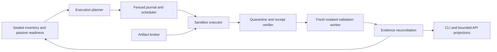

# M8.4.3 — Isolated native execution: schema, contracts and DAG

Date: **2026-10-19**. **PROVISIONAL implementation design; Phase 1 only.** The human requested Phase 1 (schema, contracts, DAG) before Phase 2 (TDD, adapters, parsers and tests) in the same step. This document specializes [ADR-007](../decisions/ADR-007-isolated-build-and-polyglot-readiness.md), the [readiness contract](m8-repository-readiness.md), [step-2 contract](m8-build-readiness-planner.md) and [six-step plan](../tasks/m8/04-comprehensive-repository-readiness.md). It does not certify an executor, implement execution, or pass step 3.

The normative typed record catalog is [execution schemas](m8-isolated-execution-schemas.md). The accompanying [JSON Schema](schemas/m8-execution-plan-v1.schema.json) validates the execution-plan envelope and task/edge/mapping structure; referential, cryptographic and safety predicates below require domain validation. [Phase-2 verification matrix](../tasks/m8/04-step3-verification-matrix.md) defines acceptance obligations, not tests already executed.

## Current Step-3 delivery scope — Core MVP (human-approved 2026-10-20)

The human accepts Step 3 at Core MVP scope: wire the existing Hyper-V launcher into a runnable offline-build/export pipeline, and remove advanced security campaigns from this step's exit criteria. The original full-production design below remains historical architecture/reference; its 98-case denominator is not the current Step-3 acceptance gate and is not claimed passed. No replacement task or backlog is created. ADR-007 records this approved amendment.

`CoreMvpBuildPipeline` calls `HyperVMvpLauncher`, which snapshots packaged controller tools and the registered Maven generator/consumer recipe, provisions a fresh bounded worker, starts the independent supervisor, builds offline in the guest and exports opaque bytes. `OutputCensus` and CAS verify every exported object and the registered generated-source/class roles. Native completion requires an independently observed exact VM Off. A durable publication pointer supports replay without another VM/build, and `generated/Generated.java` is materialized only from verified CAS bytes. The CLI entry is `evo core-mvp <registered-root> --json`; out-of-band operator registration binds the root/configuration/tool paths, so source snapshots cannot approve their own host executable.

The MVP result is `CAPTURED_NATIVE_OUTPUTS`, scope `CORE_MVP`, with `semanticTrust=PRODUCER_ASSERTION` and `qualified=false`. This is accepted build/output delivery, not a semantic certificate or an unrestricted sandbox admission token. General qualification/semantic gates remain truthful and unchanged; they do not block the human-approved bounded Core MVP closure. Host target execution, ambient credentials/host mounts, unbounded worker state and invented evidence remain prohibited.

## 1. Scope, baseline and choices

**CONFIRMED repository observation at `f702449`:** `ReadinessPlan` already supplies requirements, root recipes, Kahn ordering and iterative module SCC discovery; `CapturedBuildEvidence` has an injected Boolean verifier, not a production trust implementation. `JobJournal` supports compare-and-set revisions. `ReadinessReports` persists canonical plans but decodes a whole bounded report. There is no qualified target executor in these inspected paths.

Phase 1 delivers implementation-ready contracts for a disposable VM executor, durable scheduling, brokered acquisition, native captures and protected import. Phase 2 implements these contracts and proves the execution lane before real target builds. Generated Java/Spring reconciliation remains step 4; language engines remain step 5; whole-pipeline scale/product acceptance remains step 6. Step 3 must nevertheless capture generated outputs, support large streamed manifests, expose typed waiting/results and preserve all selected contexts.

| Choice | Reason and alternative | Replacement trigger |
|---|---|---|
| Additive execution domain in `analyzer.execution` | Keep existing passive plan/M1 preimages readable; replacing step-2 records in place would invalidate captures | Versioned migration only when a concrete representational gap remains |
| Three separate graphs: obligations, execution tasks, module relations | A build can discover its own model/dependencies; treating an obligation as an executable prerequisite deadlocks bootstrap | Preserve semantics if storage representation changes |
| Root-sized native attempt by default | Unproved plugin/global effects prevent safe module splitting; always one process per module is invalid | Native footprint and joint-compilation proof permits decomposition |
| Disposable full VM backend port; Hyper-V first local candidate | Existing approved provisional baseline; a host JVM/container is not an equivalent fallback | Qualified backend with equivalent controls; measured compatibility/overhead |
| Immutable CAS manifests + fenced journal, derived indexes | Reuse step 1; process-local queues lose attempts on restart | Measured storage contention; same replay/atomicity contract |
| Native observations plus independent per-category promotion | Exit zero and producer JSON cannot prove a classpath or semantic fact | New capture method qualified against adversarial controls |

No new numerical metric, score policy, cloud purchase or remote source-disclosure permission is introduced. OS-specific SDKs require a compatible configured runner. Backend/image/tool pins are resolved and recorded in Phase 2; their absence is an explicit prerequisite, never a guessed version or a `latest` pin.

## 2. Ownership and ports



| Owner / proposed port | Input → output | Forbidden responsibility |
|---|---|---|
| `analyzer.execution.ExecutionPlanner` | Sealed readiness revision, registry, configured policies → immutable `ExecutionPlan` | I/O, executing recipe strings, native tool types |
| `BuildEvidenceProvider` (native adapters) | Root/context/requirements + immutable prior evidence → lowering proposal, output decoder and satisfaction candidates | Granting permissions; self-asserting trusted observations |
| `SandboxExecutor` (new outward adapter) | Fully validated `LaunchRequest` → opaque attempt handle, bounded events, collect/terminate receipts | Host target execution, choosing semantic truth, widening policy |
| `ArtifactBroker` (outward adapter) | Typed acquisition request + attempt grant → quarantined material, policy decision and transfer ledger | Arbitrary guest URL forwarding, writable shared build caches |
| `ExecutionJournal` / scheduler | Tasks, fenced events, immutable manifest handles → resumable task view | Using completion strings as satisfaction proofs |
| `OutputValidator` + `ObservationVerifier` | Raw exports, controller receipts, expected scope, trusted worker result → accepted bytes, decisions, gaps | Class-loading target binaries, trusting a producer `trust` field |
| Reconciler in `analyzer` | Validated decisions/conflicts → new readiness evidence revision | Mutating a historical plan/gap; flattening contexts |
| `analyzer-filesystem` adapters | CAS/segmented ledger persistence, durable indexes | Build-family semantics or identity rules |
| `backend` / `cli` composition | Registered policy/executor IDs and selected plan IDs → jobs and pages | Arbitrary command/env/mount/image override from public API |

Keep the passive Maven adapter passive. A proposed `analyzer-execution` module owns VM lifecycle and native build adapters; it depends inward on `analyzer`, with persistence supplied through ports. Native capture helpers and image tooling stay in that module, pinned separately. Do not put target execution into `WorkerProcessSupervisor`, `MavenScan`, or the query server's request thread.

Port operations are `probe(profile)`, `launch(request, fence)`, `inspect(handle, cursor)`, `terminate(handle, fence)` and `collect(handle, fence)`. Results are closed typed outcomes, including UNAVAILABLE, UNQUALIFIED, WAITING, LOST and REJECTED; no `execute(String shellCommand)` escape hatch. IDs alone confer no launch authority: the controller resolves registered objects, verifies their digests and checks the grant on every mutation.

## 3. Identity, versioning and denominator

Use domain-separated SHA-256 over exact canonical JSON using the existing `CanonicalJson` rules. Every new immutable record includes its schema/version in the preimage. Identity is an external digest of the record, never a self-referential field. Record references resolve to immutable bytes and must be verified; a valid hash string alone is not evidence.

- Bind base inventory manifest, acquisition selection, passive plan, selected-context manifest, recipe template/provider, tool binaries/images, source/material closure, work policy and validation policy. A wrapper-properties hash is configuration evidence, not a distribution or executable pin.
- Local root/module/context IDs are always paired with the passive plan digest. New native contexts generate a new selected-context/readiness revision; preserve discovered/unselected/unknown populations and mapping to earlier candidates. Do not copy one context's capture into another.
- Ordered classpath/module path, compiler arguments, source precedence and processor paths retain order and duplicates. Semantic sets are deduplicated and sorted under explicit comparator rules. Raw paths use `LogicalPath` bytes; no Unicode normalization/case folding. Root is a tagged value, not `LogicalPath(".")`.
- A task key binds its stage, root, selected contexts, lowering recipe and exact input bindings; the enclosing plan binds edges and all task/mapping rows. Operational attempt ID, VM ID, lease timestamps, retry delay and queue timing are excluded from canonical semantic identities.
- Input slots are immutable references to `(predecessorTask, outputRole, selector)`; resolving a slot produces a new launch-input digest. The plan remains immutable. `ExecutionKey = H(plan, task, resolvedInputs, profile, toolPins, workPolicy, validatorVersions)`. A cache key cannot use unbound output slots.
- `BuildEvidenceBundle` includes captured bytes and operational receipt references and thus may differ across attempts. A separate `EvidenceProjection` binds validated fact payloads/materials/context/versions and deterministic negative decisions, omitting only explicitly named operational fields. Never remove raw byte drift to force equality. Analysis replay is defined over the same captured inputs and work policy; rebuild reproducibility is measured separately.
- Native material requests generated during execution append to the attempt's closure. Only a sealed closure can support offline replay or reuse. A request key formed before resolving dynamic dependencies is a lookup hint, not exact evidence identity.

Every selected requirement has exactly one execution disposition: one or more candidate producer tasks with an acceptance expression, a verified reusable decision, or a pending reason. Requirements with no applicable provider stay pending. Every native target/source set, returned output, broker request and discovered context has a disposition row. Empty plan is valid only when the selected requirement denominator is empty, with a sealed selection proof; it cannot imply semantic completion.

## 4. Execution DAG algorithm

### 4.1 Graph meanings and bootstrap

`G_R` is the existing requirement graph: facts that must be established. `G_M` contains module/build relations, with relation type and evidence (dependency, aggregation, parent, composite, plugin, shared generator or unknown effect). `G_E` contains executable **tasks**, not requirements. Edges point **prerequisite → consumer**. Aggregation/parent is not automatically a compilation dependency; ambiguous relationships remain obligations.

A root bootstrap task can execute native configuration/resolution/generation/compile in one sandbox attempt to discover model and dependency closure. It requires sealed source, authorized broker policy, qualified sandbox and enough pinned bootstrap tools; it does **not** require the exact model or generated outputs it is meant to discover. Missing transitive plugins/toolchains can be acquired through the broker during the attempt. Failure leaves exact progress and a waiting/failed outcome, never a fabricated model.

Native validation prerequisites in `G_R` still govern **acceptance**. They do not prohibit gathering candidate evidence before all prerequisites have been satisfied. One attempt may emit candidates for MODEL, DEPENDENCIES, TOOLCHAIN, GENERATION and BUILD_VALIDATION; decisions are then reconciled in requirement order. Observing a processor output does not automatically validate the processor's claimed input closure.

Minimal root sequence:

```text
verified input + qualified profile + registered tools
  -> NATIVE_RUN(root scope; model/resolve/generate/compile as native tool requires)
  -> COLLECT_AND_VALIDATE_BYTES (after termination, even on failed build)
  -> PROTECTED_OBSERVATION / CONTROLLED_REPLAY (fresh isolated worker)
  -> RECONCILE (accept each requirement separately)
```

Independent roots can proceed. Cross-root native substitution/shared state adds a proved dependency or joint execution group; directory separation alone does not establish independence.

### 4.2 Validation and SCC condensation

1. Validate schema/IDs/digest references, selected-context partition, root ownership, all edge endpoints and input slots. Duplicate IDs with different payloads invalidate that plan revision; no last-write-wins. Normalize identical duplicate edges before computing indegrees; conflicting conditions on the same edge are invalid.
2. Validate `G_R` as an acyclic acceptance graph. Preserve an invalid input artifact and a scoped PLAN_INVALID diagnostic; do not fabricate a smaller complete plan. Other already valid root plans remain available.
3. Build adjacency for `G_M` from evidenced relations. Retain missing endpoint relations as explicit unresolved obligations; do not silently filter them as step-2 `compilationGroups()` currently does for its display projection.
4. Compute SCCs iteratively (Kosaraju or Tarjan with explicit stack). Visit nodes/neighbors in canonical ID order. Members sort lexicographically; component key is `H(schema, orderedMembers, relationEvidence)`. Self-loop is a cycle even for a singleton.
5. **SCC is only a scheduling diagnostic, not proof that the native tool supports joint compilation.** Supported co-compilation gets one group only with adapter/version proof, compatible contexts/toolchains and complete footprint. Illegal Maven reactor cycle stays native-cycle failure. Cross-root/variant/toolchain cycles cannot be merged by unioning classpaths. Missing proof yields root-sized native investigation or pending `COCOMPILATION_UNPROVEN`.
6. Conservatively merge proved shared output/global-effect scopes for scheduling, then recompute group edges. Contraction of non-SCC nodes can introduce a cycle; repeat validation. Never break a cycle by deleting an edge or calling every task complete.
7. Lower each group into stage tasks. Native intra-build ordering remains native-owned. For proven partitions, encode external prerequisite artifacts explicitly. Selectors `-pl/-am`, Gradle targets or resumable stage shortcuts require exact native compatibility/footprint proof.
8. Run Kahn validation on `G_E`. If nodes remain, compute residual SCC witnesses; only SCC members are cycle participants, downstream nodes are blocked dependents. A new task graph is published atomically only if its execution edges are acyclic and every requirement has a disposition. Other roots can be published separately with an open root denominator.

Linear graph traversal is `O(V+E)` after ordering; canonical sort contributes `O(V log V + sum d(v) log d(v))`. A heap-based Kahn order adds `O(V log V)`. Do not enumerate all simple cycles. Production stores node/edge/indegree/frontier tables on disk, with paged scans and transactional updates. An in-memory implementation is a bounded-worker compatibility path; exhaustion checkpoints and requests another worker, never drops vertices. Native compilers that require a joint working set use larger configured workers, not arbitrary source splitting.

### 4.3 Scheduling, edges and failure propagation

An edge is either `AFTER_TERMINATION` or `AFTER_VALIDATION` and lists required output roles. The first permits collecting output after a failed/cancelled native run once quiescence is proved; it does not authorize semantic consumption. The second requires exact accepted predecessor outputs and matching predicate versions. Input slots crossing contexts require an explicit native dependency binding, never a bare same-filename match.

For fixed plan and evidence state, canonical ready order is descending count of distinct directly unlocked consumers, then ascending task key. The number is a work heuristic, not a semantic score. Canonical readiness never uses arrival order, wall clock, task duration or host free memory.

Operational admission uses fair per-job queues, a persisted rotation cursor and weighted resource reservations. Inspect ready candidates in deterministic order within each job; skip temporarily non-fitting tasks, retain their position/wait reason, and reserve capacity for an aging large task under configured policy. Resource vector is CPU, RAM, disk, process, log and network capacity; admission uses checked arithmetic and atomic reservations. Never increase allocation or buy capacity automatically. Operational dispatch order may vary with availability; evidence must be reconciled by immutable IDs, not first-arrival wins.

The internal admission v2 implementation atomically retires compute and retains the original disk/log reservation bounds after controller-proved quiescence. Storage holds keep their original ticket/fence, request and termination provenance across retries; no guest usage counter can reduce them. They remain charged until a separately authorized and verified storage reclamation protocol exists. A request blocked by retained storage remains explicit and cannot become an aging barrier that prevents fitting compute-only work. Never-launched release uses the durable launch frontier; VM Off alone cannot select that path. Legacy history that cannot establish retained storage requires reconciliation, not an empty hold list. Output capture publication records all expected byte roles and original per-row evidence but sets no active semantic pointer and never advances a task to SUCCEEDED.

```text
plan = validateAndFreeze(readiness, policies, registry)
state = replayVerifiedJournal(plan)
for each ready candidate in canonicalReadyOrder(plan, state):
    if acceptedReusableEvidence(candidate, exactInputs, currentTrustPolicy):
        appendValidatedReuseDecision(); continue
    if unmetExecutionPrerequisite(candidate):
        retainPendingReason(); continue
    if !reserveConfiguredResources(candidate):
        recordWaiting(); continue
    lease = compareAndSetLease(candidate, expectedRevision, nextFence)
    launchIdempotently(candidate, lease, resolvedImmutableInputs)
on native termination:
    proveQuiescenceOrQuarantine()
    collectAllRegisteredOutputsWithDisposition()
    validateBytesThenValidateClaimsInFreshWorker()
    publishImmutableArtifactsThenFencedCommit()
    reconcileDecisionsAndRecomputeAffectedReadiness()
```

Failed tasks block only consumers requiring their unavailable accepted outputs. Keep source facts, validated earlier stages and independent roots. `AFTER_TERMINATION` export and cleanup remain runnable. A failed root build may contain a successful module/stage, but promotion needs an independent closed boundary; overall exit code or log text alone is insufficient. A blocked task retains all immediate causes and references to root causes; UI grouping never deletes per-requirement rows.

Multiple producers use an explicit satisfaction expression: `ALL_OF` distinct evidence roles, or `ANY_EQUIVALENT` interchangeable proofs for one role. In ALL_OF, group candidates by `evidenceRole`: each role needs an accepted proof; alternatives within a role obey ANY_EQUIVALENT. This represents `(A or B) and C` without making every redundant provider mandatory. Rejected/unavailable alternatives retain dispositions and do not contradict an accepted proof merely by failing; incompatible substantive observations do create a conflict. Never choose a winning conflicting producer by speed. Existing acceptable evidence is superseded only through an explicit reconciliation decision. For the finite registered producer set, canonical finalization waits for each applicable producer's disposition; late new evidence makes a new revision. Conflict reopens affected requirements and invalidates dependent reuse views, preserving historical successes.

### 4.4 Dynamic discovery and termination

Native discovery can introduce targets, generators, contexts and materials. Store new facts as a discovery delta with origin/parent revision and selected-scope policy. Canonically deduplicate equal facts; conflicting equal keys create conflict rows. Replan into a new immutable revision, preserving completed tasks only when exact input/policy/predicate bindings still match. Do not mutate a running plan or let a guest enqueue a command.

A fixpoint iteration must either add new captured evidence/requirements, change a proved disposition, or end with a typed no-progress reason. Hash the frontier and seen `(requirement, provider, inputClosure, policy)` tuples; identical retry without a changed transient condition or work policy cannot loop forever. Per-attempt retry/work budgets produce durable waits with frontier. Dynamic infinite configuration cannot yield a finite completion claim; it remains discovery-open. A selected finite domain is always explicit.

## 5. Attempts, leases and crash consistency

Operational task states: `PENDING`, `READY`, `LEASED`, `RUNNING`, `COLLECTING`, `VALIDATING`, `SUCCEEDED`, `FAILED`, `CANCEL_REQUESTED`, `CANCELLED`, `WAITING_FOR_INPUT`, `WAITING_FOR_RESOURCES`, `QUARANTINED`. Obligation status is separately `PENDING`, `SATISFIED`, `NOT_APPLICABLE`, `CONFLICTED`. Build target status is separately `SUCCEEDED`, `FAILED`, `NOT_REACHED`, `NOT_APPLICABLE`, `UNKNOWN`. `SUCCEEDED` task means its declared task predicates passed, never “whole repo semantically complete”.

Normal transitions: PENDING → READY → LEASED → RUNNING → COLLECTING → VALIDATING → SUCCEEDED/FAILED. Any active state may request cancellation; CANCEL_REQUESTED reaches CANCELLED only after controller proves VM/process-tree termination and export closure. Lease/probe failures yield WAITING or QUARANTINED. Failed attempts are terminal; retry creates a new attempt and higher fence. Pending/task waiting states can return to READY after their cause changes. All transitions validate expected revision, attempt ID, monotonic sequence and fencing token.

- Persist launch intent and unique attempt namespace **before** asking the VM driver to start. Driver launch must be idempotent for `(attemptId, fence)`. Crash after launch but before handle recording is reconciled by controller-owned VM metadata, not guessed by PID/process name.
- Lease expiry does not prove a worker dead. The replacement controller queries the owning backend, revokes broker grant, fences collection and destroys/quarantines the old worker before allowing a conflicting retry. A partitioned remote executor keeps resource/state reserved until termination or quarantine proof exists.
- An Off snapshot alone does not fence a concurrent late Start. The candidate Hyper-V driver serializes Start/Stop and durably flushes an attempt-scoped stop barrier, including for an already-Off VM. A barrier, even truncated, rejects later Start; a retry uses a new attempt. Recovery/inspection of Off must obtain the exact Stop observation before recording termination. Failed barrier persistence still attempts Stop but returns unconfirmed disposition, never a termination proof. This control does not qualify supervisor crash handoff or absence-versus-concurrent-creation recovery.
- Controller receipt and journal commit use the current fence; late results are retained as stale forensic evidence if safe, never published as active success. Duplicate events are idempotent only if identical event identity/payload; conflicting duplicate is corruption.
- Publication order: verified output blobs → sealed output manifest → validation decisions → single fenced durable acceptance pointer. A pointer never references unflushed/missing CAS data. Crash after blobs but before pointer leaves unreferenced data, not success; replay can finish the same validated transaction. Disk-full retains the previous durable frontier.
- `JobJournal` v1 remains compatible. Store new task/attempt payloads through an additive `ExecutionJournal` port; do not pretend its current arbitrary state transitions enforce this state machine. Multi-record resource/lease admission needs one atomic transaction or an explicitly recoverable reservation protocol, not two unrelated `transition()` calls.
- Cancellation preserves already committed evidence. Collection after cancellation may publish captured bytes but cannot satisfy an unfinished compilation. Cleanup deletes only controller-created disposable attempt resources under verified ownership; it cannot delete input checkout, unrelated VM, shared CAS or user files.
- No exactly-once **execution** claim: crash/retry can execute twice in isolated namespaces. At-most-one accepted transition per fenced task revision, plus immutable duplicate evidence, is the publication guarantee. Rebuild differences remain visible.

## 6. Sandbox and broker boundary

`SandboxProfile` has operator-configured backend identity, exact driver/guest/image digests, architecture/OS, resource/work policy, transport policy and conformance record. Probe has AVAILABLE, UNAVAILABLE or UNQUALIFIED outcomes. Presence of Hyper-V cmdlets, Docker or WSL is not qualification. Hardware, image, driver, transport or enforcement-policy changes invalidate the matching qualification until rechecked.

Before real repositories: execute only registered authored conformance fixtures inside the disposable VM candidate. No host-target fallback even during setup. Controller host invokes only trusted driver/control binaries and validates arguments; repository data cannot choose executable path, shell, mount, remote endpoint or guest image. Remote executors additionally require existing explicit source-disclosure/allocation/access configuration.

Inside the guest: immutable source/artifact input, private working copy/overlay, private tool/package caches and private tmp/home. Builds that write next to source write to the copy; the base snapshot stays immutable and mutations are recorded. Exact compilation inputs refer to observed copied bytes, not an assumption that source remained unchanged. Disallow host home, agent, device/socket, clipboard/shared folder, host network and credential forwarding. Deactivate unnecessary guest integration channels; transport itself is part of conformance.

The hypervisor/controller enforce total CPU, RAM, disk allocation, networking and lifetime. Guest PID quotas and unprivileged execution reduce process abuse; the external controller caps the whole VM and kills/quarantines it if guest controls fail. Process-count claims require tested enforcement, not `-Xmx`. No privileged target user, nested virtualization or device passthrough by default. Full VM isolation does not by itself make a guest collector resistant to a compromised guest kernel; that limitation affects trust promotion.

`ArtifactBroker` is a capability service, not an unrestricted HTTP CONNECT proxy. Grants bind attempt/fence, operation/method, registered repository or tool distribution, approved path/resource patterns, byte/rate limits and credential reference. Resolution supports required repository metadata requests as well as artifact bytes. Source publication, telemetry and arbitrary POST/upload are denied. No build has direct Internet/DNS access outside the controlled route.

- Validate scheme/host/port, resolved addresses and every redirect at connection time; protect against DNS rebinding, IPv4/IPv6 encodings, metadata/link-local/loopback and private destinations unless explicitly configured. Keep TLS verification; denied requests create ledger rows.
- Repository-declared repositories and wrapper URLs are acquisition proposals. Intersect them with operator policy; do not silently substitute Central or change versions. Authentication stays broker-side with minimal scope; never inject ambient credentials or log secret URLs/headers.
- Lockfile versions, ranges, SNAPSHOTs, variant attributes, checksums and repository origin become immutable resolution records pointing to exact bytes. TLS/checksum matching does not certify producer behavior. Offline replay is exact-closure mode: missing material is WAITING_FOR_INPUT; it never falls back online invisibly.
- Share only validated immutable artifact blobs in trust/policy namespaces. Local Maven/Gradle/npm caches in an attempt are writable private copies. A custom repository's same coordinate/different bytes cannot overwrite another artifact. Shared compiled-output reuse additionally needs a closed input footprint and compatible validator/trust profile.
- Finite request/connect/idle/attempt budgets preserve a continuation. Heartbeats or repetitive log spam alone do not prove work progress; trusted stage counters and work budgets bound abuse. A huge useful build may use another configured worker/retry, without a total-repository size/time exclusion.

**CONFIRMED bounded implementation (2026-10-20):** `ControllerBrokerAuthority` checks durable launch/task ownership for broker transfer/cache/delivery. `DurableAttemptWatchdog` precommits a launch-policy-bound operational guard, activates it only after the task lease through `ExecutionController.LaunchGuard`, and latches expiry/resource/regression failures before recovery. Queue waiting does not consume worker runtime; replay/reissued grants cannot reset the guard. Only trusted controller progress sequences may extend idle time, within the fixed per-worker lease/work budget. Recovery checks the entire launch, not an attempt label alone. Broker transfer cancellation and HTTP delivery recheck authority; bytes already sent before revocation are historical transport, not an atomic rollback guarantee. Legacy process-local constructors and caller-driven polling do not provide qualified production enforcement. An independent supervisor, physical storage/log containment, sanitized image/provisioning and real lifecycle controls still have to qualify before opening repository execution.

## 7. Export, parser and trust contracts

Quarantine receives streamed bytes and an untrusted manifest. It never extracts archives directly into the host workspace or loads target classes. Validate path bytes, entry kind, length/count overflow, digest, duplicate path, case/Unicode collision, drive/UNC/device/ADS paths, link/hardlink escape, sparse-file accounting, archive traversal/nesting/expansion and guest-root mapping. Use handle-based/no-follow operations and a frozen export view to prevent TOCTOU replacement. Unsupported names are retained logically and routed to a compatible worker; never rename invisibly.

Directory outputs are manifests over every entry; symlinks and empty directories retain their own dispositions. Unsupported devices/FIFOs/sockets cannot be read as ordinary files. Every declared output has PRESENT, ABSENT, REJECTED or NOT_REACHED plus evidence. Every observed undeclared output has a classification/disposition; it is not automatically semantic input. Partial export cannot seal a complete overlay. Forensic bytes, logs and denied/malformed exports are access-controlled and do not enter trusted semantic caches.

Native parser contracts: strict schema/version, duplicate-key rejection, checked numbers, encoding validation, bounded pages/record depth, unknown field/enum rejection and source locations. XML disables external entities/DTDs; JSON does not execute expressions; Protobuf/SCIP or compiler-specific payloads stay in adapters. Structured output is preferred to heuristic log parsing. Malformed records retain raw digest and typed reason; no whole-root silent omission. Oversized manifests use streaming/segmented decoding or WAITING_FOR_RESOURCES, never an artificial full-repo eligibility cap.

Trust is per claim, with exact existing spelling: `CAPTURED_BYTES`, `PRODUCER_ASSERTION`, `VALIDATED_OBSERVATION`. A controller receipt proves which bytes were exported by an attempt. It cannot prove that target-generated `classpath.json`, a model or an index is truthful. Hash equality protects identity, not truth.

Promotion requires all of: exact requested scope/input binding, verified controller receipt under a configured trust root, qualified capture method for the category/tool version, independently verified materials, closed relevant denominator, predicate success, no unresolved contradiction and no revoked qualification. Verification returns a structured decision with failed predicates, not a caller-supplied `true`.

| Claim category | Required validation | Insufficient evidence |
|---|---|---|
| Exported bytes | Controller-collected immutable export, size/digest/path check | Guest JSON claiming a hash |
| Native exit / stage outcome | Protected supervisor event and quiescence; exact target/stage closure | Parsed `BUILD SUCCESS` log or sibling exit zero |
| Exact compiler inputs | Protected invocation/input capture, source/argfile/classpath/platform content closure; in-process hooks qualified separately | Effective POM, dependency tree, wrapper config or mutable argfile alone |
| Model/module/source-set discovery | Qualified native model observation plus complete target/context census and reconciliation | Trusting plugin-supplied enumerations as exhaustive |
| Generated lineage | Exact producer/tool/config/input and output association; completeness predicate | File under `target/` or same symbol name |
| Class/index semantic fact | Trusted extractor in fresh isolated worker; category-specific mapping/census and exact context | Target-controlled indexer, successful build or receipt alone |
| Build NOT_APPLICABLE | Independent no-compile-phase proof plus successful native semantic validation | Empty output folder or nonzero build exit |

A protected compiler-launch trace can validate the launch arguments, but not arbitrary internal compiler/plugin state. If the target can overwrite binaries, capture agent, trace, args or classpath, those fields remain producer assertions unless independently reconstructed and verified. The fresh validation worker never executes arbitrary build hooks or target classes. If native attribution needs processors/plugins, use another execution attempt; its outputs still need their own promotion predicate. Do not disable required processors and call the changed result the original build.

Controlled replay pins the exact declared environment and captured materials, runs a protected permitted compiler/extractor and compares the relevant observations. A changed recipe (disabled hook, rewritten script, changed JDK/flag) is a new explicitly qualified variant, not proof of original semantics. Where no protected method can establish an exact fact, keep that requirement pending while still making captured evidence useful.

Zero-output modules (aggregators, no-source tasks) can be valid: a validated closed output manifest with count zero and an explicit phase-applicability decision is evidence. Step-2 `CapturedBuildEvidence.validate()` currently insists on a nonempty output-digest list and compares two complete manifests. Phase 2 must bridge a manifest artifact/closure proof or introduce an additive richer verifier; never invent an output or copy the producer's manifest into `expected` as validation. Preserve old authored tests and version new behavior.

For non-compiling contexts, only the compilation obligation can be NOT_APPLICABLE. Native semantic validation remains separately SATISFIED or PENDING. Step-2 reconciliation currently propagates `compilationApplicable` to either validation kind; Phase 2 must qualify that compatibility mapping instead of carrying its blanket N/A rule into execution acceptance.

## 8. Native recipes and failure taxonomy

Maven lowering preserves the native reactor, root/parent distinction, active profiles, toolchain selection and ordered actual compilation inputs. Include plugin/extension module ordering, not only library dependencies. Generation/main/test/custom compilation are required where selected; package/verify only when output requirements need them. Neither `skipTests` nor `help` makes invocation passive. Native cyclic reactors remain explicit failures. Gradle configuration, Tooling API, included builds/buildSrc and compiler tasks all execute in guest; capture variant attributes/substitution and private daemon lifetime. Do not infer exact tasks/classpath from passive regex or an IDE model.

Plain/IDE/Ant/Bazel/sbt/custom and polyglot native families use registered lowering providers under the same boundary. Unknown families have provider-acquisition obligations. Custom recipes contain typed executable/tool references, argv, working-root and environment policy; repository scripts are data until a registered adapter authorizes their invocation within the isolated attempt. Android/JSP/OSGi/JNI/weaving/native SDKs keep target-specific requirements. No universal JVM-only or Linux-only completeness claim follows.

Failures carry stage, root/context/requirement/task, provider version, input digest, observed evidence, root-cause references and retry class. Map them into existing `CapabilityGapRecord`/acquisition/conflict records without fake pre-snapshot identities.

| Reason family | Examples | Recovery / effect |
|---|---|---|
| Environment | EXECUTOR_UNAVAILABLE, EXECUTOR_UNQUALIFIED, TOOLCHAIN_UNAVAILABLE, SDK_LICENSE_REQUIRED | Wait for configured capability; static facts remain |
| Policy | EGRESS_DENIED, CREDENTIAL_REQUIRED, SOURCE_DISCLOSURE_NOT_CONFIGURED | Wait for specific policy/input; no permission escalation by guest |
| Resource | RESOURCE_UNAVAILABLE, DISK_EXHAUSTED, WORK_BUDGET_EXHAUSTED, MANIFEST_WORKER_REQUIRED | Durable frontier; same/larger configured worker with explicit retry budget |
| Transient | BROKER_TRANSIENT, CONTROLLER_RESTART, TRANSPORT_LOST | Bounded retry after fence/quiescence; operational timing kept separate |
| Native | NATIVE_MODEL_FAILED, NATIVE_COMPILE_FAILED, NATIVE_CYCLE, TARGET_NOT_REACHED | Preserve stage outputs; retry only justified by changed input/environment or recorded transient cause |
| Trust/data | INVALID_OUTPUT, DIGEST_MISMATCH, CAPTURE_FORGERY, INPUT_CLOSURE_OPEN, OBSERVATION_UNPROVEN, PROVIDER_CONFLICT | Quarantine rejected evidence, retain obligations; no blind automatic retries |
| Planning | PLAN_INVALID, MISSING_ENDPOINT, COCOMPILATION_UNPROVEN, DISCOVERY_OPEN, NO_PROGRESS | Preserve diagnostic frontier; revise plan/provider, retain independent valid roots |
| Lifecycle | CANCELLED, STALE_FENCE, TERMINATION_UNCONFIRMED, JOURNAL_CORRUPT | No active success; quarantine unknown worker, rebuild derived indexes only from verified records |

Reason codes form `evidence.execution-gaps:m8.4-v1`; new reasons require exhaustive mapping tests. Operational journal history and canonical captured-failure projection are separate. A live timeout cannot change the semantic digest of a previously sealed successful capture; a different captured failure is a different evidence input.

## 9. Compatibility, sequencing and Phase-1 exit

Preserve `repository-readiness:m8.4-v1`, `build-context-selection:m8.4-v1`, M1 preimages, graph/query schemas and frozen formulas. New execution schemas are additive. Existing `ReadinessPlan.runnable(Set<String>)` stays a planning helper; production must not pass arbitrary guest/API IDs into it as validated completion. Exact prerequisite satisfaction is a verified ledger query.

Reconciliation introduces a versioned readiness evidence view rather than rewriting a stored v1 plan. Existing `GapResolutionRecord` has only NARROWED/SATISFIED; conflict/revocation belongs to an additive decision ledger and current-state projection, not a fabricated enum or deletion of the old record. Identical accepted captures deduplicate by semantic claim/evidence identity; non-equivalent captures produce conflict. Cache invalidation propagates through accepted dependency bindings, with previous output still auditable.

Phase 2 order within **the same step 3**: domain contracts and DAG predicates → journal/fencing and resource admission → real VM candidate/conformance → broker and export validator → native Maven/Gradle captures and protected replay → readiness/product integration and bounded verification. Author tests before behavior; instantiate the matrix below with exact backend/tool pins. No extra milestone is created.

Phase-1 exit is satisfied when schema fields, identity preimages, graph meanings/edge predicates, SCC restrictions, recovery/publication, trust and failure rules are mutually consistent; each step-3 checklist/exit row maps to planned controls; references/schema validate; and durable state clearly points to Phase 2. No production support or real isolation is claimed. Independent review is not part of this single-agent design pass; self-review and design checks are explicitly bounded.

Remaining empirical gates: configured VM availability and real isolation tests; protected capture correctness per native version; malicious-plugin and offline-replay controls; actual Maven/Gradle positives; cross-module compatibility. These are Phase-2 obligations, not missing authority to design or implement within the approved scope. If the VM is absent, all separable Phase-2 code/tests may proceed but the execution lane remains closed and step 3 incomplete.

## 10. Primary sources checked for this design

Checked 2026-10-19; project invariants remain authoritative. The design conclusions above are project choices, not upstream certifications.

- [Microsoft Hyper-V requirements](https://learn.microsoft.com/en-us/windows-server/virtualization/hyper-v/host-hardware-requirements): supported OS/hardware and SLAT checks; does not establish this host's readiness.
- [Maven multiple-module guide](https://maven.apache.org/guides/mini/guide-multiple-modules.html): reactor ordering includes instantiated plugin/extension relations; root recipes must preserve native ordering.
- [Gradle build lifecycle](https://docs.gradle.org/current/userguide/build_lifecycle.html): initialization/configuration precede task execution; configuration stays in the isolated lane.
- [SLSA provenance v1.1](https://slsa.dev/spec/v1.1/provenance): separation of build definition, resolved dependencies and run details informs record separation; no SLSA level is claimed.
