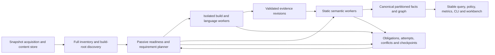

# M8.4 — Repository readiness, isolated builds and polyglot semantics

Ngày: 2026-10-17. **CONFIRMED — quyết định của chủ dự án:** bỏ cấm build mục tiêu nói chung; cấm chạy trực tiếp trên host, cho phép build trong sandbox; bỏ trần sản phẩm theo dung lượng/số file/thời gian tải; mở semantic engine ngoài Java ngay trong M8.4. **PROVISIONAL — thiết kế dưới đây:** chưa được implement, đo hiệu năng hoặc chứng nhận isolation. [ADR-007](../decisions/ADR-007-isolated-build-and-polyglot-readiness.md) ghi thay đổi phạm vi; [kế hoạch sáu bước](../tasks/m8/04-comprehensive-repository-readiness.md) sở hữu công việc; [nghiên cứu](../research/2026-10-17-m8-readiness-design.md) sở hữu nguồn và so sánh.

## Kết quả và ý nghĩa của “toàn bộ”

Tiếp nhận repo không phụ thuộc kích thước, hosting vendor, build tool hay ngôn ngữ trong một whitelist. Thu nhận toàn bộ snapshot được chọn; phát hiện mọi build root/source set; lấy bằng chứng build khi cần; phân tích bằng engine phù hợp; cho phép truy vấn toàn bộ kết quả mà không phải nạp toàn repo/graph vào RAM. Repo lớn dùng thêm thời gian, đĩa và worker theo tài nguyên được cấp, không bị loại vì một hằng số sản phẩm.

Phải phân biệt năm chiều: **inventory completeness, byte acquisition, build readiness, semantic coverage/correctness, operational completion**. Mỗi file, module, language, category và generator obligation có trạng thái riêng. Mọi byte được hash/lưu không có nghĩa mọi hành vi chương trình đã được chứng minh; build thành công không chứng minh mọi cạnh semantic đúng. Không có lời hứa hữu hạn về mọi chương trình/ngôn ngữ tương lai, mọi cấu hình động, nguồn không truy cập được hoặc dung lượng vật lý vô hạn. Đó là ranh giới của khẳng định, không phải lý do bỏ triển khai provider còn thiếu.

Mặc định comprehensive bao gồm main, test, integration/custom source sets, generated sources, tài nguyên, schema, tài liệu, build logic, binary/vendored artifacts và ngôn ngữ phụ. Các population được đo riêng; không đưa test/generated vào metric production cũ một cách âm thầm. VCS object database là metadata/history, không phải một bản sao thứ hai của cây source; lưu refs/tree/gitlinks/LFS provenance cần thiết. Không cần tải mọi revision lịch sử để đọc đầy đủ snapshot hiện tại. User selection thu hẹp được ghi thành selection khác, không gọi là comprehensive toàn repo.

## Pipeline và trách nhiệm

`analyzer` sở hữu contract, reconciliation, semantics và query meaning. `analyzer-filesystem` sở hữu streaming input/artifact persistence. `analyzer-maven` giữ passive Maven adapter. JavaParser vẫn primary Java frontend theo ADR-001. Adapter mới cho execution/language/storage có dependency hướng vào domain, không nhét Docker/Maven/Gradle/SCIP/SQL types vào core. Coordinator vẫn modular monolith; worker ngoài tiến trình là ranh giới tài nguyên/thực thi, chưa cần microservice hay Kubernetes.

Các port đề xuất: `RepositoryContentStore`, `InventoryReader`, `ReadinessPlanner`, `BuildEvidenceProvider`, `SandboxExecutor`, `LanguageSemanticProvider`, `PartitionedGraphReader`, `JobJournal`. Tên/package cuối cùng thuộc implementer; trách nhiệm và observable contract dưới đây bắt buộc.

## Thu nhận và lưu trữ vượt RAM

- Content-addressed blobs/segments trên đĩa, đọc bằng stream/range, hash SHA-256 tăng dần; kích thước/offset/count dùng biểu diễn đủ lớn và kiểm overflow. Không dùng `byte[]` toàn repo, full-directory list hoặc full JSON string làm điều kiện tiếp nhận. `AcquiredFile`/M1 list APIs cũ là compatibility view cho input nhỏ, không là lõi của luồng lớn.
- Inventory dùng external sort/cursor; mỗi logical path giữ kind, raw name/encoding, size, digest nếu đã đọc, ownership candidates, disposition và evidence. Git paths không hợp lệ với Windows, case collision, Unicode khác dạng, executable bit, symlink/gitlink cần representation trung lập; materialize trong guest phù hợp hoặc qua mapping có kiểm chứng. Không sửa tên rồi làm mất identity gốc.
- Native Git adapter vẫn hợp lý; pin commit/tree trước khi scheduling. `--filter=blob:none --no-checkout` là tối ưu khởi động nếu server hỗ trợ, rồi hydrate **tất cả** blob của snapshot comprehensive theo batch. Fallback shallow/full selected-ref fetch khi filter không hỗ trợ. Không gọi sparse/partial checkout là đủ source. Shallow history có thể cần deepen để build plugin lấy version; đó là requirement có provenance.
- Retry có backoff/jitter, giới hạn theo attempt, phân loại transient/auth/not-found/TLS/invalid-content. Journal lưu object/pack đã xác thực; không hứa Git tiếp tục chính xác byte-offset của pack dở. HTTP range chỉ dùng khi server có validator/range hợp lệ. Timeout kết nối/idle khác deadline toàn job; còn tiến triển thì không ngắt vì đã qua 120 giây.
- Hosting policy dựa transport/đích truy cập, không hard-code ba nhà cung cấp. HTTPS public/private/self-hosted là lane đầu; Git-over-SSH có adapter với configured identity, strict host-key verification và argument-safe invocation, không lấy shell/ProxyCommand/helper từ target. URL từ repo, redirects, DNS và LFS/submodule endpoints đều qua broker; chặn loopback/private/link-local/metadata service mặc định, explicit operator configuration cho endpoint nội bộ. Không lấy ambient credentials. Auth adapter dùng credential tham chiếu được cấu hình, scope read-only; thiếu quyền giữ access requirement, không giả byte.
- Submodule pin gitlink commit, recursive closure có cycle/duplicate detection; LFS pin pointer và actual object size/SHA-256. Không chạy filter/hook tùy ý. Link nằm trong selection có thể resolve với containment/alias proof; link ra ngoài chỉ thu nhận qua input mount được khai báo. Archive entries kiểm traversal, links, nesting và expansion; quarantine vùng độc hại, không âm thầm bỏ entry.
- Root manifest chỉ được seal khi denominator đã đóng. Trước đó dùng acquisition/inventory revision + frontier, không giả `SnapshotIdentity` hoàn chỉnh. Có thể công bố module snapshot đã seal riêng với liên kết provenance, không gán nó là full root snapshot. Local mutable tree cần content capture và mutation checks; không hứa atomic filesystem snapshot nếu không có provider làm được.

**Lựa chọn lưu trữ PROVISIONAL:** immutable CAS/segment files là evidence gốc; SQLite local adapter cho journal/manifest/derived lookup indexes (single writer, batched transactions, WAL checkpoint và full durability ở commit quan trọng). SQL không định nghĩa domain. Index có thể rebuild từ segment; graph truy vấn qua port có cursor/adjacency index. Không đặt WAL trên network filesystem. Chọn phiên bản/driver đã vá, pin license/digest tại bước 1; chuyển adapter khi đo được contention hoặc giới hạn triển khai. RocksDB/distributed store chưa cần trở thành điều kiện khởi động.

## Resource policy: bỏ trần repo, giữ kiểm soát công việc

| Loại giới hạn | Quyết định |
|---|---|
| Tổng repo 128 MB, 20k file; tổng job 15 phút như điều kiện nhận repo | Bỏ khỏi admissibility của comprehensive mode |
| IPC message, parser working set, API page, graph viewport | Giữ hữu hạn; chia batch/page và có continuation |
| CPU, RAM, disk, process, network của sandbox | Enforce ngoài guest; cấu hình theo worker/resource class, không dựa vào `-Xmx` riêng |
| Timeout connect/idle/hung worker | Giữ watchdog + progress lease; checkpoint/retry/escalate, không retry vô hạn |
| Solver/traversal giới hạn về độ phức tạp | Resumable/external algorithms khi khả thi; giữ exact unknown frontier nếu chưa chứng minh xong |
| Thiếu disk/quota/toolchain/credential | Checkpoint và operational waiting state có nguyên nhân; không biến thành semantic success |

Scheduler admission theo tài nguyên thực, fair queue, backpressure và configurable concurrency. Worker oversize thử shard phù hợp hoặc resource class lớn hơn trong allocation đã cấu hình; nếu không có thì `WAITING_FOR_RESOURCES`. Một compilation unit khổng lồ không được cắt tùy tiện thành đoạn rồi gọi exact semantics. Pool không tự mua cloud capacity hay tăng chi phí ngoài cấu hình. Không có fallback unisolated khi sandbox thiếu.

## Static-first build planning và execution boundary

Passive preflight đọc manifests/wrappers/toolchains, build roots, source sets, profiles/variants, generators, native tools và dependency constraints trước khi chạy. Nó tạo requirement DAG và recipe có pin/version, inputs, expected outputs, resource/network policy. Đọc source trước build giúp ưu tiên và phát hiện thiếu dữ kiện; **không chứng minh build an toàn**.

Comprehensive mode tạo **build-validation obligation cho mỗi selected context có build/compile**, kể cả static pass chưa phát hiện missing symbol. Đóng bằng native generation/compile và test/custom compilation áp dụng được, hoặc tái sử dụng capture tương thích đã được kiểm chứng trên exact input closure. Không cần rebuild toàn repo mỗi lượt; không tự bỏ validation chỉ vì parser trả zero gaps. Package/verify bổ sung khi declared requirement cần. Context không có compile phase dùng native semantic validation với `NOT_APPLICABLE` có bằng chứng cho build; không tự chạy ứng dụng để thay bước này. Build không thể chạy giữ readiness gap và static results.

Maven model invocation có extensions, Gradle configuration/Tooling API/buildSrc, sbt, Ant tasks, npm lifecycle, Python build backend, Cargo `build.rs`/proc macros, compiler plugins/annotation processors và indexer gọi các thứ đó đều là **target execution**. Chỉ chạy trong sandbox. `help`, `tasks`, `dry-run`, `skipTests` và thư mục tạm không biến target execution thành passive.

**Backend ưu tiên PROVISIONAL:** disposable VM có guest kernel đầy đủ cho compatibility; Windows controller dùng Hyper-V backend nếu máy đủ điều kiện, hoặc executor VM được cấu hình trên máy khác. Linux dùng KVM/QEMU backend tương đương. OCI image trong guest giúp pin toolchain nhưng không thay thế boundary VM. gVisor là backend tối ưu tùy chọn cho cohort đã qua compatibility/security controls; fallback từ gVisor sang VM, không sang host. Firecracker phù hợp worker Linux/KVM chuyên dụng khi boot density/overhead đã trở thành vấn đề đo được. Windows/macOS-specific toolchain dùng đúng guest/runner được operator cung cấp; không hứa Linux giả lập đầy đủ mọi SDK.

Sandbox tối thiểu:

- Một attempt nhận immutable source/artifact input và writable overlay riêng. Không host home, SSH agent, Docker socket, host network, writable source mount hoặc shared writable build cache. Không dùng host `~/.m2`, Gradle daemon hay npm cache làm scratch.
- Executor controller ngoài guest giữ capability token, admission, deadline, kill và output collection. Guest không được tạo job tùy ý hoặc tự ký receipt thành trusted semantic truth. Export files được kiểm lại path, size, digest, type và context trong quarantine; không load target classes để “đọc metadata”.
- Egress mặc định qua artifact broker; khóa destination/method/resource theo recipe. Repo-declared registries được xét bởi policy, không bị bỏ qua chỉ vì ngoài Maven Central và cũng không thành quyền truy cập tự động. Snapshot/range/dynamic dependency resolve thành exact bytes + metadata/time/repository evidence; offline replay dùng closure đã capture. Khi artifact không có thì ghi unavailable, không tự đổi version.
- Cache immutable blob chỉ được promote sau xác thực; namespace theo trust/policy/toolchain và exact closure. Hostile repo không ghi đè dependency/compiled output của repo khác. Build cache có undeclared inputs hoặc non-hermetic external state không được reuse như exact evidence.
- Guest/image lifecycle, process termination, fork/disk/log/network abuse và controller restart có test thật trước target execution. Log raw bảo vệ riêng, redact lúc hiển thị; HTTP/query limits không bị xóa vì mục tiêu scale.

Standing authorization của owner cho phép planner chọn build cần thiết trong policy đã triển khai/kiểm chứng; không hỏi lại mỗi lệnh/module. Triển khai sandbox, tải image/toolchain và chạy target là việc của implementation tasks sau kế hoạch này, chưa xảy ra trong lượt lập kế hoạch.

## Build theo module, không phá semantics của build tool

| Build family | Chiến lược |
|---|---|
| Maven | Root/aggregator/parent phân biệt; reactor ordering và dependency closure theo tool. Recipe bắt đầu generation/compile cần thiết, thêm test-compile/package/verify khi requirement đòi hỏi. `-pl`/`-am` và fail-at-end dùng khi không phá aggregator/extension behavior; toàn reactor trong sandbox khi build effects không tách được. Capture source roots, classpath/module path, compiler args, profiles, outputs và thất bại từng project. Dependency-tree text không đủ chứng minh compile classpath. |
| Gradle | Tooling API/custom versioned capture trong guest; bao gồm settings, included builds, buildSrc, variants/attributes, compile tasks, generated roots, toolchains. Model request cũng chạy configuration. Không suy ra exact selected variant từ regex Gradle DSL hoặc chỉ từ IDE model. `--continue` không đảm bảo project configuration lỗi vẫn phục hồi được; giữ phần độc lập có proof. |
| Plain Java/IDE/Ant | Khai thác source plan, `.classpath`, explicit libraries; compile recipe được ghi rõ. Ant/custom tasks trong guest. Không nhét toàn cache vào classpath hoặc bịa Maven coordinate. |
| Bazel/sbt/custom builds | Adapter/export từ native tool (Bazel action/compilation model, sbt/BSP khi có); recipe có typed inputs/outputs/cwd/env. Bazel action sandbox không thay VM trust boundary. Không tự convert repo sang Maven. |
| Polyglot package managers | Lockfiles/workspaces của npm/pnpm/yarn, Python, Cargo, Go, .NET, Composer, Bundler, Dart/Swift và native toolchain được resolver của ecosystem xử lý trong guest khi có executable hooks. Lock/checksum không tự chứng minh mọi dependency hoặc producer đúng. |

DAG scheduling tách **build root / target / source set / variant / toolchain**; nhiều root được inventory và xử lý, không gộp classpaths. SCC/co-compilation giữ nguyên joint compilation; independent modules chạy song song theo weighted resources. Build scripts có global effects chưa chứng minh được footprint thì dùng root-sized execution, không tự gắn “module-local”. Một module lỗi chỉ block các dependent obligations thực sự; mọi kết quả hoàn thành trước lỗi được giữ với status riêng.

`BuildContextSelection` và coverage manifest versioned ghi các chiều requested/discovered/selected/unselected/unknown: profiles, flavors, feature flags, targets, SDK/OS và source sets có điều kiện. Manifest gắn vào analysis identity; mọi file vẫn nằm trong inventory dù chỉ tồn tại ở variant chưa chọn. Planner mở rộng các context khả thi đã phát hiện theo policy, không tuyên bố tự liệt kê được không gian cấu hình động vô hạn. Completion chỉ đúng trong **selected finite context domain** được hiển thị; default-context success không có nghĩa complete cho mọi build context. Unknown dimensions hoặc module do executable configuration tạo ra phải giữ discovery obligation; context selection không được thu nhỏ âm thầm để làm đẹp kết quả.

## Evidence, determinism và migration

`BuildEvidenceBundle` logical fields: schema/provider/capture-tool versions; request/recipe digest; base snapshot and generated overlay identity; build root/target/source set/variant; OS/arch/image/compiler/tool hashes; exact arguments và sanitized environment policy; ordered dependency and platform manifests; observed source/generator inputs; output paths/digests and source maps; exit status, per-target outcome, diagnostics, network/material ledger, side-effect summary, completeness and trust qualification.

Reuse existing `CapabilityGapRecord`, attempt, conflict and `GapResolutionRecord`. Build exit 0 chỉ đóng câu hỏi đã qua satisfaction predicate; lịch sử gap/attempt không bị xóa. Completion dùng active unmet obligations, không dùng `gaps.isEmpty()` trên lịch sử append-only. Root cause được gom khi hiển thị nhưng từng affected occurrence vẫn có ledger row. Artifact có SHA-256 chứng minh byte identity, không chứng minh compiler/indexer không bị target plugin làm sai.

Trust qualification tách `CAPTURED_BYTES`, `PRODUCER_ASSERTED` và `VALIDATED_OBSERVATION`; schema names cuối cùng phải versioned. Receipt ngoài guest chứng minh bytes thuộc attempt, không tự nâng effective classpath/symbol do plugin khai báo thành exact fact. Promotion cần predicate theo category: controller-controlled capture với quyền/process/tool binary tách khỏi target, input closure kiểm được, và trusted extractor trong **fresh isolated semantic worker** đọc immutable captured bytes. Worker không load target code; nếu compiler hooks cần chạy thì trở lại execution lane và output mang qualification tương ứng. In-process compiler plugins không thể cung cấp trusted trace chỉ bằng cách tự ghi JSON. Native JVM in-process compilation không capture độc lập được phải dùng validated controlled replay hoặc giữ producer-asserted/unknown context. Hostile plugin ghi đè capture agent/index/args phải không đóng được requirement. Trusted observation vẫn chỉ khẳng định phạm vi đã quan sát/kiểm chứng, không chứng minh chương trình hay compiler hoàn toàn đúng. Independent semantic oracles ở gate kiểm accuracy riêng.

Source-generated outputs giữ document riêng, source set và generator lineage; class-only Lombok/Scala/Kotlin output giữ artifact coordinates, không bịa source declaration span. Annotation spans chỉ là supporting evidence. Source/bytecode/index disagreements thành conflict; không auto chọn “build thắng source”. Runtime observation, nếu sau này được dùng, chỉ đúng cho environment/configuration đã chạy.

Hai cam kết riêng: (1) **analysis replay** trên cùng captured bytes/context/provider và deterministic work policy phải cho cùng canonical digest/gap records; (2) **build reproducibility** phải đo bằng rebuild sạch. Arbitrary build có clock/network/randomness có thể ra bytes khác. Giữ raw output hashes và nondeterminism evidence; không normalize mất khác biệt để báo pass. Timing, live retry order và resource waiting ở operational journal; captured external inputs khác nhau tạo evidence revision khác nhau.

M1 Java identities/preimages và snapshot v1 artifacts không sửa hồi tố. Streaming snapshot hashing phải giữ byte-for-byte canonical v1 preimage ở compatibility cases; format/identity mới cho inventory features không biểu diễn được phải có schema/version riêng. Merkle segment/storage identity không thay thế v1 snapshot identity cùng tên. Polyglot **logical symbol key** bind language namespace + stable scope/native signature + identity-schema version. Compiler/provider/dialect-analysis versions, source/output hashes và source/binary correspondence thuộc analysis/evidence identity hoặc explicit relation, không tự đổi logical symbol ID. Direct-source/SCIP/bytecode views của cùng declaration được reconcile bằng proof, không tạo ba symbol tùy provider. Canonical kinds/relations mở qua catalog versioned, không nhồi mọi construct thành Java `TYPE`/`METHOD`. Deliberate identity migration có compatibility rejection/mapping; golden old/new round-trip và provider-upgrade tests chứng minh unchanged symbols không bị rename.

Graph v2/reader và API v2 hỗ trợ partitions, cursors, language capability và interop references. M5 v1 edge target phải cùng context; inter-context/interop relation mới cần explicit envelope với endpoint context identities, không phá invariant cũ. Cross-language relation là contract/ABI/reference evidence, không tự chứng minh một deployment world. M11 temporal evolution vẫn chưa được triển khai.

## Semantic engines đa ngôn ngữ

Native compiler/typechecker hoặc compiler-backed indexer là nền tảng; SCIP là interchange bổ sung, không phải schema domain và không phải certificate correctness. Tree-sitter cho syntax/error recovery; LSP có negotiated capabilities có thể bổ sung một số queries, không mặc định là batch exhaustive engine. Engine process/package pins và language versions được ghi rõ. Native AST, PSI, compiler symbols ở adapter.

Mỗi pack phải cung cấp actual semantic analysis: declarations, scoped symbols/imports, resolved references, callable/type/inheritance relations áp dụng được, diagnostics, source positions và uncertainty; bổ sung compiler AST/typechecker khi SCIP thiếu caller/category/type detail. Không suy ra `CALLS` từ mọi reference. Dynamic dispatch có candidate set/unknown; không biến current execution hoặc inferred receiver thành exhaustive call graph. Required categories được preregister theo ngôn ngữ; category không áp dụng có lý do, không xóa mẫu khó khỏi denominator.

Denominator không lấy từ riêng các rows engine trả về. Census riêng theo inventory/document/category, từ syntax traversal hoặc compiler traversal được kiểm chứng độc lập với index export, tạo obligations trước reconciliation; unknown/unparsable scopes vẫn có opaque obligations. So khớp mỗi emitted fact và mỗi missing occurrence với census; generated documents cũng tham gia khi overlay seal. Empty-but-exit-0 indexer, dropped document và dropped call phải bị phát hiện. Khi census chưa đóng thì ghi denominator-open, không báo semantic complete chỉ vì producer không có diagnostics.

Backlog pack bắt buộc khởi đầu và provider candidates được ghi trong bước 5 của kế hoạch. Mỗi ngôn ngữ gặp ngoài backlog phải được route tới registry/provider acquisition và có implementation/qualification obligation; không bị loại khỏi repo. Chưa có qualified pack thì semantic completion của ngôn ngữ đó chưa đạt. Không tự tải/chạy plugin tùy ý do repository chỉ định. “Engine đầy đủ” trong nghiệm thu nghĩa là đủ catalog kiến trúc đã công bố trên syntax/toolchain được kiểm chứng; không khẳng định quyết định mọi runtime behavior của ngôn ngữ.

Metrics/policy dùng language applicability. Không áp nguyên xi Java Martin metrics, Spring rules hoặc trọng số G5 cho cả JavaScript/Python/SQL rồi tính một điểm sức khỏe toàn repo. Reuse formula chỉ khi operands/meaning tương đương có test; metric/assessment model mới có version/calibration và approval riêng khi thay numerical policy. Đầy đủ inventory và semantic facts vẫn phải hiển thị khi score chưa hợp lệ.

## Completion và control gates

Job state tách operational waiting/running/canceled/failed khỏi semantic partial/complete. `PARTIAL` được giảm bằng evidence closure, không bằng đổi nhãn trạng thái. Fully acquired nhưng unsupported language vẫn semantic partial. Pre-snapshot lỗi giữ typed acquisition receipt; không tạo fake semantic gap context. Complete theo ngôn ngữ/module không đủ suy ra root complete khi frontier, inaccessible input hoặc obligation còn mở.

M8.4 acceptance gồm correctness/isolation/recovery/scale/interop controls tại bước 6; không thay G2–G6 lịch sử hay M10 approval. Mỗi claim phải chỉ rõ finite tested cohort, engine/tool versions và resource profile. Một test lớn hoặc một lượt build xanh không chứng minh “mọi repo toàn thế giới”.
