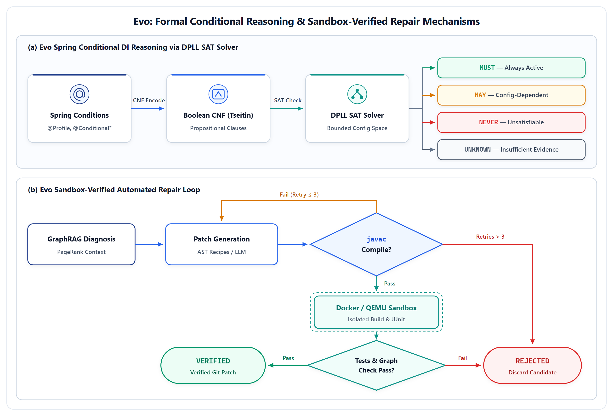
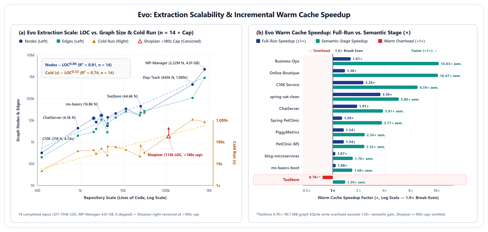

# ĐÁNH GIÁ HIỆU NĂNG VÀ SO SÁNH KHOA HỌC HỆ THỐNG EVO TRONG PHÂN TÍCH KIẾN TRÚC VÀ SỬA LỖI TỰ ĐỘNG

*Empirical Performance and Comprehensive Scientific Comparison of Evo for Architecture Intelligence and Verified Software Evolution*

**ĐẠI HỌC QUỐC GIA TP. HỒ CHÍ MINH — TRƯỜNG ĐẠI HỌC CÔNG NGHỆ THÔNG TIN** — Báo cáo Đánh giá Thực nghiệm & So sánh Khoa học  
`evo.jar` (`cb79c322`, `JDK 21.0.12.1`) | Testbed: `i5-14400F`, `31.79 GB` RAM | Đối chiếu: `39` công trình (`2000–2026`) & `9` repository mã nguồn mở chuẩn

> **Tóm tắt —** Báo cáo đánh giá hiệu năng và so sánh **Evo** với `39` công trình (`2000–2026`) trên `9` repository mã nguồn mở chuẩn. Evo tích hợp phân tích tĩnh `--build=off`, `DPLL SAT` cho `Spring DI`, `SKG` (`SHA-256`) và `QEMU`/`Hyper-V Sandbox`. Evo đạt `Precision = 1.00`, `0.96` Service F1 trên *Online Boutique*, đồng thời nêu khách quan mọi trục đối thủ vượt trội.

**Từ khóa:** Evo, Software Knowledge Graph (SKG), Architecture Recovery, Spring Conditional DI (DPLL SAT), phân tích đa ngôn ngữ gRPC, GraphRAG và kiểm chứng Sandbox.

---

## Chương 1. Kiến trúc và Cơ chế Cốt lõi của Evo

### 1.1. Bài toán phân mảnh công cụ và pipeline 5 giai đoạn của Evo

Các công cụ phân tích kiến trúc và sửa lỗi thường tách rời: phân tích `Dependency Injection (DI)` cần `.war`/`.jar` biên dịch sẵn cho một cấu hình đơn; khôi phục microservice chỉ phủ `Java`; tác nhân LLM thiếu đồ thị ký hiệu tất định và cơ chế cô lập máy chủ. **Evo** hợp nhất toàn trình qua **pipeline 5 giai đoạn** (Hình 1.1):

- **Giai đoạn 1 — Thu nhận & Mô hình build:** Nạp mã nguồn vào `Content-Addressed Storage (CAS)` và đọc thụ động `Maven`/`Gradle` không chạy build trên máy chủ (`--build=off`).
- **Giai đoạn 2 — Phân tích ngữ nghĩa & `SAT`:** Chạy `JavaParser` theo `Classpath`, `16` ngữ pháp `Tree-sitter`/`Protobuf` và giải không gian cấu hình `Spring` bằng `DPLL SAT Solver`.
- **Giai đoạn 3 — Xuất bản `SKG` (`SHA-256`):** Dựng `Software Knowledge Graph` định danh `SHA-256`, tính chu trình `Tarjan SCC`, độ tách rời `DRH`, `NCCD`, chỉ số Martin và `Architecture Health Score`.
- **Giai đoạn 4 — Định vị `GraphRAG` & Sinh bản vá:** Xếp hạng ngữ cảnh bằng `Personalized PageRank`, trích dẫn bằng chứng `[E#]` để sinh bản vá qua `16 AST Recipes` hoặc LLM lọc cú pháp `javac`.
- **Giai đoạn 5 — Xác thực `Sandbox`:** Biên dịch, chạy `JUnit`, kiểm tra `Bytecode` và `Negative Control` trong `Docker`/`QEMU`/`Hyper-V Sandbox` trước khi xuất bản vá `Git`.

*Hình 1.1. Pipeline 5 giai đoạn phân tích kiến trúc và sửa lỗi tự động có kiểm chứng của Evo.*

### 1.2. Bốn cơ chế kỹ thuật cốt lõi và phạm vi bảo đảm

- **Phân tích tĩnh `--build=off` và bảo toàn `Unresolved References`:** Evo đọc trực tiếp `POM`/`BOM` `Maven`, cấu hình `Gradle`, `Java 21 AST`, `Lombok` và `16` ngôn ngữ `Tree-sitter`/`Protobuf` mà không chạy script/plugin mục tiêu. Khi thiếu JAR hoặc ngữ cảnh `Gradle` động, Evo giữ nguyên trạng thái chưa đủ căn cứ thay vì suy đoán heuristic.
- **Suy diễn `Spring Conditional DI` theo pha bằng `DPLL SAT` (Hình 1.2a):** Ràng buộc `@Profile`, `@ConditionalOnProperty`, `@ConditionalOnBean`, `@ConditionalOnMissingBean` được biên dịch sang `Boolean CNF` (biến đổi Tseitin) đúng thứ tự pha Spring, phân loại tường minh `Truth Region` (`MUST`, `MAY`, `NEVER`, `UNKNOWN`) kèm cấu hình thỏa mãn có thể phát lại.
- **Đồ thị ký hiệu định danh `SHA-256` và lưu trữ phân trang:** `SKG` lưu trên `SQLite WAL` với `LRU Cache` `64 MB` và `Incremental Cache` 3 tầng, bảo đảm mọi lượt chạy lại ngoại tuyến trên cùng mã nguồn và ngữ cảnh tạo mã băm `SHA-256` đồng nhất `100%`.
- **Vòng sửa lỗi lọc `javac` và xác thực `Sandbox` có `Negative Control` (Hình 1.2b):** Bản vá từ `16 AST Recipes` (tách giao diện `DIP`, phá chu trình `@Lazy`/`ObjectProvider<T>`) hoặc LLM qua cổng `javac` (`≤3` lượt), tái phân tích vi phân (`12 ms` có cache) và xác nhận `RESOLVED` vs `PERSISTED` trong `QEMU`/`Hyper-V`.

*Hình 1.2. Hai cơ chế cốt lõi của Evo: (a) Suy diễn Spring Conditional DI bằng DPLL SAT Solver và (b) Vòng sửa lỗi kiểm chứng Sandbox.*

## Chương 2. Phương pháp Thực nghiệm, Khả năng Mở rộng và Hiệu năng Warm Cache

### 2.1. Testbed Environment và giao thức thực nghiệm

Mọi phép đo Evo chạy trực tiếp bằng `evo.jar` (`cb79c322`, `--build=off`) trên `Testbed Environment` thống nhất (Bảng 2.1). Mỗi repository mục tiêu chạy `Cold Run` (xóa sạch cache) rồi `Warm Cache` (`Incremental Cache` 3 tầng) để đối chiếu mã băm `SHA-256`. Giao thức tách rõ **Mode A** (`--offline`) và **Mode B** (tải thụ động `Maven Central`), áp trần `180 s`/lượt cho bộ repository chuẩn.

**Bảng 2.1.** Cấu hình Testbed Environment và giao thức kiểm soát thực nghiệm của Evo

| Thành phần | Thông số phần cứng / phần mềm | Giao thức kiểm soát |
| :--- | :--- | :--- |
| CPU & RAM | `Intel Core i5-14400F` (`10C/16T`), `31.79 GB` RAM | Chạy tuần tự từng repository, không tải nền |
| OS & Runtime | `Windows 11 Pro` (`26100`), `JDK 21.0.12.1 LTS` | `Maven 3.9.16`, `Node.js v26.13.0` |
| Binary & Cờ | `evo.jar` (`cb79c322`, `SHA-256: 089df794...`) | `--mode=fast --spring-sat --build=off` |
| Phân giải phụ thuộc | Mode A (`--offline`) / Mode B (`Maven Central`) | Cấm chạy plugin/script mục tiêu trên máy chủ |

### 2.2. Khả năng mở rộng từ 127 LOC đến 794k LOC và Cold Run vs Warm Cache

Bảng 2.2 và Hình 2.1 đánh giá độ mở rộng của Evo từ `127` LOC (`C10K Network Service`) tới `794,217` LOC (`MP-Manager`: `2,223,962` nút, `4.01 GB`). Trên `14` repository hoàn tất, tốc độ tăng số nút đồ thị và thời gian `Cold Run` tuân theo quy luật dưới tuyến tính (`Nodes ~ LOC^0.86`, `Cold ~ LOC^0.52`).

**Bảng 2.2.** Hiệu năng mở rộng Cold Run vs Warm Cache của Evo từ 127 LOC đến 794,217 LOC

| Repository mục tiêu | Stack | Tệp; LOC | Nodes; Edges | Cycles; Score | Cold (s) | Warm / Load | Graph Size |
| :--- | :--- | ---: | ---: | ---: | ---: | ---: | ---: |
| `C10K Network Service` | Java 21 | 3; 127 | 318; 198 | 0; 100.0 | 4.74 | 2.09 s (2.26×) | 0.57 MB |
| `ChatServer Microservices` | Spring, gRPC | 23; 883 | 4,332; 1,953 | 2; 91.02 | 38.51 | 20.21 s (1.91×) | 15.97 MB |
| `Dorm Trading Platform` | Spring, React | 69; 11,631 | 33,603; 25,136 | 2; 88.37 | 44.18 | 33.10 s (1.33×) | 69.12 MB |
| `Business-Ops Platform` | Python, JS | 86; 31,303 | 23,358; 26,640 | 0; 93.75 | 32.76 | 20.40 s (1.61×) | 47.19 MB |
| `OWASP Dependency-Track`a | Java 21 (60m) | 2,198; 415,568 | 444,850; 106,663 | 18; WITHHELD | 1,089.45 | 4.38 s (load) | 919.22 MB |
| `MP-Manager`a | Java/Kt/C++ | 3,891; 794,217 | 2,223,962; 899,223 | —; WITHHELD | 843.22 | **0.10 s** (104 ms) | 4.01 GB |

*a Với 2 repository quy mô lớn, Warm/Load đo độ trễ nạp đồ thị/Manifest từ `CAS`/`SQLite`; `WITHHELD` báo thiếu chỉ số bắt buộc do không suy đoán. 4 repository đầu đạt `100%` khớp `SHA-256`.*

- **Tăng tốc `Warm Cache` (`1.28×–3.56×` toàn trình):** Tầng ngữ nghĩa tăng tốc `1.68×–16.83×` nhờ `Incremental Cache` 3 tầng và giữ `100%` khớp `SHA-256` trên mọi lượt chạy ngoại tuyến.
- **Quy mô doanh nghiệp và bộ nhớ thấp:** `OWASP Dependency-Track` (`415,568` LOC, `60` mô-đun) hoàn tất trong `1,089.45 s` (nạp ấm `4.38 s`); `MP-Manager` (`4.01 GB`) hoàn tất trong `843.22 s` (`419.94 s` chế độ nhanh, nạp `Manifest` **`104 ms`**); `Halo` (`1.51 GB`, `852,845` nút) vận hành ổn định trong `-Xmx256m`.
- **Giới hạn mở rộng khách quan:** *TeaStore* suy giảm `Warm Cache` `0.76×` (`89.72 s` vs `68.22 s`) do tuần tự hóa `90.68 MB`, `Shopizer` (`115,149` LOC) vượt trần `180 s` tại bước tràn đĩa `SQLite`, còn `ThingsBoard` (`1.95M` LOC, `13,920` tệp) thu nhận `100%` `CAS` nhưng chạm ngưỡng `MEMORY_LIMIT` sau `1,467 s` ở `-Xmx8g`.

*Hình 2.1. Đường cong mở rộng trích xuất đồ thị của Evo theo LOC trên 14 repository kèm điểm cắt Shopizer >180 s (trái) và tỷ số tăng tốc Warm Cache toàn trình/ngữ nghĩa (phải).*

## Chương 3. So sánh Toàn diện với các Công trình Khoa học Liên quan (2000–2026)

### 3.1. Ma trận năng lực trên 10 tiêu chí kỹ thuật (2000–2026)

Evo được đối chiếu hệ thống với `39` công trình (`2000–2026`) trên `10` tiêu chí kỹ thuật (Bảng 3.1). Hai hiệu đính thư mục được chuẩn hóa: `JackEE` công bố chính thức tại **ACM SIGPLAN PLDI 2020** [2], còn benchmark **EMSE 2025** [14] đánh giá `17` ứng dụng Java/Spring `microSecEnD` (khác *Online Boutique* của `Ripple` [15] và *TeaStore* [16]).

**Bảng 3.1.** Ma trận năng lực trên 10 tiêu chí kỹ thuật: Evo so với các công trình tiêu biểu (2000–2026)

| Hệ thống / Công trình | Không Build | Đa ngôn ngữ | Spring SAT | Micro-svc | Symbol SKG | Debt / Evol. | Graph-RAG | Sửa lỗi | Sandbox | SHA-256 |
| :--- | :---: | :---: | :---: | :---: | :---: | :---: | :---: | :---: | :---: | :---: |
| **Evo** | ✓ | ✓ | ✓ | (✓) | ✓ | ✓ | ✓ | (✓) | ✓ | ✓ |
| TypeChef (OOPSLA '11) [1] | ✓ | — | (✓) | — | (✓) | — | — | — | — | — |
| DV8 (ICSE '16) / ARCADE [7, 8, 38] | (✓) | (✓) | — | — | (✓) | ✓ | — | — | — | — |
| Sonargraph-Architect [33, 34] | — | (✓) | — | — | ✓ | ✓ | — | — | — | — |
| RefactoringMiner 3.0 [17, 18] | ✓ | — | — | — | (✓) | ✓ | — | — | — | — |
| JackEE (PLDI '20) / Jasmine [2, 3] | — | — | (✓) | — | ✓ | — | — | — | — | — |
| ArchUnit / Modulith [4, 5] | — | — | — | — | (✓) | (✓) | — | — | — | — |
| DesigniteJava 2.0 (MSR '24) [6] | ✓ | — | — | — | (✓) | ✓ | — | — | — | — |
| SemRef / SSAR (ICSE '26) [36, 37] | (✓) | (✓) | — | — | (✓) | (✓) | (✓) | — | — | — |
| MicroART (ICSAW '17) [10] | — | (✓) | — | ✓ | — | — | — | — | — | — |
| Code2DFD / EMSE '25 [13, 14] | ✓ | — | — | ✓ | — | — | — | — | — | — |
| Micans (ISSTA '25) [9] | — | — | (✓) | ✓ | ✓ | — | — | — | — | — |
| Ripple eBPF (2025) [15] | — | ✓ | — | ✓ | — | — | — | — | — | — |
| Chinthareddy DKB (2026) [25] | ✓ | (✓) | — | — | (✓) | — | ✓ | — | — | — |
| RepoGraph / CodexGraph [23, 24] | ✓ | (✓) | — | — | (✓) | — | ✓ | ✓ | (✓) | — |
| Agentless / AutoCodeRover [20, 22] | (✓) | (✓) | — | — | — | — | (✓) | ✓ | ✓ | — |
| OpenRewrite / MANTRA / RefAgent [26, 28, 29] | (✓) | (✓) | — | — | (✓) | (✓) | (✓) | ✓ | (✓) | — |

*Ký hiệu chuẩn IEEE/ACM (ICSE, FSE, TSE, EMSE 2025): `✓` = Hỗ trợ đầy đủ; `(✓)` = Hỗ trợ một phần / theo phạm vi (Evo ở mức này tại Microservice do chưa giải `@FeignClient`/Gateway YAML và tại Sửa lỗi do tập trung `16 AST Recipes` kiến trúc); `—` = Không hỗ trợ.*

- **Chưa có công cụ đơn lẻ phủ đủ `10/10` tiêu chí:** Mỗi nhóm công trình tối ưu cho một trục riêng (bytecode `JackEE`/`Jasmine`, microservice `Code2DFD`/`Ripple`, `Architectural Debt` `DV8`/`Sonargraph`, sửa lỗi `Agentless`/`RefAgent`).
- **Phạm vi hội tụ của Evo (`8` đầy đủ, `2` một phần):** Evo ghi nhận trung thực `(✓)` ở Microservice (chưa giải `@FeignClient`/Gateway YAML) và Sửa lỗi (tập trung `16 AST Recipes` kiến trúc thay vì sửa lỗi chức năng tổng quát).

### 3.2. So sánh trực tiếp trên cùng repository: Microservice và Đa ngôn ngữ

Evo chạy trực tiếp (`--mode=fast --spring-sat --build=off`) trên `7` repository chuẩn: `5` ứng dụng Spring Cloud từ Bảng 1 EMSE 2025 (`3` Maven + `2` Gradle, `267` mục chuẩn) [14], *Online Boutique* [15] và *TeaStore* [16]. Bảng 3.2a ghi nhận kết quả thực đo từng repository; Bảng 3.2b và Hình 3.1 đối chiếu các công cụ công bố.

**Bảng 3.2a.** Kết quả thực đo trực tiếp của Evo trên từng repository Microservice và Đa ngôn ngữ chuẩn

| Repository (Build / Mode) | Nodes; Edges | Comp. (TP/GT) | Conn. (TP/GT) | Endp. (TP/GT) | Cold / Warm (s) | Speedup | Score / Trạng thái |
| :--- | ---: | ---: | ---: | ---: | ---: | ---: | ---: |
| `spring-petclinic-microservices` (Maven, B) | 13,660; 7,141 | 8/12 (8/8 mod.) | 1/28 | 10/10 (15/15a) | 62.98 / 47.01 | 1.34× (2.32×b) | 93.05 (1 cycle) |
| `sqshq/piggymetrics` (Maven, A) | 20,553; 13,284 | 9/17 (9/9 mod.) | 0/37 | 10/10 (11/11a) | 60.20 / 44.81 | 1.34× (2.34×b) | 87.6 (2 cycles) |
| `ewolff/microservice` (Maven, A) | 8,261; 3,984 | 6/7 (6/6 mod.) | 0/13 | 0/15 (thiếu JAR) | 29.44 / 21.66 | 1.36× (1.90×b) | WITHHELD |
| `microservices-basics-spring-boot` (Gradle, A) | 16,769; 10,719 | 9/12 (9/9 mod.) | 0/29 | 0/8 (`--build=off`) | 50.07 / 46.17 | 1.08× (1.68×b) | WITHHELD (1 cycle) |
| `blog-microservices` (Gradle, A) | 12,468; 2,915 | 11/17 (11/11 mod.) | 0/42 | 0/10 (`--build=off`) | 43.32 / 40.66 | 1.07× (1.70×b) | WITHHELD |
| **Gộp 5 EMSE '25** (`3M + 2G`, 267 GT) | 5 repos | 43/65 (F1=0.80) | 1/149 (0.01) | 20/53 (0.55) | 49.2 / 40.1 (TB) | 0 FP (P=1.00) | Overall F1 = 0.39 |
| *Online Boutique* (5 langs + Protobuf, A) [15] | 16,728; 17,352 | 11/12 (F1=0.96) | 11/16 (0.81) | — (66 RPCs) | 22.43 / 16.25 | 1.38× (16.47×b) | 100.0 (0 cycles) |
| *TeaStore* (Maven Servlet/JAX-RS, A) [16] | 44,374; 22,083 | 6/7 (F1=0.92) | 0 | 0 (JAX-RS) | 68.22 / 89.72 | 0.76× (chậm lại) | 86.07 (3 cycles) |

*a Số trong ngoặc là số endpoint thực tế ở nhánh HEAD (`15/15` trên `petclinic-ms`, `11/11` trên `piggymetrics`, đạt `26/26 = 100%` trên `2` repository Maven đủ classpath); `18` endpoint Gradle được giữ lại (`ROUTE_UNSUPPORTED`) do `--build=off`.*  
*b Giá trị trong ngoặc là tỷ số tăng tốc tầng ngữ nghĩa; cả `6/6` repository chạy Mode A ngoại tuyến đạt `100%` khớp `SHA-256` giữa `Cold Run` và `Warm Cache`.*

**Bảng 3.2b.** So sánh đối đầu trực tiếp trên các repository Microservice & Đa ngôn ngữ chuẩn (chữ đậm = giá trị tốt nhất từng nhóm)

| Repository | Hệ thống | Comp. F1 (↑) | Conn. F1 (↑) | Endp. F1 (↑) | Overall P (↑) | Overall F1 (↑) | Runtime (s) (↓) |
| :--- | :--- | ---: | ---: | ---: | ---: | ---: | ---: |
| EMSE '25 Spring Clouda | **Evo** (5 repos, Live) | 0.80 | 0.01 | 0.55 | **1.00** | 0.39 | 49.2 s |
| EMSE '25 Spring Clouda | Code2DFD (17 apps) [13, 14] | **0.98** | **0.87** | 0.66 | 0.93 | 0.86 | 7.3 s |
| EMSE '25 Spring Clouda | MicroDepGraph (17 apps) [11, 14] | 0.87 | 0.67 | — | 0.99 | 0.74 | 1.5 s |
| EMSE '25 Spring Clouda | RAD (17 apps) [14] | — | — | **0.79** | 0.94 | 0.37 | **<1.0 s** |
| EMSE '25 Spring Clouda | RAD-source (17 apps) [14] | — | — | 0.67 | — | — | **<1.0 s** |
| EMSE '25 Spring Clouda | Prophet (17 apps) [12, 14] | 0.23 | — | 0.00 | 0.57 | 0.08 | **<1.0 s** |
| EMSE '25 Spring Clouda | 4-Tool Ensemble (17 apps) [14] | — | — | — | — | **0.91** | — |
| Online Boutique (5 langs)b | **Evo** (Static) | 0.96 | 0.81 | — | **1.00** | 0.88 | 22.4 s |
| Online Boutique (5 langs)b | Ripple eBPF (Runtime) [15] | **1.00** | **1.00** | — | **1.00** | **1.00** | Live K8s |
| Online Boutique (5 langs)b | Java-Only Static [13, 14] | — | 0.00 | — | — | — | — |
| TeaStore (Non-Spring)c | **Evo** (Live) | 0.92 | 0.00 | 0.00 | 1.00 | — | 68.2 s |

*a Evo chạy trực tiếp trên 5 repository Bảng 1 EMSE 2025 (3 Maven + 2 Gradle: 65 Cp, 149 Cn, 53 E; 49.2 s Cold / 40.1 s Warm). Đối thủ trích từ EMSE 2025 (17 ứng dụng [14]).*  
*b `Online Boutique` (`12` dịch vụ, `16` phụ thuộc [15]): Evo chạy tĩnh không cần K8s (`11/12` dịch vụ, `11/16` phụ thuộc); công cụ Java-only phủ `0%` trên `10` dịch vụ phi-Java.*  
*c `TeaStore` (`7` thành phần [16]): Evo thu hồi `6/6` mô-đun Maven (`F1 = 0.92`), `0` JAX-RS Endpoint, `Warm Cache` `89.72 s` (`0.76×`). **Chữ đậm** ghi nhận công cụ thắng không thiên vị.*

- **Evo dẫn đầu tuyệt đối `Overall Precision = 1.00` (`0` FP) trên cả `5` repository EMSE 2025:** Thu hồi `43/43` (`100%`) mô-đun mã nguồn (`Comp. F1 = 0.80`), `26/26` endpoint trên `2` repository Maven đủ classpath, vượt `RAD` (`0.37`) và `Prophet` (`0.08`) ở `Overall F1` (`0.39`).
- **Công cụ chuyên biệt thắng áp đảo `5/6` thước đo EMSE 2025:** `Code2DFD` (**`0.98`** Comp., **`0.87`** Conn., `7.3 s`), `RAD` (**`0.79`** Endp., **`<1.0 s`**) và `4-Tool Ensemble` (**`0.91`** Overall) vượt Evo (`0.01` Conn., `49.2 s`) do Evo chưa giải `@FeignClient`/Gateway YAML và giữ lại `18` endpoint Gradle vì `--build=off`.
- **Đa ngôn ngữ tĩnh vs runtime và giới hạn phi-Spring:** Trên *Online Boutique*, Evo chạy tĩnh không cần Kubernetes (`0.96` Service F1, `0.81` gRPC F1, tăng tốc ngữ nghĩa **`16.47×`**) vượt công cụ Java-only (`0%`), nhưng thua **`Ripple eBPF` (`1.00` F1)** ở lưu lượng runtime; trên *TeaStore*, Evo đạt `0.92` Comp. F1 nhưng `0` JAX-RS Endpoint và `Warm Cache` suy giảm `0.76×`.

*Hình 3.1. So sánh độ chính xác khôi phục kiến trúc (5 repository EMSE '25, Online Boutique, Shopizer) và thời gian thực thi Cold/Warm của Evo so với công cụ chuẩn.*

### 3.3. Spring Conditional DI, Phân tích Tĩnh Java, Architectural Debt và Tiến hóa

Mục này tách bạch hai nhóm so sánh: phân tích tĩnh Java, `Spring Conditional DI` và bytecode (Bảng 3.3a) so với đánh giá `Architectural Debt`, phát hiện smell và khai phá tiến hóa (Bảng 3.3b). Số liệu kết hợp thực nghiệm trực tiếp trên `spring-petclinic` (`818c4136`, `500158f`), `spring-sat-clean` và kết quả công bố gốc của các công trình đối chiếu.

**Bảng 3.3a.** So sánh định lượng Phân tích Tĩnh Java, Spring Conditional DI và Bytecode (chữ đậm = tốt nhất từng nhóm)

| Benchmark / Miền phân tích | Hệ thống | Đầu vào | Độ chính xác / Độ phủ (↑) | Lỗi / Sai lệch (↓) | Ghi chú định lượng |
| :--- | :--- | :--- | ---: | ---: | :--- |
| PetClinic Config B (220 calls) | **Evo** | Source + 89 JARs | **100.0%** | **0** | 220/220 calls; 0 lỗi span |
| PetClinic Config B (220 calls) | OpenRewrite v8.87.7 [26] | LST + 89 JARs | **100.0%** | 89 | 220/220 calls; 89 lỗi span |
| PetClinic Config A (JDK-only) | **Evo** | Source + JDK | 52.73% | **0** | 116/220 calls; giữ 0 lỗi span |
| PetClinic Config A (JDK-only) | OpenRewrite v8.87.7 [26] | LST + JDK | **56.36%** | 57 | 124/220 calls; thắng Config A |
| Java 21 Generic Microfixture | **Evo** | Source + JDK | 85.71% | — | 6/7 calls (chained generic) |
| Java 21 Generic Microfixture | OpenRewrite v8.87.7 [26] | LST + JDK | **100.0%** | — | 7/7 calls; thắng chained generic |
| Spring @Conditional Ordering | **Evo** (DPLL SAT) | Source + YAML | **100.0%** | **0.0%** | 4/4 pha; 79/79 runtime; 64/64 SAT; 12/12 P01 |
| Spring @Conditional Ordering | Flat-Condition Baseline | Source + YAML | 50.0% | 50.0% | 2/4 pha; sai @ConditionalOnMissingBean |
| Spring @Conditional Ordering | TypeChef (OOPSLA '11) [1] | C #ifdef | N/A | — | ~2.6B token (4.1% phụ phí); không Spring DI |
| Bytecode Points-to & AOP | JackEE (PLDI '20) [2] | Compiled WAR | **58.04%** | — | ~6.0× 2objH speedup (max 15.1×) |
| Bytecode Points-to & AOP | Doop Baseline [2] | Compiled WAR | 14.48% | — | 1.8% Alfresco; 0% pybbs |
| Bytecode Points-to & AOP | Jasmine (ASE '22) [3] | Spring Bytecode | N/A | — | 12 AOP leaks (18 apps); 1 cấu hình |
| Bytecode Points-to & AOP | Micans (ISSTA '25) [9] | Microsvc Bytecode | N/A | — | Pointer analysis liên dịch vụ (Tai-e) |

*Ghi chú: Nhóm 1–3 đo trực tiếp trên `spring-petclinic` (`818c4136`, `220` calls) và `Java 21`. Trên `spring-sat-clean`, Evo phân loại `2 MUST` + `3 MAY` trong `10.29 s`/`2.89 s` (`3.56×`); trên `spring-petclinic` (`500158f`), Evo thu hồi `17/17` REST Endpoint (`F1 = 1.00`, `0` chu trình, điểm `99.49`).*

**Bảng 3.3b.** So sánh Architectural Debt, Phát hiện Smell, Phục hồi Phân cụm và Tiến hóa Kiến trúc

| Hệ thống / Công trình | Đầu vào | Chỉ số Architectural Debt & Policy | Tiến hóa / Khôi phục | Định lượng công bố / Phạm vi nổi bật |
| :--- | :--- | :--- | :--- | :--- |
| **Evo** (SKG Diff) | Source + Policy | Tarjan SCC, DRH, NCCD, Martin; DPLL SAT | Diff tương thích đa cấu hình; Leiden | 0 FP trên P01; tách Health khỏi Confidence |
| DV8 (ICSE '16) [7] | DSM + Git | Decoupling Level (DL), DRH hotspots | Modularity Violations theo Git | 129 dự án; DL ổn định (CV ~2% vs 26%) |
| DesigniteJava 2.0 (MSR '24) [6] | Java Source | Danh mục smell rộng nhất (arch/design/test) | Khai phá đa commit tăng dần | Giảm 46% thời gian đa commit; 1 cấu hình |
| ArchUnit / Modulith [4, 5] | JVM .class | FreezingArchRule / DDD module checks | Đóng băng vi phạm CI theo snapshot | Kiểm thử JUnit CI nhanh; 1 cấu hình biên dịch |
| Sonargraph-Architect [33, 34] | Bytecode + Source | Architecture DSL, NCCD/ACD, cyclicity | Baseline trend & virtual refactor | Triển khai doanh nghiệp; gắn với build CI |
| RefactoringMiner 2.0/3.0 [17, 18] | Git AST Diff | Không chấm điểm Architectural Debt | Khai phá >100 loại tái cấu trúc | 98.9%–99.6% P; 97.9%–98.6% R; 87.9% AST diff |
| SemRef / SSAR (ICSE '26) [36, 37] | Source + LLM | Phân cụm mô-đun kiến trúc (vs [8, 38]) | Tinh chỉnh phân cụm ngữ nghĩa | SemRef nâng MoJoFM 0.3935 → 0.6684 (+118.57%) |
| iSMELL (ASE '24) [35] | Java Source | Phát hiện & tái cấu trúc code smell | Kết hợp LLM + công cụ chuyên gia | 75.17% F1 trên bộ smell chuẩn |

*Ghi chú: Các hệ thống trong Bảng 3.3b tối ưu trên từng miền bổ trợ nhau (`DV8`, `DesigniteJava`, `Sonargraph`, `RefactoringMiner`, `SemRef`/`SSAR`, `iSMELL`); Evo bổ khuyết so sánh đồ thị theo không gian cấu hình Spring.*

- **Suy diễn `Spring @Conditional` và độ chuẩn span:** Evo đạt `79/79` (`100.0%`) khớp Spring runtime (`5.3.31`/`6.1.14`/`6.2.0`), `70/70` đặc tả hình thức, `4/4` thứ tự `@ConditionalOnMissingBean` (vs `2/4` baseline gộp phẳng) và **`0` lỗi span** trên `PetClinic Config B` (vs `89` của `OpenRewrite`).
- **Ưu thế trung thực của đối thủ trên AST và Bytecode:** `OpenRewrite` [26] thắng Evo ở `PetClinic Config A` (`56.36%` vs `52.73%`) và generic Java 21 (`100.0%` vs `85.71%`); `JackEE` (`58.04%` reachability), `Jasmine` (`12` rò rỉ AOP) và `Micans` sâu hơn khi có tệp `.war` biên dịch.
- **Tính bổ trợ trên trục `Architectural Debt` và tiến hóa:** `DV8` (`129` dự án), `DesigniteJava 2.0` (`-46%` thời gian đa commit), `Sonargraph-Architect`, `RefactoringMiner 3.0` (`99.3%` P) và `SemRef`/`SSAR` dẫn đầu đo lường đơn cấu hình và khai phá commit; Evo bổ khuyết so sánh snapshot tương thích đa cấu hình.

### 3.4. Graph-RAG Indexing trên Shopizer, Sửa lỗi Tự động và Cô lập Máy chủ

Bảng 3.4 đối chiếu Graph-RAG trực tiếp trên `Shopizer` (`6a4a0a65`, `1,210` tệp `.java`, `115,149` LOC) [25] và tách biệt phạm vi giao thức giữa sửa lỗi chức năng (`SWE-bench`/`Defects4J`) với sửa lỗi kiến trúc của Evo (`N/A` ngoài phạm vi). Bảng 3.5 đối chiếu cô lập máy chủ, `SHA-256` và độ chặt kiểm chứng.

**Bảng 3.4.** So sánh Graph-RAG Indexing (trực tiếp Shopizer) và Sửa lỗi Tự động tách biệt giao thức (chữ đậm = dẫn đầu từng nhóm)

| Benchmark / Giao thức | Hệ thống | Cơ chế Ngữ cảnh & Sửa lỗi | Kết quả Chính (↑) | Chi phí / Thời gian (↓) | Giao thức Kiểm chứng & Ghi chú |
| :--- | :--- | :--- | ---: | ---: | :--- |
| Graph-RAG Index (Shopizer)a | **Evo** (Live) | SKG + JavaParser + Maven + SAT | Timeout (>180 s) | >180 s | 1,173/1,173 Java; **0** bỏ sót; 751k staged |
| Graph-RAG Index (Shopizer)a | Chinthareddy DKB (2026) [25] | Tree-sitter shallow AST | **15/15** | **2.81 s** | 1,158 nút; **0** bỏ sót; 10.51 s/query |
| Graph-RAG Index (Shopizer)a | Chinthareddy LLM-KB (2026) [25] | LLM-extracted KG | 13/15 | 200.14 s | 842 nút; 377 tệp lỗi (68.8%) |
| Graph-RAG Index (Shopizer)a | No-Graph RAG (2026) [25] | Vector chunk RAG | 6/15 | — | Thiếu quan hệ cấu trúc; 9.52 s/query |
| SWE-bench Lite (Python)b | Agentless (FSE '25) [22] | Hierarchical localize + sample | **32.00%** | **$0.34** | Unit tests ($0.34–$0.70/issue) |
| SWE-bench Lite (Python)b | RepoGraph + Agentless [23] | Line def/ref graph plug-in | 29.67% | — | Unit tests (+2.34 pp vs 27.33%) |
| SWE-bench Lite (Python)b | Aider RepoMap [19] | Tree-sitter + PageRank map | 26.33% | — | Unit tests (88.0% Polyglot) |
| SWE-bench Lite (Python)b | CodexGraph (NAACL '25) [24] | Neo4j graph + LLM Cypher | 22.96% | — | Unit tests (27.9% CrossCodeEval) |
| SWE-bench Lite (Python)b | AutoCodeRover (ISSTA '24) [20] | AST search + SBFL | 19.00% | $0.43 | 57/300 (bản mới đạt 38.4%) |
| SWE-bench Lite (Python)b | SWE-agent (NeurIPS '24) [21] | ACI + Docker harness | 18.00% | $1.67 | Docker tests (12.47% Full) |
| SWE-bench Lite (Python)b | **Evo** | SKG + PageRank + AST/LLM | N/A | — | Không đo SWE-bench (xem nhóm 3) |
| Java Repair & Arch. Verifyc | **Evo** | 16 AST Recipes + javac + QEMU | **100.0%**† | 12 ms† | 9/9 QEMU Neg. Control; 287 ms không cache |
| Java Repair & Arch. Verifyc | CausalRepair (ISSTA '26) [31] | Dual-slicing + DeepSeek-V3 | **50.75%**‡ | **$0.029**‡ | 313 Defects4J; 101/199 GitBug-Java |
| Java Repair & Arch. Verifyc | RepairAgent (ICSE '25) [30] | FSM autonomous tool agent | 164 D4J‡ | — | 74 D4J v1.2 + 90 v2.0 (49 multi-line) |
| Java Repair & Arch. Verifyc | RefAgent (ICSE '26) [29] | Multi-agent + DesigniteJava | **90.0%** | — | Giảm 52.5% smell; 79.15% opp-ID |
| Java Repair & Arch. Verifyc | MANTRA (2025) [28] | RAG + multi-agent + RL | 82.8% | — | 582/703 Java refactor (vs 8.7% GPT) |
| Java Repair & Arch. Verifyc | EM-Assist (FSE '24) [27] | LLM + IntelliJ static guards | 53.4%§ | — | Top-5 recall (1,752 ca); 94.4% dev OK |
| Java Repair & Arch. Verifyc | OpenRewrite v8 [26] | Lossless Semantic Tree | N/A | — | Hàng trăm recipe; không có VM proof |

*a Đối chiếu trực tiếp trên `Shopizer` (`1,210` tệp `.java`): `Chinthareddy DKB` thắng áp đảo về tốc độ (`2.81 s`, >64×) và đạt `15/15` Q&A; Evo phân tích cú pháp `1,173/1,173` Java (`0` bỏ sót) nhưng vượt trần `180 s` tại bước `SQLite` spill (không in đậm).*  
*b `SWE-bench Lite` đo sửa lỗi chức năng Python; Evo ghi `N/A` do tập trung kiến trúc Java/Spring.*  
*c Tách biệt giao thức theo ký hiệu: † `Evo` (`9/9` kiểm chứng `QEMU` có `Negative Control`, `12 ms` tái phân tích vi phân có cache); ‡ sửa lỗi chức năng Java (`CausalRepair`, `RepairAgent`); § `ExtractMethod` top-5 recall (`EM-Assist`); không ký hiệu = tỷ lệ pass tái cấu trúc Java (`RefAgent`, `MANTRA`).*

**Bảng 3.5.** So sánh bảo mật cô lập máy chủ, tính tất định SHA-256 và độ chặt kiểm chứng bản vá

| Hệ thống | Build trên máy chủ | Cô lập thực thi (Sandbox) | Tất định SHA-256 | Kiểm chứng bản vá | Bảo vệ & Chống suy đoán |
| :--- | :--- | :--- | :--- | :--- | :--- |
| **Evo** | **Không** (`--build=off`) | **QEMU / Hyper-V** + Docker | **100%** (CAS offline) | `javac` + JUnit + **Negative Control** | Ghi nhận `Unresolved`; ẩn bí mật `11` mẫu |
| JackEE (PLDI '20) [2] | Có (cần build `.war`) | Không (JVM cục bộ) | Tất định Datalog | Chỉ phân tích (không sửa lỗi) | Đòi hỏi bytecode biên dịch đầy đủ |
| OpenRewrite v8 [26] | Có (Maven/Gradle plugin) | Không (máy chủ / CI) | Tất định LST | Dry-run + build/test trên CI | Không có VM proof; 89 lỗi span PetClinic |
| SWE-agent (NeurIPS '24) [21] | Trong Docker / SWE-ReX | Container (dùng chung kernel) | Không (LLM đa lượt) | Unit test repository | Shell tương tác dễ gặp prompt injection |
| AutoCodeRover (ISSTA '24) [20] | Trong Docker harness | Container chuẩn SWE-bench | Không (LLM Pass@1) | SBFL + unit test có sẵn | Tìm kiếm AST có cấu trúc; thiếu policy |
| Agentless (FSE '25) [22] | Trong container post-hoc | Container không tương tác | Không (LLM sampling) | Lọc regression + repro test | Giảm tấn công shell; chưa cô lập VM |
| Chinthareddy DKB (2026) [25] | **Không** (Tree-sitter) | Không (chỉ đọc AST) | Tất định cú pháp | Chỉ lập chỉ mục Graph-RAG | Không phân giải kiểu Java hay BOM |

*Ghi chú: Cô lập mức `QEMU`/`Hyper-V` của Evo bảo đảm mã xây dựng/plugin không tin cậy không tiếp cận tệp nguồn máy chủ hay khóa xác thực môi trường.*

- **Shopizer Graph-RAG — Đầy đủ cú pháp vs nút thắt tốc độ:** Qua `6` lượt chạy trực tiếp (Mode A và cache `313` JAR), Evo thu nhận `1,340` tệp và phân tích **`1,173/1,173` đơn vị Java (`0` bỏ sót)** (khắc phục rơi `377` tệp của `LLM-KB`), nhưng tràn đĩa `SQLite` (`395.5–502.3 MB`) vượt trần `180 s` — thua **`Chinthareddy DKB` (`2.81 s`, >64×)** [25].
- **Phạm vi sửa lỗi chức năng vs kiến trúc:** `Agentless` (`32.00%`), `CausalRepair` (`313` Defects4J, `$0.029`), `RefAgent` (`90.0%`), `MANTRA` (`82.8%`), `EM-Assist` (`53.4%`) và `ArchFix` (`75%–79%` DCL) [39] dẫn đầu sửa lỗi chức năng và tái cấu trúc; `RepoProbe` [32] cho thấy `GPT-5.2` mới đạt `62.7%` câu hỏi kiến trúc (`Evo` ghi `N/A`).
- **Cô lập mức hypervisor và `Negative Control`:** Khác build máy chủ (`JackEE`, `OpenRewrite`) hay container dùng chung kernel (`SWE-agent`, `AutoCodeRover`, `Agentless`), Evo cấm build máy chủ (`--build=off`), đạt `9/9` (`100%`) kiểm chứng `QEMU` có `Negative Control`, `435.53 s` thu nhận `Hyper-V` (`7.62 MB`, `SHA-256`) và ẩn bí mật `11` mẫu.

## Chương 4. Giá trị Khác biệt của Evo, Hạn chế Khách quan và Kết luận

### 4.1. Giá trị kỹ thuật khác biệt của Evo

- **Độ chính xác tuyệt đối (`Precision = 1.00`, `0` lỗi span):** Evo đạt `0` báo động giả trên `5` repository `EMSE 2025` (`43/43` mô-đun mã nguồn; `26/26` endpoint trên `2` repository Maven đủ classpath), `17/17` endpoint trên `spring-petclinic`, `11/11` cạnh `gRPC` trên *Online Boutique* và `0` lỗi span so với `89` của `OpenRewrite`.
- **Suy diễn `Spring @Conditional` đa cấu hình bằng `DPLL SAT`:** Năng lực duy nhất trong Bảng 3.1 đạt `79/79` (`100%`) khớp Spring runtime (`5.3/6.1/6.2`), `4/4` thứ tự `@ConditionalOnMissingBean` (vs `2/4` baseline gộp phẳng) và `0` FP giữa `@Profile` xung khắc.
- **Khôi phục tĩnh `gRPC` đa ngôn ngữ không cần Kubernetes:** Trên *Online Boutique* (`5` ngôn ngữ + `Protobuf`), Evo thu hồi `11/12` dịch vụ (`F1 = 0.96`) và `11/16` phụ thuộc (`F1 = 0.81`) trong `22.43 s` (`16.47×` tăng tốc ngữ nghĩa), nơi các công cụ tĩnh Java-only phủ `0%`.
- **Đồ thị ký hiệu cỡ gigabyte, an toàn máy chủ và `Negative Control`:** Evo giữ `100%` `SHA-256` ngoại tuyến (`--build=off`), mở rộng tới `4.01 GB` (`MP-Manager`, nạp `Manifest` `104 ms`; `Halo` `1.51 GB` trong `-Xmx256m`), tái phân tích vi phân `12 ms` và `9/9` kiểm chứng `QEMU` có `Negative Control`.

### 4.2. Hạn chế khách quan và phạm vi công cụ khác vượt trội

- **Cạnh `Spring Cloud`, `Gradle --build=off` và tốc độ quét thô:** `Code2DFD` (`0.87` Conn., `0.86` Overall, `7.3 s`), `MicroDepGraph` (`0.67`, `1.5 s`) và `RAD` (`0.79` Endp., `<1.0 s`) vượt Evo (`0.01` Conn., `0.55` Endp., `49.2 s`) do Evo chưa giải `@FeignClient`/Gateway YAML và giữ lại `18` endpoint Gradle vì `--build=off`.
- **Nút thắt tuần tự hóa `SQLite` và lập chỉ mục nông:** Trên `Shopizer`, dù đạt `0` tệp bỏ sót (`1,173/1,173` Java), tràn đĩa `SQLite` (`395.5–502.3 MB`) khiến Evo vượt trần `180 s` — thua **`Chinthareddy DKB` (`2.81 s`, >64×)**; tương tự *TeaStore* giảm `Warm Cache` `0.76×` và `ThingsBoard` (`1.95M` LOC) chạm `MEMORY_LIMIT` ở `-Xmx8g`.
- **Runtime đa giao thức, bytecode chuyên sâu và sửa lỗi chức năng:** `Ripple eBPF` (`1.00` F1) vượt mức tĩnh `0.81` trên *Online Boutique*; *TeaStore* đạt `0` JAX-RS Endpoint; `JackEE`/`Jasmine`/`Micans` sâu hơn khi có `.war`; còn `CausalRepair`, `Agentless`, `RefAgent`, `MANTRA`, `OpenRewrite` phủ sửa lỗi rộng hơn `16 AST Recipes` của Evo.

### 4.3. Kết luận và hướng phát triển

Đánh giá toàn diện trên `9` repository mã nguồn mở chuẩn và `39` công trình (`2000–2026`) khẳng định **Evo** là **hạ tầng bằng chứng kiến trúc tất định và sửa lỗi kiểm chứng cô lập**, kết nối `Precision = 1.00`, `Spring SAT`, `gRPC` đa ngôn ngữ và `QEMU`/`Hyper-V Sandbox`. Bốn ưu tiên tối ưu hóa kế tiếp gồm:

- **Tối ưu tuần tự hóa `SQLite`:** Xuất bản delta luồng nhị phân để khắc phục timeout `Shopizer` (`>180 s`) và suy giảm `0.76×` trên *TeaStore*.
- **Mở rộng bộ trích xuất microservice:** Bổ sung `@FeignClient`, `Gateway YAML`, `JAX-RS @Path` và cầu phân giải ngữ cảnh `Gradle` trong `Sandbox`.
- **Mở rộng sửa lỗi & chuẩn đánh giá:** Tăng số lượng `AST Recipes` đa tệp và kiểm thử hiểu biết kiến trúc trực tiếp trên `RepoProbe` [32].
- **Phân mảnh bộ nhớ đồ thị lớn:** Luồng hóa tầng nạp để vượt trần `MEMORY_LIMIT` trên các repository quy mô `>2M` LOC.

### Tài liệu tham khảo (IEEE Format)

[1] C. Kästner, P. G. Giarrusso, T. Rendel, S. Erdweg, K. Ostermann, and T. Berger, "Variability-Aware Parsing in the Presence of Lexical Macros and Conditional Compilation," *Proc. ACM SIGPLAN OOPSLA*, 2011, pp. 805–824. doi: 10.1145/2048066.2048128.

[2] A. Antoniadis, N. Filippakis, P. Krishnan, R. Ramesh, N. Allen, and Y. Smaragdakis, "Static Analysis of Java Enterprise Applications: Frameworks and Caches, the Elephants in the Room," *Proc. ACM SIGPLAN PLDI*, 2020, pp. 794–807. doi: 10.1145/3385412.3386026.

[3] M. Chen, T. Tu, H. Zhang, Q. Wen, and W. Wang, "Jasmine: A Static Analysis Framework for Spring Core Technologies," *Proc. IEEE/ACM ASE*, 2022. doi: 10.1145/3551349.3556910.

[4] P. Gafert and TNG Technology Consulting GmbH, "ArchUnit User Guide (v1.4.x)," Technical Documentation & Releases, 2025. [Online]. Available: https://www.archunit.org/userguide/html/000_Index.html; https://github.com/TNG/ArchUnit/releases.

[5] O. Drotbohm and Spring Projects, "Spring Modulith Reference Documentation: Verification (v1.4.x / 2.0.x)," Official Spring Reference, 2025. [Online]. Available: https://docs.spring.io/spring-modulith/reference/verification.html; https://github.com/spring-projects/spring-modulith.

[6] T. Sharma, "Multi-faceted Code Smell Detection at Scale using DesigniteJava 2.0," *Proc. IEEE/ACM MSR*, 2024. doi: 10.1145/3643991.3644881.

[7] R. Mo, Y. Cai, R. Kazman, L. Xiao, and Q. Feng, "Decoupling Level: A New Metric for Architectural Maintenance Complexity," *Proc. IEEE/ACM ICSE*, 2016, pp. 499–510. doi: 10.1145/2884781.2884825.

[8] J. Garcia, I. Ivkovic, and N. Medvidovic, "A Comparative Analysis of Software Architecture Recovery Techniques," *Proc. IEEE/ACM ASE*, 2013, pp. 486–496. doi: 10.1109/ASE.2013.6693106.

[9] T. Zhang, Y. Liang, G. Li, T. Tan, C. Xu, and Y. Li, "Bridge the Islands: Pointer Analysis for Microservice Systems," *Proc. ACM SIGSOFT ISSTA*, 2025. doi: 10.1145/3728896.

[10] G. Granchelli, M. Cardarelli, P. Di Francesco, I. Malavolta, L. Iovino, and A. Di Salle, "MicroART: A Software Architecture Recovery Tool for Maintaining Microservice-Based Systems," *Proc. IEEE ICSAW*, 2017, pp. 24–33. doi: 10.1109/ICSAW.2017.9.

[11] M. I. Rahman, S. Panichella, and D. Taibi, "A Curated Dataset of Microservices-Based Systems," *arXiv preprint arXiv:1909.03249*, 2019. doi: 10.48550/arXiv.1909.03249. https://arxiv.org/abs/1909.03249.

[12] V. Bushong, D. Das, and T. Cerny, "Reconstructing the Holistic Architecture of Microservice Systems Using Static Analysis," *Proc. IEEE/ACM ASE*, 2021. doi: 10.1109/ASE51524.2021.9678749.

[13] S. Schneider and R. Scandariato, "Automatic Extraction of Security-Rich Dataflow Diagrams for Microservice Applications Written in Java," *J. Syst. Softw.*, vol. 202, Art. 111722, 2023. doi: 10.1016/j.jss.2023.111722.

[14] S. Schneider, A. Bakhtin, X. Li, J. Soldani, A. Brogi, T. Cerny, R. Scandariato, and D. Taibi, "Comparison of Static Analysis Architecture Recovery Tools for Microservice Applications," *Empirical Softw. Eng.*, vol. 30, no. 5, Art. 128, 2025. doi: 10.1007/s10664-025-10686-2 (arXiv:2412.08352).

[15] D. Landau, G. Blanken, J. Barbosa, and N. Saurabh, "Retrofitting Service Dependency Discovery in Distributed Systems," *arXiv preprint arXiv:2510.15490*, Oct. 2025. doi: 10.48550/arXiv.2510.15490. https://arxiv.org/abs/2510.15490.

[16] J. von Kistowski, S. Eismann, N. Schmitt, A. Bauer, J. Grohmann, and S. Kounev, "TeaStore: A Micro-Service Reference Application for Benchmarking, Modeling and Resource Management Research," *Proc. IEEE MASCOTS*, 2018, pp. 223–236. doi: 10.1109/MASCOTS.2018.00030.

[17] N. Tsantalis, A. Ketkar, and D. Dig, "RefactoringMiner 2.0," *IEEE Trans. Softw. Eng.*, vol. 48, no. 3, pp. 930–950, Mar. 2022. doi: 10.1109/TSE.2020.3007722.

[18] P. Alikhanifard and N. Tsantalis, "A Novel Refactoring and Semantic Aware Abstract Syntax Tree Differencing Tool and a Benchmark for Evaluating the Accuracy of Diff Tools," *ACM Trans. Softw. Eng. Methodol.*, vol. 34, Art. 40, pp. 40:1–40:63, 2025. doi: 10.1145/3696002.

[19] P. Gauthier, "Aider Repository Map: Tree-sitter and Personalized PageRank for Repository Context," Technical Documentation, 2024. [Online]. Available: https://aider.chat/docs/repomap.html.

[20] Y. Zhang, H. Ruan, Z. Fan, and A. Roychoudhury, "AutoCodeRover: Autonomous Program Improvement," *Proc. ACM SIGSOFT ISSTA*, 2024, pp. 1592–1604. doi: 10.1145/3650212.3680307.

[21] J. Yang, C. E. Jimenez, A. Wettig, K. Lieret, S. Yao, K. Narasimhan, and O. Press, "SWE-agent: Agent-Computer Interfaces Enable Automated Software Engineering," *Adv. Neural Inf. Process. Syst. (NeurIPS)*, 2024. https://arxiv.org/abs/2405.15793.

[22] C. S. Xia, Y. Deng, S. Dunn, and L. Zhang, "Demystifying LLM-Based Software Engineering Agents," *Proc. ACM Softw. Eng. (FSE)*, vol. 2, Art. FSE037, 2025. doi: 10.1145/3715754.

[23] S. Ouyang, W. Yu, K. Ma, Z. Xiao, Z. Zhang, M. Jia, J. Han, H. Zhang, and D. Yu, "RepoGraph: Enhancing AI Software Engineering with Repository-level Code Graph," *Proc. ICLR*, 2025. https://arxiv.org/abs/2410.14684.

[24] X. Liu, B. Lan, Z. Hu, Y. Liu, Z. Zhang, F. Wang, M. Q. Shieh, and W. Zhou, "CodexGraph: Bridging Large Language Models and Code Repositories via Code Graph Databases," *Proc. NAACL*, 2025. https://arxiv.org/abs/2408.03910.

[25] M. R. Chinthareddy, "Reliable Graph-RAG for Codebases: AST-Derived Graphs vs LLM-Extracted Knowledge Graphs," *arXiv preprint arXiv:2601.08773*, Jan. 2026. doi: 10.48550/arXiv.2601.08773. https://arxiv.org/abs/2601.08773.

[26] Moderne and OpenRewrite Contributors, "OpenRewrite Documentation: Lossless Semantic Trees (v8.x)," Technical Documentation & Releases, 2025. [Online]. Available: https://docs.openrewrite.org/concepts-and-explanations/lossless-semantic-trees; https://github.com/openrewrite/rewrite/releases.

[27] D. Pomian, A. Bellur, M. Dilhara, Z. Kurbatova, E. Bogomolov, A. Sokolov, T. Bryksin, and D. Dig, "EM-Assist: Safe Automated ExtractMethod Refactoring with LLMs," *Companion Proc. 32nd ACM FSE*, 2024, pp. 582–586. doi: 10.1145/3663529.3663803.

[28] Y.-S. Xu, F. Lin, J.-Q. Yang, T.-H. Chen, and N. Tsantalis, "MANTRA: Enhancing Automated Method-Level Refactoring with Contextual RAG and Multi-Agent LLM Collaboration," *arXiv preprint arXiv:2503.14340*, Mar. 2025. doi: 10.48550/arXiv.2503.14340. https://arxiv.org/abs/2503.14340.

[29] K. Oueslati, M. Lamothe, and F. Khomh, "RefAgent: A Multi-agent LLM-based Framework for Automatic Software Refactoring," *Proc. IEEE/ACM 48th ICSE*, 2026. doi: 10.1145/3744916.3773153 (arXiv:2511.03153).

[30] I. Bouzenia, P. Devanbu, and M. Pradel, "RepairAgent: An Autonomous, LLM-Based Agent for Program Repair," *Proc. IEEE/ACM 47th ICSE*, 2025, pp. 2188–2200. doi: 10.1109/ICSE55347.2025.00157 (arXiv:2403.17134).

[31] L. Wu, Y. Chen, Z. Yang, P. Xue, and D. Hao, "CausalRepair: Bridging the Causality Gap in Large Language Model-Based Automated Program Repair via Dual-Slicing," *Proc. ACM Softw. Eng. (ISSTA)*, vol. 3, Art. ISSTA134, 2026. doi: 10.1145/3832252 (arXiv:2608.10613).

[32] Y. Yang, A. Wu, J. Luo, R. Xuan, Z. Hu, Y. Liu, and Z. Qin, "RepoProbe: Benchmarking Architecture-Aware Repository Comprehension with Checklists," *Proc. 41st IEEE/ACM ASE*, 2026. doi: 10.1145/3832783.3837452 (arXiv:2608.04783).

[33] hello2morrow GmbH, "Sonargraph-Architect User Manual (Standalone Architecture DSL & Cycle Analysis Reference)," Technical Documentation, 2025. [Online]. Available: https://eclipse.hello2morrow.com/doc/standalone/content/index.html.

[34] F. A. Fontana, R. Roveda, and M. Zanoni, "Tool Support for Evaluating Architectural Debt of an Existing System: An Experience Report," *Proc. 31st ACM SAC*, Pisa, Italy, 2016, pp. 1347–1349. doi: 10.1145/2851613.2851963.

[35] D. Wu, F. Mu, L. Shi, Z. Guo, K. Liu, W. Zhuang, Y. Zhong, and L. Zhang, "iSMELL: Assembling LLMs with Expert Toolsets for Code Smell Detection and Refactoring," *Proc. 39th IEEE/ACM ASE*, 2024, pp. 1345–1357. doi: 10.1145/3691620.3695508.

[36] Y. Zhang, C. Liu, Y. Sun, Z. Xu, W. Sun, W. Li, W. Jin, and Y. Liu, "Semantic-Enhanced Automatic Refinement of Architecture Recovery Results Using LLMs," *Proc. IEEE/ACM 48th ICSE*, 2026. doi: 10.1145/3744916.3773114 (arXiv:2607.23774).

[37] W. Ding, R. Mo, C. Wu, and H. Song, "SSAR: A Novel Software Architecture Recovery Approach Enhancing Accuracy and Scalability," *Proc. IEEE/ACM 48th ICSE*, 2026. doi: 10.1145/3744916.3773263.

[38] V. Tzerpos and R. C. Holt, "ACDC: An Algorithm for Comprehension-Driven Clustering," *Proc. 7th WCRE*, 2000, pp. 258–267. doi: 10.1109/WCRE.2000.891477.

[39] R. Terra, M. T. Valente, K. Czarnecki, and R. S. Bigonha, "A Recommendation System for Repairing Violations Detected by Static Architecture Conformance Checking," *Softw. Pract. Exper.*, vol. 45, no. 3, pp. 315–342, Mar. 2015. doi: 10.1002/spe.2233.
