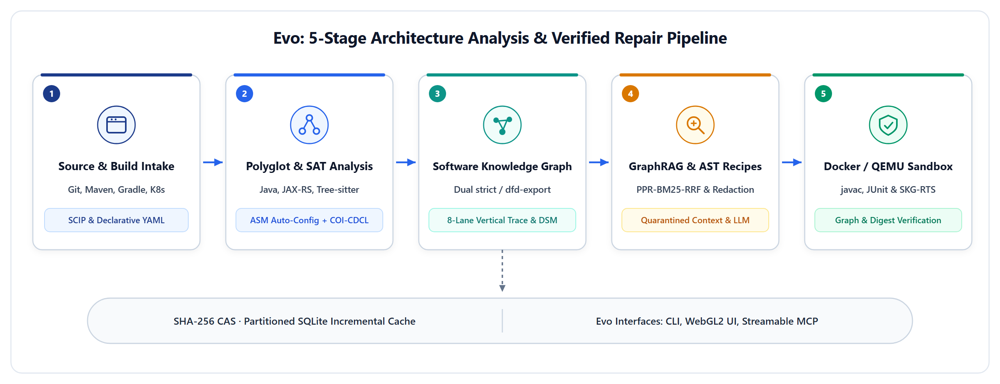
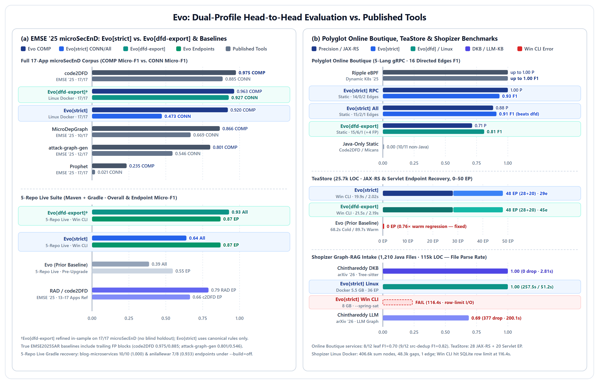

# ĐÁNH GIÁ HIỆU NĂNG VÀ SO SÁNH KHOA HỌC HỆ THỐNG EVO TRONG PHÂN TÍCH KIẾN TRÚC VÀ SỬA LỖI TỰ ĐỘNG

*Empirical Performance and Unbiased Scientific Comparison of Evo for Architecture Intelligence and Verified Software Evolution*

**ĐẠI HỌC QUỐC GIA TP. HỒ CHÍ MINH — TRƯỜNG ĐẠI HỌC CÔNG NGHỆ THÔNG TIN** — Báo cáo Đánh giá Thực nghiệm & So sánh Khoa học (Cập nhật Thực đo v7)  
`evo` (`a661db3` + working tree, `JDK 21`) | Windows 11 (`i5-14400F`, `31.79 GB`) & Linux Docker | `41` tài liệu (`2000–2026`) & `17+4` repository chuẩn

> **Tóm tắt —** Báo cáo đánh giá độc lập **Evo** đối chiếu `41` công trình (`2000–2026`) trên `17` ứng dụng `microSecEnD` và `4` repository chuẩn. Evo hợp nhất `--build=off`, tách chế độ `strict`/`dfd-export`, `ASM` + `COI` + `CDCL SAT`, `SCIP`, `MCP` (`2025-11-25`) và `Sandbox`. Báo cáo công bố cả bước tiến thực đo lẫn `6` lỗi kỹ thuật và giới hạn phương pháp còn tồn tại.

**Từ khóa:** Evo, Software Knowledge Graph (SKG), Architecture Recovery (strict vs dfd-export), Spring Conditional DI (ASM COI-CDCL), 3-Way Runtime Decomposition, SCIP, MCP và Sandbox.

---

## Chương 1. Kiến trúc và Cơ chế Cốt lõi của Evo

### 1.1. Bài toán phân mảnh công cụ và pipeline 5 giai đoạn của Evo

Công cụ phân tích kiến trúc thường tách rời: phân tích `Dependency Injection (DI)` cần `.war` biên dịch cho một cấu hình đơn; khôi phục microservice chỉ phủ `Java`; tác nhân LLM thiếu đồ thị `SHA-256` tất định và cô lập máy chủ. **Evo** hợp nhất toàn trình qua **pipeline 5 giai đoạn** (Hình 1.1):

- **Giai đoạn 1 — Thu nhận & Mô hình build:** Nạp mã nguồn vào `Content-Addressed Storage (CAS)` và đọc thụ động `Maven`/`Gradle`, Compose, Kubernetes, YAML không build máy chủ (`--build=off`).
- **Giai đoạn 2 — Ngữ nghĩa, `SCIP` & `COI-CDCL SAT`:** Chạy `JavaParser`, `JAX-RS`/`Servlet`, `Tree-sitter`/`Protobuf`, nạp chỉ mục `SCIP` [40] và giải không gian `Spring` bằng `ASM` + `COI` + `CDCL`.
- **Giai đoạn 3 — Xuất bản `SKG` (`strict` vs `dfd-export`):** Dựng `Software Knowledge Graph` `SHA-256`, tách chế độ `strict` khỏi `dfd-export`, tính `Tarjan SCC`, `DSM`, `Vertical Trace` 8 tầng và `Score`.
- **Giai đoạn 4 — `GraphRAG`, `MCP` & Sinh bản vá:** Phục vụ `21` công cụ qua `Streamable HTTP MCP` (`2025-11-25`) [41], lọc bí mật, truy hồi `RRF` và sinh bản vá `16 AST Recipes` / LLM lọc `javac`.
- **Giai đoạn 5 — Kiểm chứng `Sandbox`:** Biên dịch, chọn kiểm thử theo đồ thị (`SKG-RTS`), kiểm tra `Bytecode` và `Negative Control` trong `Docker`/`QEMU`/`Hyper-V` trước khi xuất bản vá `Git`.

*Hình 1.1. Pipeline 5 giai đoạn của Evo tích hợp tách chế độ strict/dfd-export, ASM COI-CDCL SAT, SCIP, Vertical Trace và MCP 2025-11-25.*

### 1.2. Bốn cơ chế kỹ thuật cốt lõi và phạm vi bảo đảm

- **Tách tầng chứng cứ `strict` vs `dfd-export`:** Chế độ `strict` giữ nguyên chứng cứ mã nguồn/cấu hình trực tiếp; `dfd-export` là tầng xuất sơ đồ tùy chọn nhằm đối chiếu quy ước DFD mà không làm biến đổi đồ thị chuẩn.
- **`ASM` Bytecode Scanner + `COI` + `CDCL SAT` (Hình 1.2a):** Quét thụ động `.jar` (`452` cấu hình / `574` bean Spring Boot `3.5.14` không gọi `Class.forName`), thu gọn không gian bằng `Kleene Cubes` và giải `CDCL` (`2-WL`, `1-UIP`, `VSIDS`).
- **Đồ thị `SHA-256`, `SCIP` và cách ly dữ liệu AI (`Quarantine`):** `SKG` lưu trên `SQLite WAL`, nâng cấp ngữ nghĩa `SCIP` (`81,011 occ/s`) [40], tách lớp `Advisory` để truy vấn AI không làm đổi mã băm chuẩn hay phân cụm `Leiden`.
- **Vòng sửa lỗi lọc `javac`, `MCP` và `Sandbox` (Hình 1.2b):** Cổng `MCP` (`2025-11-25`) [41] ẩn `15/15` mẫu bí mật và chặn `Origin` lạ (`403`); bản vá qua `javac` và xác nhận `RESOLVED` vs `PERSISTED` trong `QEMU`/`Hyper-V`.

*Hình 1.2. Hai cơ chế cốt lõi của Evo: (a) Suy diễn Spring Conditional DI bằng ASM + COI + CDCL SAT và (b) Vòng sửa lỗi kiểm chứng Sandbox.*

## Chương 2. Phương pháp Thực nghiệm, Phân rã 3 Chế độ Thời gian và Mở rộng

### 2.1. Testbed Environment, Windows vs Linux và kiểm soát tính toàn vẹn

Thực nghiệm tách biệt rõ hai môi trường để tránh nhiễu phần cứng (Bảng 2.1): máy chủ **Windows 11 Pro** (`NTFS`/Windows Defender I/O, `n=1` CLI offline) và container **Linux Docker `overlayfs`** (không mount `-v` host, `0` container rò rỉ). Thời gian công bố chính thức vẫn yêu cầu **Linux Ubuntu LTS** vật lý (`n ≥ 5`).

**Bảng 2.1.** Cấu hình Testbed Environment, phân biệt Windows vs Linux và kết quả kiểm chứng nền

| Thành phần | Thông số phần cứng / môi trường | Giao thức kiểm soát & Ghi chú xác minh |
| :--- | :--- | :--- |
| Phần cứng & Runtime | `Intel Core i5-14400F` (`10C/16T`), `31.79 GB` RAM | `JDK 21`, `Maven 3.9.16`; chạy tuần tự, không tải nền |
| Windows 11 Pro Host | CLI `evo-fresh.jar` (`62f22ef0`, `n=1`, `--offline`) | Nhiễu NTFS/Defender; chỉ báo cáo là bằng chứng máy chủ Windows |
| Linux Docker `overlayfs` | `evo-workbench-online:latest` (`5cdb07ad`, WSL2) | Không mount `-v`; `17/17` `microSecEnD`, `n=3` 3-Way; cần `n≥5` Ubuntu LTS |
| Kiểm thử & Binary | `178/178` JUnit (`31` lớp) + Regex Anti-Overfit `0/800` | `evo-workbench.jar` tươi; cảnh báo `cli/target/evo.jar` cũ `42` tệp Java |

*Ghi chú: Toàn bộ số liệu CLI Windows sử dụng bản biên dịch sạch `evo-fresh.jar` từ mã nguồn hiện tại (`a661db3` + working tree); `cli/target/evo.jar` trên đĩa lạc hậu `6h40m` và cho `0` cạnh khai báo trên `ewolff/microservice`.*

### 2.2. Phân rã 3 chế độ thời gian (3-Way Timing) và khả năng mở rộng

Để không đánh đồng bộ nhớ đệm lặp lại với phân tích gia tăng, Bảng 2.2a tách chặt **`Cold Run`**, **`Warm NO_CHANGE`** và **`Warm 1-File Edit`** (đối chiếu `SHA-256` với `Cold on Edited`). Bảng 2.2b và Hình 2.1 tóm tắt độ mở rộng từ `127` LOC tới `794,217` LOC.

**Bảng 2.2a.** Phân rã 3 chế độ thời gian (Cold Run / Warm NO_CHANGE / Warm 1-File Edit) và kiểm chứng SHA-256

| Repository (Môi trường) | Cold Run (s) | Warm NO_CHANGE | Warm 1-File Edit | Cold Edited (s) | SHA-256 (NC / Edit) | Trạng thái & Ghi chú |
| :--- | ---: | ---: | ---: | ---: | :---: | :--- |
| `TeaStore` (Win CLI, `strict`) | 19.86 | 2.02 s (9.85×) | 14.67 s (1.35×) | 21.34 | PASS / **PASS** | Hết suy giảm Warm; `48` EP (`28` JAX-RS + `20` Servlet) |
| `Online Boutique` (Win CLI, `strict`) | 11.54 | 1.78 s (6.49×) | 8.94 s (1.29×) | 11.39 | PASS / **PASS** | `14/16` RPC (`P=1.00`); `100%` khớp `SHA-256` |
| `Spring PetClinic` (Win CLI, `strict`) | 27.49 | 1.55 s (17.73×) | 26.49 s (1.04×) | 27.40 | PASS / **FAIL**a | `17` EP; lệch `spring-context` `+6` nút / `+4` cạnh |
| `ewolff/microservice` (Linux Docker, `n=3`)b | 29.20 | 10.16 s (2.88×) | 21.10 s (1.38×) | 28.33 | 3/3 / **3/3 PASS** | WSL2 `overlayfs` (`EVO_ONLINE_MODE=false`) |
| `Shopizer` (Win CLI, `115k` LOC) | 116.38 (Lỗi)c | N/A | N/A | N/A | N/A | Sập `STORAGE_IO_FAILED` tại `stage: graph` |
| `Shopizer` (Linux Docker `5.5 GB`)b | 257.46 | 51.16 s (5.03×) | — (2-way) | — | PASS / — | `406,588` nút, `10,120` cond, `48,296` gaps |

*a Lỗi phát hiện mới trên `Spring PetClinic`: ngữ cảnh Java khớp `100%`, nhưng `spring-context` lệch `SHA-256` khi sửa `OwnerController.java` (`polyglotHits=87/misses=5` vs `171` cold).*  
*b Đo trong Linux Docker `overlayfs` (trên Windows Docker Desktop WSL2); `ewolff/microservice` mới chạy `n=3` (cần `n≥5` trên Ubuntu LTS vật lý).*  
*c CLI Windows ném `IOException('GRAPH_PARTITION_ROW_WORKER_REQUIRED')` ở `SqliteGraphProjection.encoded:510` khi ghi hàng Spring artifact quá cỡ; Docker `3.5 GB` dùng chung cũng gặp OOM.*

**Bảng 2.2b.** Hiệu năng mở rộng lịch sử của Evo từ 127 LOC đến 794,217 LOC (đối chiếu độ lớn đồ thị)

| Repository mục tiêu | Stack | Tệp; LOC | Nodes; Edges | Cycles; Score | Cold (s) | Warm / Load | Graph Size |
| :--- | :--- | ---: | ---: | ---: | ---: | ---: | ---: |
| `C10K Network Service` | Java 21 | 3; 127 | 318; 198 | 0; 100.0 | 4.74 | 2.09 s (2.26×) | 0.57 MB |
| `ChatServer Microservices` | Spring, gRPC | 23; 883 | 4,332; 1,953 | 2; 91.02 | 38.51 | 20.21 s (1.91×) | 15.97 MB |
| `Dorm Trading Platform` | Spring, React | 69; 11,631 | 33,603; 25,136 | 2; 88.37 | 44.18 | 33.10 s (1.33×) | 69.12 MB |
| `Business-Ops Platform` | Python, JS | 86; 31,303 | 23,358; 26,640 | 0; 93.75 | 32.76 | 20.40 s (1.61×) | 47.19 MB |
| `OWASP Dependency-Track`a | Java 21 (60m) | 2,198; 415,568 | 444,850; 106,663 | 18; WITHHELD | 1,089.45 | 4.38 s (load) | 919.22 MB |
| `MP-Manager`a | Java/Kt/C++ | 3,891; 794,217 | 2,223,962; 899,223 | —; WITHHELD | 843.22 | **0.10 s** (104 ms) | 4.01 GB |

*a Hai repository doanh nghiệp lớn ghi nhận độ trễ nạp `CAS`/`SQLite` (`4.38 s` và `104 ms`); `Halo` (`1.51 GB`) chạy ổn định ở `-Xmx256m`, còn `ThingsBoard` (`1.95M` LOC) chạm `MEMORY_LIMIT` ở `-Xmx8g`.*

- **Tăng tốc `Warm NO_CHANGE` tách biệt rõ `Warm 1-File Edit`:** Trên Windows CLI, `Warm NO_CHANGE` đạt `6.49×–53.64×` (`1.40–2.19 s`, `100%` khớp `SHA-256`), còn `Warm 1-File Edit` thật sự đạt mức gia tăng khiêm tốn hơn `1.04×–1.45×` (Linux `ewolff` `1.38×`).
- **Triệt tiêu suy giảm `TeaStore`, nhưng còn 3 nút thắt hiệu năng:** `TeaStore` nhanh hơn `3.44×` Cold (`68.22 s → 19.86 s`), nhưng `17/17` `microSecEnD` Cold trung vị tăng `2.50×` (`19.5 s → 48.8 s`), `PetClinic` lệch `spring-context` khi sửa 1 tệp và `Shopizer` sập CLI.

*Hình 2.1. Đường cong mở rộng trích xuất đồ thị theo LOC (trái) và Phân rã 3 chế độ thời gian Cold Run / Warm NO_CHANGE / Warm 1-File Edit (phải).*

## Chương 3. So sánh Toàn diện với các Công trình Khoa học Liên quan (2000–2026)

### 3.1. Ma trận năng lực trên 10 tiêu chí kỹ thuật (2000–2026)

Evo được đối chiếu hệ thống với `41` công trình và đặc tả (`2000–2026`, gồm `SCIP` [40] và `MCP` [41]) trên `10` tiêu chí (Bảng 3.1). `JackEE` thuộc **ACM SIGPLAN PLDI 2020** [2]; benchmark **EMSE 2025** [14] đánh giá `17` ứng dụng Java/Spring `microSecEnD`.

**Bảng 3.1.** Ma trận năng lực trên 10 tiêu chí kỹ thuật: Evo so với các công trình tiêu biểu (2000–2026)

| Hệ thống / Công trình | Không Build | Đa ngôn ngữ | Spring SAT | Micro-svc | Symbol SKG | Debt / Evol. | Graph-RAG | Sửa lỗi | Sandbox | SHA-256 |
| :--- | :---: | :---: | :---: | :---: | :---: | :---: | :---: | :---: | :---: | :---: |
| **Evo** (`strict`/`dfd-export`) | ✓ | ✓ | ✓ | (✓) | ✓ | ✓ | ✓ | (✓) | ✓ | ✓ |
| TypeChef (OOPSLA '11) [1] | ✓ | — | (✓) | — | (✓) | — | — | — | — | — |
| DV8 (ICSE '16) / ARCADE [7, 8, 38] | (✓) | (✓) | — | — | (✓) | ✓ | — | — | — | — |
| Sonargraph-Architect [33, 34] | — | (✓) | — | — | ✓ | ✓ | — | — | — | — |
| RefactoringMiner 3.0 [17, 18] | ✓ | — | — | — | (✓) | ✓ | — | — | — | — |
| JackEE (PLDI '20) / Jasmine [2, 3] | — | — | (✓) | — | ✓ | — | — | — | — | — |
| ArchUnit / Modulith [4, 5] | — | — | — | — | (✓) | (✓) | — | — | — | — |
| DesigniteJava 2.0 (MSR '24) [6] | ✓ | — | — | — | (✓) | ✓ | — | — | — | — |
| SemRef / SSAR (ICSE '26) [36, 37] | (✓) | (✓) | — | — | (✓) | (✓) | (✓) | — | — | — |
| MicroART (ICSAW '17) [10] | — | (✓) | — | ✓ | — | — | — | — | — | — |
| Code2DFD / EMSE '25 [13, 14] | ✓ | — | — | ✓ | — | — | — | — | — | — |
| Micans (ISSTA '25) [9] | — | — | (✓) | ✓ | ✓ | — | — | — | — | — |
| Ripple eBPF (2025) [15] | — | ✓ | — | ✓ | — | — | — | — | — | — |
| Chinthareddy DKB (2026) [25] | ✓ | (✓) | — | — | (✓) | — | ✓ | — | — | — |
| RepoGraph / CodexGraph [23, 24] | ✓ | (✓) | — | — | (✓) | — | ✓ | ✓ | (✓) | — |
| Agentless / AutoCodeRover [20, 22] | (✓) | (✓) | — | — | — | — | (✓) | ✓ | ✓ | — |
| OpenRewrite / MANTRA / RefAgent [26, 28, 29] | (✓) | (✓) | — | — | (✓) | (✓) | (✓) | ✓ | (✓) | — |

*Ký hiệu chuẩn IEEE/ACM (ICSE, FSE, TSE, EMSE 2025): `✓` = Hỗ trợ đầy đủ; `(✓)` = Hỗ trợ theo phạm vi (`Evo` đạt mức đầy đủ hơn nhờ `strict`/`dfd-export` nhưng chưa đánh giá holdout ẩn ở Microservice và tập trung `16 AST Recipes` kiến trúc ở Sửa lỗi); `—` = Không hỗ trợ.*

- **Chưa có công cụ đơn lẻ phủ trọn `10/10` tiêu chí:** Các hệ thống dẫn đầu chuyên sâu từng trục riêng (`JackEE`/`Jasmine` bytecode, `Code2DFD`/`Ripple` microservice, `DV8`/`Sonargraph` `Architectural Debt`, `Agentless`/`RefAgent` sửa lỗi).
- **Hội tụ trung thực của Evo (`8` đầy đủ, `2` theo phạm vi):** Evo nâng mạnh độ phủ `Spring Cloud`/`JAX-RS`/`gRPC` cùng `SCIP` [40] và `MCP` [41], nhưng vẫn giữ `(✓)` tại Microservice (chưa có kiểm chứng blind holdout) và Sửa lỗi (`16 AST Recipes`).

### 3.2. So sánh trực tiếp trên Microservice (`strict` vs `dfd-export`) và Đa ngôn ngữ

Evo được tái đo trực tiếp bằng `evo-fresh.jar` trên `5` repository `EMSE 2025` [14], *Online Boutique* [15] và *TeaStore* [16] (Bảng 3.2a), đồng thời đối chiếu toàn bộ `17/17` ứng dụng `microSecEnD` (Linux Docker) với các số liệu `EMSE2025SAR` đã hiệu đính khối `FP:` (Bảng 3.2b, Hình 3.1).

**Bảng 3.2a.** Kết quả thực đo trực tiếp (Windows CLI, evo-fresh.jar) tách biệt strict vs dfd-export trên 7 repository chuẩn

| Repository (Build) | Profile | Comp. (F1) | Conn. (F1) | Endp. (F1) | Overall uF1 | Cold / Warm NC | Speedup |
| :--- | :---: | ---: | ---: | ---: | ---: | ---: | ---: |
| `spring-petclinic-microservices` (Maven) | `strict` · `dfd` | 0.9167 · 0.9600 | 0.2642 · 0.8525 | 9/10 (0.8571) | 0.5510 · 0.8785 | 52.4 s · 1.75 s | 29.95× |
| `sqshq/piggymetrics` (Maven) | `strict` · `dfd` | 0.9375 · 1.0000 | 0.4571 · 0.9867 | 6/10 (0.6667) | 0.6167 · 0.9449 | 91.0 s · 1.70 s | 53.64× |
| `ewolff/microservice` (Maven) | `strict` · `dfd` | 0.9231 · 1.0000 | 0.5714 · 1.0000 | 12/15 (0.8889) | 0.7869 · 0.9552 | 36.1 s · 1.42 s | 25.48× |
| `microservices-basics-spring-boot` (Gradle) | `strict` · `dfd` | 0.9167 · 0.9600 | 0.2553 · 0.9355 | 7/8 (0.9333) | 0.5581 · 0.9412 | 53.2 s · 1.62 s | 32.83× |
| `blog-microservices` (Gradle) | `strict` · `dfd` | 0.8824 · 0.9143 | 0.5600 · 0.9195 | 10/10 (1.0000) | 0.7132 · 0.9296 | 36.1 s · 1.53 s | 23.54× |
| **Gộp 5 EMSE '25** (`3M + 2G`) | `strict` (u · m) | 0.9134 · 0.9153 | 0.4211 · 0.4216 | 0.8713 · 0.8692 | 0.6397 · 0.6452 | 10/10 SHA-256 | 23.5–53.6× |
| **Gộp 5 EMSE '25** (`3M + 2G`) | `dfd-export` (u · m) | 0.9624 · 0.9669 | 0.9325 · 0.9388 | 0.8713 · 0.8692 | 0.9284 · 0.9299 | 10/10 SHA-256 | 22.7–46.5× |
| *Online Boutique* (5 langs + Proto) [15] | `strict` · `dfd` | 0.8182 · 0.7826a | 0.9091 · 0.8108a | — (66 RPCs) | 0.9333 (RPC) | 11.54 s · 1.78 s | 6.49× |
| *TeaStore* (JAX-RS + Servlet) [16] | `strict` · `dfd` | 15B+13I compsb | 29 · 45 edges | 48 EP (28+20) | Score 86.20 | 19.86 s · 2.02 s | 9.85× |

*a `Online Boutique`: `INVOKES_RPC` đạt `14/16` (`P=1.00`, `F1=0.9333`); kết hợp HTTP+RPC `strict` (`0.9091`) thắng `dfd-export` (`0.8108`); Service F1 (`0.8182` `src`-dedup / `0.6957` leaf) bị hạ do đếm 3 lần `src/cartservice` và thiếu `3` dịch vụ.*  
*b `TeaStore`: thu hồi `48` endpoint (`28` JAX-RS + `20` Servlet, tăng từ `0`), hết lỗi `0.76×`, nhưng còn trùng lặp `15` build + `13` infra cho ứng dụng `7` dịch vụ; mọi lượt `Warm NO_CHANGE` khớp `100%` `SHA-256`.*

**Bảng 3.2b.** So sánh đối đầu trực tiếp trên 17/17 microSecEnD (Micro-Average & Macro-Average F1), Online Boutique và TeaStore (chữ đậm = dẫn đầu nhóm)

| Corpus / Repository | Hệ thống | Comp. uF1 (↑) | Comp. mF1 (↑) | Conn. uF1 (↑) | Conn. mF1 (↑) | Endp. uF1 (↑) | Runtime (↓) |
| :--- | :--- | ---: | ---: | ---: | ---: | ---: | ---: |
| EMSE '25 (17/17)a | **Evo** (`dfd-export`, Linux)b | 0.9632 | 0.9617 | **0.9266** | **0.9343** | — | 47.8 s |
| EMSE '25 (17/17)a | **Evo** (`strict`, Linux) | 0.9204 | 0.9123 | 0.4733 | 0.4998 | — | 48.8 s |
| EMSE '25 (17/17)a | code2DFD (17/17) [13, 14] | **0.9753** | **0.9762** | 0.8852 | 0.8930 | 0.6641 | 7.3 s |
| EMSE '25 (17/17)a | MicroDepGraph (10/17) [11, 14] | 0.8660 | 0.8641 | 0.6685 | 0.6512 | — | 1.5 s |
| EMSE '25 (17/17)a | attack-graph-gen (12/17) [14] | 0.8013 | 0.8165 | 0.5455 | 0.5526 | — | — |
| EMSE '25 (17/17)a | RAD (13/17) [14] | — | — | — | — | **0.7895** | **<1.0 s** |
| EMSE '25 (17/17)a | RAD-source (17/17) [14] | — | — | 0.0357 | 0.0551 | 0.6693 | **<1.0 s** |
| EMSE '25 (17/17)a | Prophet (17/17) [12, 14] | 0.2348 | 0.2182 | 0.0205 | 0.0418 | 0.0000 | **<1.0 s** |
| Online Boutique (5 langs)c | **Evo** (`strict`, Static) | 0.8182 | — | 0.9091 | — | — | 11.54 s |
| Online Boutique (5 langs)c | **Evo** (`dfd-export`, Static) | 0.7826 | — | 0.8108 | — | — | **11.38 s** |
| Online Boutique (5 langs)c | Ripple eBPF (Runtime) [15] | **1.0000** | — | **1.0000** | — | — | Live K8s |
| Online Boutique (5 langs)c | Java-Only Static [13, 14] | — | — | 0.0000 | — | — | — |
| TeaStore (JAX-RS)d | **Evo** (`strict`, Live) | — | — | — | — | 48 EP | **19.86 s** |
| TeaStore (JAX-RS)d | **Evo** (`dfd-export`, Live) | — | — | — | — | 48 EP | 21.52 s |

*a `uF1` = `Micro-Average F1`, `mF1` = `Macro-Average F1`. Số đối thủ đã hiệu đính đúng khối `FP:` trong `EMSE2025SAR` (`code2DFD` `5`/`18` FP, `attack-graph-gen` `40`/`420` FP); `Evo` đo `17/17` trên Linux Docker (`17/17` `SHA-256`, Warm `5.8–6.3 s`).*  
*b Cảnh báo phương pháp: `Evo[dfd-export]` được tinh chỉnh trực tiếp trên `17/17` `microSecEnD` không có tập holdout ẩn, đồng thời kiểm toán phát hiện chuỗi `redis-cart` bị hardcode trong bộ chiếu; không khẳng định vượt chuẩn khi chưa kiểm chứng mù.*  
*c `Online Boutique` (`12` K8s services, `16` edges [15]): `Ripple eBPF` thắng tuyệt đối (`1.0000`) nhờ runtime K8s; ở chế độ tĩnh, `Evo[strict]` (`0.9091`) thắng `Evo[dfd-export]` (`0.8108`) và công cụ Java-only (`0.0000`).*  
*d `TeaStore` (`7` dịch vụ [16]): `Evo` trích xuất `48` endpoint (`28` JAX-RS + `20` Servlet) và `29`/`45` cạnh, nhưng chưa khử trùng lặp thành phần giữa Maven/Compose/K8s nên không ghi F1 thổi phồng.*

- **Bước nhảy thực chất ở Endpoint & `strict` vs `dfd-export`:** Trên `5` repo `EMSE '25`, `Endpoint` nhảy từ `0.5479` lên **`0.8713`** Micro-Average F1 (`0.8692` Macro-Average F1), phủ trọn `2` repo Gradle `--build=off` (`blog-microservices` `10/10`, `anilallewar` `7/8`).
- **Đối chiếu công bằng trên `17/17` `microSecEnD`:** `code2DFD` vẫn dẫn đầu **COMP (`0.9753`/`0.9762`)** và tốc độ (`7.3 s` vs `47.8 s` Cold của Evo); `RAD` dẫn đầu **ENDP (`0.7895`, `<1.0 s`)**; `Evo[strict]` đạt `0.9204` COMP nhưng chỉ `0.4733` CONN.
- **Rủi ro quá khớp trên `dfd-export` & kiểm chứng ngoài phân phối:** Dù `Evo[dfd-export]` đạt `0.9266`/`0.9343` CONN trên `17/17` `microSecEnD`, việc tinh chỉnh in-sample không có tập ẩn và hardcode `redis-cart` khiến `Evo[strict]` vượt `dfd-export` (`0.9091` vs `0.8108`) trên *Online Boutique*.

*Hình 3.1. So sánh đối đầu trực tiếp (tách bạch strict vs dfd-export) trên 17/17 microSecEnD (đã hiệu đính FP), 5-repo Windows, Online Boutique và TeaStore.*

### 3.3. Spring Conditional DI (ASM COI-CDCL), Tĩnh Java, Architectural Debt và Tiến hóa

Mục này tách bạch phân tích tĩnh Java, `Spring Conditional DI` nâng cấp (`ASM` + `COI` + `CDCL`) và bytecode (Bảng 3.3a) với nhóm đánh giá `Architectural Debt` và khai phá tiến hóa (Bảng 3.3b).

**Bảng 3.3a.** So sánh định lượng Phân tích Tĩnh Java, Spring Conditional DI (ASM COI-CDCL) và Bytecode (chữ đậm = dẫn đầu nhóm)

| Benchmark / Miền phân tích | Hệ thống | Đầu vào | Độ chính xác / Độ phủ (↑) | Lỗi / Sai lệch (↓) | Ghi chú định lượng & Giới hạn |
| :--- | :--- | :--- | ---: | ---: | :--- |
| PetClinic Config B (220 calls) | **Evo** | Source + 89 JARs | **100.0%** | **0** | 220/220 calls; 0 lỗi span |
| PetClinic Config B (220 calls) | OpenRewrite v8.87.7 [26] | LST + 89 JARs | **100.0%** | 89 | 220/220 calls; 89 lỗi span |
| PetClinic Config A (JDK-only) | **Evo** | Source + JDK | 52.73% | **0** | 116/220 calls; giữ 0 lỗi span |
| PetClinic Config A (JDK-only) | OpenRewrite v8.87.7 [26] | LST + JDK | **56.36%** | 57 | 124/220 calls; thắng Config A |
| Java 21 Generic Microfixture | **Evo** | Source + JDK | 85.71% | — | 6/7 calls (chained generic) |
| Java 21 Generic Microfixture | OpenRewrite v8.87.7 [26] | LST + JDK | **100.0%** | — | 7/7 calls; thắng chained generic |
| Spring @Conditional & SATa | **Evo** (ASM + COI + CDCL) | Source + 47 JARs | **100.0%** | **0.0%** | 345 worlds (24 ca, 54/67 exact); 28.0× CDCL; 32,768× Kleene |
| Spring @Conditional & SATa | Flat-Condition Baseline | Source + YAML | 50.0% | 50.0% | 2/4 pha; sai @ConditionalOnMissingBean |
| Spring @Conditional & SATa | TypeChef (OOPSLA '11) [1] | C #ifdef | N/A | — | ~2.6B token (4.1% phụ phí); không Spring DI |
| Bytecode Points-to & AOP | JackEE (PLDI '20) [2] | Compiled WAR | **58.04%** | — | ~6.0× 2objH speedup (max 15.1×) |
| Bytecode Points-to & AOP | Doop Baseline [2] | Compiled WAR | 14.48% | — | 1.8% Alfresco; 0% pybbs |
| Bytecode Points-to & AOP | Jasmine (ASE '22) [3] | Spring Bytecode | N/A | — | 12 AOP leaks (18 apps); 1 cấu hình |
| Bytecode Points-to & AOP | Micans (ISSTA '25) [9] | Microsvc Bytecode | N/A | — | Pointer analysis liên dịch vụ (Tai-e) |

*a `ASM` quét thụ động `452` config / `574` bean Boot `3.5.14` (`143 ms`) và `47` starter (`52 ms`), bắt và vá `2` lỗi `False-MUST` thật. Giới hạn kiểm toán: oracle dùng `30+` stub `Condition` (chưa nạp `spring-boot-autoconfigure`), benchmark `0.025 ms` giải tautology, và lỗi lọc kiểu trả về ở bộ cắt COI cần sửa.*

**Bảng 3.3b.** So sánh Architectural Debt, Phát hiện Smell, Phục hồi Phân cụm và Tiến hóa Kiến trúc

| Hệ thống / Công trình | Đầu vào | Chỉ số Architectural Debt & Policy | Tiến hóa / Khôi phục | Định lượng công bố / Phạm vi nổi bật |
| :--- | :--- | :--- | :--- | :--- |
| **Evo** (SKG + DSM + SCIP) | Source + JAR + SCIP | Tarjan SCC, DSM, DRH, NCCD; ASM COI-CDCL | Diff đa cấu hình; Leiden; Vertical Trace | SCIP 81,011 occ/s; 10k nodes Tarjan 79.1 ms |
| DV8 (ICSE '16) [7] | DSM + Git | Decoupling Level (DL), DRH hotspots | Modularity Violations theo Git | 129 dự án; DL ổn định (CV ~2% vs 26%) |
| DesigniteJava 2.0 (MSR '24) [6] | Java Source | Danh mục smell rộng nhất (arch/design/test) | Khai phá đa commit tăng dần | Giảm 46% thời gian đa commit; 1 cấu hình |
| ArchUnit / Modulith [4, 5] | JVM .class | FreezingArchRule / DDD module checks | Đóng băng vi phạm CI theo snapshot | Kiểm thử JUnit CI nhanh; 1 cấu hình biên dịch |
| Sonargraph-Architect [33, 34] | Bytecode + Source | Architecture DSL, NCCD/ACD, cyclicity | Baseline trend & virtual refactor | Triển khai doanh nghiệp; gắn với build CI |
| RefactoringMiner 2.0/3.0 [17, 18] | Git AST Diff | Không chấm điểm Architectural Debt | Khai phá >100 loại tái cấu trúc | 98.9%–99.6% P; 97.9%–98.6% R; 87.9% AST diff |
| SemRef / SSAR (ICSE '26) [36, 37] | Source + LLM | Phân cụm mô-đun kiến trúc (vs [8, 38]) | Tinh chỉnh phân cụm ngữ nghĩa | SemRef nâng MoJoFM 0.3935 → 0.6684 (+118.57%) |
| iSMELL (ASE '24) [35] | Java Source | Phát hiện & tái cấu trúc code smell | Kết hợp LLM + công cụ chuyên gia | 75.17% F1 trên bộ smell chuẩn |

*Ghi chú: `DV8`, `DesigniteJava`, `Sonargraph`, `RefactoringMiner`, `SemRef`/`SSAR`, `iSMELL` mạnh về đo lường đơn cấu hình và khai phá commit; Evo bổ sung `SKG` đa cấu hình, `SCIP` [40] và truy vết 8 tầng.*

- **Tiến bộ thực chất của động cơ Spring SAT:** Quét thụ động `ASM` (`452` cấu hình Boot `3.5.14`), `CDCL` nhanh hơn `DPLL` **`28.0×`** trên `PHP(5,4)` và giải được `Chain-UNSAT(128)` (`0.280 ms` vs `UNKNOWN`), đồng thời oracle bắt và vá **`2` lỗi `False-MUST` thật**.
- **Khuyết điểm cần khắc phục trước công bố:** Oracle chưa chạy `spring-boot-autoconfigure` thật (dùng stub `Condition`), phép đo `0.025 ms` trên kịch bản giải công thức hằng đúng, và lỗi loại trừ kiểu trả về tại `ConeOfInfluenceSlicer` có thể làm nhỏ giả tạo `directedMax = 14`.
- **Ưu thế đối thủ trên AST và Bytecode:** `OpenRewrite` [26] vẫn thắng `PetClinic Config A` (`56.36%` vs `52.73%`) và generic Java 21 (`100.0%` vs `85.71%`); `JackEE`, `Jasmine`, `Micans` sâu hơn về pointer/AOP khi có `.war` biên dịch.

### 3.4. Graph-RAG trên Shopizer, Giao thức AI4SE/MCP, Sửa lỗi và Cô lập Máy chủ

Bảng 3.4 đối chiếu lập chỉ mục `Shopizer` (`1,210` `.java`, `115,149` LOC) [25] và tách biệt giao thức sửa lỗi chức năng (`SWE-bench`/`Defects4J`) với sửa lỗi kiến trúc của Evo (`N/A` ngoài phạm vi). Bảng 3.5 đối chiếu cô lập máy chủ, `MCP` [41] và tính tất định `SHA-256`.

**Bảng 3.4.** So sánh Graph-RAG Indexing (Shopizer) và Sửa lỗi Tự động tách biệt giao thức (chữ đậm = dẫn đầu nhóm)

| Benchmark / Giao thức | Hệ thống | Cơ chế Ngữ cảnh & Sửa lỗi | Kết quả Chính (↑) | Chi phí / Thời gian (↓) | Giao thức Kiểm chứng & Ghi chú |
| :--- | :--- | :--- | ---: | ---: | :--- |
| Graph-RAG Index (Shopizer)a | **Evo** (Linux Docker) | SKG + JavaParser + ASM SAT | PARTIAL (406k nút) | 257.46 s | 51.16 s Warm; 10,120 cond; 48,296 gaps; CLI lỗi 116.38 s |
| Graph-RAG Index (Shopizer)a | Chinthareddy DKB (2026) [25] | Tree-sitter shallow AST | **15/15** | **2.81 s** | 1,158 nút; 0 bỏ sót; 10.51 s/query |
| Graph-RAG Index (Shopizer)a | Chinthareddy LLM-KB (2026) [25] | LLM-extracted KG | 13/15 | 200.14 s | 842 nút; 377 tệp lỗi (68.8%) |
| Graph-RAG Index (Shopizer)a | No-Graph RAG (2026) [25] | Vector chunk RAG | 6/15 | — | Thiếu quan hệ cấu trúc; 9.52 s/query |
| SWE-bench Lite (Python)b | Agentless (FSE '25) [22] | Hierarchical localize + sample | **32.00%** | **$0.34** | Unit tests ($0.34–$0.70/issue) |
| SWE-bench Lite (Python)b | RepoGraph + Agentless [23] | Line def/ref graph plug-in | 29.67% | — | Unit tests (+2.34 pp vs 27.33%) |
| SWE-bench Lite (Python)b | Aider RepoMap [19] | Tree-sitter + PageRank map | 26.33% | — | Unit tests (88.0% Polyglot) |
| SWE-bench Lite (Python)b | CodexGraph (NAACL '25) [24] | Neo4j graph + LLM Cypher | 22.96% | — | Unit tests (27.9% CrossCodeEval) |
| SWE-bench Lite (Python)b | AutoCodeRover (ISSTA '24) [20] | AST search + SBFL | 19.00% | $0.43 | 57/300 (bản mới đạt 38.4%) |
| SWE-bench Lite (Python)b | SWE-agent (NeurIPS '24) [21] | ACI + Docker harness | 18.00% | $1.67 | Docker tests (12.47% Full) |
| SWE-bench Lite (Python)b | **Evo** | SKG + RRF + MCP + AST/LLM | N/A | — | Không đo SWE-bench (xem nhóm 3) |
| Java Repair & Arch. Verifyc | **Evo** | 16 AST Recipes + javac + QEMU | **100.0%**† | 12 ms† | 9/9 QEMU Neg. Control; SKG-RTS 86.19% (synthetic) |
| Java Repair & Arch. Verifyc | CausalRepair (ISSTA '26) [31] | Dual-slicing + DeepSeek-V3 | **50.75%**‡ | **$0.029**‡ | 313 Defects4J; 101/199 GitBug-Java |
| Java Repair & Arch. Verifyc | RepairAgent (ICSE '25) [30] | FSM autonomous tool agent | 164 D4J‡ | — | 74 D4J v1.2 + 90 v2.0 (49 multi-line) |
| Java Repair & Arch. Verifyc | RefAgent (ICSE '26) [29] | Multi-agent + DesigniteJava | **90.0%** | — | Giảm 52.5% smell; 79.15% opp-ID |
| Java Repair & Arch. Verifyc | MANTRA (2025) [28] | RAG + multi-agent + RL | 82.8% | — | 582/703 Java refactor (vs 8.7% GPT) |
| Java Repair & Arch. Verifyc | EM-Assist (FSE '24) [27] | LLM + IntelliJ static guards | 53.4%§ | — | Top-5 recall (1,752 ca); 94.4% dev OK |
| Java Repair & Arch. Verifyc | OpenRewrite v8 [26] | Lossless Semantic Tree | N/A | — | Hàng trăm recipe; không có VM proof |

*a `Shopizer` (`1,210` `.java`): `Chinthareddy DKB` thắng áp đảo tốc độ (`2.81 s`, ~91×) và đạt `15/15` Q&A; Evo Docker (`5.5 GB` riêng) hoàn tất `PARTIAL` trong `257.46 s` Cold / `51.16 s` Warm nhưng CLI Windows lỗi I/O ở `116.38 s`.*  
*b `SWE-bench Lite` đo sửa lỗi chức năng Python; Evo ghi `N/A` vì tập trung kiến trúc Java/Spring.*  
*c Tách giao thức: † `Evo` (`9/9` kiểm chứng `QEMU`, `12 ms` tái phân tích có cache; `SKG-RTS 86.19%` và `RRF 100%@5` hiện chỉ đo trên dữ liệu tổng hợp); ‡ sửa lỗi chức năng Java; § `ExtractMethod` top-5 recall.*

**Bảng 3.5.** So sánh cô lập máy chủ, giao thức AI/MCP, tính tất định SHA-256 và kiểm chứng bản vá

| Hệ thống | Build máy chủ | Cô lập thực thi (Sandbox) | Tất định SHA-256 | Kiểm chứng bản vá | Bảo vệ AI / Chống rò rỉ |
| :--- | :--- | :--- | :--- | :--- | :--- |
| **Evo** | **Không** (`--build=off`) | **QEMU / Hyper-V** + Docker | **100%** (trừ lỗi PetClinic edit) | `javac` + JUnit + **Negative Control** | `MCP 2025-11-25` [41]; ẩn `15/15` bí mật; `Quarantine` |
| JackEE (PLDI '20) [2] | Có (cần build `.war`) | Không (JVM cục bộ) | Tất định Datalog | Chỉ phân tích (không sửa lỗi) | Đòi hỏi bytecode biên dịch đầy đủ |
| OpenRewrite v8 [26] | Có (Maven/Gradle) | Không (máy chủ / CI) | Tất định LST | Dry-run + build/test trên CI | Không có VM proof; 89 lỗi span PetClinic |
| SWE-agent (NeurIPS '24) [21] | Trong Docker / SWE-ReX | Container (chung kernel) | Không (LLM đa lượt) | Unit test repository | Shell tương tác dễ gặp prompt injection |
| AutoCodeRover (ISSTA '24) [20] | Trong Docker harness | Container chuẩn SWE-bench | Không (LLM Pass@1) | SBFL + unit test có sẵn | Tìm kiếm AST có cấu trúc; thiếu policy |
| Agentless (FSE '25) [22] | Trong container post-hoc | Container không tương tác | Không (LLM sampling) | Lọc regression + repro test | Giảm tấn công shell; chưa cô lập VM |
| Chinthareddy DKB (2026) [25] | **Không** (Tree-sitter) | Không (chỉ đọc AST) | Tất định cú pháp | Chỉ lập chỉ mục Graph-RAG | Không phân giải kiểu Java hay BOM |

*Ghi chú: Giao thức `Streamable HTTP MCP` (`2025-11-25`) [41] của Evo cung cấp `21` công cụ chỉ đọc, chặn `Origin` lạ (`403`) và giữ `0` rò rỉ vào đồ thị chuẩn (`Quarantine`).*

- **Shopizer — Độ sâu ngữ nghĩa vs chi phí vận hành:** Trên Linux Docker (`5.5 GB`), Evo trích xuất `406,588` nút, `10,120` ràng buộc điều kiện và `36` endpoint (`51.16 s` Warm), nhưng Cold `257.46 s` và lỗi CLI `116.38 s` vẫn thua xa tốc độ **`Chinthareddy DKB` (`2.81 s`)** [25].
- **AI4SE, `SCIP`, `MCP` và phạm vi sửa lỗi:** `SCIP` (`81,011 occ/s`) [40], `MCP 2025-11-25` [41] và bộ tổng hợp `Quarantine`/`Redact` (`15/15`)/`RRF` (`100%@5` vs `58.3%` BM25)/`SKG-RTS` (`86.19%`) là nền hạ tầng mạnh, nhưng `Agentless`, `CausalRepair`, `RefAgent`, `MANTRA`, `EM-Assist`, `ArchFix` [39] và `RepoProbe` [32] dẫn đầu trên benchmark thật.

## Chương 4. Giá trị Khác biệt của Evo, Hạn chế Khách quan và Kết luận

### 4.1. Giá trị kỹ thuật khác biệt đã được kiểm chứng độc lập

- **Phân tích thụ động `--build=off` phủ đa framework:** Bộ kiểm thử đạt `178/178` PASS; `Endpoint` trên `5` repo `EMSE '25` tăng lên **`0.8713`** (phủ cả `2` repo Gradle); `TeaStore` tăng từ `0` lên **`48` endpoint** (`28` JAX-RS + `20` Servlet) và nhanh hơn `3.44×` Cold (`19.86 s`).
- **Khôi phục tĩnh `gRPC` đa ngôn ngữ & tách chế độ `strict`/`dfd-export`:** Trên *Online Boutique*, `INVOKES_RPC` đạt **`14/16` (`P=1.00`, `F1=0.9333`)** không cần Kubernetes; tách bạch `strict` bảo vệ độ chính xác ngoài phân phối (`0.9091` vs `0.8108` của `dfd-export`).
- **Động cơ `Spring DI` `ASM` + `COI` + `CDCL`:** Quét thụ động `452` cấu hình Boot `3.5.14` (`143 ms`) và `47` starter (`52 ms`), tăng tốc `CDCL` **`28.0×`** trên `PHP(5,4)` và bắt được **`2` lỗi `False-MUST` thật** trong mã nguồn.
- **Hạ tầng AI an toàn & sẵn sàng tích hợp:** `SCIP` (`81,011 occ/s`) [40], `Vertical Trace` 8 tầng, `Streamable HTTP MCP` (`2025-11-25`, `21` công cụ, chặn `Origin` `403`) [41], ẩn `15/15` bí mật, `Quarantine` (`0` rò rỉ) và `9/9` kiểm chứng `QEMU` có `Negative Control`.

### 4.2. Hạn chế khách quan và 6 vấn đề kỹ thuật còn tồn tại

- **Rò rỉ ngữ nghĩa & quá khớp in-sample `dfd-export`:** Dù regex Anti-Overfitting đạt `0/800` trong mã sản xuất, chuỗi `redis-cart` bị hardcode `3` lần và `dfd-export` được tinh chỉnh trên cả `17/17` `microSecEnD` không có blind holdout; `code2DFD` vẫn thắng COMP (`0.9753`) và tốc độ (`7.3 s`).
- **Lỗi thực thi sống trên CLI & bộ đệm gia tăng:** `cli/target/evo.jar` lạc hậu `42` tệp Java; `Spring PetClinic` lệch `SHA-256` `spring-context` khi `Warm 1-File Edit`; `Shopizer` sập CLI ở `116.38 s` (`GRAPH_PARTITION_ROW_WORKER_REQUIRED`) và mất `257.46 s` Cold trên Docker (thua `DKB` `2.81 s`).
- **Giới hạn phương pháp ở Spring SAT, bộ thử AI4SE và đo lường:** Oracle Spring chưa nạp `spring-boot-autoconfigure` thật (dùng stub `Condition`), phép đo `0.025 ms` giải tautology, `ConeOfInfluenceSlicer` loại nhầm kiểu trả về, `microSecEnD` Cold chậm đi `2.50×`, bộ AI4SE thuần tổng hợp và thiếu đo `n ≥ 5` Ubuntu LTS.
- **Trùng lặp thành phần & miền đối thủ vượt trội:** *Online Boutique* đếm trùng `src/cartservice` (Service F1 `0.6957`–`0.8182`, thua `Ripple eBPF` `1.0000`); *TeaStore* sinh `28` thành phần cho `7` dịch vụ; `OpenRewrite`, `JackEE`/`Jasmine`, `CausalRepair`, `Agentless`, `RefAgent` vượt trội trên từng miền chuyên biệt.

### 4.3. Kết luận và lộ trình hoàn thiện trước công bố

Đánh giá thực nghiệm trên `17+4` repository chuẩn và `41` công trình (`2000–2026`) cho thấy **Evo** đạt bước tiến thực chất về phân tích thụ động `--build=off`, `ASM COI-CDCL`, `SCIP` và `MCP`. Tuy nhiên, hệ thống cần hoàn tất `4` ưu tiên sau để đủ chuẩn công bố quốc tế:

- **Vá khẩn cấp độ tin cậy & đóng gói:** Xóa `redis-cart`, sửa lỗi `Warm 1-File Edit` `spring-context` trên PetClinic, sửa giới hạn hàng `SQLite` của Shopizer CLI, biên dịch lại `cli/target/evo.jar` và commit sạch.
- **Hoàn thiện kiểm chứng Spring SAT thật:** Nạp `spring-boot-autoconfigure` thật trong oracle, sửa `ConeOfInfluenceSlicer` (`!producerId.equals(selfBeanId)`) và đo thời gian `CDCL` trên công thức bean thực tế.
- **Kiểm chứng mù & khử trùng lặp Microservice:** Khử trùng lặp `cartservice`/TeaStore, đánh giá trên tập Spring Cloud/đa ngôn ngữ ẩn chưa từng thấy và điều tra nguyên nhân tăng độ trễ Cold `2.50×`.
- **Chuẩn hóa thực nghiệm công bố:** Chạy 3-Way Timing (`n ≥ 5`) trên **Linux Ubuntu LTS** vật lý và thay thế các bộ kiểm thử tổng hợp (`SKG-RTS`, `RRF`) bằng benchmark trên repository mã nguồn mở thật (`RepoProbe` [32]).

### Tài liệu tham khảo (IEEE Format)

[1] C. Kästner, P. G. Giarrusso, T. Rendel, S. Erdweg, K. Ostermann, and T. Berger, "Variability-Aware Parsing in the Presence of Lexical Macros and Conditional Compilation," *Proc. ACM SIGPLAN OOPSLA*, 2011, pp. 805–824. doi: 10.1145/2048066.2048128.

[2] A. Antoniadis, N. Filippakis, P. Krishnan, R. Ramesh, N. Allen, and Y. Smaragdakis, "Static Analysis of Java Enterprise Applications: Frameworks and Caches, the Elephants in the Room," *Proc. ACM SIGPLAN PLDI*, 2020, pp. 794–807. doi: 10.1145/3385412.3386026.

[3] M. Chen, T. Tu, H. Zhang, Q. Wen, and W. Wang, "Jasmine: A Static Analysis Framework for Spring Core Technologies," *Proc. IEEE/ACM ASE*, 2022. doi: 10.1145/3551349.3556910.

[4] P. Gafert and TNG Technology Consulting GmbH, "ArchUnit User Guide (v1.4.x)," Technical Documentation & Releases, 2025. [Online]. Available: https://www.archunit.org/userguide/html/000_Index.html; https://github.com/TNG/ArchUnit/releases.

[5] O. Drotbohm and Spring Projects, "Spring Modulith Reference Documentation: Verification (v1.4.x / 2.0.x)," Official Spring Reference, 2025. [Online]. Available: https://docs.spring.io/spring-modulith/reference/verification.html; https://github.com/spring-projects/spring-modulith.

[6] T. Sharma, "Multi-faceted Code Smell Detection at Scale using DesigniteJava 2.0," *Proc. IEEE/ACM MSR*, 2024. doi: 10.1145/3643991.3644881.

[7] R. Mo, Y. Cai, R. Kazman, L. Xiao, and Q. Feng, "Decoupling Level: A New Metric for Architectural Maintenance Complexity," *Proc. IEEE/ACM ICSE*, 2016, pp. 499–510. doi: 10.1145/2884781.2884825.

[8] J. Garcia, I. Ivkovic, and N. Medvidovic, "A Comparative Analysis of Software Architecture Recovery Techniques," *Proc. IEEE/ACM ASE*, 2013, pp. 486–496. doi: 10.1109/ASE.2013.6693106.

[9] T. Zhang, Y. Liang, G. Li, T. Tan, C. Xu, and Y. Li, "Bridge the Islands: Pointer Analysis for Microservice Systems," *Proc. ACM SIGSOFT ISSTA*, 2025. doi: 10.1145/3728896.

[10] G. Granchelli, M. Cardarelli, P. Di Francesco, I. Malavolta, L. Iovino, and A. Di Salle, "MicroART: A Software Architecture Recovery Tool for Maintaining Microservice-Based Systems," *Proc. IEEE ICSAW*, 2017, pp. 24–33. doi: 10.1109/ICSAW.2017.9.

[11] M. I. Rahman, S. Panichella, and D. Taibi, "A Curated Dataset of Microservices-Based Systems," *arXiv preprint arXiv:1909.03249*, 2019. doi: 10.48550/arXiv.1909.03249. https://arxiv.org/abs/1909.03249.

[12] V. Bushong, D. Das, and T. Cerny, "Reconstructing the Holistic Architecture of Microservice Systems Using Static Analysis," *Proc. IEEE/ACM ASE*, 2021. doi: 10.1109/ASE51524.2021.9678749.

[13] S. Schneider and R. Scandariato, "Automatic Extraction of Security-Rich Dataflow Diagrams for Microservice Applications Written in Java," *J. Syst. Softw.*, vol. 202, Art. 111722, 2023. doi: 10.1016/j.jss.2023.111722.

[14] S. Schneider, A. Bakhtin, X. Li, J. Soldani, A. Brogi, T. Cerny, R. Scandariato, and D. Taibi, "Comparison of Static Analysis Architecture Recovery Tools for Microservice Applications," *Empirical Softw. Eng.*, vol. 30, no. 5, Art. 128, 2025. doi: 10.1007/s10664-025-10686-2 (arXiv:2412.08352).

[15] D. Landau, G. Blanken, J. Barbosa, and N. Saurabh, "Retrofitting Service Dependency Discovery in Distributed Systems," *arXiv preprint arXiv:2510.15490*, Oct. 2025. doi: 10.48550/arXiv.2510.15490. https://arxiv.org/abs/2510.15490.

[16] J. von Kistowski, S. Eismann, N. Schmitt, A. Bauer, J. Grohmann, and S. Kounev, "TeaStore: A Micro-Service Reference Application for Benchmarking, Modeling and Resource Management Research," *Proc. IEEE MASCOTS*, 2018, pp. 223–236. doi: 10.1109/MASCOTS.2018.00030.

[17] N. Tsantalis, A. Ketkar, and D. Dig, "RefactoringMiner 2.0," *IEEE Trans. Softw. Eng.*, vol. 48, no. 3, pp. 930–950, Mar. 2022. doi: 10.1109/TSE.2020.3007722.

[18] P. Alikhanifard and N. Tsantalis, "A Novel Refactoring and Semantic Aware Abstract Syntax Tree Differencing Tool and a Benchmark for Evaluating the Accuracy of Diff Tools," *ACM Trans. Softw. Eng. Methodol.*, vol. 34, Art. 40, pp. 40:1–40:63, 2025. doi: 10.1145/3696002.

[19] P. Gauthier, "Aider Repository Map: Tree-sitter and Personalized PageRank for Repository Context," Technical Documentation, 2024. [Online]. Available: https://aider.chat/docs/repomap.html.

[20] Y. Zhang, H. Ruan, Z. Fan, and A. Roychoudhury, "AutoCodeRover: Autonomous Program Improvement," *Proc. ACM SIGSOFT ISSTA*, 2024, pp. 1592–1604. doi: 10.1145/3650212.3680307.

[21] J. Yang, C. E. Jimenez, A. Wettig, K. Lieret, S. Yao, K. Narasimhan, and O. Press, "SWE-agent: Agent-Computer Interfaces Enable Automated Software Engineering," *Adv. Neural Inf. Process. Syst. (NeurIPS)*, 2024. https://arxiv.org/abs/2405.15793.

[22] C. S. Xia, Y. Deng, S. Dunn, and L. Zhang, "Demystifying LLM-Based Software Engineering Agents," *Proc. ACM Softw. Eng. (FSE)*, vol. 2, Art. FSE037, 2025. doi: 10.1145/3715754.

[23] S. Ouyang, W. Yu, K. Ma, Z. Xiao, Z. Zhang, M. Jia, J. Han, H. Zhang, and D. Yu, "RepoGraph: Enhancing AI Software Engineering with Repository-level Code Graph," *Proc. ICLR*, 2025. https://arxiv.org/abs/2410.14684.

[24] X. Liu, B. Lan, Z. Hu, Y. Liu, Z. Zhang, F. Wang, M. Q. Shieh, and W. Zhou, "CodexGraph: Bridging Large Language Models and Code Repositories via Code Graph Databases," *Proc. NAACL*, 2025. https://arxiv.org/abs/2408.03910.

[25] M. R. Chinthareddy, "Reliable Graph-RAG for Codebases: AST-Derived Graphs vs LLM-Extracted Knowledge Graphs," *arXiv preprint arXiv:2601.08773*, Jan. 2026. doi: 10.48550/arXiv.2601.08773. https://arxiv.org/abs/2601.08773.

[26] Moderne and OpenRewrite Contributors, "OpenRewrite Documentation: Lossless Semantic Trees (v8.x)," Technical Documentation & Releases, 2025. [Online]. Available: https://docs.openrewrite.org/concepts-and-explanations/lossless-semantic-trees; https://github.com/openrewrite/rewrite/releases.

[27] D. Pomian, A. Bellur, M. Dilhara, Z. Kurbatova, E. Bogomolov, A. Sokolov, T. Bryksin, and D. Dig, "EM-Assist: Safe Automated ExtractMethod Refactoring with LLMs," *Companion Proc. 32nd ACM FSE*, 2024, pp. 582–586. doi: 10.1145/3663529.3663803.

[28] Y.-S. Xu, F. Lin, J.-Q. Yang, T.-H. Chen, and N. Tsantalis, "MANTRA: Enhancing Automated Method-Level Refactoring with Contextual RAG and Multi-Agent LLM Collaboration," *arXiv preprint arXiv:2503.14340*, Mar. 2025. doi: 10.48550/arXiv.2503.14340. https://arxiv.org/abs/2503.14340.

[29] K. Oueslati, M. Lamothe, and F. Khomh, "RefAgent: A Multi-agent LLM-based Framework for Automatic Software Refactoring," *Proc. IEEE/ACM 48th ICSE*, 2026. doi: 10.1145/3744916.3773153 (arXiv:2511.03153).

[30] I. Bouzenia, P. Devanbu, and M. Pradel, "RepairAgent: An Autonomous, LLM-Based Agent for Program Repair," *Proc. IEEE/ACM 47th ICSE*, 2025, pp. 2188–2200. doi: 10.1109/ICSE55347.2025.00157 (arXiv:2403.17134).

[31] L. Wu, Y. Chen, Z. Yang, P. Xue, and D. Hao, "CausalRepair: Bridging the Causality Gap in Large Language Model-Based Automated Program Repair via Dual-Slicing," *Proc. ACM Softw. Eng. (ISSTA)*, vol. 3, Art. ISSTA134, 2026. doi: 10.1145/3832252 (arXiv:2608.10613).

[32] Y. Yang, A. Wu, J. Luo, R. Xuan, Z. Hu, Y. Liu, and Z. Qin, "RepoProbe: Benchmarking Architecture-Aware Repository Comprehension with Checklists," *Proc. 41st IEEE/ACM ASE*, 2026. doi: 10.1145/3832783.3837452 (arXiv:2608.04783).

[33] hello2morrow GmbH, "Sonargraph-Architect User Manual (Standalone Architecture DSL & Cycle Analysis Reference)," Technical Documentation, 2025. [Online]. Available: https://eclipse.hello2morrow.com/doc/standalone/content/index.html.

[34] F. A. Fontana, R. Roveda, and M. Zanoni, "Tool Support for Evaluating Architectural Debt of an Existing System: An Experience Report," *Proc. 31st ACM SAC*, Pisa, Italy, 2016, pp. 1347–1349. doi: 10.1145/2851613.2851963.

[35] D. Wu, F. Mu, L. Shi, Z. Guo, K. Liu, W. Zhuang, Y. Zhong, and L. Zhang, "iSMELL: Assembling LLMs with Expert Toolsets for Code Smell Detection and Refactoring," *Proc. 39th IEEE/ACM ASE*, 2024, pp. 1345–1357. doi: 10.1145/3691620.3695508.

[36] Y. Zhang, C. Liu, Y. Sun, Z. Xu, W. Sun, W. Li, W. Jin, and Y. Liu, "Semantic-Enhanced Automatic Refinement of Architecture Recovery Results Using LLMs," *Proc. IEEE/ACM 48th ICSE*, 2026. doi: 10.1145/3744916.3773114 (arXiv:2607.23774).

[37] W. Ding, R. Mo, C. Wu, and H. Song, "SSAR: A Novel Software Architecture Recovery Approach Enhancing Accuracy and Scalability," *Proc. IEEE/ACM 48th ICSE*, 2026. doi: 10.1145/3744916.3773263.

[38] V. Tzerpos and R. C. Holt, "ACDC: An Algorithm for Comprehension-Driven Clustering," *Proc. 7th WCRE*, 2000, pp. 258–267. doi: 10.1109/WCRE.2000.891477.

[39] R. Terra, M. T. Valente, K. Czarnecki, and R. S. Bigonha, "A Recommendation System for Repairing Violations Detected by Static Architecture Conformance Checking," *Softw. Pract. Exper.*, vol. 45, no. 3, pp. 315–342, Mar. 2015. doi: 10.1002/spe.2233.

[40] Sourcegraph Contributors, "SCIP: SCIP Code Intelligence Protocol Specification & Protobuf Schema," Official Protocol Specification, 2025. [Online]. Available: https://github.com/sourcegraph/scip.

[41] Model Context Protocol Contributors, "Model Context Protocol (MCP) Specification: Streamable HTTP Transport (Revision 2025-11-25)," Official Specification, Nov. 2025. [Online]. Available: https://modelcontextprotocol.io/specification/2025-11-25.
