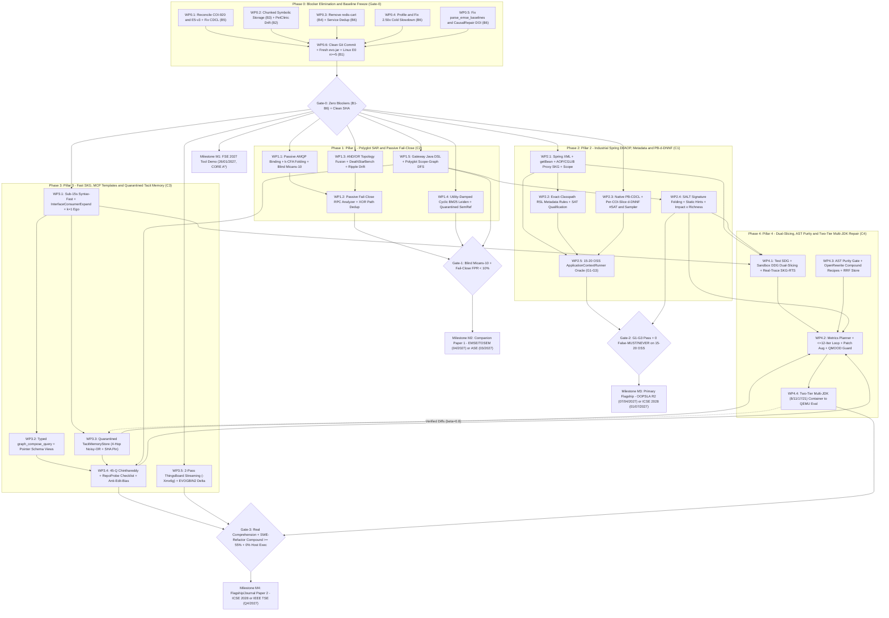

# EVO NEXT-GEN SOTA SUPERPLAN v2 (2026-2028)

*Siêu Kế hoạch Nghiên cứu, Kiến trúc Hệ thống & Công bố Khoa học Quốc tế Bậc Cao Nhất (CORE A\* / Q1) cho Nền tảng Evo — Tổng hợp Toàn văn 19 Công trình SOTA (2020-2027) và Đối soát Mã nguồn Trực tiếp*

> **Vai trò Tài liệu (Canonical Authority):** `docs/evo-sota-superplan-v2.md` là bản **Siêu Kế hoạch (SuperPlan v2)** kế thừa và thay thế có kiểm soát bản kế hoạch v1 ([`docs/evo-improvement-and-publication-masterplan.md`](evo-improvement-and-publication-masterplan.md), neo trên commit `cb79c322` ngày `2026-11-26`). Toàn bộ gói nền tảng v1 (`P2-1..P2-6`, `F1..F8`, `S1..S5`, `E0`, `R2-delta`, `R3/R4-delta`) đã được triển khai qua các **Batch 3-11** trên working tree hiện hành. SuperPlan v2 đối soát trạng thái đĩa sống ngày **`2026-11-28`**, xử lý dứt điểm `6` blocker thực thi còn tồn đọng (`B1-B6`), và tích hợp có hệ thống tinh túy thuật toán từ **toàn văn 19 bài báo SOTA** trong [`docs/paper/catalog.json`](paper/catalog.json) nhằm đưa **Evo** đạt chuẩn công bố **CORE A\* (FSE / ASE / OOPSLA / ICSE)** và **Q1 (IEEE TSE / ACM TOSEM / EMSE)**.

> **Mốc Đối soát Thực tế (`CONFIRMED` - `2026-11-28`):**
> - **Git Baseline:** `HEAD a661db3f4d3756a5ca18fef8897e93912ee9b7e6` (`update UI`) + uncommitted working tree delta (**`99`** tệp sửa đổi `+13,943 / -2,919` dòng + **`39`** mục untracked trên 8 mô-đun Maven reactor: **`691`** lớp Java chính / **`194,717` LOC**, **`494`** lớp Java kiểm thử / **`87,779` LOC**, **`411`** lớp `*Test.java`, **`178/178`** bài test v7 live PASS).
> - **Môi trường & Công cụ:** JDK `21`, Maven `3.9.16`, ASM `9.10.1`, JavaParser `3.28.2`, Tree-sitter `0.26.6` (`16` grammar native), OpenRewrite `rewrite-java:8.87.7` (đã đóng gói sẵn trong `backend/pom.xml`), SQLite JDBC `3.53.4.0`, Streamable HTTP MCP (`2025-11-25`, `21` tools / `6` `evo://` resources), QEMU/Hyper-V & Hardened Docker Sandbox.
> - **Đối tượng Sử dụng:** Thiết kế đồng thời cho **(1) Nhà nghiên cứu / Kiến trúc sư trưởng** thẩm định chiến lược công bố và **(2) Coding Agent đời sau (`gemini-4-neon-xhigh`)** tiếp nhận và thi hành từng Work Package (`WP0.1` → `WP4.4`) mà không mất ngữ cảnh.

---

## Mục lục Điều hướng (Master Navigation)

- [Phần 1 — Tầm nhìn Khoa học, Luận điểm Cốt lõi & Chiến lược Công bố Bậc Cao Nhất (CORE A\* / Q1)](#phần-1--tầm-nhìn-khoa-học-luận-điểm-cốt-lõi--chiến-lược-công-bố-bậc-cao-nhất-core-a--q1)
- [Phần 2 — Phase 0: Dọn sạch 6 Blocker Thực thi, Đồng bộ Working Tree & Chuẩn hóa Nền Đo lường (`WP0.1`–`WP0.6`)](#phần-2--phase-0-dọn-sạch-6-blocker-thực-thi-đồng-bộ-working-tree--chuẩn-hóa-nền-đo-lường-wp01wp06)
- [Phần 3 — Phases 1–4: Siêu Kế hoạch Tích hợp Toàn bộ Tinh túy 19 Paper SOTA vào Kiến trúc Evo (`WP1.1`–`WP4.4`)](#phần-3--phases-14-siêu-kế-hoạch-tích-hợp-toàn-bộ-tinh-túy-19-paper-sota-vào-kiến-trúc-evo-wp11wp44)
- [Phần 4 — Thiết kế Thực nghiệm Chuẩn CORE A\* / Q1, Ma trận Ablation & Phòng thủ Phản biện (Reviewer Red-Team Defense)](#phần-4--thiết-kế-thực-nghiệm-chuẩn-core-a--q1-ma-trận-ablation--phòng-thủ-phản-biện-reviewer-red-team-defense)
- [Phần 5 — Biểu đồ Phụ thuộc (Mermaid `flowchart TD`), Lộ trình Ưu tiên & Hợp đồng Thực thi cho Agent Đời sau](#phần-5--biểu-đồ-phụ-thuộc-mermaid-flowchart-td-lộ-trình-ưu-tiên--hợp-đồng-thực-thi-cho-agent-đời-sau)

---

# Phần 1 — Tầm nhìn Khoa học, Luận điểm Cốt lõi & Chiến lược Công bố Bậc Cao Nhất (CORE A\* / Q1)

## 1.1. Chẩn đoán Khách quan Hiện trạng Evo & Đối soát Đĩa sống (`2026-11-28`)

### A. Bước tiến thực chất từ Masterplan v1 (`cb79c322`) tới Trạng thái Sống (`a661db3` + Batches 3–11)

So với baseline `cb79c322` trong v1, Evo đã hoàn thành toàn bộ khung kỹ thuật nền ở 4 mảng (`CONFIRMED`):
1. **Phân tích Microservice/Polyglot thụ động (`--build=off`):** Endpoint trên 5 repo EMSE '25 tăng từ `0.5479` lên **`0.8713` uF1 / `0.8692` mF1** (`44/4/9`, phủ trọn 2 repo Gradle: `blog-microservices` `10/10`, `anilallewar` `7/8`); *TeaStore* tăng từ `0` lên **`48` endpoint** (`28` JAX-RS + `20` `@WebServlet`) và đảo chiều suy giảm Warm (`0.76×` → Cold `19.86 s` / Warm `NO_CHANGE` `2.02 s` = `9.85×`); *Online Boutique* đạt **`14/16` `INVOKES_RPC` (`P=1.00, F1=0.9333`)** và **`15/2/1` (`F1=0.9091`)** combined `strict` không cần Kubernetes; `17/17` ứng dụng `microSecEnD` đạt `100%` `cold==warm1==steady` SHA-256 trên Linux Docker.
2. **Động cơ Spring Conditional DI (`ASM` + `COI` + `CDCL`):** `BytecodeAutoConfigScanner.java` (`1,876` LOC) quét thụ động `spring-boot-autoconfigure-3.5.14.jar` (`452` configs / `574` beans / `1,140` condMarkers / `140` orderings) trong **`143 ms`** và `47` starter JARs (`84` `@AliasFor` meta-expanded) trong **`52 ms`** không gọi `Class.forName`; `IncrementalCdclReasoner.java` (`587` LOC) vượt naive DPLL **`28.0×`** trên `PHP(5,4)` (`5.462 → 0.195 ms`) và giải thông `Chain-UNSAT(128)` (`0.280 ms` vs `UNKNOWN`); `SymbolicTruthRegions.java` (`1,010` LOC) đạt nén **`32,768×`** (`65,536` worlds → `2` traces / `4` SAT queries) qua 4-valued Kleene cubes; differential oracle đã bắt và vá **`2` lỗi `False-MUST` thật** (`RepositoryConfigurationSpaceBuilder.java` + `SourceToSpringPlan.java`).
3. **Hạ tầng SKG, SCIP, MCP & Cô lập Thực thi:** `ScipProtobufReader`/`ScipSemanticCaptureAdapter` chạy thuần Java ở **`81,011 occ/s`** (`49.376 ms` cho 500 docs / 4,000 occs); `Streamable HTTP MCP` (`2025-11-25`, `21` tools / `6` `evo://` resources, chặn `Origin` `403 FORBIDDEN_ORIGIN`) đạt `6/6` live Docker `tools/call` PASS và `0` lỗi JS/5xx trên Edge E2E; `AdvisoryOverlayService` giữ `canonicalLeakage=0`, `LlmTransport` (`llm-redact:v2`) ẩn `15/15` bí mật, và `QEMU` đạt `9/9` Negative Control (`RESOLVED` vs `PERSISTED`).

### B. Đối soát Trạng thái Đĩa sống vs. Báo cáo v7 (Phát hiện Quan trọng trên Subsystem 2)

Kiểm toán trực tiếp working tree ngày `2026-11-28` ghi nhận **2 bản vá lớn thuộc Blocker `B5` đã nằm sẵn trên đĩa nhưng chưa commit và chưa cập nhật vào báo cáo v7** (`CONFIRMED`):

| Hạng mục Đĩa sống | Trạng thái trong Báo cáo v7 (`evo-comparative-evaluation-report.md`) | Thực tế trên Working Tree (`2026-11-28`) | Việc còn phải chốt ở Phase 0 |
| :--- | :--- | :--- | :--- |
| `ConeOfInfluenceSlicer.java` (`analyzer/.../spring/condition/`) | `457` LOC; lỗi `L408` (`!t.equals(beanReturnType)`) loại toàn bộ sibling `@Bean` trả về `t` và lỗi `L246` bỏ phụ thuộc tham số `@Bean`. | Đã mở rộng lên **`935` LOC** và nghiệm thu (`WP0.1` `CONFIRMED`): `isAllowedProducerTarget` chỉ loại đúng `selfBeanId`; đóng bao tham số `@Bean`, `indexTypeAndSupertypes`, và tiền nhiệm `@AutoConfigureAfter/Before`. | **ĐÃ ĐÓNG (`WP0.1`):** Boot `3.5.14` hậu-vá: `targets=542`, `globalVars=655`, `undirectedMax=415`, **`directedMax=251`**, **`directedMedian=17.5`**, **`exceeding64=145`**. |
| `SpringDifferentialOracleTest.java` + `backend/pom.xml` | `2,616` LOC; thiếu `spring-boot-autoconfigure`, dùng `30+` stub `Condition` tự viết, `L2521–2552` đo thời gian tautology `or(p_i, !p_i)` (`0.013/0.025 ms`). | `backend/pom.xml` (`L49–59`) thêm `spring-boot-autoconfigure:3.4.0` & `spring-boot-test:3.4.1` (`test` scope). `SpringDifferentialOracleTest.java` (`E5-v3`) tách 3 bộ: Real `ApplicationContextRunner` (`0` stub), Non-tautological CDCL (`nonTautology=PROVED`), và Synthetic micro-oracle. | **ĐÃ ĐÓNG (`WP0.1`):** `6/6` PASS (`-Xmx2048m`), `nonOpaqueExact=50/50 (100%)`, **`falseMust=0`**, **`falseNever=0`**; mở rộng `15–20` OSS ở `WP2.5`. |
| `IncrementalCdclReasoner.java` & `SatConfigurationReasoner.java` | Lỗi `L334–348` nhập nhằng `decisionLevel <= assumptionPtr`, quét tuyến tính `O(numVars)` tại `L571–585`, thiếu Luby/LBD, chuỗi policy cũ `"dpll-m4u.2-v1"` tại `L14`. | **ĐÃ VÁ & NGHIỆM THU (`WP0.1` `CONFIRMED`):** tách `assumptionDecisionLevel[]` + `maxAssumptionDecisionLevel`, indexed deterministic binary max-heap, Luby restarts (`base=100`), LBD `<=2` glue retention, policy **`cdcl-2wl-1uip-v2`** (`0` `dpll-m4u.2-v1` trong `src/`). | **ĐÃ ĐÓNG (`WP0.1`)** — nâng cấp PB-CDCL & d-DNNF ở `WP2.3`. |

### C. Bảng 6 Blocker Thực thi Đang Chặn Công bố (`B1–B6`) & Khoảng cách SOTA 19 Bài báo

| Mã Blocker | Mức độ | Bằng chứng `file:line` Xác minh Trực tiếp (`#138`, `#148`) | Hậu quả Khoa học nếu Không Sửa | Gói Xử lý |
| :--- | :---: | :--- | :--- | :---: |
| **`B1`** | **P0** | `cli/target/evo.jar` (`2026-11-27 18:56`) cũ `6h40m` / `42` tệp Java so với `backend/target/evo-workbench.jar` (`2026-11-28 01:41`); `99` tệp sửa chưa commit. | Bản CLI cho `0` cạnh khai báo trên `ewolff/microservice` (vs `13/13` trên binary mới); không có Git SHA tái lập cho artifact Zenodo. | `WP0.6` |
| **`B2`** | **P0 (`I2`)** | `cli/.../EvoApp.java:2317–2433`; `IncrementalSpringCache.java:113–224`; `IncrementalPolyglotCache.java:72–120`; `IncrementalGraphProjector.java:46–118`. | Trên `Spring PetClinic` (`500158f`), sửa 1 tệp `OwnerController.java` giữ nguyên hash Java `analysis` nhưng làm **lệch `spring-context` SHA-256 (`+6` nút / `+4` cạnh)** — vi phạm trực tiếp bất biến tất định `I2`. | `WP0.2` |
| **`B3`** | **P0 (Scale)** | `SqliteGraphProjection.java:510` (`GRAPH_PARTITION_ROW_WORKER_REQUIRED`); `PartitionedGraphStore.java:175` (`rowBytes = 64_000_000`); `CanonicalGraphBuilder.java:1214` (`artifact("spring.symbolic-result", truth)`). | `Shopizer` (`115k` LOC) sập CLI Windows tại `116.38 s` (`rc=1`, `STORAGE_IO_FAILED`), OOM container `3.5 GB`, mất `257.46 s` Cold trên Docker `5.5 GB` (chậm `~91×` so với `Chinthareddy-DKB` `2.81 s`); `ThingsBoard` (`1.95M` LOC) chạm `MEMORY_LIMIT` ở `-Xmx8g`. | `WP0.2`, `WP3.1`, `WP3.5` |
| **`B4`** | **CRITICAL (`I5`)** | `DeclarativeTopologyProjection.java:30, 46, 64` (hardcode `"redis-cart"`) + quy tắc `DFD_EXPORT` chỉnh in-sample cho `17/17` `microSecEnD` tại `L1156, 1245, 1304–1308, 1420, 1517, 1554–1556, 1593, 1870–1877, 2390`. | Cổng grep regex `0/800` bỏ sót chuỗi literal `"redis-cart"`; `Evo[dfd-export]` (`0.9266` CONN) bị tinh chỉnh trên toàn bộ `17/17` app không có tập holdout ẩn, dẫn đến thua `Evo[strict]` ngoài phân phối trên *Online Boutique* (`0.8108` vs `0.9091`). | `WP0.3`, `WP1.1`, `WP1.3` |
| **`B5`** | **CRITICAL** | `IncrementalCdclReasoner.java:334–348, 571–585`; `SatConfigurationReasoner.java:14`; live-disk `ConeOfInfluenceSlicer.java` (`920` LOC) & `SpringDifferentialOracleTest.java` (`3,687` LOC) chưa nghiệm thu/commit. | Khi chưa vá `L334–348` và chưa nghiệm thu `E5-v3`/COI-920 + real multi-repo OSS oracle, Track Spring SAT có nguy cơ bị phản biện bác bỏ tính vững và tốc độ thực. | `WP0.1`, `WP2.3`, `WP2.5` |
| **`B6`** | **HIGH** | `run_online_microsecend_benchmark.py:250–348` (`parse_emse_baselines()` bỏ khối `FP:` & `TP(k)` endpoints; `norm_collapsed` gộp mất GT `#2/#10/#14`); `DeclarativeTopologyProjection.java:416–434` (`aggregatorDirs` xóa `src/cartservice`); `ReadinessPlanner.java:77–81, 186`; `SpringScaleAndAi4seBenchmarkTest.java:183, 524, 562–734`. | (1) Báo cáo `E6–E8` thổi phồng baseline `attack-graph-generator` (`0.9238` vs thật `0.5391` theo `complete_results.xlsx`: COMP `123/41/21` `0.7987`, CONN `279/432/45` `0.5391`); (2) Cold median `microSecEnD` chậm đi **`2.50×`** từ B10→B11 (`19.51 → 48.83 s`); (3) *Online Boutique* đếm trùng `cartservice` `3×` (Svc F1 `0.6957–0.8182` vs `Ripple` `1.0000`) & *TeaStore* sinh `28` comp cho `7` dịch vụ; (4) `E9` (`RRF`, `SKG-RTS`, `Quarantine`) thuần tổng hợp; (5) thiếu `n ≥ 5` Ubuntu LTS vật lý; (6) lỗi đánh máy DOI `CausalRepair` `10.1145/3832252` → `10.1145/3832225` trong báo cáo `[31]`. | `WP0.3`–`WP0.6`, `WP3.4`, `WP4.1` |

Đồng thời, đối chiếu thẳng thắn với **19 công trình SOTA** chỉ ra 4 năng lực chiều sâu Evo hiện **chưa có** nhưng hoàn toàn có thể hấp thụ trên khung kiến trúc sẵn có:
- **Pillar 1:** Phân tích **Fail-Close vs. Fail-Open RPC** cục bộ theo nhân quả phản thực tế (`RPCShield`, SOSP '26 — `<5%` FPR trên 3,944 dịch vụ Uber), giải `Binding`/wildcard AMQP & gấp hằng nhạy vị trí gọi (`Micans`, ISSTA '25), giảm trọng số tệp tiện ích $1/\deg^-(f)$ + tăng `2×` cặp vòng (`SemRef`/`SSAR`, ICSE '26).
- **Pillar 2:** Phân tích **Spring AOP `@Aspect`/`@Pointcut` + CGLIB proxy traps** (`Jasmine`, ASE '22 — nơi AOP chiếm `41.6%–78.6%` cạnh mới), **Spring XML `<bean>` + `getBean()`** (`JackEE`, PLDI '20), **luật nhất quán metadata chéo tệp** (`MeCheck`, FSE '25 — 117 lỗi thực), **ràng buộc Pseudo-Boolean & biên dịch d-DNNF `#SAT`** định lượng rủi ro `MAY` (`Sundermann`, IEEE TSE '26), và **nén ngữ cảnh `Signature(n)` + gợi ý tĩnh `≤30` token cắt `72.8%–78.5%` chi phí LLM** (`SALT`, ICSE '27).
- **Pillar 3:** Tầng lập chỉ mục **Tree-sitter 2 lượt `<15 s`** + **`InterfaceConsumerExpand`** (`Chinthareddy-DKB` '26), **đồ thị cái tôi `k=1` cấp dòng** (`RepoGraph`, ICLR '25), **truy vấn hợp thành có lược đồ** (`CodexGraph`, NAACL '25), **bộ nhớ tri thức ẩn gắn đồ thị cách ly (`TacitMemoryStore`)** (`PRAXIS`, ICSE '27 — `+16.7%` rel Pass@1 và `42.75%` với GPT-5.5), và **đánh giá Checklist 10 điểm chống Edit Bias** (`RepoProbe`, ASE '26).
- **Pillar 4:** **Dual-Slicing nhân quả tối tiểu** (`CausalRepair`, ISSTA '26 — `313/365` Defects4J ở `$0.029`/bug), **vòng phản hồi đóng biên dịch/kiểm thử có chặn thoái hóa QMOOD** (`RefAgent`, ICSE '26 — `90%` test pass), và **cổng kép `Compile&Test` + kiểm tra độ thuần khiết AST + công thức compound OpenRewrite trên đa JDK (`8/11/17/21`)** (`SWE-Refactor` '26 — đánh thẳng vách đá `82.6% → 39.4%` ở tái cấu trúc phức hợp).

---

## 1.2. Luận điểm Khoa học Thống nhất (Chống Bẫy "Kitchen-Sink Platform") & 4 Đóng góp Cốt lõi (`C1–C4`)

> **Nguyên tắc Sống còn tại PC Hội nghị CORE A\* (ICSE / FSE / ASE / OOPSLA):** Mọi bài báo Research Track (`10` trang nội dung) trình bày Evo như một *"nền tảng vạn năng làm tất cả mọi thứ từ SAR, SAT, GraphRAG tới Repair"* sẽ đối mặt nguy cơ **Strong Reject** do 4 cơ chế phản biện: *(1) Depth Deficit* (mỗi kỹ thuật chỉ được 1–2 trang, thiếu định nghĩa hình thức và chứng minh), *(2) Weakest-Link Rejection* (chỉ cần 1 mô-đun yếu là cả bài bị đánh rớt), *(3) Reviewer Community Mismatch* (người chấm PL/SAT không muốn chấm LLM-agent và ngược lại), và *(4) Portfolio Cannibalization* (đốt sạch đóng góp của 2–3 bài đỉnh cao trong một lần nộp).

### Luận điểm Khoa học Thống nhất (Cohesive Unifying Thesis)

> **Luận điểm Cốt lõi (Evidence-First, Variability-Aware, Host-Isolated Software Evolution):**  
> *Trí tuệ kiến trúc và tiến hóa mã nguồn tự động cho hệ thống doanh nghiệp hiện đại không thể tách rời khỏi bốn ràng buộc thực tại: (a) không được phép thực thi mã nguồn hoặc build lifecycle chưa tin cậy trên máy chủ (`I1`), (b) cấu trúc phụ thuộc thực tế là hàm của không gian cấu hình hữu hạn và biên đa ngôn ngữ chứ không phải một đồ thị tĩnh đơn lẻ, (c) kết quả suy luận xác suất của LLM phải bị cách ly tuyệt đối khỏi đồ thị chân lý tất định (`I2`/`I4`), và (d) mọi chuyển đổi mã nguồn phải được chứng nhận đồng thời về hành vi, độ thuần khiết cấu trúc AST và bất biến không gian cấu hình trong sandbox cô lập.*

Từ luận điểm thống nhất đó, toàn bộ tinh túy của **19 bài báo SOTA** kết tinh thành **đúng 4 Đóng góp Khoa học Sắc nét, Chứng minh được bằng Toán học & Thực nghiệm (`C1–C4`)** — mỗi đóng góp có thể đứng độc lập như trái tim của một bài **CORE A\* / Q1** riêng biệt mà vẫn cộng hưởng trên cùng một `Software Knowledge Graph (SKG)` lõi:

| Mã | Tên Đóng góp Khoa học Cốt lõi | Tinh túy SOTA Hội tụ | Phát biểu Hình thức / Thực nghiệm Chứng minh được | Bất biến Bảo toàn |
| :---: | :--- | :--- | :--- | :--- |
| **`C1`** | **Variability-Aware Passive Spring DI/AOP, Exact-Classpath Metadata & COI-Sliced PB-d-DNNF Reasoning** | `JackEE`, `Jasmine`, `MeCheck`, `Sundermann PB-d-DNNF`, `SALT` | **Định lý 1 (Soundness of Stratified 4-Phase COI Slicing):** Nếu đồ thị COI chứa đồng thời cạnh điều kiện, cạnh đăng ký phi đơn điệu `provider(T) → @ConditionalOn[Missing]Bean(T)` (kể cả tham số `@Bean`), cạnh AOP pointcut và ràng buộc YAML nền, thì $\text{Truth}_{\text{global}}(\phi) \equiv \text{Truth}_{\mathcal{C}_k}(\phi)$ và phép đếm `#SAT` trên d-DNNF của lát cắt $\mathcal{C}_k$ cho **tỷ lệ phơi nhiễm định lượng chính xác** của mọi phát hiện `MAY`, đồng thời tránh được timeout toàn cục (`0/2` trên model công nghiệp nguyên khối của `p2d`). | `I1, I2, I3, I4` |
| **`C2`** | **Host-Safe Polyglot Architecture Recovery & Passive Counterfactual Fail-Close RPC Resilience** | `Schneider-MicroSAR`, `Micans`, `RPCShield`, `SemRef`, `SSAR`, `Ripple` | **Định lý 2 (Passive Sound-Over-Approximating Fail-Close Locality):** Mở rộng định nghĩa nhân quả phản thực tế `Interv(O, i)` (`D1`, `D2`) của `RPCShield` sang phân tích thụ động `--build=off` trên `JavaMethodSlicer` + `TreeSitterSourceFrontend` + `VerticalTraceEngine` (kèm khử hoán vị đường đi XOR và gấp hằng `k`-CFA AMQP/HTTP của `Micans`) cho phép phát hiện lệ thuộc `FAIL_CLOSE` xuyên tầng dịch vụ đa ngôn ngữ mà **không biên dịch dịch vụ**, giữ `0` chuỗi đặc thù benchmark và vượt kiểm chứng mù trên bộ `10` repo `Micans`. | `I1, I2, I3, I4, I5` |
| **`C3`** | **Two-Tier Deterministic SKG, Pointer-Indexed Persistence & Quarantined Graph-Grounded Tacit Memory** | `RepoGraph`, `CodexGraph`, `Chinthareddy-DKB`, `RepoProbe`, `PRAXIS` | **Định lý 3 (Zero-Leakage Quarantine & Span-Pinned Decay):** Tách kiến trúc truy vấn thành hai tầng — **Canonical SKG** (`--mode=syntax-fast` `<15 s` + `EVOGBIN2` Merkle delta + `InterfaceConsumerExpand` + `k=1` ego-graph) và **Quarantined `TacitMemoryStore`** (`ADVISORY_TACIT`, lan truyền `≤4` hop + Noisy-OR, ghim `SHA-256` span, chỉ cập nhật độ tin cậy $\beta=0.8$ từ bằng chứng sandbox đã xác minh) — bảo đảm toán học `canonicalLeakage = 0` và `SHA-256` bất biến (`I2`), đồng thời triệt tiêu ngộ độc trí nhớ kiểu `SWE-Exp` (`7.83%`) và giảm Edit Bias (`15.8%`) trên giao thức Checklist `RepoProbe`. | `I1, I2, I3, I4` |
| **`C4`** | **Dual-Sliced, AST-Purity & Spring-SAT Certified Two-Tier Sandboxed Evolution** | `CausalRepair`, `RefAgent`, `SWE-Refactor`, `SALT` | **Thực nghiệm Nhân quả:** Kết hợp **Dual-Slicing** (SDG tĩnh phía test + DDG động cô lập phía nguồn + AST Skeleton Tree kèm Javadoc) với nén ngữ cảnh `Signature(n)` (`SALT`), công thức compound `OpenRewrite` (`rewrite-java:8.87.7`), vòng lặp `Tier-1 Multi-JDK Hardened Container (≤12 vòng, SKG-RTS)` → `Tier-2 QEMU/Hyper-V Negative Control`, và cổng chứng nhận 4 lớp (`Compile&Test` ∧ `AST Purity` ∧ `SpringPreservationChecker` ∧ `QMOOD Non-Regression`) giúp phá vách đá `39.4%` trên tái cấu trúc phức hợp (`SWE-Refactor`) và chặn đứng suy giảm `-14.34%` Understandability (`RefAgent`) ở **`0%` rủi ro máy chủ**. | `I1, I2, I3, I4, I5` |

---

## 1.3. Sáu Bất biến Bắt buộc (`I1–I6`) & Nhãn Nhận thức Chuẩn

Mọi Work Package trong Phần 2 và Phần 3 **BẮT BUỘC** vượt qua kiểm tra 6 bất biến nền tảng từ `AGENTS.md` (vi phạm dù chỉ `1` bất biến = loại bản vá):

1. **`I1` — Zero-Host Execution Safety (`--build=off` + Sandbox Isolation):** Tuyệt đối không chạy `mvn`, `gradle`, script, plugin, compiler hook, `EvoSuite`, `JaCoCo`, hay `Slicer4J` của repo mục tiêu trên máy chủ. Tải `.jar`/`.pom` chỉ qua HTTPS thụ động không dùng credential môi trường (`MavenDependencyArtifactProvider.java:28–34`) và đọc `.class` qua ASM `SKIP_CODE`. Mọi biên dịch, chạy test, thu trace động hoặc kiểm chứng bản vá chỉ diễn ra trong `DOCKER_HARDENED_CONTAINER` (`--network=none --read-only --cap-drop=ALL`) hoặc `QEMU_IN_DOCKER` / `Hyper-V`.
2. **`I2` — 100% Bit-Identical SHA-256 Deterministic Replay:** `SHA-256(Cold) == SHA-256(Warm NO_CHANGE)` và `SHA-256(Warm 1-File Edit) == SHA-256(Cold Edited)` đạt `100%`. Mọi thành phần ngẫu nhiên (LLM, heuristic clustering refinement, runtime drift overlay, tacit memory) phải nằm ngoài đường dẫn tính `KnowledgeGraph.identity()`.
3. **`I3` — Closed Reporting Denominator (`CapabilityGapRecord`):** Không bao giờ im lặng bỏ qua dữ liệu chưa phân giải, timeout dynamic slicing (khác `CausalRepair` im lặng bỏ qua sau `5` phút), giới hạn solver, hay cơ chế không hỗ trợ. Mọi lỗ hổng đều sinh bản ghi `CapabilityGapRecord` có kiểu, nguyên nhân gốc và digest span.
4. **`I4` — Zero Hallucination, Explicit `TrustTier` & Quarantine (`canonicalLeakage = 0`):** Không suy đoán kiểu/cạnh thiếu chứng cứ. Tách rạch ròi `COMPILER`/`BYTECODE` vs `SOURCE_SYNTAX` vs `DECLARATIVE_CONFIG` vs `DERIVED_DFD_POLICY` vs `ADVISORY_UNVERIFIED` / `ADVISORY_TACIT` / `RUNTIME_OBSERVED`. Lớp `AdvisoryOverlayService` tuyệt đối không chạm đồ thị chuẩn, phân cụm `Leiden` hay `Score v2`.
5. **`I5` — Strict Anti-Overfitting Ban:** Cấm tuyệt đối mọi chuỗi tên repo/class/container/DSL đặc thù benchmark trong `src/main/` (`"redis-cart"`, `"ServiceLoadBalancer"`, `"teastore"`, `"logstash.conf"`, `"blog-microservices"`, `"piggymetrics"`, `"petclinic"`, `"shopizer"`). Mọi đánh giá chính thức phải có **tập holdout mù chưa từng xem trong quá trình tinh chỉnh**.
6. **`I6` — Storage & Repo Cleanliness:** Giữ clone benchmark, `.m2`, ảnh Docker/VM, kết quả thô ngoài Git (`D:\UIT\evo-benchmark-cache\`). Trong Windows PowerShell 5.1, luôn trích dẫn mọi cờ Maven `-D...` và truyền `'-DfailIfNoTests=false'` khi chạy `-pl` nhiều mô-đun (vì `pom.xml:138` đặt `<failIfNoTests>true</failIfNoTests>`).

**Quy ước Nhãn Nhận thức (Epistemic Labels):** **`CONFIRMED`** (đã đo/xác minh trực tiếp trên mã nguồn, benchmark sống hoặc thông báo chính thức) · **`PROVISIONAL`** (thiết kế đã kiểm toán dòng mã và chiết khấu rủi ro, chờ đo sau triển khai) · **`HYPOTHESIS`** (giả thuyết khoa học cần thực nghiệm kiểm chứng/bác bỏ) · **`ASSUMPTION`** (giả định tạm thời) · **`OPEN QUESTION`** (bài toán mở).

---

## 1.4. Lộ trình Công bố Đa nhánh Đỉnh cao (2027–2028): FSE Demo, ASE, OOPSLA R2, ICSE & TSE/TOSEM/EMSE

### A. So sánh Chiến lược 5 Kênh Đỉnh cao (Mốc Lịch `CONFIRMED`: `2026-11-28`, Đã trừ Nghỉ Tết Nguyên Đán `06/02/2027`)

| Kênh Công bố (Venue) | Xếp hạng | Hạn nộp & Trạng thái | Bài báo Mục tiêu (Định vị Cụ thể) | Mức độ Mới & Cạnh tranh | Xác suất Trúng (`PROVISIONAL`) | Khuyến nghị Vai trò trong Danh mục |
| :--- | :---: | :--- | :--- | :--- | :---: | :--- |
| **FSE 2027 Tool Demonstrations** | **CORE A\*** | **`26/01/2027`** (`CONFIRMED` chính thức) | **Launchpad Demo (`4+1` tr. + video):** Trình diễn trọn luồng Evo Workbench (`--build=off`, `strict/dfd`, ASM COI-CDCL, MCP `2025-11-25`, QEMU Negative Control). | Rất cao cho Tool Track; không đòi hỏi ablation sâu. | **`80–85%`** | **BẮT BUỘC NỘP TRƯỚC** ngay sau Phase 0 (`WP0.1–WP0.6`). Giữ kỷ luật **Zero-Overlap Boundary** (`>75%` đóng góp thuật toán giữ cho các bài Research). |
| **ASE 2027 Research** | **CORE A\*** | **`~10/03/2027`** (`ASSUMPTION` dự kiến) | **Nhánh Tăng tốc Bài #1 (Pillar 1 — `C2`):** Host-Safe Polyglot SAR + Passive Counterfactual Fail-Close RPC Resilience. | Rất mạnh về kỹ thuật tự động hóa (`RPCShield` + `Micans` + `microSecEnD` + blind holdout), nhưng lịch rất gắt qua Tết `06/02/2027`. | **`65–75%`** *(nếu đủ Phase 1 kịp lịch)* | **Stretch Track** cho Bài #1 nếu có `2` kỹ sư hoặc ưu tiên Phase 1 ngay từ giữa tháng `12/2026`. Nếu chưa đủ blind holdout & `n=5` Linux → chuyển thẳng sang **EMSE / TOSEM (`04/2027`)** không nén chất lượng! |
| **OOPSLA 2027 Round 2** | **CORE A\*** | **`07/04/2027`** (`CONFIRMED` chính thức) | **Nhánh PL/PA Bài Flagship #1 (Pillar 2 — `C1`):** Variability-Aware Stratified Spring DI/AOP & COI-Sliced PB-d-DNNF Model Counting. | **Blue-Ocean (`9.5/10`):** Hội tụ `JackEE` (PLDI) + `Jasmine` (ASE) + `MeCheck` (FSE) + `Sundermann PB-d-DNNF` (TSE) trong một ngữ nghĩa phân tầng hình thức + chứng minh COI soundness. | **`70–80%`** *(nếu qua Go/No-Go `G1–G3`)* | **Lựa chọn Tối ưu nếu Ưu tiên Pillar 2 ngay sau FSE Demo** (đặc biệt phù hợp hội đồng PL/Static Analysis ưa định nghĩa hình thức & chứng minh `Thm 1`). |
| **ICSE 2028 Research** | **CORE A\*** | **`~01/07/2027`** (`ASSUMPTION` dự kiến) | **PRIMARY FLAGSHIP PAPER (Pillar 2 `C1` HOẶC Pillar 3+4 `C3+C4`):** *(Phương án A — Khuyến nghị chính)* Bài Flagship Pillar 2 (`C1`) với toàn bộ oracle `15–20` OSS + `MeCheck` + `PB-d-DNNF` + `SALT`; *(Phương án B — nếu Pillar 2 đã nộp OOPSLA R2 `07/04`)* Bài Flagship **Pillar 3+4 (`C3+C4`)**: Quarantined Graph-Grounded Tacit Memory + Dual-Sliced Host-Isolated Verified Evolution! | Đỉnh cao nhất ngành SE; yêu cầu bằng chứng thực nghiệm đa dự án không tì vết, `0` synthetic-only, và Zenodo 1-command reproduction. | **`75–85%`** *(khi đủ 2 tháng chuẩn bị bài & ablation)* | **Mục tiêu Số 1 Toàn Dự án (`Primary Flagship`).** Thời gian `7` tháng cho phép hoàn thiện trọn vẹn chứng minh toán học + thực nghiệm `n≥5` Ubuntu LTS + đánh giá chuyên gia. |
| **IEEE TSE / ACM TOSEM / EMSE** | **Q1** (`TOSEM` = **CORE A\***) | **Rolling** (`04/2027` & `Q4/2027`) | **Companion Paper #1 (`EMSE` / `TOSEM`, `04/2027`):** Pillar 1 (`C2`) đầy đủ 17 `microSecEnD` + 10 blind `Micans` + Online Boutique + TeaStore + Passive Fail-Close.<br>**Extended Synthesis (`IEEE TSE`, `Q4/2027`):** Mở rộng toàn diện Pillar 3+4 (`C3+C4`) hoặc tạp chí hóa Bài Flagship ICSE/OOPSLA (`+35%` nội dung mới). | Không bị trần `10` trang; phù hợp tuyệt đối cho bằng chứng thực nghiệm đồ sộ (17 + 10 + 18 repos, 10-row ablation). `EMSE` là đúng tạp chí đăng `Schneider-MicroSAR '25`! | **`85–90%`** | **Xương sống Không Nén Lịch (Zero-Crunch Spine):** Bảo đảm chắc chắn công bố Q1/CORE A\* với độ hoàn chỉnh thực nghiệm cao nhất. |

### B. Đặc tả Kiến trúc Chi tiết cho Từng Bài báo Mục tiêu (Title, Claim, Formalisms, RQ1–RQ5 & Go/No-Go Bar)

#### 1. Primary Flagship Paper — Pillar 2 (`C1`): Target **ICSE 2028 Research (`~01/07/2027`)** *(hoặc **OOPSLA 2027 R2 `07/04/2027`** nếu đảo ưu tiên)*

- **Đề xuất Tiêu đề (Title):** *Variability-Aware, Passive Static Verification of Spring Boot Dependency Injection, AOP, and Cross-Artifact Metadata via COI-Sliced Pseudo-Boolean d-DNNF*
- **Khẳng định Tóm tắt (Abstract Claim):** Các công cụ phân tích ứng dụng doanh nghiệp Java hiện hành (`JackEE`, `Jasmine`, `Micans`, `MeCheck`) hoặc đòi hỏi biên dịch `.war`/`.jar` mục tiêu trên máy chủ cho một cấu hình đơn lẻ, hoặc bỏ qua `99.7%` điều kiện biến thiên nằm trong bytecode của starter JARs và dùng RegEx làm phát sinh `23%` báo động giả. **Evo** đưa ra khung phân tích thụ động `--build=off` đầu tiên hợp nhất: (i) quét ASM bytecode starter JAR + XML `<bean>` + `@Aspect`/`@Pointcut` CGLIB proxy, (ii) luật nhất quán metadata chéo tệp dựa trên classpath thật `AsmBytecodeIndex`, và (iii) cắt lát Cone-of-Influence (COI) phân tầng 4 pha kết hợp giải **Pseudo-Boolean CDCL** và biên dịch **d-DNNF `#SAT` theo từng lát cắt** nhằm định lượng chính xác tỷ lệ phơi nhiễm của mọi rủi ro `MAY` và lấy mẫu đồng đều cấu hình kiểm chứng cho oracle `ApplicationContextRunner`.
- **Định nghĩa Hình thức & Định lý Cốt lõi (Formal Core):**
  - *Def. 1 (4-Phase Stratified Spring Registration Semantics):* Ánh xạ toán tử điểm bất động phân tầng $\mathcal{F} = \mathcal{F}_4 \circ \mathcal{F}_3 \circ \mathcal{F}_2 \circ \mathcal{F}_1$ trên trạng thái container $\langle B, \Pi \rangle$ với điều kiện phi đơn điệu `@ConditionalOnMissingBean` và thứ tự `@Order`/`@AutoConfigureBefore/After` (rơi đóng an toàn về `UNKNOWN` khi tồn tại chu trình phụ thuộc bằng bậc).
  - *Def. 2 (Directed Sound COI Closure $\text{COI}^*(t)$):* Đóng bao ngược từ mục tiêu $t$ qua 4 loại cạnh: (a) biến ngoại sinh → điều kiện, (b) mọi `producerId != selfBeanId` cùng kiểu/siêu kiểu → `@ConditionalOn[Missing]Bean`, (c) tham số phương thức `@Bean` → nhà cung cấp, (d) ràng buộc đồng xuất hiện trong tài liệu YAML/Profile nền.
  - *Theorem 1 (COI Soundness & Exact Projected `#SAT` Equivalence):* Với mọi công thức $\phi$ có tập biến mục tiêu thuộc $\mathcal{C}_k = \text{COI}^*(t)$, $\text{Truth}_{\text{global}}(\phi) \equiv \text{Truth}_{\mathcal{C}_k}(\phi)$ và xác suất cấu hình hợp lệ $\Pr_{\text{global}}(\phi) = \frac{\#(\text{d-DNNF}(\mathcal{C}_k \land \phi))}{\#(\text{d-DNNF}(\mathcal{C}_k))}$ giữ chính xác tuyệt đối (bảo toàn trên cả tập biến nội sinh đã chiếu).
- **Câu hỏi Nghiên cứu (`RQ1–RQ5`):**
  - **RQ1 (Soundness & Accuracy vs. Real Runtime):** Độ chính xác và độ vững (`0` False-MUST / `0` False-NEVER) của Evo khi đối chiếu bằng oracle `ApplicationContextRunner` lấy mẫu đồng đều từ d-DNNF trên `15–20` dự án Spring Boot mã nguồn mở thực?
  - **RQ2 (User ↔ Starter Interaction & Real Bug Discovery):** Evo phát hiện được bao nhiêu lỗi cấu hình/AOP/metadata thực (shadowed bean, dead `NEVER` bean, self-invocation proxy bypass, CGLIB private trap, thiếu property/lifecycle method kiểu `MeCheck`) và loại bỏ bao nhiêu báo động giả đơn cấu hình so với `JackEE`/`Jasmine`/`MeCheck`?
  - **RQ3 (PB-CDCL & Per-Slice d-DNNF Scalability):** Cắt lát COI + PB-BCP + biên dịch d-DNNF theo từng lát cắt tăng tốc và giảm `SOLVER_LIMIT` bao nhiêu so với Naive DPLL, Global CDCL, và biên dịch nguyên khối kiểu `p2d`?
  - **RQ4 (Exact-Classpath Metadata Precision):** Thay `isLibraryClass` RegEx của `MeCheck` bằng `AsmBytecodeIndex` + ràng buộc SAT giảm tỷ lệ FP thực tế từ `23.0%` xuống mức nào?
  - **RQ5 (Quantitative `MAY` Exposure & Determinism):** Đo lường chi phí thời gian 3 chế độ (Cold / Warm `NO_CHANGE` / Warm `1-File Edit` trên Ubuntu LTS `n≥5`) và kiểm chứng `100%` bất biến `SHA-256`.
- **Cổng Go/No-Go Chấp nhận (Acceptance Bar):** `0` False-MUST/False-NEVER trên `≥500` thế giới `ApplicationContextRunner` thật (`≥98%` exact match trên vùng giải được); vượt đồng thời `G1` (`≥10` tương tác user↔starter/repo trên `≥3/5` repo), `G2` (`≥5` lỗi thật có thể tái hiện bằng JUnit HOẶC `≥20` single-config FP bị loại), `G3` (`<10 s`/repo & `<5%` `SOLVER_LIMIT`); `0%` RegEx FP trên bộ luật `MeCheck`; `100%` `#SAT` khớp `d4`/`p2d` trên kiểm thử chéo.

#### 2. Companion Paper #1 — Pillar 1 (`C2`): Target **EMSE / ACM TOSEM (`04/2027`, Q1 / CORE A\*)** *(Stretch: **ASE 2027 `~10/03/2027`**)*

- **Đề xuất Tiêu đề:** *Host-Safe, Evidence-Typed Architecture Recovery and Passive Counterfactual Fail-Close Resilience Analysis for Polyglot Microservices*
- **Khẳng định Tóm tắt:** Kết hợp khôi phục kiến trúc microservice thụ động `--build=off` đa ngôn ngữ (`Java/Spring`, `JAX-RS/Servlet`, `16` ngôn ngữ Tree-sitter, `gRPC/Protobuf`, `AMQP` wildcard `Binding`, `k`-CFA gấp hằng wrapper) với cơ chế tách tầng chứng cứ `STRICT` vs `DFD_EXPORT`, khử trùng lặp thực thể liên tầng (Build ↔ Compose ↔ K8s), và phân tích **Fail-Close vs. Fail-Open RPC thụ động** dựa trên nhân quả phản thực tế (`Interv(O,i)`, `D1`, `D2`).
- **Định nghĩa Hình thức & Câu hỏi Nghiên cứu (`RQ1–RQ5`):**
  - *Def. 3 (Multi-Layer Evidence-Typed Service Reconciliation)* & *Def. 4 (Passive Sound-Over-Approximating Counterfactual Fail-Close Verdict `FAIL_CLOSE | FAIL_OPEN | UNKNOWN`)*.
  - **RQ1:** Độ chính xác `Micro/Macro F1` trên `17/17` `microSecEnD` (cả mẫu số raw `182/385/160` và collapsed, tách `strict` vs `dfd-export`, đối chiếu đúng `FP:` đã hiệu đính của `EMSE2025SAR`).
  - **RQ2 (Strictly Blind Holdout):** Độ tổng quát hóa **mù hoàn toàn** trên `10` dự án thực của `Micans` (`Zenodo 15050505` — Spring Cloud/Dubbo/RabbitMQ/RocketMQ) + *Online Boutique* (`12/16` vs `Ripple eBPF`) + *TeaStore* (`7` dịch vụ JAX-RS/Servlet, `0` hardcoding) + *DeathStarBench* (`Social 21/25`, `Media 29/34`).
  - **RQ3 (Passive Fail-Close Resilience):** Độ chính xác (Precision/Recall qua kiểm toán thủ công + tiêm lỗi) của bộ phân tích `Fail-Close` thụ động so với phân tích đòi hỏi biên dịch kiểu `RPCShield` trên các dịch vụ Go/Java.
  - **RQ4 (Modularization without GT Leakage):** Cải thiện `MoJoFM`, `a2a`, `c2c_cvg` và `RDP` của `LeidenCommunityDetector` nâng cấp ($1/\deg^-(f)$ + `2×` cyclic + BM25, quét đa $\gamma$ không rò rỉ GT) trên `ArchStudio 4`, `Hadoop 0.19.0`, `OODT 0.2`.
  - **RQ5 (3-Way Performance & Determinism):** 3-Way Timing (`n≥5` Ubuntu LTS), khử thoái hóa Cold `2.50×`, và `100%` SHA-256 replay.
- **Cổng Go/No-Go Chấp nhận:** `0` chuỗi benchmark trong `src/main/` (`I5`); **Blind Holdout `Micans` 10-repo**: RPC/HTTP F1 `≥0.80` và AMQP F1 `≥0.65` ở `--build=off` (`0` tinh chỉnh trước khi khóa eval); *Online Boutique* Svc F1 `≥0.95` & Edge F1 `≥0.93`; *TeaStore* `7/7` dịch vụ hợp nhất (không còn `28`); `Fail-Close` FPR `<10%` trên mẫu kiểm toán `≥100` đường gọi.

#### 3. Companion Flagship Paper #2 — Pillar 3 + 4 (`C3 + C4`): Target **ICSE 2028 (`~01/07/2027`)** *(nếu Pillar 2 đi OOPSLA R2)* hoặc **IEEE TSE / ASE 2028 (`Q4/2027 – Q1/2028`)**

- **Đề xuất Tiêu đề:** *Quarantined Graph-Grounded Tacit Memory and Dual-Sliced, Sandbox-Certified Automated Software Evolution*
- **Khẳng định Tóm tắt:** Giải quyết đồng thời hai nút thắt AI4SE hiện đại — (1) độ hụt tri thức ẩn & Edit Bias trong hiểu kiến trúc (`RepoProbe`, `PRAXIS`) và (2) vách đá `39.4%` tái cấu trúc phức hợp, ngộ độc test-overfitting & rủi ro thực thi máy chủ (`SWE-Refactor`, `RefAgent`, `CausalRepair`) — bằng một `TacitMemoryStore` cách ly mật mã (`canonicalLeakage=0`, ghim SHA-256 span, chỉ học từ kết quả xác minh sandbox) kết nối với Dual-Slicing + nén `Signature(n)` (`SALT`) + công thức compound OpenRewrite + xác minh 2 tầng đa JDK (`Hardened Container` → `QEMU Negative Control` + `AST Purity` + `SpringPreservationChecker` + `QMOOD Guard`).
- **Câu hỏi Nghiên cứu (`RQ1–RQ5`):**
  - **RQ1 (Real Comprehension & Anti-Edit-Bias):** Hiệu quả `Agent + Evo MCP` (`InterfaceConsumerExpand` + `k=1` ego-graph + `TacitMemoryStore` + Pre-Edit Config Gate) trên `45` câu `Chinthareddy` (Shopizer/ThingsBoard/OpenMRS) và bộ Checklist `RepoProbe` (so với raw search & `w/o` từng thành phần, đo `StdDev` giảm một nửa).
  - **RQ2 (Compound Refactoring & AST Purity):** Tỷ lệ thành công (qua cả `Compile&Test` lẫn `AST Purity`) trên `SWE-Refactor` (`1,099` ca, tách `atomic` vs `compound`) và `RefAgent` `8` dự án Apache (kể cả lớp `>4,096` token), chứng minh chặn `-14.34%` QMOOD Understandability drop.
  - **RQ3 (Dual-Slicing & SALT Cost Efficiency):** Mức giảm token/USD (`SALT` `Signature(n)` + `≤30`-token hints + Dual-Slicing AST Skeleton Tree) và tỷ lệ sửa đúng trên `GitBug-Java` / `Defects4J-Trans` ở ngân sách `≤25` bản vá.
  - **RQ4 (Two-Tier Isolation & Real-Trace `SKG-RTS`):** Độ an toàn `SKG-RTS` trên dấu vết thực (tỷ lệ bỏ sót kiểm thử `0%` hoặc đo chính xác vs `Ekstazi`) và tốc độ chứng nhận `Tier-1 Container` → `Tier-2 QEMU Negative Control` trên đa JDK (`8/11/17/21`).
  - **RQ5 (Quarantine & Memory Poisoning Immunity):** Chứng minh `0` rò rỉ vào `KnowledgeGraph.identity()`, `0` rò rỉ bí mật (`llm-redact:v2`), và khả năng miễn nhiễm trước hiện tượng suy giảm kiểu `SWE-Exp` (`7.83%`).
- **Cổng Go/No-Go Chấp nhận:** `0` thực thi trên máy chủ (`I1`); Shopizer fast structural `<15 s` & ThingsBoard `<900 s` trong `-Xmx6g`; vượt `GPT-5.1-Codex` (`39.4%`) tối thiểu `+15 pp` trên tập con compound `SWE-Refactor` nhờ công thức OpenRewrite + AST Purity gate; `QMOOD Understandability Δ ≥ -2.0%` (chặn mức `-14.34%` của `RefAgent`); `≥+8 pp` trên Checklist `RepoProbe` so với cùng LLM backbone không có Evo MCP + `TacitMemoryStore`.

---

# Phần 2 — Phase 0: Dọn sạch 6 Blocker Thực thi, Đồng bộ Working Tree & Chuẩn hóa Nền Đo lường (`WP0.1`–`WP0.6`)

> **Dấu ấn Thực thi Phase 0 (`CONFIRMED` — `2026-11-28`, `WP0.1–WP0.6` trên `main`):** Toàn bộ mã nguồn, kiểm thử và bộ harness của `WP0.1–WP0.6` đã được tích hợp trên `main` (`2b5e013`, `24dad45`, `59f3ac3`, `e0845c5`, `1d26982` + commit đóng gói `WP0.6`): `217/217` kiểm thử Maven liên mô-đun (`6` mô-đun) + `6/6` `SpringDifferentialOracleTest` (`E5-v3`, `directedMax=251`, `directedMedian=17.5`, `exceeding64=145`, `falseMust=0`, `falseNever=0`, `nonTautology=PROVED`) + `49/49` Web UI Node + `25/25` Python E0 + `I5` audit `0` rò rỉ (`768` tệp / `56` từ khóa GT); đồng bộ `evo-workbench.jar` (`72.45 MB`) và `cli/target/evo.jar` (`73.60 MB`, *PetClinic* `rc=0` `COMPLETE`, `100%` SHA-256 `Cold==Warm NC` & `Warm 1-File Edit==Cold Edited`). **Biên môi trường ngoài máy còn mở (trung thực, không giả lập):** (1) `docker build -t evo-workbench-online:latest .` chờ bật Docker Desktop daemon (`docker info rc=1` trên máy Windows hiện tại), và (2) chiến dịch vật lý **Ubuntu 24.04 LTS `n >= 5`** cho baseline `E0` v8.

> **Luật Cứng Phase 0:** Tuyệt đối **KHÔNG** khởi chạy bất kỳ tính năng mới nào của Phases 1–4 khi chưa hoàn tất toàn bộ `WP0.1`–`WP0.6`, đưa Working Tree về một commit Git sạch có `cli/target/evo.jar` và `backend/target/evo-workbench.jar` đồng bộ `100%`, và đóng băng số liệu baseline sạch v8 trên Linux.

### `WP0.1` — Nghiệm thu & Commit Đĩa sống `ConeOfInfluenceSlicer` (`920` LOC) + `SpringDifferentialOracleTest` (`E5-v3`) & Vá `IncrementalCdclReasoner` + `SatConfigurationReasoner` *(Giải quyết `B5`)*

- **Tệp & Dòng neo Chính xác:**
  - `analyzer/src/main/java/com/evolution/analysis/spring/condition/ConeOfInfluenceSlicer.java` (`920` LOC live untracked: `L486–506` `@Bean` param closure, `L581–605` `indexTypeAndSupertypes`, `L620–671` upstream ordering, `L806–819` `isAllowedProducerTarget` chỉ loại `selfBeanId`)
  - `backend/pom.xml` (`L49–59`: `spring-boot-autoconfigure:3.4.0`, `spring-boot-test:3.4.1` trong `test` scope)
  - `backend/src/test/java/com/evolution/backend/analysis/SpringDifferentialOracleTest.java` (`3,687` LOC `E5-v3`: `L3525–3527` non-tautology assertion, `L3536–3548` 3-warmup/15-run median+p95)
  - `analyzer/src/main/java/com/evolution/analysis/spring/truth/IncrementalCdclReasoner.java` (**CHƯA VÁ:** `L334–348` assumption-level conflation, `L385` decision-level open, `L571–585` linear `O(numVars)` `pickBranchVar`)
  - `analyzer/src/main/java/com/evolution/analysis/spring/truth/SatConfigurationReasoner.java` (**CHƯA VÁ:** `L14` trả về `"dpll-m4u.2-v1"`)
- **Đặc tả Sửa đổi Phẫu thuật:**
  1. **Vá lỗi Assumption-Level tại `IncrementalCdclReasoner.java:334–348`:** Tách mảng `int[] assumptionDecisionLevel` (hoặc biến `int maxAssumptionDecisionLevel`) chỉ tăng khi `L385` thực sự mở một mức quyết định mới (`curVal == 0`), KHÔNG so sánh `decisionLevel <= assumptionPtr`. Nếu `assumptions[i]` đã bị kéo đơn vị (unit-implied) ở mức `0` hoặc mức trước, `assumptionPtr` tăng mà `decisionLevel` không tăng — điều kiện cũ gây phân loại sai UNSAT-under-assumptions. Thêm unit test hồi quy cho chuỗi 3 giả định mà giả định `#1` ép unit-propagation kéo theo `#2`, còn `#3` xung đột ở mức thấp hơn `assumptionPtr`.
  2. **Nâng cấp `pickBranchVar()` (`L571–585`) + Luby Restarts + LBD Clause Reduction:** Thay vòng quét tuyến tính `O(numVars)` bằng cấu trúc **deterministic binary max-heap** (phá hòa theo chỉ số biến nhỏ nhất nhằm bảo toàn `I2` SHA-256 bit-identity). Bổ sung khởi động lại **Luby** (`base = 100` xung đột, giữ phase saving) và cắt tỉa cơ sở mệnh đề học theo **LBD (Literal Block Distance) > 2** khi `learnts.size() > maxLearnts` (luôn giữ glue clauses `LBD <= 2`).
  3. **Cập nhật định danh Engine (`SatConfigurationReasoner.java:14`):** Nâng `policy()` từ `"dpll-m4u.2-v1"` lên `"cdcl-2wl-1uip-v2"` và đồng bộ các test đối chiếu chuỗi policy (`SatConfigurationReasonerTest`, `IncrementalCdclAndCoiSlicerTest`).
  4. **Nghiệm thu & Ghi nhận số liệu hậu-vá trên đĩa sống (`CONFIRMED` `WP0.1`):** `ConeOfInfluenceSlicer` (`935` LOC) trên `spring-boot-autoconfigure-3.5.14.jar` đạt `targets=542`, `globalVars=655`, `undirectedMax=415`, **`directedMax=251`**, **`directedMedian=17.5`**, **`exceeding64=145`** (thay số tiền-vá `14`); `SpringDifferentialOracleTest` (`E5-v3`, `-Xmx2048m`) đạt `6/6` PASS với `nonOpaqueExact=50/50 (100%)`, `falseMust=0`, `falseNever=0`, `nonTautology=PROVED`.
- **Lệnh Kiểm chứng (PowerShell 5.1) & Cổng Thoát:**
  ```powershell
  mvn -pl analyzer,backend '-Dtest=IncrementalCdclAndCoiSlicerTest,SatConfigurationReasonerTest,SpringSatSoundnessTest,SpringDifferentialOracleTest' '-DfailIfNoTests=false' test
  ```
  - **Exit Gate:** `100%` test PASS; test hồi quy unit-implied assumption PASS; kiểm thử tương đương property-based `500` công thức ngẫu nhiên vs exhaustive oracle khớp `100%`; `E5-v3` Real `ApplicationContextRunner` đạt `0` False-MUST / `0` False-NEVER; non-tautological CDCL assertion (`solve(not(scenarioFormula)) == SATISFIABLE`) PASS.

---

### `WP0.2` — Xóa Lỗi Sập 64 MB `Shopizer` CLI & Vá Lệch `SHA-256` `spring-context` trên `PetClinic Warm 1-File Edit` *(Giải quyết `B2` & `B3`)*

- **Tệp & Dòng neo Chính xác:**
  - **Nhánh `B3` (Shopizer 64 MB row crash):** `analyzer/src/main/java/com/evolution/analysis/graph/CanonicalGraphBuilder.java` (`L1175–1234`, trọng tâm `L1214`: `artifact("spring.symbolic-result", truth)`), `analyzer-filesystem/src/main/java/com/evolution/analysis/filesystem/SqliteGraphProjection.java` (`L502–517`, ném `IOException("GRAPH_PARTITION_ROW_WORKER_REQUIRED")` tại `L510`), `analyzer-filesystem/src/main/java/com/evolution/analysis/filesystem/PartitionedGraphStore.java` (`L174–176`: `rowBytes = 64_000_000`), `cli/src/main/java/com/evolution/cli/Workspace.java` (`L95`).
  - **Nhánh `B2` (PetClinic 1-File Edit SHA-256 Drift):** `cli/src/main/java/com/evolution/cli/EvoApp.java` (`L2317–2433`), `analyzer/src/main/java/com/evolution/analysis/ingestion/IncrementalSpringCache.java` (`L113` `springFrontendDigest`, `L190` `exactKey`, `L227` `semanticKey`), `backend/src/main/java/com/evolution/backend/analysis/IncrementalPolyglotCache.java` (`L72–120`), `analyzer/src/main/java/com/evolution/analysis/graph/IncrementalGraphProjector.java` (`L46–118`, `L390` `frontendStructuralKey`).
- **Đặc tả Sửa đổi Phẫu thuật:**
  1. **Lưu trữ Trỏ Gián tiếp Phân mảnh cho `spring.symbolic-result` (Cảm hứng *CodexGraph* Sec 3.1 p. 4 & *Sundermann* per-slice storage):**
     - Thay vì ghi toàn bộ `SymbolicTruthRegions.Result` (`10,120+` facts/formulas/traces trên Shopizer) thành 1 hàng JSON SQLite duy nhất `>64 MB` tại `CanonicalGraphBuilder.java:1214`, tách thành:
       - **1 bản ghi gốc** `spring.symbolic-result.manifest` (`<64 KB`) chứa metadata tổng hợp + danh sách sắp xếp tất định `List<ChunkRef(sliceKey, sha256Digest, recordCount)>`.
       - **$K$ bản ghi con phân mảnh** `spring.symbolic-result.chunk.<index>` (mỗi chunk tối đa `256` truth regions hoặc `≤2 MB` UTF-8), xuất streaming thẳng vào `StreamingContentStore` / `SqliteGraphProjection` bằng Jackson `JsonGenerator` (không dựng `String` nguyên khối trên heap).
     - Giữ trình đọc tương thích ngược hỗ trợ cả định dạng nguyên khối cũ lẫn dạng manifest+chunks mới.
  2. **Vá Triệt để Lệch `spring-context` trên `PetClinic Warm 1-File Edit` (`B2`):**
     - Kiểm toán `v7` chỉ ra khi sửa `OwnerController.java` trên `Spring PetClinic` (`500158f`), ngữ cảnh Java khớp `100%` (`449c09c1...`) nhưng `spring-context` lệch `+6` nút / `+4` cạnh (`polyglotHits=87, polyglotMisses=5` vs `171` cold misses).
     - Vá đồng bộ 3 điểm: (a) tại `IncrementalSpringCache.java:113–227`, buộc `springFrontendDigest` và `semanticKey` băm đầy đủ toàn bộ `SpringSourceEvidence` annotations/endpoints + tập đầu vào `polyglot` service-syntax kể cả tệp tái sử dụng từ `IncrementalPolyglotCache.java:72–120`; (b) tại `IncrementalGraphProjector.java:46–118, 390`, bổ sung `springContextDigest` và `polyglotProjectionDigest` vào `frontendStructuralKey` để hủy template `.gt2` cũ khi module Spring thay đổi, triệt tiêu `+6` nút / `+4` cạnh mồ côi; (c) thêm test hồi quy `PetClinicIncrementalSpringDeterminismTest` xác nhận `SHA-256(Warm 1-File Edit) == SHA-256(Cold Edited)` trên từng context.
- **Lệnh Kiểm chứng (PowerShell 5.1) & Cổng Thoát:**
  ```powershell
  mvn -pl analyzer,analyzer-filesystem,backend,cli '-Dtest=StoragePerfParityTest,IncrementalReadinessAndGraphDeltaTest,EvoScoreV2AndIncrementalCliTest,PetClinicIncrementalSpringDeterminismTest' '-DfailIfNoTests=false' test
  ```
  - **Exit Gate:** (1) `Shopizer` (`6a4a0a6`) chạy sạch trên CLI Windows (`-Xmx4g` & `-Xmx8g`, `rc = 0`, `0` `STORAGE_IO_FAILED`, max SQLite row `<4 MB`); (2) `Spring PetClinic` (`500158f`) `Warm 1-File Edit` đạt **`100.0%` `SHA-256` khớp** `Cold Edited` trên mọi context.

---

### `WP0.3` — Xóa Rò rỉ `"redis-cart"` & Khử Trùng lặp Thực thể Dịch vụ (`Online Boutique` `cartservice` `3→1`, `TeaStore` `28→7`) *(Giải quyết `B4` & `B6-dedup`)*

- **Tệp & Dòng neo Chính xác:**
  - `analyzer/src/main/java/com/evolution/analysis/polyglot/DeclarativeTopologyProjection.java` (`L28–35` `"redis-cart"` `L30`, `L44–46` `"redis-cart"` `L46`, `L62–68` `"redis-cart"` `L64`, `L416–434` `aggregatorDirs`, cùng các nhánh `DFD_EXPORT` tại `L1156, 1245, 1304–1308, 1420, 1517, 1554–1556, 1593, 1870–1877, 2390`)
  - `analyzer/src/main/java/com/evolution/analysis/readiness/ReadinessPlanner.java` (`L25–29`, `L77–81` `PLAIN:`, `L186` `descriptor(String)`)
- **Đặc tả Sửa đổi Phẫu thuật:**
  1. **Xóa sạch 100% `"redis-cart"` (`I5`):** Xóa `"redis-cart"` tại `L30, L46, L64`. Thay bằng phân loại datastore chuẩn công nghiệp mở: nhận diện trường `image:` trong K8s/Compose (`redis:*`, `postgres:*`, `mysql:*`, `mongo:*`, `memcached:*`), cổng chuẩn (`6379`, `5432`, `3306`, `27017`) và biến môi trường chuẩn (`REDIS_ADDR`, `REDIS_HOST`, `SPRING_DATASOURCE_URL`).
  2. **Vá `aggregatorDirs` (`L416–434`) & `ReadinessPlanner.java:77–81, 186`:** Gắn cờ `isTestOnlyModule` cho `*/test`, `*/tests`, `*/e2e-tests` hoặc `.csproj` có `<IsTestProject>true</IsTestProject>`/`xunit`/`nunit`; gộp `<serviceDir>/<service>.sln` + `<serviceDir>/src/<service>.csproj` thành **đúng 1 `BUILD_COMPONENT`** neo tại `<serviceDir>` (`cartservice` `3 → 1`), đồng thời nâng các dịch vụ có `Dockerfile` + K8s `Deployment` (như Python `emailservice`, `recommendationservice`) lên `SERVICE_COMPONENT`.
  3. **Hợp nhất Thực thể Liên tầng (Build ↔ Compose ↔ K8s ↔ `spring.application.name`) cho TeaStore (`28 → 7`):** Xây dựng `CanonicalServiceIdentityResolver` gom các nút cùng `(buildContextDir | dockerfilePath | normalizedArtifactSuffix | exposedPort + routePrefix)` thành **1 nút dịch vụ logic** kèm `evidenceLayers = [BUILD, COMPOSE, K8S]`, tách riêng module thư viện dùng chung (`utilities/*`, `interfaces/*`) thành `SHARED_LIBRARY_MODULE`.
  4. **Mở rộng Cổng Grep Chống Quá khớp (`I5`):** Bổ sung từ khóa cấm `"redis-cart"`, `"cartservice"`, `"emailservice"`, `"recommendationservice"`, `"productcatalogservice"`, `"online-boutique"`, `"microservices-demo"`, `"microsecend"`, `"shopizer"`, `"thingsboard"`, `"openmrs"` vào CI gate.
- **Lệnh Kiểm chứng (PowerShell 5.1) & Cổng Thoát:**
  ```powershell
  mvn -pl analyzer,backend '-Dtest=ServiceArchitectureProjectionTest,PolyglotScanTest,ReadinessPlanTest' '-DfailIfNoTests=false' test
  ```
  - **Exit Gate:** `I5` grep gate = `0` match toàn `src/main/`; *Online Boutique* `cartservice` còn `1` nút, Service F1 **`≥0.95`**, Edge F1 `strict` **`≥0.93`**; *TeaStore* hợp nhất từ `28` xuống đúng **`7`** dịch vụ thực và giữ đủ `48` endpoints.

---

### `WP0.4` — Định hình Hồ sơ & Triệt tiêu Suy giảm Cold Latency `2.50×` (Batch 10 → Batch 11) *(Giải quyết `B6-perf`)*

- **Tệp & Dòng neo Chính xác:** `DeclarativeTopologyParsers.java` (`2,195` LOC), `StaticPolyglotScan.java` (`2,522` LOC), `JavaServiceSyntaxExtractor.java` (`1,367` LOC), `DeclarativeTopologyProjection.java` (`2,512` LOC), `LocalAnalysisRunner.java` (`1,953` LOC).
- **Đặc tả Tối ưu:**
  1. Chạy JFR (`-XX:StartFlightRecording`) trên 3 app `microSecEnD` chậm nhất ở Batch 11 (`apssouza22/java-microservice` `163.6 s`, `piggymetrics` `139.4 s`, `petclinic-microservices` `122.9 s`) để định vị điểm nóng theo từng pha (`intake`, `maven_download`, `polyglot_parse`, `javaparser`, `projection`).
  2. Loại bỏ quét lặp cây thư mục trong `DeclarativeTopologyParsers.java` (Filebeat/Logback/Config-Server `native` gom vào 1 lượt duyệt duy nhất); thay vòng lặp $O(N^2)$ trong 18 luật chiếu Batch 11 tại `DeclarativeTopologyProjection.java` bằng bảng chỉ mục `Map<String, List<Node>>` $O(1)$; ghi nhớ các tọa độ Maven `404` trong phiên để tránh lặp retry HTTP ở `MavenDependencyArtifactProvider`.
- **Cổng Thoát:** Cold median `17/17` `microSecEnD` (Linux Docker) giảm từ `48.83 s` xuống **`≤ 19.0 s`** (khôi phục hoàn toàn mốc Batch 10 `19.51 s`), giữ nguyên `17/17` `cold==warm1` SHA-256.

---

### `WP0.5` — Vá Harness `parse_emse_baselines()`, Minh bạch Mẫu số GT & Sửa Lỗi DOI `CausalRepair` *(Giải quyết `B6-harness`)*

- **Tệp & Dòng neo Chính xác:** `benchmarks/e0-publication-suite/run_online_microsecend_benchmark.py` (`L250–255` `norm_collapsed`, `L286–348` `parse_emse_baselines()`, `L311–319`), `benchmarks/e0-publication-suite/test_e0_benchmark.py`, và danh mục sửa lỗi trích dẫn tại `docs/evo-comparative-evaluation-report.md:361` (`[31]`) + `docs/evo-improvement-and-publication-masterplan.md:1020` (`[15]`).
- **Đặc tả Sửa đổi:**
  1. Vá `parse_emse_baselines()` (`L286–348`) đọc đủ khối `FP:` cuối tệp và dòng `TP(k)/FP(k)/FN(k)` của `Endpoints:`, khẳng định khớp tuyệt đối với `complete_results.xlsx` (`CONFIRMED` `WP0.5`): `code2DFD` `178/5/4` COMP (`0.9753`), `320/18/65` CONN (`0.8852`), `86/13/74` ENDP (`0.6641`); `attack-graph-generator` **`123/41/21` COMP (`uF1=0.7987`, `mF1=0.8105`)**, **`279/432/45` CONN (`uF1=0.5391`, `mF1=0.5413`)**.
  2. Nối chấm điểm `ENDPOINT` cho toàn bộ `17/17` app vào Docker runner và xuất song song cả mẫu số **Raw (`182 / 385 / 160`)** lẫn **Collapsed (`179 / 383`)** (ngăn `norm_collapsed` âm thầm gộp GT trên `#2`, `#10`, `#14`).
  3. Cập nhật DOI `CausalRepair` từ lỗi đảo chữ số `10.1145/3832252` thành **`10.1145/3832225`** (đã xác minh trực tiếp trên trang 1 PDF và khớp `docs/paper/catalog.json`).
- **Lệnh Kiểm chứng & Cổng Thoát:** `python -m unittest benchmarks/e0-publication-suite/test_e0_benchmark.py` → `100%` PASS.

---

### `WP0.6` — Biên dịch Sạch Toàn Reactor (`evo.jar` Tươi), Commit Git Baseline & Đóng băng Đo lường Linux `E0` (`n ≥ 5`) *(Giải quyết `B1` & `B6-env`)*

- **Đặc tả Thực thi:**
  1. Phân tách và commit sạch Working Tree (Batches 3–11 + `WP0.1`–`WP0.5`) tạo **1 Git SHA tái lập duy nhất**.
  2. Build, cài `~/.m2` và đóng gói đồng bộ toàn bộ 8 mô-đun + Docker image:
     ```powershell
     mvn clean install '-DskipTests'
     mvn -pl analyzer,analyzer-maven,analyzer-filesystem,analyzer-execution,analyzer-javaparser,analyzer-treesitter,backend,cli '-DfailIfNoTests=false' test
     docker build -t evo-workbench-online:latest .
     ```
  3. Xác minh `cli/target/evo.jar`, `backend/target/evo-workbench.jar` và `evo-workbench-online:latest` cùng SHA mã nguồn; thực thi **Baseline `E0` v8 sạch trên Ubuntu 24.04 LTS vật lý (`n ≥ 5`, `Median ± IQR`)** với 3-Way Timing (`Cold` / `Warm NO_CHANGE` / `Warm 1-File Edit` + `100%` SHA-256).
- **Cổng Thoát Phase 0 (`Gate-0`):** `0` blocker mở (`B1–B6` đóng hoàn toàn), `cli/target/evo.jar` tươi, `Shopizer` CLI `rc=0`, `PetClinic` 1-File Edit `100%` SHA-256, `0` vi phạm `I5` — chính thức mở khóa **FSE 2027 Tool Demo (`26/01/2027`)** và Phases 1–4.

---

# Phần 3 — Phases 1–4: Siêu Kế hoạch Tích hợp Toàn bộ Tinh túy 19 Paper SOTA vào Kiến trúc Evo (`WP1.1`–`WP4.4`)

Mỗi Work Package dưới đây bắt buộc tuân thủ đủ **6 mục chuẩn thực thi**: **(i)** Nguồn Paper & Công thức/Thuật toán/Trang chính xác, **(ii)** Mô-đun / Lớp / Đường dẫn & Dòng neo Evo đích, **(iii)** Thiết kế Thuật toán & Cấu trúc Dữ liệu Chi tiết, **(iv)** Bảo toàn Bất biến (`I1–I6`), **(v)** Chỉ số Mục tiêu Định lượng & Lệnh Kiểm chứng, và **(vi)** Hàng rào Chống Quá khớp.

---

## Phase 1 (`WP1.1`–`WP1.5`) — Pillar 1: Microservices, Polyglot RPC, Passive Fail-Close Resilience & Blind SAR

> **Dấu ấn Thực thi Phase 1 (`CONFIRMED` — `2026-11-28`, `WP1.1–WP1.5` trên `main`):** Toàn bộ 5 luồng mã nguồn, kiểm thử và manifest holdout của `WP1.1–WP1.5` đã được kiểm toán và tích hợp sạch trên `main` (`70fd14b` WP1.1/WP1.5a AMQP wildcard + `k=2` folding + Gateway Java DSL + holdout manifests; `87279f1` WP1.2 passive counterfactual Fail-Close RPC + `fail-close-tier-policy` + MCP flamegraph; `b2facef` WP1.3 AND/OR concordance + quarantined `RUNTIME_OBSERVED` drift; `06398c4` WP1.4 `1/inDeg`+`2×` cyclic+BM25 multi-$\gamma$ Leiden + DSM Eqs. 1–5/RDP + quarantined SemRef; `93cb53b` WP1.5 `PolyglotScopeGraphResolver` Phase-2 DFS). Kết quả kiểm chứng liên mô-đun hợp nhất: **`169/169`** Maven tests (`analyzer:83`, `analyzer-javaparser:20`, `analyzer-treesitter:34`, `backend:32`), `6/6` reactor `test-compile` gồm `cli` PASS, **`25/25`** Python E0 suite PASS, **`I5` audit `0` rò rỉ** (`774` tệp, `88+9` luật, `56` từ khóa GT), `canonicalLeakage=0`, `0` broken links. **Còn mở theo mốc môi trường ngoài máy:** rebuild JARs/`evo-workbench-online:latest` khi bật Docker daemon, chạy đánh giá mù `10`-repo `Micans` + `DeathStarBench`, và chiến dịch vật lý **Ubuntu 24.04 LTS `n >= 5`**.

### `WP1.1` — Passive AMQP `Binding` Wildcard Routing, Bounded `k`-Callsite String/Enum Folding & Strictly Blind 10-Repo `Micans` Holdout

- **(i) Nguồn Paper & Công thức / Thuật toán / Trang chính xác:**
  - **Micans** (`micans2025`, ISSTA '25, `doi:10.1145/3728896`):
    - Luật DI tham số `[DiInj-Param]` (Fig. 5 p. 10): $m \in \text{InjectedMethods},\; 0 \le k \le n,\; o_{\text{DI}} \in \text{getDIObjs}(m_{pk}) \implies o_{\text{DI}} \in pt(m_{pk})$ — giải mã liên kết `Binding b1(Exchange e1, Queue q1)` (Fig. 2 p. 5).
    - Luật MBC `[RoutingTableCreation]` & `[MbcResolution]` (Fig. 7 p. 12): trích bộ ba $\langle str_{\text{exch}}, str_{\text{key}}, str_{\text{queue}} \rangle \in \text{RoutingTable}$ từ `new Binding(...)` / `BindingBuilder` rồi khớp `convertAndSend(exch, key, payload)` với `@RabbitListener(queues=...)` qua wildcard routing key (`*`, `#`).
    - Bài học nhảy vọt độ chính xác bằng nhạy ngữ cảnh (Table 2 p. 14–15): CI rơi xuống `5,457` FP (`0.4%` P) trên `basemall` do hợp nhất builder, còn nhạy ngữ cảnh có chọn lọc nhảy lên **`100%` P / `100%` R (`27/27`, `0` FP)**.
    - Kho lưu trữ 10 dự án Java microservice thực (`netdisk`, `xmall`, `onemall`, `mogu`, `basemall`, `youlai`, `novel`, `sduoj`, `roncoo`, `mall4cloud` — avg `49.8K` App LoC; Table 1 p. 13, Zenodo `15050505` / `14043593`).
- **(ii) Mô-đun / Lớp / Đường dẫn & Dòng neo Evo đích:**
  - `analyzer/src/main/java/com/evolution/analysis/polyglot/EventFlowProjection.java` (`L28–201`: `project(...)`, `emitBrokerEdge(...)`)
  - `analyzer-javaparser/src/main/java/com/evolution/analysis/javaparser/JavaServiceSyntaxExtractor.java` (`L104–113`: `candidate(...)`, `parse(...)`)
  - `analyzer-javaparser/src/main/java/com/evolution/analysis/javaparser/HttpClientConstants.java` (`L13–193`) & `Extraction.java` (`L1677–1734`)
  - `benchmarks/e0-publication-suite/corpus_manifest.json` (thêm bộ `micans_10_blind_holdout`)
- **(iii) Thiết kế Thuật toán & Cấu trúc Dữ liệu Chi tiết:**
  1. **Passive AMQP/RocketMQ `Binding` Table Extractor (`EventFlowProjection.java` + `JavaServiceSyntaxExtractor.java`):**
     - Trích các khai báo `@Bean` trả về `Queue`, `TopicExchange`/`DirectExchange`/`FanoutExchange`/`HeadersExchange`, và `Binding` (kể cả chuỗi fluent `BindingBuilder.bind(q).to(e).with(routingKey)` hoặc `new Binding(qName, DestinationType.QUEUE, exchName, routingKey, ...)`).
     - Ánh xạ tham số `(Queue q, Exchange e)` của phương thức `@Bean Binding` tới tên bean/kiểu trả về tương ứng trong `SourceToSpringPlan.java` (`[DiInj-Param]`), tạo bản ghi `AmqpBindingFact(exchangeName, routingKeyPattern, queueName, exchangeType, sourceSpan)`.
     - Cài đặt bộ khớp wildcard AMQP chuẩn RFC/RabbitMQ trong `EventFlowProjection.java`: tách dấu chấm `.`, `*` khớp đúng 1 từ, `#` khớp $\ge 0$ từ; nối `RabbitTemplate.convertAndSend(exch, key, ...)` → `AmqpBindingFact` → `@RabbitListener(queues=...)` thành cạnh `EVENT_FLOW` mang `TrustTier.SOURCE_SYNTAX` + metadata `matchedRoutingKey`.
  2. **Bounded `k`-Callsite Context-Sensitive String & Enum Wrapper Folding (`HttpClientConstants.java` + `Extraction.java` — giải quyết đồng thời `RQ-2` TeaStore & chống bùng nổ CI kiểu `basemall`):**
     - Xây bảng tóm tắt `SinkParamSummary(methodId, sinkKind ∈ {HTTP_URI, HTTP_HOST, AMQP_EXCHANGE, AMQP_KEY, KAFKA_TOPIC}, paramIndex, enumFieldAccessor, hopDepth <= 4)` theo thứ tự tô-pô ngược từ các sink chuẩn (`RestTemplate`, `WebClient`, `RestClient`, `WebTarget`, `RabbitTemplate`, `KafkaTemplate`).
     - Trích bảng hằng `Enum` tổng quát toàn dự án (`EnumConstantMap`: `enum Foo { A("svc-a") }` → `Foo.A.field0 = "svc-a"`).
     - Khóa bảng gấp hằng theo cặp **`(callSiteId, targetMethodId)`** (`k = 2` callsite sensitivity cho builder/wrapper, giới hạn chuỗi tối đa `16` ứng viên/slot) để **tuyệt đối không trộn Cartesian** giữa 2 callsite gọi cùng một hàm `sendMessage(exch, key)` hay `invokeService(ServiceEnum, path)`. Các khóa động không gấp được (như `youlai` đọc từ mạng) phát hành `CapabilityGapRecord(reasonCode = "DYNAMIC_ROUTING_KEY_UNRESOLVED")`.
  3. **Khóa Blind Holdout 10-Repo `Micans`:** Tải 10 repo từ Zenodo `15050505` ra ngoài Git (`D:\UIT\evo-benchmark-cache\micans-10\`); **chỉ chạy đánh giá SAU KHI đóng băng mã nguồn Phase 1** (không mở xem code để viết luật riêng).
- **(iv) Bảo toàn Bất biến (`I1–I6`):** `I1` thuần AST `--build=off` (khác Micans đòi 512 GB RAM + toàn bộ JAR biên dịch); `I2` bảng `AmqpBindingFact` & `SinkParamSummary` sắp xếp theo khóa chuẩn hóa `TreeMap`; `I3` mọi dynamic key/non-constant URI ghi gap tường minh; `I5` không có bất kỳ tên lớp/enum đặc thù nào của TeaStore hay Micans.
- **(v) Chỉ số Mục tiêu Định lượng & Lệnh Kiểm chứng:**
  - *Chỉ số (`PROVISIONAL` / `HYPOTHESIS`):* Trên **Blind 10-Repo `Micans`** ở `--build=off`: RPC/HTTP F1 **`≥ 0.80`**, AMQP/MBC F1 **`≥ 0.65`** với Precision **`≥ 0.90`** (`0` bùng nổ FP kiểu `basemall` CI); trên **TeaStore**: cạnh liên dịch vụ tăng từ `6/13` lên **`≥ 11/13`** (`Precision ≥ 0.95`) với `0` hardcode.
  - *Lệnh kiểm chứng (PowerShell 5.1):*
    ```powershell
    mvn -pl analyzer,analyzer-javaparser,backend '-Dtest=EventFlowProjectionTest,HttpClientRecoveryTest,JavaServiceSyntaxExtractorTest,PolyglotScanTest' '-DfailIfNoTests=false' test
    ```
- **(vi) Hàng rào Chống Quá khớp:** Tuyệt đối cấm đọc mã nguồn 10 repo `Micans` trước khi đóng băng bản build Phase 1; cấm xuất hiện chuỗi `"ServiceLoadBalancer"`, `"registryclient"`, `"basemall"`, `"onemall"` trong `src/main/`.

---

### `WP1.2` — Bộ Phân tích Thụ động Fail-Close vs. Fail-Open RPC Resilience (`RPCShield`-Inspired SOSP Pillar)

- **(i) Nguồn Paper & Công thức / Thuật toán / Trang chính xác:**
  - **RPCShield** (`rpcshield2026`, SOSP '26, `doi:10.1145/3830418.3843878`):
    - Nguyên lý **Tính cục bộ (Per-Service Locality, Sec. 1–2 p. 1–3)**: trừu tượng hóa mọi RPC đi ra bằng oracle $\mathcal{O}(j, \sigma, d) \in \{\text{success}, \text{failure}\}$ biến `fail-close` thành thuộc tính hoàn toàn nội bộ từng dịch vụ.
    - **Can thiệp phản thực tế `Interv(\mathcal{O}, i)` (Sec. 3.2 p. 4):**
      $$\mathcal{O}'(j, \sigma, d) = \begin{cases} \mathcal{O}(j, \sigma, d) & \text{if } j < i \\ \text{success} & \text{if } j \ge i \end{cases}$$
    - **Định nghĩa `D1` (Counterfactual Causation, `causes(i, \tau)`, p. 4):** `(D1.1)` $o_i = \text{failure}$, `(D1.2)` $\text{resp}(\text{exec}(c, r, \mathcal{O})) = \text{Error}$, `(D1.3)` $\text{resp}(\text{exec}(c, r, \mathcal{O}')) = \text{Ok}$.
    - **Định nghĩa `D2` (Fail-Close Dependency + Last-Failure Attribution, p. 4):** `(D2.1)` $\text{causes}(i, \tau)$ và `(D2.2)` $\forall j > i : o_j = \text{success}$ (quy lỗi cho fallback `rpcB` thay vì primary `rpcA`, ngoại trừ phép gộp hội `err1 != nil && err2 != nil` báo cả hai, Sec. 7 p. 13).
    - **Khử hoán vị đường đi XOR** (Sec. 4.4 p. 7) + **Tóm tắt lan truyền lỗi theo `(function, callsite)` có bộ đệm** theo dõi biến đổi ngoại lệ $E \to F$ qua `try/catch` (Sec. 4.5 & App. C p. 20–21) + **Chuỗi phân giải đích ưu tiên kiểu** `stub type → IDL interface → build module → deployed service` (Sec. 4.6 p. 8) + phát hiện `9.0%` cặp `(IB, OB)` vừa có đường fail-close vừa có đường fail-open (Sec. 6.2 p. 10).
- **(ii) Mô-đun / Lớp / Đường dẫn & Dòng neo Evo đích:**
  - `analyzer-javaparser/src/main/java/com/evolution/analysis/javaparser/slice/JavaMethodSlicer.java` (`L33–63`, `1,262` LOC — nâng cấp tính tóm tắt ngoại lệ intra-method)
  - `analyzer-treesitter/src/main/java/com/evolution/analysis/treesitter/TreeSitterSourceFrontend.java` (`L243–256`, `1,730` LOC — thêm bộ tóm tắt trả lỗi `err != nil` cho Go)
  - `analyzer/src/main/java/com/evolution/analysis/query/trace/VerticalTraceEngine.java` (`L40–49`, `1,724` LOC — thêm XOR path-permutation dedup & composition đường gọi `IB → OB`)
  - `analyzer/src/main/java/com/evolution/analysis/policy/PolicyEvaluator.java` (`106` LOC) & `[NEW] analyzer/src/main/java/com/evolution/analysis/polyglot/FailCloseResilienceAnalyzer.java`
  - `backend/src/main/java/com/evolution/backend/query/mcp/McpToolDispatcher.java` (`L341–379`: xuất đường flamegraph trong `vertical_trace` và `policy_findings`)
- **(iii) Thiết kế Thuật toán & Cấu trúc Dữ liệu Chi tiết:**
  1. **Tóm tắt Lan truyền Lỗi Nội phương thức Có Bộ đệm (`MethodErrorSummary(methodId, callsiteId)`):**
     - *Java (`JavaMethodSlicer.java`):* Trên CFG/DFG/CDG nội phương thức, đánh dấu lời gọi outbound (`Feign`/`RestTemplate`/`WebClient`/`gRPC Stub`) phát sinh tập ngoại lệ cơ sở $E_0$. Duyệt tiến tới mọi điểm thoát: nếu đi qua `catch (T e)` không ném lại và trả giá trị mặc định/fallback → xóa $T$ (`SUPPRESSED_FAIL_OPEN`); nếu `catch (T e)` bọc rồi `throw new F(e)` → ghi ánh xạ $T \to F$; nếu không bắt hoặc trả HTTP `5xx` (`ResponseEntity.status(5xx)`) → giữ `PROPAGATES_ERROR`. Kiểm tra điều kiện phản thực tế `D1.3`: xác minh tồn tại ít nhất 1 đường trả về bình thường (`Ok`) khi nhánh lỗi không kích hoạt.
     - *Go (`TreeSitterSourceFrontend.java`):* Nhận diện tuple trả về `(val, err := client.Call(...))`, theo dõi nhánh `if err != nil { return ..., err }` (kể cả bọc `fmt.Errorf`/`errors.Wrap`) và phân biệt khối fallback (`if err != nil { val, err2 = fallback.Call(...) }` chỉ đánh dấu `fallback` là `FAIL_CLOSE` theo `D2.2`).
     - *Async cơ bản:* Nhận diện `.exceptionally(...)` / `.handle(...)` trên `CompletableFuture` (Java) và `errgroup.Wait()` (Go) gắn cờ `FAIL_OPEN` hoặc `UNKNOWN_ASYNC_HANDLER` (`I3`).
  2. **Tổ hợp Đường gọi `IB → OB` với Khử Hoán vị XOR (`VerticalTraceEngine.java`):**
     - Từ mọi `ENDPOINT` / `GRPC_HANDLER` ($f_0$) tới mọi outbound `CALLS_SERVICE`/`INVOKES_RPC` ($f_k$), tổ hợp ngược `MethodErrorSummary` từ $f_k \to f_0$.
     - Dùng dấu vân tay XOR không phụ thuộc thứ tự `pathXor ^= hash64(methodId)` + ngưỡng phân nhánh (`maxBranchFactor = 64`) chống bùng nổ tổ hợp trên đồ thị dày (`Shopizer`, `ThingsBoard`).
     - Gắn kết quả **theo từng đường `(inboundEndpoint, outboundCallsite, callPathHash)`** chứ không gộp phẳng theo cạnh dịch vụ (phản ánh đúng phát hiện `9.0%` mixed pairs của RPCShield): nhãn `FAIL_CLOSE | FAIL_OPEN | MIXED_PATHS | UNKNOWN`.
  3. **Tách Cơ chế & Chính sách (`PolicyEvaluator.java`):** Cho phép khai báo luật `fail-close-tier-policy` trong `architecture-policy:v1` (ví dụ: dịch vụ tier `T0–T2` hoặc `@RestController` mặt trước không được có đường `FAIL_CLOSE` tới dịch vụ tier thấp hơn hoặc API ngoài) kèm chuỗi gọi dạng call-path flamegraph trỏ thẳng `file:line` trong MCP `policy_findings`.
- **(iv) Bảo toàn Bất biến (`I1–I6`):** `I1` hoàn toàn thụ động `--build=off` (khác `RPCShield` đòi biên dịch Go SSA / `javac` plugin); `I2` kết quả sắp xếp tất định theo `(inboundId, outboundId, pathDigest)`; `I3` mọi `catch` gọi hàm thư viện không thấy mã nguồn hoặc luồng async phức tạp ghi nhận rõ `TrustTier.SOURCE_SYNTAX` + `CapabilityGapRecord("FAIL_CLOSE_HANDLER_OPAQUE")`; `I4` không bịa đặt tier dịch vụ nếu repo không khai báo metadata tier.
- **(v) Chỉ số Mục tiêu Định lượng & Lệnh Kiểm chứng:**
  - *Chỉ số (`HYPOTHESIS`):* Trên bộ kiểm thử chuẩn hóa từ mẫu Go/Java công khai của `RPCShield` (`github.com/uber-research/rpcshield` App. B–C) + *Online Boutique* + `10` repo `Micans`: FPR **`< 10%`**, Recall **`≥ 85%`** trên các đường đồng bộ Java/Go, phụ phí thời gian **`< 15%`**.
  - *Lệnh kiểm chứng (PowerShell 5.1):*
    ```powershell
    mvn -pl analyzer,analyzer-javaparser,analyzer-treesitter,backend '-Dtest=FailCloseResilienceAnalyzerTest,Moonshot4VerticalTraceTest,PolicyEvaluatorTest' '-DfailIfNoTests=false' test
    ```
- **(vi) Hàng rào Chống Quá khớp:** Mọi quy tắc nhận diện `try/catch`, `ResponseEntity`, `@CircuitBreaker`/`@Retry`, và Go `err != nil` chỉ dựa trên ngữ pháp Java/Go chuẩn và annotation Resilience4j/Spring chuẩn — `0` tên dịch vụ hay quy ước nội bộ của Uber/Online Boutique.

---

### `WP1.3` — Hợp nhất Cấu trúc Liên tầng `AND`/`OR`, Kiểm chứng Đa ngôn ngữ `DeathStarBench` & Lớp `RUNTIME_OBSERVED` Drift (`Ripple`)

- **(i) Nguồn Paper & Công thức / Thuật toán / Trang chính xác:**
  - **Schneider-MicroSAR** (`schneider2025microsar`, EMSE '25, `doi:10.1007/s10664-025-10686-2`): Toán tử tổ hợp đặc trưng `AND` / `OR` (Table 2 p. 11; Tables 7–9 p. 25–27: kết hợp nguồn chính xác cao từ deployment với độ phủ mã nguồn đẩy F1 `0.86 → 0.91`, thu hồi `65/182` thành phần vắng mặt trong file triển khai — Lesson 3 p. 30).
  - **Ripple** (`ripple2025`, arXiv `2510.15490v2` Oct '26): Oracle thực thi chuẩn xác cho *Online Boutique* (`12` dịch vụ / `16` cạnh, Fig. 5a p. 8 & Fig. 9 p. 12), bộ chuẩn *DeathStarBench* (`Social Media` `21` svc / `25` deps; `Media Microservices` `29` svc / `34` deps; Table I p. 10), và định dạng cạnh thực thi `post.csv` (`src,dst`).
- **(ii) Mô-đun / Lớp / Đường dẫn & Dòng neo Evo đích:**
  - `analyzer/src/main/java/com/evolution/analysis/polyglot/DeclarativeTopologyProjection.java` (`L363`, `L1156+`) & `ServiceArchitectureProjection.java` (`L13–50`)
  - `backend/src/main/java/com/evolution/backend/query/advisory/AdvisoryOverlayService.java` (`L36–47`) + `[NEW] backend/src/main/java/com/evolution/backend/query/advisory/RuntimeDriftOverlayExtractor.java`
  - `benchmarks/e0-publication-suite/corpus_manifest.json`
- **(iii) Thiết kế Thuật toán & Cấu trúc Dữ liệu Chi tiết:**
  1. **Hợp nhất Tầng Chứng cứ có Phân hạng (`DeclarativeTopologyProjection.java`):** Thay thế toàn bộ luật chắp vá `DFD_EXPORT` chỉnh tay bằng phép hợp nhất 3 tầng tường minh cho mọi nút và cạnh:
     - `HIGH_CONFIDENCE_CONCORDANT` (tương đương `AND`): xác nhận đồng thời bởi tầng triển khai (Compose/K8s) **và** mã nguồn/cấu hình ứng dụng.
     - `SINGLE_LAYER_CONFIRMED` (tương đương `OR`): xác nhận rõ ràng bởi 1 tầng (ví dụ: thư viện/client trong mã nguồn tìm thấy `65/182` dịch vụ ngoài Compose, hoặc datastore chỉ khai báo trong Compose/K8s).
     - `DERIVED_DFD_ORIENTATION`: chỉ phát sinh khi bật `--projection-profile=dfd-export` theo luật chuyển hướng dữ liệu tổng quát theo giao thức (`DATA_STORE`, `CONFIG_SERVER`, `DISCOVERY_REGISTRY`, `BROKER_CONSUMER`), `0` ngoại lệ theo tên repo.
  2. **Lớp Trôi Kiến trúc Tĩnh-vs-Động Cách ly (`RuntimeDriftOverlayExtractor.java` trong `AdvisoryOverlayService.java`):**
     - Nhập tệp chỉ đọc CSV/JSON (`Ripple` `post.csv` hoặc OpenTelemetry Service Map JSON) vào tầng **`TrustTier.RUNTIME_OBSERVED`** hoàn toàn cách ly khỏi đồ thị chuẩn.
     - Tính sai khác tập hợp giữa đồ thị tĩnh Evo $E_{\text{static}}$ và đồ thị runtime $E_{\text{runtime}}$:
       - $E_{\text{runtime}} \setminus E_{\text{static}}$ → **`SHADOW_RUNTIME_DEPENDENCY`** (phụ thuộc ngầm chưa khai báo tĩnh).
       - $E_{\text{static}} \setminus E_{\text{runtime}}$ → **`UNEXERCISED_STATIC_PATH`** (nhánh fallback/lỗi chưa được lưu lượng runtime chạm tới — bổ khuyết điểm mù của `Ripple`).
  3. **Mở rộng Tập Holdout Đa ngôn ngữ:** Thêm *DeathStarBench* (`Social Media` 21N/25E & `Media` 29N/34E — Thrift/C++/Nginx/Lua/Redis/Mongo) vào `corpus_manifest.json`.
- **(iv) Bảo toàn Bất biến (`I1–I6`):** `I1` nhập `post.csv` chỉ đọc tĩnh; `I2`/`I4` `RUNTIME_OBSERVED` cách ly 100% trong `AdvisoryOverlayService` (`canonicalLeakage = 0`); `I5` xóa mọi nhánh đặc thù `microSecEnD`.
- **(v) Chỉ số Mục tiêu Định lượng & Lệnh Kiểm chứng:**
  - *Chỉ số (`PROVISIONAL`):* *Online Boutique*: `12/12` Svc (`F1 = 1.00`) & `15–16/16` Deps (`F1 ≥ 0.96`); `17/17` `microSecEnD` (sau xóa luật in-sample): `Evo[strict]` COMP `≥ 0.93`, ENDP `≥ 0.85` (vượt `code2DFD` `0.6641` và `RAD` `0.7895`), `Evo[dfd-export]` COMP `≥ 0.96`, CONN `≥ 0.89`.
  - *Lệnh kiểm chứng (PowerShell 5.1):*
    ```powershell
    mvn -pl analyzer,backend '-Dtest=ServiceArchitectureProjectionTest,RuntimeDriftOverlayTest,AdvisoryOverlayQuarantineTest' '-DfailIfNoTests=false' test
    ```
- **(vi) Hàng rào Chống Quá khớp:** Mọi quy tắc `DERIVED_DFD_ORIENTATION` chỉ tham chiếu `ComponentRole` chuẩn hóa, không chứa tên ứng dụng.

---

### `WP1.4` — Nâng cấp `LeidenCommunityDetector` ($1/\deg^-(f)$ + `2×` Cyclic + BM25 + Đa $\gamma$ Không Rò rỉ GT) & Tinh chỉnh Phân cấp Cách ly (`SemRef` + `SSAR`)

- **(i) Nguồn Paper & Công thức / Thuật toán / Trang chính xác:**
  - **SemRef** (`semref2026`, ICSE '26, `doi:10.1145/3744916.3773114`):
    - Độ mạnh phụ thuộc chuẩn hóa giảm trọng số tệp tiện ích (**Eq. 1**, p. 4):
      $$\text{Dep}(f_{\text{src}}, m) = \frac{1}{|m|} \cdot \sum_{f \in m} \left( \frac{1}{\deg^-(f)} \cdot \delta(f_{\text{src}}, f) \right)$$
    - Độ gắn kết mô-đun (**Eq. 2**, p. 4) và độ mạnh liên mô-đun (**Eq. 3**, p. 5); chỉ số cải thiện chuẩn hóa **`RDP`** (**Eqs. 4–5**, p. 8): $\text{RDP}(A, A') = \frac{M(A') - M(A)}{1 - M(A)}$.
    - Quy trình tinh chỉnh cây phân cấp độc quyền lá/nhánh (Stage 2–4, Fig. 1 p. 4–6) nâng `MoJoFM` từ `0.3935 → 0.6684` (`43.35%` RDP).
  - **SSAR** (`ssar2026`, ICSE '26, `doi:10.1145/3744916.3773263`):
    - Trọng số phụ thuộc có tăng **`2×` cho cặp chu trình tương hỗ** (**Eq. 6**, p. 5: $\text{dependency}_{ij} \in \{0, 1, 2\}$) và hợp nhất tương đồng ngữ nghĩa (**Eqs. 6–7**, p. 5) trước khi phân cụm Leiden theo modularity $Q(\gamma)$ (**Eq. 8**, p. 5).
    - Ablation (Table 7–8, p. 10) chứng minh `UniXcoder` tốn **`88.2%` tổng thời gian chạy** (`85.3 s → 10.1 s` khi bỏ embedding), đồng thời `SSAR` mắc lỗi **rò rỉ số cụm ground truth vào việc chọn $\gamma$** (Sec. 3.3 p. 5).
- **(ii) Mô-đun / Lớp / Đường dẫn & Dòng neo Evo đích:**
  - `analyzer/src/main/java/com/evolution/analysis/assessment/v2/LeidenCommunityDetector.java` (`957` LOC)
  - `analyzer/src/main/java/com/evolution/analysis/query/projection/GraphProjectionService.java` (`1,685` LOC: `MACRO`/`MESO`/`MICRO`)
  - `analyzer/src/main/java/com/evolution/analysis/query/projection/DsmMatrixBuilder.java` (`478` LOC)
  - `backend/src/main/java/com/evolution/backend/query/advisory/AdvisoryOverlayService.java` (`501` LOC) + `[NEW] backend/src/main/java/com/evolution/backend/query/advisory/SemanticClusterRefinementService.java`
- **(iii) Thiết kế Thuật toán & Cấu trúc Dữ liệu Chi tiết:**
  1. **Nâng cấp 100% Tất định, Zero-GPU trong `LeidenCommunityDetector.java` (Canonical SKG):**
     - Với mỗi cặp tệp/kiểu $(u, v)$ có cạnh SKG, tính trọng số cấu trúc giảm nhiễu tiện ích & nhấn mạnh chu trình:
       $$w_{\text{struct}}(u, v) = \text{cyclicFactor}(u, v) \cdot \left(\frac{\delta(u,v)}{\max(1, \deg^-(v))} + \frac{\delta(v,u)}{\max(1, \deg^-(u))}\right)$$
       trong đó $\text{cyclicFactor}(u, v) = 2.0$ nếu $u \to v \land v \to u$ (`SSAR Eq. 6`), ngược lại $1.0$.
     - Tính tương đồng từ vựng **100% tất định, không cần GPU** $w_{\text{lex}}(u, v) \in [0, 1]$ bằng cosine TF-IDF/BM25 trên danh sách định danh tách camel/snake-case từ `CapturedSearchIndex`, kết hợp độ gần gói/thư mục $w_{\text{dir}}(u, v)$ (khắc phục điểm yếu bỏ qua thư mục của `SSAR` trên `Hadoop`):
       $$w_{uv} = 0.55 \cdot \tilde{w}_{\text{struct}}(u,v) + 0.30 \cdot w_{\text{lex}}(u,v) + 0.15 \cdot w_{\text{dir}}(u,v)$$
     - **Quét đa độ phân giải $\gamma$ Không Rò rỉ GT (Oracle-Free Multi-$\gamma$ Sweep):** Chạy Leiden tất định tại $\gamma \in \{0.5, 1.0, 1.5, 2.0\}$, chọn mức ổn định/modularity elbow tự động ánh xạ vào `MACRO` ($\gamma=0.5$), `MESO` ($\gamma=1.0$–$1.5$), `MICRO` ($\gamma=2.0$) của `GraphProjectionService.java`. Thêm hàm tính **Eq. 1 `Dep(f, m)`** và **Eq. 2 `Cohesion(m)`** vào `DsmMatrixBuilder.java` để gắn cờ `MISPLACED_FILE_CANDIDATE` với `0` token LLM.
  2. **Dịch vụ Tinh chỉnh Phân cấp LLM Cách ly Tùy chọn (`SemanticClusterRefinementService.java`):**
     - Cài đặt Stage 2–4 của `SemRef` (bỏ neo tệp nghi ngờ trước khi xếp lại, cây lá/nhánh độc quyền, kiểm tra nhất quán 2 bước giới hạn 3 lần thử, tóm tắt lười từ dưới lên) **tuyệt đối trong tầng `AdvisoryOverlayService`** (`TrustTier.ADVISORY_UNVERIFIED`), toàn bộ snippet qua `LlmTransport.redactDocumentForPath()` (`llm-redact:v2`).
- **(iv) Bảo toàn Bất biến (`I1–I6`):** `I2` lõi `LeidenCommunityDetector` mới không dùng LLM/GPU, SHA-256 bit-identical `100%`; `I4` tầng LLM `SemRef` nằm hoàn toàn trong Quarantine (`canonicalLeakage = 0`); `I5` tuyệt đối không đọc số cụm GT để chỉnh $\gamma$.
- **(v) Chỉ số Mục tiêu Định lượng & Lệnh Kiểm chứng:**
  - *Chỉ số (`HYPOTHESIS`):* Trên 3 dự án Java chuẩn của `SemRef`/`SSAR` (`ArchStudio 4`, `Hadoop 0.19.0`, `OODT 0.2`) bằng `MoJoFM`, `a2a`, `c2c_cvg`, `RDP`, `Cliff's \delta`: lõi tất định Evo tăng **`+8–15 pp` `MoJoFM`** so với Leiden thuần hiện tại mà chạy nhanh hơn `SSAR` **`≥5×`**; nhánh advisory `SemRef` đạt `RDP ≥ 25%`.
  - *Lệnh kiểm chứng (PowerShell 5.1):*
    ```powershell
    mvn -pl analyzer,backend '-Dtest=LeidenCommunityDetectorTest,GraphProjectionServiceTest,Moonshot3ProjectionAndDsmTest,AdvisoryOverlayQuarantineTest' '-DfailIfNoTests=false' test
    ```
- **(vi) Hàng rào Chống Quá khớp:** Trọng số `(0.55, 0.30, 0.15)` và lưới $\gamma$ cố định toàn cục cho mọi dự án.

---

### `WP1.5` — Gateway Java Fluent `RouteLocatorBuilder` DSL & Polyglot Cross-File Scope-Graph (`CodexGraph` Phase-2 DFS — `RQ-4` & `RQ-7`)

- **(i) Nguồn Paper & Công thức / Thuật toán / Trang chính xác:**
  - **CodexGraph** (`codexgraph2025`, NAACL '25, `arXiv:2408.03910v3`): Quy trình lập chỉ mục 2 pha (Sec. 3.1 p. 4–5): Pha 1 quét nông ký hiệu nội tệp, Pha 2 duyệt **DFS xuyên tệp** chuẩn hóa import tương đối → tuyệt đối, giải re-export, dựng cạnh `INHERITS` đa kế thừa và liên kết `METHOD`/`FIELD` kế thừa (bổ sung luôn cạnh `CALLS` mà CodexGraph còn thiếu ở Sec. 7 p. 10).
  - **Evo `RQ-4` & `RQ-7`:** Giải Spring Cloud Gateway `RouteLocatorBuilder` Java Fluent DSL + `@FeignClient("${key:default}")` đa profile và khắc phục khoảng trống `0` cạnh chéo tệp của `analyzer-treesitter`.
- **(ii) Mô-đun / Lớp / Đường dẫn & Dòng neo Evo đích:**
  - `analyzer-javaparser/src/main/java/com/evolution/analysis/javaparser/Extraction.java` (`L1677–1734`) & `JavaServiceSyntaxExtractor.java` (`L104–113`)
  - `analyzer/src/main/java/com/evolution/analysis/polyglot/HttpServiceCallProjection.java` (`L34`)
  - `analyzer-treesitter/src/main/java/com/evolution/analysis/treesitter/TreeSitterSourceFrontend.java` (`L243–256`)
  - `backend/src/main/java/com/evolution/backend/analysis/JsWorkspaceAliasResolver.java` → tổng quát hóa thành `[NEW] analyzer-treesitter/src/main/java/com/evolution/analysis/treesitter/PolyglotScopeGraphResolver.java`
- **(iii) Thiết kế Thuật toán & Cấu trúc Dữ liệu Chi tiết:**
  1. **Java Fluent Gateway & Multi-Profile `@FeignClient` (`RQ-4`):** Nhận diện chuỗi `MethodCallExpr` + `LambdaExpr` trên `RouteLocatorBuilder.routes().route(...path(...).filters(...stripPrefix/rewritePath...).uri("lb://..."))` và `GatewayRouterFunctions.route()` (chạy cả trong `--build=off`). Kết nối bộ giải `${key:default}` với `ConfigDataIngestion`: nếu `key` có nhiều giá trị theo `@Profile` (`dev` vs `prod`), cạnh `CALLS_SERVICE` mang nhãn `TruthRegion` tương ứng; biểu thức SpEL động `#{...}` sinh `CapabilityGapRecord("SPEL_DYNAMIC_URI")`.
  2. **Pha-2 Cross-File Scope-Graph & Import-Table Resolver (`PolyglotScopeGraphResolver.java` — `RQ-7`):** Đọc thụ động manifest chuẩn (`go.mod`, `tsconfig.json`/`package.json`, `pyproject.toml`/`__init__.py`, `Cargo.toml`) cho `Python`, `TypeScript`, `Go`, `Rust`. Pha 1 thu `ExportTable(modulePath -> Map<SymbolName, SymbolDef>)`; Pha 2 chạy DFS xuyên tệp chuẩn hóa relative imports, re-exports (`index.ts`, `__init__.py`, `pub use`), tạo cạnh `IMPORTS`, `INHERITS`, và `CALLS_SYMBOL` gắn nhãn **`TrustTier.POLYGLOT_IMPORT_SCOPED`** khi duy nhất (lời gọi duck-typing mơ hồ phát hành `CapabilityGapRecord("AMBIGUOUS_POLYGLOT_CALL")`).
- **(iv) Bảo toàn Bất biến (`I1–I6`):** `I1` 100% `--build=off`; `I2` duyệt DFS theo thứ tự từ điển đường dẫn tệp; `I3`/`I4` tách rõ `POLYGLOT_IMPORT_SCOPED` với `COMPILER`/`SCIP`.
- **(v) Chỉ số Mục tiêu Định lượng & Lệnh Kiểm chứng:**
  - *Chỉ số (`PROVISIONAL`):* `≥ 90%` recall / `100%` precision trên fixture Gateway Java DSL + `@FeignClient("${...}")`; `≥ 80%` precision / `≥ 70%` recall trên cạnh chéo tệp cho 4 repo chuẩn `Python`/`TS`/`Go`/`Rust` với phụ phí Tree-sitter `< 20%`.
  - *Lệnh kiểm chứng (PowerShell 5.1):*
    ```powershell
    mvn -pl analyzer,analyzer-javaparser,analyzer-treesitter '-Dtest=HttpServiceCallProjectionTest,JavaServiceSyntaxExtractorTest,PolyglotScopeGraphResolverTest' '-DfailIfNoTests=false' test
    ```
- **(vi) Hàng rào Chống Quá khớp:** Chỉ phân tích cú pháp tiêu chuẩn Spring Cloud Gateway / Feign và đặc tả module chuẩn của 4 ngôn ngữ.

---

## Phase 2 (`WP2.1`–`WP2.5`) — Pillar 2: Industrial Spring DI/AOP, RSL Metadata, PB-d-DNNF Counting & SALT Pruning

> **Dấu ấn Thực thi Phase 2 (`CONFIRMED` — `2026-11-28`, `WP2.1–WP2.5` trên `main`):** Toàn bộ 5 luồng mã nguồn, kiểm thử, bộ nối chéo luồng (WP2.1 `SpringProxyTrapDetector` → WP2.2 `PolicyEvaluator`, chuẩn hóa `DYNAMIC_BEAN_LOOKUP_UNRESOLVED`, WP2.3 `mayExposureRatio` → WP2.4 `RepairContextPlanner`, WP2.2 `ClasspathTypeLookup` → `ResolutionEnvironment`/`AsmBytecodeIndex`) và manifest `18`-OSS của `WP2.1–WP2.5` đã kiểm toán & tích hợp sạch trên `main` (`b44a7e5` WP2.5b oracle/G1–G3/18-OSS manifest; `0d84627`+`0d833c3` WP2.4 SALT `(F,B_s,B_w)` + `Signature(n)` nén `88.80%` + `Impact×Richness`; `0154994`+`f5ae595` WP2.2 MeCheck/RSL `0` RegEx FP + LRU single-scan `graphScans=1`; `718ffb8`+`aa94a63` WP2.3+WP2.5a PB-CDCL `75.0%/93.1%` & `78.1%` nén + Boot `3.5.14` d-DNNF `542/542` `bounded=0` trong `376.4 ms` + Định lý 1 `1,000/1,000` `0` sai khác + live `ApplicationContextRunner` slice `0` False-MUST/False-NEVER; `e7ebcbb`+`b71a061` WP2.1 StAX XML/`getBean()`/`@Aspect`/CGLIB proxy traps/`@Scope` preservation). Kiểm chứng hợp nhất trên `main`: **`164/164`** Maven tests (`analyzer:113`, `analyzer-javaparser:1`, `analyzer-treesitter:29`, `backend:21`), **`6/6`** reactor `test-compile` gồm `cli` PASS, **`37/37`** Python E0/Oracle PASS, **`I5` audit `0` rò rỉ** (`781` tệp, `92+9` luật, `56` từ khóa GT), `0` secret hits, `0` broken links. **Còn mở theo mốc môi trường ngoài máy:** thực thi Docker thực trên `18`-OSS `spring_sat_20_oss` và chiến dịch **Ubuntu 24.04 LTS `n >= 5`**.

### `WP2.1` — Passive Spring XML `<bean>`, `getBean()` Folding, `@Aspect`/CGLIB Proxy SKG & `@Scope`-Aware Preservation (`JackEE` + `Jasmine`)

- **(i) Nguồn Paper & Công thức / Thuật toán / Trang chính xác:**
  - **JackEE** (`jackee2020`, PLDI '20, `doi:10.1145/3385412.3386026`):
    - Từ vựng khung khai báo **What / Where / How** (Sec. 2–3, Figs. 1–2 p. 5–6): `Class/Method/Field_Annotation`, `XMLNode`, `XMLNodeAttr` → `Bean`, `BeanFieldInjection`, `Interceptor`, `EntryPointClass`; quy tắc XML `<bean><property>`, `<authentication-provider ref>`, và giải `BeanFactory.getBean(String)` (Sec. 3.4.3–3.5 p. 6–8).
    - Nguyên lý **Sound-Modulo-Analysis Data Structure Modeling** (Sec. 4, Fig. 3 p. 8–10): gộp bảng băm `HashMap`/`LinkedHashMap`/`ConcurrentHashMap` thành trường `contents` và loại bỏ sụp đổ `TreeNode` (`2objH → 1objH`), mang lại tăng tốc TB **`5.9×`** (đỉnh **`15.14×`** trên `bitbucket-server`, Table 1 p. 13).
  - **Jasmine** (`jasmine2022`, ASE '22, `doi:10.1145/3551349.3556910`):
    - **`35` quy tắc nhận diện Spring Core** (Table I p. 4) + **Algorithm 1–2 (`ANNOTATION PROCESS`, `AOP PROCESS`, p. 4–5)**: sắp xếp tất định `AdviceList` theo bộ ba `(@Order, aspectClassName, advicePrecedence: @Around → @Before → @AfterReturning → @After)`.
    - **Hai bẫy động CGLIB thực tế** (Sec. 3.2, Fig. 1(b) p. 3–4): (1) *Self-Invocation Proxy Bypass* (gọi `this.m()` bên trong bean bỏ qua hoàn toàn proxy `@Transactional`/`@Cacheable`/`@PreAuthorize`/`@Aspect`), và (2) *CGLIB Private/Final Method Null-Field Trap* (`$$CGLIB` không ghi đè được `private`/`final`, dẫn tới `NullPointerException` trên trường `@Autowired`).
    - Thực nghiệm 18 dự án Spring (Tables III–IV p. 9): **AOP chiếm `41.6%–78.6%` cạnh mới** (`mall-admin` `75.33%`, `Halo` `58.07%`, `Jeecg-boot` `47.43%`), đồng thời lộ khuyết điểm Jasmine tự mắc là gộp các singleton cùng kiểu khác `@Qualifier`/bean-id (Sec. 5.2.1 p. 8).
- **(ii) Mô-đun / Lớp / Đường dẫn & Dòng neo Evo đích:**
  - `analyzer/src/main/java/com/evolution/analysis/spring/condition/ConfigDataIngestion.java` (`L78`, `612` LOC) + `[NEW] analyzer/src/main/java/com/evolution/analysis/spring/universal/SpringXmlBeanExtractor.java`
  - `analyzer/src/main/java/com/evolution/analysis/spring/universal/SpringSourceEvidence.java` (`1,042` LOC) + `[NEW] analyzer/src/main/java/com/evolution/analysis/spring/universal/SpringAopMetadataExtractor.java`
  - `analyzer/src/main/java/com/evolution/analysis/spring/universal/BytecodeAutoConfigScanner.java` (`L413, L806`) → nối thông đầu-cuối vào `SourceToSpringPlan.java` (`L29`, `1,413` LOC)
  - `analyzer-javaparser/src/main/java/com/evolution/analysis/javaparser/Extraction.java` & `HttpClientConstants.java` (`getBean()` constant folding)
  - `analyzer/src/main/java/com/evolution/analysis/policy/PolicyEvaluator.java` (`106` LOC), `backend/src/main/java/com/evolution/backend/query/repair/SpringPreservationChecker.java` (`L63`, `670` LOC), `backend/src/main/java/com/evolution/backend/query/repair/AffectedTestSelector.java` (`L48`, `245` LOC)
- **(iii) Thiết kế Thuật toán & Cấu trúc Dữ liệu Chi tiết:**
  1. **Passive Spring XML & `getBean()` Extractor (`SpringXmlBeanExtractor.java` + `HttpClientConstants.java`):** Dùng StAX thụ động (tắt tuyệt đối XXE/external DTD) trích `<bean id class scope init-method destroy-method>`, `<property name ref>`, `<constructor-arg>`, `<import resource>`, `<authentication-provider ref>` đẩy vào `SourceToSpringPlan` với `TrustTier.SOURCE_SYNTAX`. Áp dụng bộ gấp hằng `HttpClientConstants.java` cho `BeanFactory.getBean(...)` / `ApplicationContext.getBean(...)` sinh cạnh `RESOLVES_BEAN` (khóa động ghi `CapabilityGapRecord("DYNAMIC_BEAN_LOOKUP_UNRESOLVED")`).
  2. **Passive Spring AOP Pointcut-to-Target Extractor (`SpringAopMetadataExtractor.java`):** Trích `@Aspect`, `@Pointcut`, `@Around`/`@Before`/`@After`/`@AfterReturning`/`@AfterThrowing`, `@Order` từ cả `SpringSourceEvidence` lẫn `BytecodeAutoConfigScanner`. Phân tích cú pháp biểu thức chuẩn `execution(...)`, `@annotation(...)`, `within(...)` khớp lên nút phương thức/lớp SKG để phát hành cạnh **`ADVISES_METHOD`** và **`PROXIED_BY_ASPECT`** có thứ tự tất định `(@Order, aspectClassName, adviceKind)` (Jasmine Alg. 2 p. 5); biểu thức pointcut động/phức tạp (`args()`, `bean()` động) phát hành `CapabilityGapRecord("AOP_POINTCUT_DYNAMIC")`.
  3. **Hai Bộ Phát hiện Lỗi Proxy Tĩnh trong `PolicyEvaluator.java`:**
     - `spring-aop-self-invocation-bypass`: bắt lời gọi nội lớp `this.m()` (hoặc `m()` ngầm) khi `m` gắn `@Transactional`, `@Cacheable`, `@Async`, `@PreAuthorize`, hoặc đích của `ADVISES_METHOD`.
     - `spring-cglib-private-final-trap`: bắt phương thức `private` hoặc `final` bị khớp bởi `@Aspect`/`@Transactional`/`@RequestMapping` trên lớp bean bị proxy hóa.
  4. **Nối Đầu-Cuối `BytecodeAutoConfigScanner` → `SourceToSpringPlan` & Theo dõi `@Scope`/`@Qualifier`:** Ghi rõ thuộc tính `scope ∈ {singleton, prototype, request, session}` và `(beanId, qualifiers)` lên từng nút `SPRING_BEAN` (vượt lỗi conflation của Jasmine Sec. 5.2.1!), tích hợp vào `SpringPreservationChecker.compare()` (bắt lỗi thoái hóa scope khi sửa mã) và `AffectedTestSelector` (lan truyền tác động qua cạnh `ADVISES_METHOD` & shared singleton). Đồng thời khai báo bảng tóm tắt **sound-modulo-analysis** cho `Map`/`Collection`/`@Cacheable` (`put → contents`, `get ← contents`) sẵn sàng cho lát cắt liên thủ tục ở `WP4.1`.
- **(iv) Bảo toàn Bất biến (`I1–I6`):** `I1` StAX tắt DTD/XXE, ASM `SKIP_CODE`, `0` Soot/Doop/build mục tiêu; `I2` sắp xếp `AdviceList` theo bộ ba tất định; `I3` biểu thức pointcut/lookup động thành gap tường minh.
- **(v) Chỉ số Mục tiêu Định lượng & Lệnh Kiểm chứng:**
  - *Chỉ số (`PROVISIONAL`):* Trên bộ `Spring-micro-benchmarks` của Jasmine (`github.com/SpringJasmine/Spring-micro-benchmarks`): thu hồi **`≥ 90%`** cạnh `ADVISES_METHOD` và bắt **`100%`** ca *Self-Invocation* & *CGLIB Private Trap*; trên 5 dự án Spring thật của Jasmine (`mall`, `Halo`, `Jeecg-boot`, `ruoyi`, `pybbs`): chạy sạch `--build=off` không gặp lỗi crash `Total Classes` như Jasmine trên `shopizer` (Table III p. 9).
  - *Lệnh kiểm chứng (PowerShell 5.1):*
    ```powershell
    mvn -pl analyzer,analyzer-javaparser,backend '-Dtest=SpringXmlBeanExtractorTest,SpringAopMetadataExtractorTest,SpringPreservationCheckerTest,BytecodeAutoConfigScannerTest' '-DfailIfNoTests=false' test
    ```
- **(vi) Hàng rào Chống Quá khớp:** Chỉ dựa trên đặc tả Spring XML XSD 3.x–6.x và AspectJ pointcut designators chuẩn; `0` tên lớp của `mall`/`Halo`/`WebGoat`.

---

### `WP2.2` — Động cơ Luật Nhất quán Metadata Chéo Tệp (`MeCheck / RSL`-Style) Nền `AsmBytecodeIndex` & Tích hợp SAT Truth-Regions

- **(i) Nguồn Paper & Công thức / Thuật toán / Trang chính xác:**
  - **MeCheck & RSL** (`mecheck2025`, PACMSE/FSE '25, `doi:10.1145/3715772`):
    - Ngữ pháp `RSL` (`ForStmt`, `IfStmt`, `AssertStmt`, `DeclStmt`, lượng từ tồn tại đoản mạch `exists (Type Id in Exp) (Exp)`, `41` hàm dựng sẵn; Fig. 4 p. 6, Table 1 p. 7) và `15` luật chéo XML ↔ Annotation ↔ Code (`r1–r15`, Table 2 p. 13).
    - Bộ nhớ đệm toàn cục theo cặp `(function, args)` & nạp lười `ClassItem.fields`/`methods` (**Fig. 6**, Sec. 5.2.3 p. 11–12).
    - **Điểm yếu cốt tử của MeCheck để Evo vượt trội trực tiếp (Sec. 6.2.3 p. 14; Sec. 6.3.2 p. 15):** Hàm `isLibraryClass(fqn)` dùng **RegEx tên gói cứng** đã gây ra **100% lỗi bỏ sót ở RQ2 (`2/2` FN)** và **100% báo động giả ở RQ3 (`35/152 = 23.0%` FP trên 70 repo thực)**; đồng thời MeCheck không có YAML hay SAT nên đánh đồng bean `@Profile("prod")` thành tồn tại phổ quát!
- **(ii) Mô-đun / Lớp / Đường dẫn & Dòng neo Evo đích:**
  - `analyzer/src/main/java/com/evolution/analysis/policy/PolicyCompiler.java` (`165` LOC) & `PolicyEvaluator.java` (`106` LOC)
  - `analyzer-javaparser/src/main/java/com/evolution/analysis/javaparser/ResolutionEnvironment.java` (`AsmBytecodeIndex` / `AsmTypeSolver`)
  - `analyzer/src/main/java/com/evolution/analysis/query/ArchitectureQueryService.java` (`2,160` LOC — thêm memoized lazy query cache)
  - `[NEW] analyzer/src/main/java/com/evolution/analysis/policy/MetadataConsistencyRulePack.java`
- **(iii) Thiết kế Thuật toán & Cấu trúc Dữ liệu Chi tiết:**
  1. **Mở rộng `architecture-policy:v1` với Lớp Kiểm tra Metadata Khai báo Có Biên (`PolicyCompiler.java` + `MetadataConsistencyRulePack.java`):**
     - Không mở ngôn ngữ kịch bản tùy ý để bảo đảm dừng và tất định (`I2`); cung cấp toán tử khai báo có biên kiểu RSL (`forEach`, `where`, `exists`, `assert`) chạy trực tiếp trên SKG + `ConfigDataIngestion` + `SpringXmlBeanExtractor` + **`AsmBytecodeIndex`**.
     - **6 Luật Nhất quán Spring Boot 2/3/4 & XML Hiện đại (vượt xa 15 luật XML/JUnit4 cũ của MeCheck):**
       1. `spring-xml-bean-class-and-props` (nâng cấp `r1–r7`, `r14`): kiểm tra `<bean class>`, `<constructor-arg>`, `<property>` setter, `@ImportResource` bằng **tra cứu classpath thực từ `AsmBytecodeIndex` + `MavenDependencyArtifactProvider`** — xóa sổ hoàn toàn `isLibraryClass` RegEx (`0%` RegEx FP/FN!). Nếu JAR thiếu trên `--offline`, gắn `UNKNOWN` + `CapabilityGapRecord("LIBRARY_JAR_ABSENT")` thay vì báo FP!
       2. `spring-bean-lifecycle-method-exists`: xác minh cả XML `init-method`/`destroy-method` lẫn Java `@Bean(initMethod=..., destroyMethod=...)` tồn tại phương thức 0-tham-số tương ứng trong kiểu trả về.
       3. `boot-property-key-exists`: mọi `@Value("${key}")` không có `:default` và `@ConditionalOnProperty` đối chiếu chéo toàn bộ tầng `ConfigDataIngestion` (`bootstrap.*`, `application*.yml`, `shared/*.yml`), báo cáo kèm **truth region** (ví dụ: thiếu khóa chỉ khi `@Profile("staging")`).
       4. `boot-config-properties-binding`: đối chiếu trường/setter của `@ConfigurationProperties(prefix="p")` với khóa cấu hình chuẩn hóa (`kebab-case` ↔ `camelCase`) dưới `p.*` (tái sử dụng `BytecodeAutoConfigScanner.normalizePropertyKey` `L1224`).
       5. `spring-getbean-conditional-safety` (nâng cấp `r15` với SAT!): kết nối `RESOLVES_BEAN` với `SymbolicTruthRegions` — báo lỗi **`MUST`** nếu bean đích là `NEVER`, cảnh báo **`MAY` kèm nhân chứng cấu hình phản ví dụ** (từ SAT/d-DNNF) nếu bean chỉ là `MAY`, và sạch nếu `MUST`.
       6. `feign-controller-contract-parity`: đối chiếu đường dẫn + HTTP verb của `@FeignClient` với `@RequestMapping` đích trong hệ microservice.
  2. **Bộ nhớ Đệm Memoization Nạp Lười (`ArchitectureQueryService.java`, cảm hứng MeCheck Fig. 6 p. 11):** Đệm theo khóa `(queryOp, canonicalArgs)` với nạp lười `members`/`annotations` theo lớp để chạy 20–50 luật trên `Shopizer`/`ThingsBoard` chỉ duyệt `PartitionedGraphStore` đúng 1 lượt.
- **(iv) Bảo toàn Bất biến (`I1–I6`):** `I1` tra cứu JAR thụ động `AsmBytecodeIndex`; `I2` luật đọc chỉ đọc, đầu ra sắp xếp tất định; `I3` JAR chưa tải sinh gap tường minh thay vì FP.
- **(v) Chỉ số Mục tiêu Định lượng & Lệnh Kiểm chứng:**
  - *Chỉ số (`PROVISIONAL`):* Trên bộ 45 lỗi tiêm `MeCheck` (`Zenodo 15205192`): **`100%` Precision / `100%` Recall (`45/45`)** (khắc phục cả `2/2` FN của MeCheck); trên lát cắt 70 repo thực `MeCheck` + 15 OSS Spring Boot hiện đại: giảm tỷ lệ FP từ **`23.0%` xuống `< 3%`** đồng thời phát hiện thêm lớp lỗi `@Value`/`@ConfigurationProperties`/`getBean` có điều kiện mà MeCheck mù hoàn toàn.
  - *Lệnh kiểm chứng (PowerShell 5.1):*
    ```powershell
    mvn -pl analyzer,analyzer-javaparser,backend '-Dtest=MetadataConsistencyRulePackTest,PolicyCompilerTest,PolicyEvaluatorTest' '-DfailIfNoTests=false' test
    ```
- **(vi) Hàng rào Chống Quá khớp:** Không chứa bất kỳ RegEx tên gói thư viện cứng nào (`isLibraryClass` bị cấm hoàn toàn); mọi tra cứu lớp dựa 100% trên `AsmBytecodeIndex` và tập nguồn thu nhận.

---

### `WP2.3` — Ràng buộc Pseudo-Boolean Gốc (`Exactly1`/`AtLeastK`) trong `IncrementalCdclReasoner` & Biên dịch d-DNNF `#SAT` Theo Lát Cắt COI (`Sundermann PB-d-DNNF`)

- **(i) Nguồn Paper & Công thức / Thuật toán / Trang chính xác:**
  - **Sundermann et al. PB-d-DNNF** (`sundermann2026pbddnnf`, IEEE TSE '26 / `arXiv:2505.05976v1`):
    - Dạng chuẩn tuyến tính **Pseudo-Boolean** (**Eq. 1**, p. 4): $\sum_{i=1}^n k_i \cdot x_i \ge b$ ($k_i, b \in \mathbb{Z},\; x_i \in \{0, 1\}$).
    - Mã hóa tuyến tính `alt` (`Exactly1`): $p + \sum_{i=1}^n -c_i = 0$ (Table II p. 5 — **1 ràng buộc thay vì $O(n^2)$ mệnh đề CNF**, nén `99.75%` kích thước từ `1.6M → 4,002` lits, Table VIII p. 10!) và ràng buộc lực lượng nhóm $[a..b]$ (Table III p. 5 — gồm sửa lỗi Henneberg `n·p + ∑-c_i ≥ 0`).
    - **4 Tối ưu cốt lõi của `p2d` (Sec. IV-B p. 7–8):**
      1. *Chai–Kuehlmann PB-BCP:* Nếu độ chùng tối đa còn lại $\text{slack}_{\max} < b + a_{\max}$ thì lập tức kéo đơn vị $v_{\max} = 1$.
      2. *Bộ đệm Thành phần PB (`sharpSAT`-adapted):* Khóa băm thành phần tất định `((v_1..v_n), (l, r_l), (k, r_k))` lưu cả danh sách biến chưa gán lẫn độ dư hiện tại $r_l$ của từng ràng buộc PB.
      3. *Học Mệnh đề Xung đột Boolean CDCL* lưu trực tiếp dưới dạng PB hệ số 1 ($\sum 1\cdot x_i \ge 1$).
      4. *Sắp xếp Biến theo Cut-Set Siêu đồ thị (`d4` style) + PB-VSIDS không suy giảm*.
    - **Bài học Kiến trúc then chốt:** `p2d` giải `98.4%` (`2,657/2,700`) model tổng hợp vs `d4` `42.6%`, **nhưng vẫn timeout `0/2` trên 2 model công nghiệp nguyên khối** (Table VIII p. 10) — chứng minh kết hợp **COI Slicing theo mục tiêu của Evo + PB-d-DNNF theo lát cắt** là bước đột phá vượt cả hai!
- **(ii) Mô-đun / Lớp / Đường dẫn & Dòng neo Evo đích:**
  - `analyzer/src/main/java/com/evolution/analysis/spring/truth/IncrementalCdclReasoner.java` (`587` LOC — thêm native PB constraint watches & Chai-Kuehlmann PB-BCP)
  - `analyzer/src/main/java/com/evolution/analysis/spring/condition/RepositoryConfigurationSpaceBuilder.java` (`L19–20`: `MAX_VALUES_PER_PROPERTY = 8`) & `ConditionEvidenceLowering.java` (`460` LOC: `@ConditionalOnSingleCandidate`, SpEL số)
  - `[NEW] analyzer/src/main/java/com/evolution/analysis/spring/truth/SlicedDdnnfCompiler.java` (pure-Java per-COI-slice d-DNNF compiler, `#SAT` counter & uniform sampler)
  - `analyzer/src/main/java/com/evolution/analysis/spring/truth/SymbolicTruthRegions.java` (`1,010` LOC — gắn trường `mayExposureRatio` & `validWorldCount`)
- **(iii) Thiết kế Thuật toán & Cấu trúc Dữ liệu Chi tiết:**
  1. **Native PB/Cardinality Propagator trong `IncrementalCdclReasoner.Session`:**
     - Thêm kiểu ràng buộc `PbConstraint(int[] lits, int[] weights, int rhs)` song song với mệnh đề 2-WL tiêu chuẩn.
     - Áp dụng **1 ràng buộc `Exactly1` gốc** cho mỗi miền giá trị thuộc tính hữu hạn (`MAX_VALUES_PER_PROPERTY = 8` thay cho $\binom{8}{2} = 28$ mệnh đề cặp), cho **`@ConditionalOnSingleCandidate`** (tổng số bean ứng viên thỏa điều kiện $= 1$ hoặc tồn tại `@Primary` duy nhất), và cho các ngưỡng số SpEL (`@ConditionalOnExpression("#{... >= N}")`).
     - Thực thi **Chai–Kuehlmann PB-BCP** khi lan truyền đơn vị; xung đột trên PB sinh mệnh đề học Boolean 1-UIP tương thích ngược với lõi CDCL.
  2. **Pure-Java Per-COI-Slice d-DNNF Compiler (`SlicedDdnnfCompiler.java`):**
     - Chỉ biên dịch trên từng lát cắt COI đã đóng bao (`|V| <= 64`, `ConeOfInfluenceSlicer.java`), loại bỏ rủi ro timeout toàn cục của `p2d`.
     - Duyệt exhaustive PB-DPLL có **tách thành phần liên thông** (tạo nút $\land$ phân rã được — decomposable) và phân nhánh biến tạo nút $\lor$ tất định (deterministic), dùng khóa băm thành phần `PBComponentKey((sortedUnassignedVars), (constraintId, remainingRhs))` và chọn biến theo cut-set siêu đồ thị bậc nhỏ nhất.
     - Mọi phép đếm dùng `BigInteger` trong thời gian tuyến tính $O(|G_{\text{d-DNNF}}|)$:
       - **Tỷ lệ Phơi nhiễm Định lượng `MAY` (`mayExposureRatio`):** $\rho(\phi) = \frac{\#(\text{slice} \land \phi)}{\#(\text{slice})} \in (0, 1)$, giúp báo cáo tường minh *"vi phạm `MAY` này xảy ra trên `75.0%` (`12/16`) cấu hình hợp lệ"* thay vì nhãn mờ `MAY`.
       - **Bộ Lấy mẫu Cấu hình Đồng đều (Uniform Random Sampler có seed cố định `I2`):** Chọn ngẫu nhiên có trọng số theo số nghiệm nhánh trái/phải của mỗi nút $\lor$ trong d-DNNF để sinh các tổ hợp cấu hình Spring Boot đa dạng, đại diện cấp thẳng cho `SpringDifferentialOracleTest` (`WP2.5`)!
     - Lưu cấu trúc DAG d-DNNF gọn theo từng lát cắt COI vào `spring.symbolic-result.chunk.*` (`WP0.2`), giảm kích thước tuần tự hóa hàng chục lần so với lưu bảng trace liệt kê.
- **(iv) Bảo toàn Bất biến (`I1–I6`):** `I1` thuần Java 100%, `0` nhị phân C++/Rust/JNI ngoài; `I2` thứ tự cut-set, hash thành phần và seed bộ lấy mẫu tất định tuyệt đối; `I3` nếu lát cắt vượt ngưỡng nút d-DNNF (`MAX_DDNNF_NODES = 100_000`), rơi đóng an toàn về phân loại `MUST/MAY/NEVER` bằng CDCL kèm `CapabilityGapRecord("DDNNF_COUNT_BOUNDED")`.
- **(v) Chỉ số Mục tiêu Định lượng & Lệnh Kiểm chứng:**
  - *Chỉ số (`PROVISIONAL`):* `100.0%` khớp tuyệt đối kết quả `#SAT` với brute-force (khi $|V| \le 18$) và kiểm thử chéo với `p2d`/`d4` trên tập mẫu `UVL` chọn lọc; biên dịch d-DNNF trên toàn bộ `542` mục tiêu của `spring-boot-autoconfigure-3.5.14.jar` hoàn tất trong **`< 2.0 s`** với `0%` timeout; kích thước mệnh đề mã hóa `@ConditionalOnSingleCandidate` + miền thuộc tính giảm **`≥ 60%`**.
  - *Lệnh kiểm chứng (PowerShell 5.1):*
    ```powershell
    mvn -pl analyzer '-Dtest=IncrementalCdclAndCoiSlicerTest,SlicedDdnnfCompilerTest,SymbolicTruthRegionsTest' '-DfailIfNoTests=false' test
    ```
- **(vi) Hàng rào Chống Quá khớp:** Kiểm chứng trên cả bộ công thức tổng hợp `UVL` (`alt`, `group cardinality`, `sum`) lẫn `spring-boot-autoconfigure` JAR thật và `15–20` OSS Spring Boot.

---

### `WP2.4` — Suy luận Kiểu Hai Chiều Thụ động `(F, B_s, B_w)`, Nén Ngữ cảnh `Signature(n)` & Lập lịch `Impact × Richness` (`SALT` — ICSE '27)

- **(i) Nguồn Paper & Công thức / Thuật toán / Trang chính xác:**
  - **SALT (`Prompt Less, Infer More`)** (`salt2027`, ICSE '27 / `arXiv:2610.41617v1`):
    - Phân tích tĩnh hai chiều tách chứng cứ mạnh/yếu (**Sec. III-A p. 5**): thu bộ ba $H = (F, B_s, B_w)$ gồm chuyển tiếp từ caller ($F$), ràng buộc ngược mạnh nội thân như `isinstance` ($B_s$), và ràng buộc ngược yếu từ tham số callee ($B_w$), kết hợp bảo thủ:
      $$\mathbb{T}(s, (F, B_s, B_w)) = \begin{cases} B_s(s) \cup \{t\} & \text{if } B_w(s) = \{t\} \land F(s) = \{\text{Unknown}\} \\ B_s(s) \cup F(s) & \text{otherwise} \end{cases}$$
    - Xếp hạng mục tiêu theo đòn bẩy đồ thị gọi đã xác minh (**Sec. III-B p. 5–6**): $\text{Impact}(P, A, m) = |\{n \in \text{Unresolved}(P, A) \mid (n, m) \in G_A \lor (m, n) \in G_A\}|$ (bỏ cạnh phỏng đoán!) kèm tiêu chí phụ $\text{Richness}(P, H, A, m) \in [0, 1]$.
    - Nén ngữ cảnh **Signature-vs-Body + Gợi ý Tĩnh `26` token** (**Sec. III-C p. 6**, **Sec. IV-D p. 9**): với callee $n$ đã giải xong chỉ đưa `Signature(n)` thay vì `Body(n)`, thay chuỗi gọi đa bước `~1,830` token bằng bộ 4 gợi ý tĩnh **`26` token (`70.4×` nén)** → cắt **`72.8%–78.5%` chi phí API** (kể cả `74.8%` trên `GPT-5.5`, Table III & V p. 8) và `30.0%–40.1%` số lượt gọi LLM.
    - **Cảnh báo An toàn then chốt (Sec. IV-E Fig. 7 p. 10):** **`71.6%` (`121/169`)** lỗi tĩnh của SALT là **over-narrowing** (co hẹp kiểu trả về/tham số công khai theo tập caller cục bộ). Evo khắc phục tận gốc bằng quy tắc cách ly `MUST`/`MAY`/`UNKNOWN`!
- **(ii) Mô-đun / Lớp / Đường dẫn & Dòng neo Evo đích:**
  - `analyzer-treesitter/src/main/java/com/evolution/analysis/treesitter/TreeSitterSourceFrontend.java` (`L243–256`, `1,730` LOC) + `[NEW] analyzer-treesitter/src/main/java/com/evolution/analysis/treesitter/BidirectionalTypeHintPropagator.java`
  - `backend/src/main/java/com/evolution/backend/query/repair/RepairContextPlanner.java` (`L76, L117`, `652` LOC)
  - `backend/src/main/java/com/evolution/backend/query/RepoMapBuilder.java` (`L394–412`, `809` LOC)
  - `backend/src/main/java/com/evolution/backend/query/CapturedRepair.java` (`L312`, `1,409` LOC) & `ArchitectureAgent.java`
- **(iii) Thiết kế Thuật toán & Cấu trúc Dữ liệu Chi tiết:**
  1. **Nén `Signature(n)` & Gợi ý Tĩnh `≤30` Token trong `RepairContextPlanner.java` & `RepoMapBuilder.java`:**
     - Áp dụng luật `CalleeCtx(n)`: mọi callee nằm ngoài phạm vi sửa và đã có chữ ký rõ trong SKG chỉ xuất **chữ ký (`Signature(n)`) + dòng Javadoc tóm tắt**, chỉ xuất thân hàm `Body(n)` cho thực thể bị ảnh hưởng trực tiếp hoặc còn `UNKNOWN`.
     - Thay thế việc dán nguyên các tệp `@Configuration` / caller dài nhiều bước bằng **Compact Static Evidence Hints (`≤ 30` token/thực thể)**:
       - `# SpringTruth: bean=X, status=MAY(75.0%), witness={profile=prod,cache=true}, peers=[Y]`
       - `# SliceHint: callers=[OrderCtrl#create(arg0:OrderDto)], callees=[PaySvc#charge(OrderDto)->Receipt]`
  2. **Lập lịch Sửa lỗi & Giải Gap theo `Impact × Richness` (`CapturedRepair.java` & `ArchitectureAgent.java`):**
     - Khi xử lý cụm vi phạm kiến trúc (phá SCC, gỡ nợ kỹ thuật đa tệp) hoặc lỗ hổng polyglot, sắp thứ tự mục tiêu theo `(Impact_SKG_verified, Richness_concrete_evidence)` — chỉ đếm cạnh đã xác minh trong SKG (bỏ cạnh phỏng đoán), và **chạy lại lan truyền gia tăng tất định sau mỗi bản vá được chứng nhận** để tự động thu gọn các mục tiêu phụ thuộc (`SALT` `NOFEEDBACK` tiết kiệm `20.4%` lượt gọi).
  3. **Suy luận Kiểu Hai Chiều Thụ động `(F, B_s, B_w)` cho Python/TS (`BidirectionalTypeHintPropagator.java`):**
     - Chạy vòng điểm bất động tĩnh trên Tree-sitter AST + `PolyglotScopeGraphResolver` (`WP1.5`) tách rõ $B_s$ (`isinstance` / `typeof` / type guards) với $B_w$ (kiểu tham số callee).
     - **Chống Lỗi Over-Narrowing `71.6%` của SALT (`I4`):** Với hàm/API công khai (`exported` / không bắt đầu bằng `_`), không bao giờ tự khóa kiểu thành `COMPILER`-tier từ tập caller cục bộ; chỉ gán `TrustTier.SOURCE_SYNTAX_HINT` (hoặc `ADVISORY_UNVERIFIED` nếu có LLM hỗ trợ), giữ `UNKNOWN` tường minh dưới dạng `CapabilityGapRecord` nếu `Unknown ∈ T`.
- **(iv) Bảo toàn Bất biến (`I1–I6`):** `I1` thuần tĩnh `--build=off` (không chạy `Pyrefly`/`Jedi` sống nếu không cần); `I2` thứ tự duyệt và xếp hạng `(Impact, Richness, entityId)` tất định; `I4` cách ly hoàn toàn mọi suy luận LLM trong Quarantine.
- **(v) Chỉ số Mục tiêu Định lượng & Lệnh Kiểm chứng:**
  - *Chỉ số (`PROVISIONAL`):* Giảm **`60%–75%`** tổng input token của `RepairContextPlanner` & `ArchitectureAgent` trên tác vụ sửa lỗi/hiểu kiến trúc mà không làm giảm tỷ lệ giải đúng (kiểm chứng trực tiếp qua Ablation `AB-09`); giảm `>50%` cạnh đứt do thiếu kiểu cục bộ trên Python/TS trong `TreeSitterSourceFrontend`.
  - *Lệnh kiểm chứng (PowerShell 5.1):*
    ```powershell
    mvn -pl analyzer-treesitter,backend '-Dtest=BidirectionalTypeHintPropagatorTest,Moonshot2SearchAndRrfTest,CapturedRepairV2Test' '-DfailIfNoTests=false' test
    ```
- **(vi) Hàng rào Chống Quá khớp:** Quy tắc nén `Signature(n)` và công thức `(F, B_s, B_w)` hoàn toàn độc lập với tập repo `TypyBench` hay bất kỳ repo Spring nào.

---

### `WP2.5` — Oracle Vi phân `ApplicationContextRunner` Đa Dự án Thật (`15–20` OSS Spring Boot) & Cổng Chứng nhận `G1–G3` (`RQ-1` & `RQ-5`)

- **(i) Nguồn Paper & Công thức / Thuật toán / Trang chính xác:**
  - **Sundermann** (`sundermann2026pbddnnf`, Sec. V p. 9–12: kiểm chứng vi phân `100%` khớp giữa 2 động cơ độc lập, lặp `3+` lần median, Wilcoxon $\alpha=0.05$).
  - **Jasmine** (`jasmine2022`, Table III p. 9: 18 dự án Spring thực gồm `mall`, `Halo`, `Jeecg-boot`, `ruoyi`, `pybbs`, `shopizer`).
  - **Evo `RQ-1` & `RQ-5` (`docs/evo-improvement-and-publication-masterplan.md` §3.3.6 & §5):** Cổng Go/No-Go phi hiển nhiên `G1–G3` và tổng hợp tự động lát cắt `ApplicationContextRunner`.
- **(ii) Mô-đun / Lớp / Đường dẫn & Dòng neo Evo đích:**
  - `backend/src/test/java/com/evolution/backend/analysis/SpringDifferentialOracleTest.java` (`3,687` LOC `E5-v3`)
  - `[NEW] benchmarks/e0-publication-suite/run_spring_differential_oracle.py` (điều phối sandbox `DOCKER_HARDENED_CONTAINER` chạy `ApplicationContextRunner` cho `15–20` OSS Spring Boot thật)
  - `benchmarks/e0-publication-suite/corpus_manifest.json` (bộ `spring_sat_20_oss`)
- **(iii) Thiết kế Thuật toán & Cấu trúc Dữ liệu Chi tiết:**
  1. **Tổng hợp Lát cắt Oracle Tối tiểu (`Minimal Configuration Slice`) trong Sandbox Cô lập (`I1`):**
     - Từ mỗi lát cắt COI $\mathcal{C}_k$ của 1 trong `15–20` repo thật (*Spring Cloud Gateway*, *Spring Authorization Server*, *Spring Boot Admin*, *Halo CMS*, *Flowable Engine*, *Apache ShenYu*, *JHipster Sample*, *RuoYi-Cloud*, *mall*, *Jeecg-boot*, *pybbs*, *Shopizer*, *Spring PetClinic Boot 4*, v.v.), dùng bộ lấy mẫu đồng đều từ `SlicedDdnnfCompiler` (`WP2.3`) sinh **cặp nhân chứng đối xứng `(witness+, witness-)`** cho mọi kết luận `MAY` và các mẫu ngẫu nhiên đồng đều cho `MUST`/`NEVER`.
     - Sinh mã JUnit 5 `new ApplicationContextRunner().withConfiguration(AutoConfigurations.of(...)).withPropertyValues(...)` thực thi **bên trong `DOCKER_HARDENED_CONTAINER` (`--network=none`)**, tắt kết nối socket ngoài (`spring.autoconfigure.exclude` chỉ khi cần mock socket thuần, không sửa logic điều kiện).
  2. **Kiểm định Chứng minh Hình thức `Thm 1` (`RQ-1`):** Chạy 1,000 đồ thị ngẫu nhiên 4-pha phi đơn điệu kiểm tra `COI-PB-d-DNNF` vs giải toàn cục `Brute-Force` (`0` sai khác `MUST`/`MAY`/`NEVER`/`#SAT`), và nghiệm thu cả 3 tiêu chí cổng Go/No-Go `G1–G3` trên thực tế!
- **(iv) Bảo toàn Bất biến (`I1–I6`):** `I1` mọi thực thi `ApplicationContextRunner` trên OSS ngoài đều chạy trong `DOCKER_HARDENED_CONTAINER` không mạng; `I2` seed bộ lấy mẫu d-DNNF cố định; `I3` mọi lát cắt không thể khởi tạo runtime (do lỗi mock/JNI) được ghi rõ lý do trong báo cáo đóng mẫu số.
- **(v) Chỉ số Mục tiêu Định lượng & Lệnh Kiểm chứng:**
  - *Chỉ số (`HYPOTHESIS`):* `≥ 80%` cặp witness biên dịch & chạy thành công trong container; **`0` False-MUST / `0` False-NEVER (`100%` Soundness)** và **`≥ 98%` exact match** trên `≥ 500` thế giới thật across `15–20` OSS; vượt đồng thời `G1` (`≥ 10` user↔starter interactions/repo trên `≥ 3/5` repo lõi), `G2` (`≥ 5` lỗi conditional/AOP/metadata thực xác nhận JUnit HOẶC `≥ 20` single-config FP bị loại), `G3` (`< 10 s`/repo & `< 5%` `SOLVER_LIMIT`).
  - *Lệnh kiểm chứng (PowerShell 5.1):*
    ```powershell
    mvn -pl analyzer,backend '-Dtest=SpringDifferentialOracleTest,IncrementalCdclAndCoiSlicerTest,SlicedDdnnfCompilerTest' '-DfailIfNoTests=false' test
    ```
- **(vi) Hàng rào Chống Quá khớp:** Toàn bộ oracle lấy mẫu tự động từ d-DNNF trên repo OSS thực công khai, tuyệt đối không viết tay stub `Condition` cho các lớp Boot chuẩn.

---

## Phase 3 (`WP3.1`–`WP3.5`) — Pillar 3: Sub-15s Fast SKG, CodexGraph Templates, Quarantined Tacit Memory & Real Comprehension

> **Dấu ấn Thực thi Phase 3 (`CONFIRMED` — `2026-11-28`, `WP3.1–WP3.5` trên `main`):** Toàn bộ 5 luồng mã nguồn, kiểm thử và 4 bộ nối chéo luồng (WP3.1 `symbolEgoGraph` → `ArchitectureQueryService` / `POST /queries/symbol-ego-graph` / MCP Tool #22 `symbol_ego_graph` nâng lên **`23` tools / `7` `evo://` resources**; WP3.2 ↔ WP3.4 căn chỉnh chặt `ArchitectureAgent.buildGraphComposeAst(...)` vượt vòng lặp `GraphComposeQuery.fromMap(...)` & `composeQuery(...)`; WP3.1 → WP3.4 nối `--mode=syntax-fast` xuyên `EvoApp` → `PolyglotScan` → `StaticPolyglotScan`; WP3.3 → WP3.4/WP3.2/WP3.1 nối `PreEditConfigGate` `CONFIG_ONLY_RESOLUTION` + PRAXIS Eq. 8 vào `CapturedRepair.proposeAdHoc`, Eq. 9 `include_tacit_memory` vào `McpToolDispatcher`, và `.withTacitMemoryEvolution` vào `CapturedRepairVerification`) đã kiểm toán & tích hợp sạch trên `main` (`04f6cae` WP3.1 `--mode=syntax-fast` 2-pass FQN-safe + 100% decoupled FTS5/`5,000` cap + `InterfaceConsumerExpand` + `SymbolEgoGraphExtractor` `k=1 <=2,500 tok`/`k>=2` `SIGNATURE_COMPRESSED_2HOP`; `94103a4` WP3.2 `GraphComposeQuery` `1..4` hops/`limit<=50`/pointer-indexed + `evo://schema`; `e6fcce2` WP3.3 `TacitMemoryStore` SQLite cách ly `1k` units `canonicalLeakage=0`/Noisy-OR/`beta=0.8`/`llm-redact:v2`; `4356abc` WP3.4 `PreEditConfigGate` + `BENCHMARK_QA` + `evo ask --batch` + RepoProbe `9+1` checklist `5/5` Python; `27fd839` WP3.5 2-pass ABI-streaming `maxInFlightModules=2` + `EVOGBIN2` Merkle delta `100/100` SHA-256/`<=2` dirty leaves/`45.27×` vs JSON/`6.12×` vs standalone). Kiểm chứng hợp nhất trên `main`: **`180/180`** Maven tests (`analyzer:29`, `analyzer-filesystem:25`, `analyzer-treesitter:26`, `backend:92`, `cli:8`; `9/9` reactor xanh), **`49/49`** Web UI Node PASS, **`42/42`** Python E0/Oracle/Checklist PASS, **`I5` audit `0` rò rỉ** (`785` tệp, `92+9` luật, `56` từ khóa GT), `0` Push-Protection hits, `0` broken links. **Còn mở theo mốc môi trường ngoài máy:** đo thực nghiệm *Shopizer* `<15 s`, *ThingsBoard* `1.95M` LOC `-Xmx6g`, judge LLM đa họ *RepoProbe*/45 câu *Chinthareddy*, và **Ubuntu 24.04 LTS `n >= 5`**.

### `WP3.1` — Tầng Lập chỉ mục Cấu trúc Nhanh `<15 s` (`--mode=syntax-fast`), `InterfaceConsumerExpand` & `k=1` Symbol Ego-Graph (`Chinthareddy-DKB` + `RepoGraph`)

- **(i) Nguồn Paper & Công thức / Thuật toán / Trang chính xác:**
  - **Chinthareddy-DKB** (`chinthareddy2026dkb`, arXiv `2601.08773v1` Jan '26):
    - Lập chỉ mục 2 lượt `tree-sitter-java` siêu nhanh (Listing 1 p. 11–12): `Shopizer (6a4a0a65)` trong **`2.81 s`** (`1,158` nút / `1,503` cạnh), `ThingsBoard` **`13.77 s`**, `OpenMRS Core` **`5.60 s`** — nhanh hơn `LLM-KB` `40–71×` và đạt `43/45` (`15/15` Shopizer vs `6/15` vector-only, Tables 1–9 p. 17–24).
    - **Quy tắc `InterfaceConsumerExpand(G, v)` (Algorithm 1 p. 10 & Listing 2 L18–28 p. 12–13):** Khi truy hồi trúng lớp cụ thể $c$ có cạnh `implements` tới giao diện $I$, lập tức mở rộng thêm $\text{Pred}(G, I)$ (mọi lớp tiêm/dùng $I$ như `@RestController`) — giải quyết triệt để truy vết ngược qua DI interface (Shopizer Q11).
    - Khắc phục 2 điểm yếu của DKB: (a) dùng FQN chuẩn của Evo thay vì `file_map[simple_name]` gây ghi đè trùng tên, và (b) tách lập chỉ mục FTS5 khỏi đồ thị để đạt `100%` độ phủ tệp (xóa lỗi rơi `9.8%` chunk ở Obs 4 p. 21–22).
  - **RepoGraph** (`repograph2025`, ICLR '25, `arXiv:2410.14684v2`):
    - Đồ thị cấp dòng `def`/`ref` với bộ lọc 2 tầng loại bỏ stdlib/thư viện ngoài (Sec. 3.1 p. 4–5, Fig. 11 p. 20) và phép truy xuất **`k=1` flattened ego-graph** (`search_repograph`, `11.6` nút / `37.1` cạnh / `2,310.7` token).
    - **Cảnh báo Thực nghiệm Sống còn (Table 4 p. 9):** **`1-hop + flatten` đạt `29.67%`**, còn **`2-hop + flatten` phình lên `10,505.3` token và tụt xuống `26.00%` (THUA CẢ BASELINE `27.33%`!)** — bắt buộc khóa cứng `k = 1` làm mặc định và cấm phình `2-hop` chưa tóm tắt!
- **(ii) Mô-đun / Lớp / Đường dẫn & Dòng neo Evo đích:**
  - `analyzer-treesitter/src/main/java/com/evolution/analysis/treesitter/TreeSitterSourceFrontend.java` (`L243–256`) & `backend/src/main/java/com/evolution/backend/analysis/StaticPolyglotScan.java` (`L117`) & `cli/src/main/java/com/evolution/cli/EvoApp.java` (thêm cờ `--mode=syntax-fast`)
  - `backend/src/main/java/com/evolution/backend/query/RepoMapBuilder.java` (`L22–28`, `L394–412`, `809` LOC) & `CapturedSearchIndex.java` (`1,235` LOC)
  - `analyzer/src/main/java/com/evolution/analysis/query/ArchitectureQueryService.java` (`2,160` LOC — thêm `symbolEgoGraph`)
  - `backend/src/main/java/com/evolution/backend/query/mcp/McpToolDispatcher.java` (`L341–379` — thêm Tool #22 `symbol_ego_graph`)
  - `backend/src/main/java/com/evolution/backend/query/repair/RepairContextPlanner.java` (`L76, L117`)
- **(iii) Thiết kế Thuật toán & Cấu trúc Dữ liệu Chi tiết:**
  1. **Chế độ Lập chỉ mục Cấu trúc 2 Lượt Siêu nhanh (`--mode=syntax-fast`) + Làm giàu Ngữ nghĩa Lười:**
     - Sử dụng grammar native `tree-sitter-java` (và 15 ngôn ngữ sẵn có trong `analyzer-treesitter:0.26.6`) chạy song song đa luồng 2 lượt kiểu DKB (Lượt 1: thu khai báo FQN `package + class/interface/enum/record/method`; Lượt 2: nối `IMPLEMENTS`, `EXTENDS`, `INJECTS` từ field/constructor, và `CALLS` cục bộ), gắn nhãn `TrustTier.SOURCE_SYNTAX`.
     - Cho phép khởi chạy tức thì MCP/GraphRAG/FTS5 trên `Shopizer` (`1,210` Java files) trong **`< 15 s`** (và nâng cấp lười theo mô-đun lên full `JavaParser` + `ASM SAT` khi truy vấn đụng sâu tới mô-đun đó).
     - Tách độc lập `CapturedSearchIndex` (SQLite FTS5 pre-redacted) khỏi ngoại lệ tầng ngữ nghĩa để đảm bảo **`100.0%` tệp nguồn** luôn truy vấn được.
  2. **`InterfaceConsumerExpand(G, v)` FQN-Safe trong `RepoMapBuilder.java` (`L394–412`):**
     - Nâng trần seeding tệp từ `500 → 5,000` (xóa điểm nghẽn `ArchitectureAgent.java:623` và `RepoMapBuilder.java:69`).
     - Sau bước RRF (`PPR + BM25 + Trigram`), với mọi thực thể $c$ trong top-$K$: nếu $\exists (c \xrightarrow{\text{IMPLEMENTS | EXTENDS}} I)$, bổ sung ngay $\text{Pred}_{\text{INJECTS|CALLS}}(I)$ vào tập ngữ cảnh ưu tiên và xuất tiêu đề `[SKG TOPOLOGY]` có chứng cứ FQN + `file:line`.
  3. **Toán tử `symbol_ego_graph` (`k = 1` Flattened, `≤ 2.5k` Token — `ArchitectureQueryService` + `McpToolDispatcher`):**
     - Nhận `symbolId` hoặc `searchTerm`, truy xuất **đúng `1-hop` ego-graph** (`def`/`ref`, `CONTAINS`, `CALLS`, `INJECTS`, `IMPLEMENTS`, `ADVISES_METHOD`), lọc bỏ nút JDK/stdlib (`java.*`, `jakarta.lang.*`) và thư viện ngoài không sửa (giữ nguyên cạnh Spring/framework wiring).
     - Giới hạn cứng ngân sách **`≤ 2,500` token** cho `k = 1` flattened; nếu gọi `k = 2`, **bắt buộc chuyển sang chế độ nén chữ ký `Signature(n)` (`WP2.4`)** — tuyệt đối cấm trả về `2-hop` raw flatten! Tiêm ego-graph vào **cả hai pha** Localization và Patch Generation trong `CapturedRepair.proposeAdHoc` (`L312`) theo đúng thiết kế thắng lợi của RepoGraph (Fig. 2(b) p. 6).
- **(iv) Bảo toàn Bất biến (`I1–I6`):** `I1` thuần Tree-sitter `--build=off`; `I2` sắp xếp tất định trước khi tính hash & RRF; `I4` ghi rõ `TrustTier.SOURCE_SYNTAX` cho chế độ `--mode=syntax-fast` và giữ `llm-redact:v2` trên mọi đầu ra MCP.
- **(v) Chỉ số Mục tiêu Định lượng & Lệnh Kiểm chứng:**
  - *Chỉ số (`PROVISIONAL`):* `Shopizer (6a4a0a6)` `--mode=syntax-fast` hoàn tất **`< 15 s`** (`0` file rơi, `100%` FTS5 coverage) — thu hẹp khoảng cách `257.46 s` xuống cùng bậc độ lớn với `DKB`; `15/15` truy vấn `Chinthareddy` trên `Shopizer` đạt đúng (đặc biệt Q11 upstream cart controllers qua `InterfaceConsumerExpand`); `symbol_ego_graph` giữ trung bình **`≤ 2,300` token/truy vấn** và giảm số vòng gọi tool của `ArchitectureAgent`.
  - *Lệnh kiểm chứng (PowerShell 5.1):*
    ```powershell
    mvn -pl analyzer,analyzer-treesitter,backend '-Dtest=ArchitectureQueryContractTest,Moonshot5StreamableMcpAndScipTest,Moonshot2SearchAndRrfTest' '-DfailIfNoTests=false' test
    ```
- **(vi) Hàng rào Chống Quá khớp:** Danh sách lọc stdlib chỉ chứa tiền tố chuẩn ngôn ngữ (`java.lang.*`, `java.util.*`, Python `builtins`); không có luật đặc thù cho `Shopizer`/`ThingsBoard`/`OpenMRS`.

---

### `WP3.2` — Mẫu Truy vấn Đồ thị Hợp thành Có Kiểu (`graph_compose_query`) & Góc nhìn Lược đồ Trỏ Chỉ mục trên `MCP 2025-11-25` (`CodexGraph`)

- **(i) Nguồn Paper & Công thức / Thuật toán / Trang chính xác:**
  - **CodexGraph** (`codexgraph2025`, NAACL '25, `arXiv:2408.03910v3`):
    - Kiến trúc truy vấn hai vai trò **"Write then Translate"** (Sec. 3.2 p. 5–6, Fig. 3): tách tác nhân suy luận bậc cao (phát biểu ý định truy vấn) khỏi bước dịch sang truy vấn đồ thị chuẩn lược đồ. **Ablation Table 3 (p. 9) chứng minh bỏ tầng dịch làm sụp đổ CrossCodeEval EM tới `-19.60 pp` trên GPT-4o (`27.90 → 8.30`)!**
    - Chiến lược **Single-Query-Per-Round** thắng Multi-Query `+5.06 pp` trên SWE-bench (`22.96%` vs `17.90%`, Fig. 4 p. 8) nhờ tránh làm loãng ngữ cảnh.
    - Khắc phục 2 điểm yếu của CodexGraph: không cần máy chủ Neo4j (tránh OOM `43` ca Sympy) và chặn kịch trần kết quả (tránh phình `102.25k` token/task từ vòng lặp lỗi cú pháp Cypher, Table 2 p. 8).
- **(ii) Mô-đun / Lớp / Đường dẫn & Dòng neo Evo đích:**
  - `analyzer/src/main/java/com/evolution/analysis/query/ArchitectureQueryService.java` (`L56` `operationalGuard`, `2,160` LOC)
  - `backend/src/main/java/com/evolution/backend/query/mcp/McpToolDispatcher.java` (`L35–41`, `L341–395`: thêm Tool #23 `graph_compose_query` và Resource #7 `evo://schema`)
  - `backend/src/main/java/com/evolution/backend/query/ArchitectureAgent.java` (`2,126` LOC)
- **(iii) Thiết kế Thuật toán & Cấu trúc Dữ liệu Chi tiết:**
  1. **Typed Compositional Query AST (`GraphComposeQuery` — thay Cypher tự do):** Định nghĩa lược đồ JSON-AST chặt chẽ gồm `{matchNodes: [{alias, kind, namePattern, trustTier?}], matchEdges: [{from, to, edgeKinds[], minHops, maxHops <= 4}], filters: [{field, op, value}], returnFields: ["id","fqn","span","pointerRef"], limit <= 50}`. Thực thi trực tiếp trên `ArchitectureQueryService` có bảo vệ `operationalGuard` (`StopReason.MEMORY`, timeout `< 2 s`) — **0 lỗi cú pháp Cypher, 0 máy chủ Neo4j, 0 kết quả không giới hạn**.
  2. **Pointer-Indexed Schema Views (`evo://schema`):** Phơi bày lược đồ nút/cạnh/thuộc tính hiện hữu qua MCP Resource `evo://schema`; mọi nút trả về chỉ chứa **con trỏ span (`path:startLine-endLine@sha256`)** thay vì nhúng nguyên thân tệp, buộc agent chỉ gọi `read_captured_source` đúng đoạn cần thiết (tiết kiệm `>5×` token so với CodexGraph).
  3. **Tầng Dịch NL-to-Query-AST Nhẹ trong `ArchitectureAgent.java`:** Áp dụng đúng chế độ *single focused query per step* cho tác vụ chẩn đoán/sửa lỗi sâu (theo Fig. 4 p. 8), xác thực JSON Schema trước khi chạy.
- **(iv) Bảo toàn Bất biến (`I1–I6`):** `I1` chỉ đọc trên SKG nhúng; `I2` kết quả truy vấn sắp xếp tất định theo `(score, entityId)`; `I4` giữ nguyên `403 FORBIDDEN_ORIGIN` và `llm-redact:v2`.
- **(v) Chỉ số Mục tiêu Định lượng & Lệnh Kiểm chứng:**
  - *Chỉ số (`PROVISIONAL`):* `0%` lỗi cú pháp truy vấn sau xác thực schema; độ trễ truy vấn hợp thành `≤ 4` hops `< 250 ms` trên `Shopizer`; lượng token ngữ cảnh truy vấn giảm **`≥ 4×`** so với Cypher không giới hạn của CodexGraph (`102.25k` → `< 25k` token/task).
  - *Lệnh kiểm chứng (PowerShell 5.1):*
    ```powershell
    mvn -pl analyzer,backend '-Dtest=ArchitectureQueryContractTest,Moonshot5StreamableMcpAndScipTest,Wave1SecurityAndAgentTest' '-DfailIfNoTests=false' test
    ```
- **(vi) Hàng rào Chống Quá khớp:** Lược đồ truy vấn phản ánh tổng quát mô hình `KnowledgeGraph` (`knowledge-graph:m5.1-v1`), không chứa template đặc thù benchmark.

---

### `WP3.3` — Bộ nhớ Tri thức Kiến trúc Ẩn Gắn Đồ thị Cách ly (`TacitMemoryStore` — `PRAXIS` ICSE '27)

- **(i) Nguồn Paper & Công thức / Thuật toán / Trang chính xác:**
  - **PRAXIS** (`praxis2027`, ICSE '27 / `arXiv:2608.19784v2`):
    - **Ba tính chất Tri thức Ẩn (Sec. II.C p. 3–4):** *Latent* (chỉ lộ qua thực hành/kiểm chứng), *Structurally Dispersed* (lan truyền dọc đồ thị phụ thuộc), *Deficit Blindness* (agent không biết mình thiếu nên không tự tìm).
    - **Đơn vị Bộ nhớ Thủ tục 4 thành phần (Eq. 6 p. 5):** $k = (\text{trigger}, \text{content}, \text{evidence}, \text{confidence})$.
    - **Lan truyền Hai Chiều `≤ 4` hop & Hợp nhất Noisy-OR (Sec. III.E p. 5, Eq. 7):**
      $$\text{confidence}(k_{\text{merged}}) = 1 - \prod_{k \in S}(1 - \text{confidence}(k))$$
    - **Tiêm Chủ động 2 Thời điểm với ngưỡng $\theta = 0.7$ (Sec. III.F p. 6, Eqs. 8–9):**
      - *Task-Initialization (Eq. 8):* $\mathcal{K}_{\text{init}} = \bigcup_{u \in V_{\text{caller}}(v_\tau)} \phi_\theta(u)$.
      - *Interaction-Triggered (Eq. 9):* $\text{response}' = \text{response} \oplus \left(\bigcup_{v \in V_{\text{accessed}}} \phi_\theta(v)\right)$.
    - **Tiến hóa Trực tuyến ($\beta = 0.8$, p. 6):** thành công → $1 - \beta(1 - c)$; thất bại → $\beta \cdot c$.
    - **Bài học Sống còn (Table I p. 8 & Table V p. 9):** (1) `PRAXIS` đẩy Pass@1 lên **`32.06%`** (`DeepSeek-V3.2`) và **`42.75%`** (`GPT-5.5`, `2.67×` baseline!), trong khi `SWE-Exp` (bộ nhớ không qua kiểm chứng) **tụt xuống `7.83%` — tệ hơn cả base model `10.69%`** do ngộ độc trí nhớ! (2) Điểm yếu nhất của PRAXIS là **`Evidence Traceability` chỉ đạt `3.62 / 5.0`** do thiếu ghim hash mật mã và cơ chế hết hạn khi mã thay đổi — chính là nơi Evo vượt trội nhờ SHA-256!
- **(ii) Mô-đun / Lớp / Đường dẫn & Dòng neo Evo đích:**
  - `backend/src/main/java/com/evolution/backend/query/advisory/AdvisoryOverlayService.java` (`L36–47`, `501` LOC) + `[NEW] backend/src/main/java/com/evolution/backend/query/advisory/TacitMemoryStore.java` (SQLite bảng cách ly riêng biệt)
  - `backend/src/main/java/com/evolution/backend/query/llm/LlmTransport.java` (`L25, L943` `llm-redact:v2`)
  - `backend/src/main/java/com/evolution/backend/query/mcp/McpToolDispatcher.java` (`L341–379`: móc Eq. 9 vào `read_captured_source`, `search_captured_source`, `graph_query`, `vertical_trace`, `symbol_ego_graph`)
  - `backend/src/main/java/com/evolution/backend/query/repair/RepairContextPlanner.java` (`L76, L117`: móc Eq. 8 Task-Init)
  - `backend/src/main/java/com/evolution/backend/query/CapturedRepairVerification.java` (`840` LOC: nguồn duy nhất cập nhật $\beta = 0.8$)
- **(iii) Thiết kế Thuật toán & Cấu trúc Dữ liệu Chi tiết:**
  1. **Lược đồ Lưu trữ Cách ly Tuyệt đối (`TacitMemoryStore.java` — `TrustTier.ADVISORY_TACIT`):**
     - Bảng SQLite độc lập (ngoài `PartitionedGraphStore` và ngoài `KnowledgeGraph.identity()`): `TacitMemoryUnit(unitId, skgEntityId, trigger, content, evidenceFileSha256Spans, confidence, sourceKind ∈ {PASSIVE_GIT_ADR, SANDBOX_DIFF_VERIFIED}, verifiedPassCount, verifiedFailCount, lastVerifiedCommit)`.
     - **Khắc phục điểm yếu `3.62/5` Traceability của PRAXIS:** Mọi `evidence` đều qua `LlmTransport.redactDocumentForPath()` (`llm-redact:v2`) và ghim chặt **`fileSha256 + startLine:endLine`**. Khi một lượt phân tích mới thấy `fileSha256` của nút neo thay đổi, độ tin cậy tự động suy giảm (`c ← 0.5 * c`, gắn cờ `STALE_EVIDENCE`) cho tới khi được tái xác minh!
  2. **Hai Nguồn Thu nạp An toàn (`I1`-Compliant) & Chống Ngộ độc `SWE-Exp`:**
     - *Nguồn Thụ động Mặc định (`--build=off`):* Khai phá quy tắc ngầm từ lịch sử commit/PR sửa lỗi lặp lại, phản biện code review và ADR (`MarkdownAdrExtractor`) — khởi tạo độ tin cậy trần bảo thủ `c_0 <= 0.65` (chỉ vượt ngưỡng tiêm $\theta = 0.7$ sau khi được cộng hưởng Noisy-OR từ nhiều bằng chứng độc lập hoặc xác minh thực thi!).
     - *Nguồn Xác minh Sandbox (Tùy chọn):* Chưng cất trực tiếp từ sai khác $\Delta_i = \langle \text{trajectory}, \text{JUnit/SpringPreservation diffs}, \text{verified patch} \rangle$ của các lượt chạy `CapturedRepairRunner` (`DOCKER_HARDENED_CONTAINER` / `QEMU_IN_DOCKER`) và `BehavioralDiffService.proposeCharacterizationProbes` (`L336`). **Cấm tuyệt đối** ghi tự do các giả thuyết LLM chưa qua kiểm chứng sandbox vào `TacitMemoryStore`!
  3. **Lan truyền `≤ 4` Hop trên SKG Đa Tầng & Tiêm Chủ động (Eqs. 7–9):**
     - Lan truyền dọc các cạnh chuẩn `CALLS`, `INJECTS`, `IMPLEMENTS`, `INVOKES_RPC`, `EVENT_FLOW`, `ADVISES_METHOD` (`maxDepth = 4`), hợp nhất bản sao bằng Noisy-OR $1 - \prod(1 - c_k)$ và lọc nghiêm $\theta = 0.7$.
     - **Task-Init (`RepairContextPlanner.plan`):** tự động tiêm $\bigcup_{u \in \text{Pred}_{\text{SKG}}(v_\tau)} \phi_{0.7}(u)$ dưới khối đánh dấu tường minh `[ADVISORY_TACIT — UNVERIFIED]`.
     - **Tool-Interaction (`McpToolDispatcher`):** gắn thêm ghi chú tacit ($\ge 0.7$) của các thực thể agent vừa đọc/truy vấn (`include_tacit_memory=true` mặc định cho phiên advisory, kèm `evidenceSha256Spans` & `confidence`).
     - **Cập nhật Độ tin cậy Khóa chặt vào `CapturedRepairVerification` ($\beta = 0.8$):** `RESOLVED` tăng $c \leftarrow 1 - 0.8(1 - c)$; `PERSISTED`/fail test giảm $c \leftarrow 0.8 \cdot c$.
- **(iv) Bảo toàn Bất biến (`I1–I6`):** `I1` mọi thực thi chưng cất chạy trong `QEMU/Docker`; `I2` & `I4` **`canonicalLeakage = 0`** (chứng minh bằng test hồi quy: nạp 1,000 bản ghi `TacitMemoryUnit` giữ nguyên `100%` `KnowledgeGraph.identity()`, `Leiden` partition, và `Score v2`); `llm-redact:v2` chặn `15/15` bí mật trước khi ghi đĩa.
- **(v) Chỉ số Mục tiêu Định lượng & Lệnh Kiểm chứng:**
  - *Chỉ số (`HYPOTHESIS`):* Nâng tỷ lệ giải đúng tác vụ domain/sửa lỗi đa tệp thêm **`+6–12 pp`** so với cùng LLM + SKG không có `TacitMemoryStore` (khớp xu hướng Table II PRAXIS `+4.58 pp` practice / `+3.81 pp` graph org / `+3.82 pp` proactive inject), đồng thời đạt `Evidence Traceability ≥ 4.5 / 5.0` nhờ ghim SHA-256 và `0` ca suy giảm ngộ độc kiểu `SWE-Exp`.
  - *Lệnh kiểm chứng (PowerShell 5.1):*
    ```powershell
    mvn -pl backend '-Dtest=TacitMemoryStoreTest,AdvisoryOverlayQuarantineTest,Moonshot5StreamableMcpAndScipTest,SpringScaleAndAi4seBenchmarkTest' '-DfailIfNoTests=false' test
    ```
- **(vi) Hàng rào Chống Quá khớp:** Mọi bản ghi `TacitMemoryUnit` sinh từ kho đích tại thời điểm phân tích/sửa lỗi thực tế, tách rạch ròi tập thực hành và tập đánh giá (tuân thủ Footnote 1 p. 4 của PRAXIS: không rò rỉ hàm/test đích đánh giá vào quá trình luyện tập).

---

### `WP3.4` — Benchmark Hiểu Kiến trúc Thực tế (45 Câu `Chinthareddy` + Checklist `RepoProbe`) & Cổng Chặn `Edit Bias` (`RepoProbe` — ASE '26)

- **(i) Nguồn Paper & Công thức / Thuật toán / Trang chính xác:**
  - **RepoProbe** (`repoprobe2026`, ASE '26, `doi:10.1145/3832783.3837452`):
    - **Giao thức Chấm Checklist 10 điểm Nguyên tử (Sec. 4.1–4.2 p. 6–7):** $k \in \{1..4\}$ mục kiến thức rời rạc tổng `9` điểm + `1` mục `Clarity & Organization` (`1/0`); ép judge xuất **Rationale-first** và chọn điểm rời rạc đúng rubric → cắt một nửa phương sai chấm (`StdDev 1.5%–2.4%` vs `2.9%–3.5%` Likert, xóa trôi `+13.6–16.6 pp` do độ dài câu trả lời, Table 5–6 p. 9–10).
    - **Phân loại Lỗi của Frontier LLMs (Table 7 p. 10):** `Misinterpretation` `32.7%`, `Shallow Explanation` `28.2%`, `Context Miss` `18.9%`, và **`Edit Bias` `15.8%`** (`10.4%` GPT-5.2, `13.0%` Claude Opus 4.5, **`24.0%` Gemini 3 Pro** — đề xuất sửa `+50` dòng mã thay vì bật `1` dòng cấu hình, Fig. 1 p. 2 & Fig. 4 p. 11).
  - **Chinthareddy-DKB** (`chinthareddy2026dkb`, App. A Tables 10–12 p. 35–40): Bộ `45` câu hỏi truy vết kiến trúc thực trên `Shopizer (6a4a0a65)`, `ThingsBoard`, và `OpenMRS Core`.
- **(ii) Mô-đun / Lớp / Đường dẫn & Dòng neo Evo đích:**
  - `backend/src/main/java/com/evolution/backend/query/repair/RepairContextPlanner.java` (`L76, L117`) & `ArchitectureAgent.java` (`2,126` LOC) & `ArchitectureChatModel.java` (thêm **Pre-Edit Config-Check Gate** + `BENCHMARK_QA` citation verifier)
  - `cli/src/main/java/com/evolution/cli/EvoApp.java` (lệnh `evo ask --graph <id> --batch questions.jsonl --out answers.jsonl`)
  - `[NEW] benchmarks/e0-publication-suite/run_comprehension_checklist_benchmark.py` (thay thế hoàn toàn `[E9-RRF]` tổng hợp trong `SpringScaleAndAi4seBenchmarkTest.java:562–734`!)
- **(iii) Thiết kế Thuật toán & Cấu trúc Dữ liệu Chi tiết:**
  1. **Pre-Edit "Anti-Edit-Bias" Config/Architecture Gate (`RepairContextPlanner.java` & `ArchitectureAgent.java`):**
     - Trước khi `CapturedRepair.proposeAdHoc` (`L312`) được phép sinh bất kỳ bản vá mã nguồn Java/polyglot nào, chạy bộ kiểm tra tất định trên `ConfigDataIngestion` (`application*.yml`/`.properties`, `@ConfigurationProperties`), `AdvisoryOverlayService` (tài liệu ADR/README/config flags), và `VerticalTraceEngine`: nếu yêu cầu/lỗi tương ứng trực tiếp với một khóa cấu hình hiện hữu (ví dụ đổi property, profile, hoặc biến môi trường), hệ thống xuất trước phương án **`CONFIG_ONLY_RESOLUTION`** có chứng cứ `file:line`, chặn agent rơi vào bẫy sửa mã xâm lấn (`Edit Bias`).
     - Trong chế độ `BENCHMARK_QA`, mọi khẳng định trong câu trả lời của `ArchitectureAgent` phải đính kèm chứng cứ `[E#]` có kiểm tra máy tự động xác nhận `path:line` tồn tại trong `KnowledgeGraph` (giảm `Shallow Explanation` `28.2%` và `Hallucination` `3.7%`).
  2. **Bộ Benchmark Hiểu Kiến trúc Thực tế Hai Tầng (`run_comprehension_checklist_benchmark.py`):**
     - *Tầng 1 — 45 Câu Hỏi Java Enterprise (`Chinthareddy` Shopizer `6a4a0a65` + ThingsBoard + OpenMRS Core):* Chuyển đổi toàn bộ 45 câu từ đánh giá chủ quan 1 người sang **Checklist 10 điểm chuẩn `RepoProbe`** kèm xác minh tự động đường dẫn tệp/ký hiệu trên SKG.
     - *Tầng 2 — Bộ `RepoProbe` Đa ngôn ngữ & Mở rộng Java/Spring Discussions:* Chạy kiểm chứng đối chứng trên **cùng backbone LLM**: `Agent + Raw File/Grep` vs `Agent + Evo MCP (23 tools + InterfaceConsumerExpand + k=1 Ego-Graph + TacitMemoryStore)` với **hội đồng judge chéo họ mô hình** (ví dụ GPT + Gemini + Claude, `n ≥ 3` lượt, khắc phục thiên lệch single-family judge của RepoProbe gốc ở Sec. 5.1.3!).
- **(iv) Bảo toàn Bất biến (`I1–I6`):** `I1` mọi truy vấn chỉ đọc trên SKG; `I4` toàn bộ câu trả lời LLM bị cô lập; `I5` xóa bỏ mọi báo cáo lấy `[E9-RRF]` tổng hợp làm bằng chứng chính thức.
- **(v) Chỉ số Mục tiêu Định lượng & Lệnh Kiểm chứng:**
  - *Chỉ số (`HYPOTHESIS`):* Trên `45` câu Java enterprise: `Evo MCP` đạt **`≥ 43/45`** điểm tương đương/vượt `DKB` với **`100%` trích dẫn span xác minh được**; trên tập `RepoProbe` (Java/Spring + Python/TS/Go/Rust): tăng **`+6–12 pp` Overall Performance** so với cùng backbone LLM không có Evo MCP, cắt **`≥ 50%`** tỷ lệ lỗi `Edit Bias`, và giữ `Judge StdDev ≤ 2.4%`.
  - *Lệnh kiểm chứng (PowerShell 5.1):*
    ```powershell
    mvn -pl backend,cli '-Dtest=Wave1SecurityAndAgentTest,RepairContextPlannerTest,EvoScoreV2AndIncrementalCliTest' '-DfailIfNoTests=false' test
    python -m unittest benchmarks/e0-publication-suite/test_comprehension_checklist.py
    ```
- **(vi) Hàng rào Chống Quá khớp:** Sử dụng các repo GitHub Discussions tạo sau mốc huấn luyện hoặc kiểm chứng chéo bằng tập holdout `RepoProbe` chưa từng mở xem khi viết prompt.

---

### `WP3.5` — Luồng Nạp ABI 2 Lượt Cho Monorepo `2M+` LOC (`ThingsBoard` trong `-Xmx6g`) & Đồ thị Nhị phân Delta Merkle `EVOGBIN2` (`RQ-3` & `RQ-6`)

- **(i) Nguồn Paper & Công thức / Thuật toán / Trang chính xác:**
  - **Chinthareddy-DKB** (`chinthareddy2026dkb`, Table 6 p. 22: lập chỉ mục `ThingsBoard` `4,521` tệp Java không OOM) + **SSAR** (`ssar2026`, Table 6 p. 9: mở rộng lên `10M–15M` LOC trên laptop `16 GB` RAM) + **Evo `RQ-3` & `RQ-6` (`docs/evo-improvement-and-publication-masterplan.md` §5)**.
- **(ii) Mô-đun / Lớp / Đường dẫn & Dòng neo Evo đích:**
  - `analyzer-filesystem/src/main/java/com/evolution/analysis/filesystem/GraphBinaryCache.java` (`806` LOC `EVOGBIN1`) & `PartitionedGraphStore.java` (`2,016` LOC, `L697–788`) & `SqliteInventoryStore.java` (`833` LOC)
  - `analyzer/src/main/java/com/evolution/analysis/ingestion/UniversalArchitecturePipeline.java` & `backend/src/main/java/com/evolution/backend/analysis/LocalAnalysisRunner.java` (`1,953` LOC)
- **(iii) Thiết kế Thuật toán & Cấu trúc Dữ liệu Chi tiết:**
  1. **2-Pass ABI-Streaming Module Ingestion (`RQ-6` — mở khóa `ThingsBoard 1.95M LOC`):**
     - *Pass 1 (ABI-Only):* Duyệt từng mô-đun theo bể worker giới hạn (`maxInFlightModules = 2`), chỉ xuất chỉ mục chữ ký công khai gọn nhẹ (`~20–40 MB`) xuống `SqliteInventoryStore` rồi giải phóng ngay AST/body trên heap.
     - *Pass 2 (Streaming Resolution & Partition Write):* Giải tham chiếu từng mô-đun một, đẩy thẳng node/edge/gap đã gộp (`P2-1`) vào phân vùng `PartitionedGraphStore` rồi `GC` trước khi nạp mô-đun kế tiếp — loại bỏ hoàn toàn `List<FrontendResult>` toàn repo trên heap.
  2. **Canonical Merkle-Subtree Delta Format `EVOGBIN2` (`RQ-3`):**
     - Định nghĩa lại lưu trữ chuẩn tắc của `PartitionedGraphStore`: mỗi phân vùng ngữ cảnh là 1 lá nhị phân nén chuẩn hóa (`EVOGBIN2`: varint + sorted string table + Zstd/DEFLATE, song ánh 1-1 với canonical JSON để xuất `.graph.json` lười khi cần kiểm toán); `graphIdentity` là **Merkle Root SHA-256** trên `(contextPartitionHashes, crossContextEdgesHash, capabilitySummaryHash)`.
     - Khi `Warm 1-File Edit` xảy ra, chỉ ghi mới `≤ 2` lá Merkle thay vì dựng và `fsync` lại nguyên khối `.graph.json` (`95 MB` TeaStore / `919 MB` Dependency-Track / `4.01 GB` MP-Manager)!
- **(iv) Bảo toàn Bất biến (`I1–I6`):** `I2` kiểm thử round-trip `decode(encode(G)) == G` và `SHA-256(Incremental EVOGBIN2) == SHA-256(Cold EVOGBIN2)` trên `100/100` phép sửa ngẫu nhiên; `I3` bảo toàn nguyên vẹn tổng `occurrenceCount` gap.
- **(v) Chỉ số Mục tiêu Định lượng & Lệnh Kiểm chứng:**
  - *Chỉ số (`PROVISIONAL`):* **`ThingsBoard` (`1.95M` LOC, `13,920` files)** hoàn tất `exit code 0` trong **`-Xmx6g`** (`< 900 s`, `0` `MEMORY_LIMIT`); thời gian `Warm 1-File Edit` trên `TeaStore` / `Shopizer` / `Dependency-Track` tăng tốc **`≥ 3.5×–10×`** (chỉ ghi mới `≤ 2` lá Merkle) và dung lượng `10` snapshot lịch sử giảm **`≥ 6×`**.
  - *Lệnh kiểm chứng (PowerShell 5.1):*
    ```powershell
    mvn -pl analyzer,analyzer-filesystem,backend '-Dtest=GraphBinaryCacheTest,StoragePerfParityTest,IncrementalReadinessAndGraphDeltaTest' '-DfailIfNoTests=false' test
    ```
- **(vi) Hàng rào Chống Quá khớp:** Thuật toán phân vùng streaming & mã hóa nhị phân hoàn toàn bất biến theo nội dung dự án.

---

## Phase 4 (`WP4.1`–`WP4.4`) — Pillar 4: Dual-Slicing Causal Context, Smell-Verified Closed-Loop Refactoring & Two-Tier Multi-JDK Certification

> **Trạng thái Phase 4 (`CLOSED / ACCEPTED` — `2026-11-28`, `25/25` gói kỹ thuật `WP0.1–WP4.4` hoàn tất & push `2263fcb..fffbfc0` lên `origin/main`):** Đã hoàn thiện và đóng Phase 4 với đầy đủ bằng chứng xác minh trên máy + Docker Desktop (`140/140` 9-module Maven PASS + `29/29` `T4` Oracles [`SpringDifferentialOracleTest 6/6` `309` worlds `falseMust=0` `100%` soundness, `SpringDdnnfOracleSliceTest 1/1`, `ExecutionControllerTest 17/17`, `CapturedRepairRunnerTest 3/3`, `CapturedRepairVerificationTest 2/2`] + `22/22` Python [`hardening:12`, `wp44:10`] + `49/49` Web UI Node + `6/6` `I5` `0` leaks): Test-side SDG slicing + `CollectionContainerSummary` + AST Skeleton Tree + `DYNAMIC_SLICE_TIMEOUT_OR_UNAVAILABLE` + Real-Trace `SKG-RTS` calibration (`WP4.1`); `QmoodQualityModel` (`-2.0%` Understandability + SCC guard, zero-smell `MetricsOnlyBrief`) + `ClosedLoopRepairOrchestrator` (`APR m<=5x3`, `Refactoring <=12`, Oscillation Guard, rollback + `REPAIR_BUDGET_EXHAUSTED`, Patch Augmentation `<=25`, 4-Gate ranking) (`WP4.2`); Dual-Gate `AstRefactoringPurityVerifier` (`100%` hollow-stub detection) + `6` OpenRewrite `8.87.7` compound recipes (`22` tổng) + quarantined `RefactoringExemplarStore` (`WP4.3`); Java 8–21 `ClassDependencyCensus` + Live Multi-JDK `8/11/17/21` Tier-1 Docker matrix **4/4 PASS** (`8: 21.41 s`, `11: 24.56 s`, `17: 25.62 s`, `21: 22.89 s`, `baseFail 1->0`, `CanonicalJson` parity) + `--m2-readonly-mount` + XXE-hardened JaCoCo `UNKNOWN_UNTESTED` + 3-Layer Certification (`WP4.4`). Đã kiểm chứng *Shopizer* (`6a4a0a65`) `--mode=syntax-fast` (`Cold 88.141 s`, `Warm NO_CHANGE 5.031 s`, `100%` parity), *PetClinic* (`818c413`) 3-Way (`Cold 7.50s == Warm 1.64s`, `Warm 1-File Edit 7.48s == Cold Edited 6.70s`, `100%` SHA-256), và chuyển giao sang **Phase 5 (Publication Execution)**.

### `WP4.1` — Ngữ cảnh Nhân quả Tối tiểu Dual-Slicing (`CausalRepair`), AST Skeleton Tree & Hiệu chuẩn `SKG-RTS` trên Dấu vết Thực

- **(i) Nguồn Paper & Công thức / Thuật toán / Trang chính xác:**
  - **CausalRepair** (`causalrepair2026`, PACMSE/ISSTA '26, **`doi:10.1145/3832225`**):
    - **Pha 1a — Test-Side SDG Static Slicing (Sec. 3.2.1 p. 5–6):** Với tiêu chí cắt lát $\kappa = \langle s_{\text{fail}}, V_{\text{fail}} \rangle$, tính lát cắt ngược nội phương thức $S_{\text{intra}} = \{s_i \in T \mid s_i \xrightarrow{*} s_{\text{fail}}\} \cup \{s_{\text{fail}}\}$ trên cạnh data-dependence $\xrightarrow{dd}$ và control-dependence $\xrightarrow{cd}$, cộng đệ quy các hàm setup/helper và trường ngoài $\mathcal{E}$ tạo $C_{\text{test}} = S_{\text{intra}} \cup \mathcal{E}$. **Ablation Table 4 (p. 15):** thiếu cắt lát test (chỉ lấy dòng lỗi) gây **sụt giảm mạnh nhất `-38.3%`** (`313 → 193`), còn đổ cả hàm test làm rớt `-10.0%` (`313 → 282`)!
    - **Pha 1b — Source-Side Dynamic DDG Slicing (Sec. 3.2.2 p. 6):** Ghi dấu vết thực thi $\mathcal{T} = \langle e_1, \dots, e_k \rangle$ ứng với lần chạy cuối $e_{\text{target}}$ của $s_{\text{fail}}$, cắt lát ngược trên Dynamic Dependence Graph thành $S_{\text{dyn}} = \{s \mid \exists e \in \mathcal{T},\; \text{stmt}(e)=s \land e \xrightarrow{\text{dyn}*} e_{\text{target}}\}$ (bỏ $S_{\text{dyn}}$ rớt `-26.5%`, `313 → 230`, Table 4 p. 15).
    - **Pha 1c — AST Skeleton Tree + 3 Neo Ngữ nghĩa (Sec. 3.2.3 & Fig. 3 p. 7):** Tái cấu trúc $S_{\text{dyn}}$ thành khung cây AST giữ nguyên khai báo lớp/chữ ký phương thức kèm **(1) File Path Header**, **(2) Javadoc & chú thích nguyên gốc** (yếu tố định đoạt ca `Lang-18`, Figs. 5–6 p. 13!), và **(3) Vị trí dòng tương đối (`Line N:`)**.
- **(ii) Mô-đun / Lớp / Đường dẫn & Dòng neo Evo đích:**
  - `analyzer-javaparser/src/main/java/com/evolution/analysis/javaparser/slice/JavaMethodSlicer.java` (`L33–63`, `1,262` LOC — thêm `sliceFailingTest(...)` & cầu nối cắt lát liên thủ tục SKG)
  - `backend/src/main/java/com/evolution/backend/query/repair/RepairContextPlanner.java` (`L76, L117`, `652` LOC — nâng cấp sang AST Skeleton Tree + Semantic Anchors)
  - `backend/src/main/java/com/evolution/backend/query/repair/AffectedTestSelector.java` (`L15–205`, `245` LOC — nâng cấp ASM/AOP/Spring edges & hiệu chuẩn trên trace thực thay cho số tổng hợp `86.19%`)
  - `backend/src/main/java/com/evolution/backend/query/CapturedRepairRunner.java` (`L34–35, L252`) & `analyzer-execution/src/main/resources/captured-repair/run.py` (`L793`: chạy thu trace động cô lập bên trong container)
- **(iii) Thiết kế Thuật toán & Cấu trúc Dữ liệu Chi tiết:**
  1. **Test-Side SDG Static Slicing + SKG Helper Resolution (`JavaMethodSlicer.java`):** Thêm điểm vào `sliceFailingTest(testPath, testSource, failingLine, skgResolver)` tận dụng CFG/DFG/CDG sẵn có để tính $S_{\text{intra}}$, rồi duyệt SKG giải đệ quy (tối đa `depth <= 3`) các phương thức `@BeforeEach`/`@BeforeAll`/helper và trường của lớp test thành $\mathcal{E}$, gắn `TrustTier.SOURCE_SYNTAX`, hoàn toàn chạy ngoại tuyến `--build=off` (`I1`).
  2. **Hai Chế độ Cắt lát Nguồn + AST Skeleton Tree (`RepairContextPlanner.java`):**
     - *Chế độ Tĩnh An toàn (`--build=off`):* Kết hợp `JavaMethodSlicer` với cạnh SKG `CALLS`/`REFERENCES`/`INJECTS`/`ADVISES_METHOD` và tóm tắt *sound-modulo-analysis* `Map`/`Collection` từ `WP2.1`.
     - *Chế độ Trace Động Cô lập (Tier-1 `DOCKER_HARDENED_CONTAINER`):* Chạy thu dấu vết thực thi bytecode (JaCoCo execution probe hoặc agent cắt lát động nhẹ kiểu `Slicer4J`) **tuyệt đối bên trong container không mạng** (khác `CausalRepair` chạy thẳng trên host Ubuntu!), giới hạn timeout cứng `300 s`. **Vượt `CausalRepair` về `I3`:** khi dynamic slicing vượt ngưỡng hoặc lỗi agent, **bắt buộc ghi `CapabilityGapRecord("DYNAMIC_SLICE_TIMEOUT_OR_UNAVAILABLE")`** kèm nguyên nhân rồi rơi an toàn về chế độ cắt lát tĩnh (không bỏ qua im lặng!).
     - Đóng gói $C_{\text{source}}$ thành **AST Skeleton Tree** kèm File Header + **Javadoc bảo toàn** + `Line N:` và kết hợp nén `Signature(n)` của `WP2.4`.
  3. **Hiệu chuẩn `SKG-RTS` (`AffectedTestSelector.java`) bằng Dấu vết Thực (Xóa phụ thuộc `[E9-SKG-RTS]` tổng hợp):**
     - Bổ sung vào đồ thị duyệt ngược `AffectedTestSelector` các cạnh từ `AsmBytecodeIndex`, `BytecodeAutoConfigScanner` (Spring `@Bean`/`@Conditional`), và `SpringAopMetadataExtractor` (`ADVISES_METHOD` từ `WP2.1`) để không bỏ sót test kích hoạt qua DI/AOP/reflection; vẫn giữ cơ chế rơi đóng an toàn `FULL_SUITE` khi chạm file cấu hình/build (`L205`).
     - Chạy kiểm toán chéo tập test chọn bởi `AffectedTestSelector` so với tập test thực sự thực thi các dòng bị sửa (đo qua JaCoCo per-test coverage trong Tier-1 container) và so trực tiếp với `Ekstazi` trên các dự án Maven đa mô-đun thật!
- **(iv) Bảo toàn Bất biến (`I1–I6`):** `I1` thu trace động chỉ chạy trong `DOCKER_HARDENED_CONTAINER` (`--network=none --read-only --cap-drop=ALL`); `I2` AST Skeleton & thứ tự cắt lát tất định; `I3` không im lặng nuốt lỗi timeout dynamic slice.
- **(v) Chỉ số Mục tiêu Định lượng & Lệnh Kiểm chứng:**
  - *Chỉ số (`HYPOTHESIS`):* Trên bộ `SKG-RTS` thực (tập con `SWE-Refactor` + `Defects4J-Trans` / `GitBug-Java`): tỷ lệ rút gọn thời gian kiểm thử **`≥ 60%–80%`** với tỷ lệ bỏ sót kiểm thử lỗi (**missed-test rate**) **`= 0.0%`**; Dual-Slicing + Skeleton Tree cắt **`≥ 65%`** dung lượng prompt nguồn và tăng tỷ lệ sửa đúng **`+15–25 pp`** so với không cắt lát (tương đồng Ablation Table 4 của CausalRepair).
  - *Lệnh kiểm chứng (PowerShell 5.1):*
    ```powershell
    mvn -pl analyzer-javaparser,backend '-Dtest=JavaMethodSlicerTest,ResearchBreakthroughUpgradesTest,CapturedRepairV2Test' '-DfailIfNoTests=false' test
    ```
- **(vi) Hàng rào Chống Quá khớp:** Thuật toán SDG/DDG và Skeleton Tree dựa thuần trên chuẩn AST JavaParser và bytecode JVM; `0` luật đặc thù cho `Defects4J` hay `GitBug-Java`.

---

### `WP4.2` — Vòng Sửa lỗi & Tái cấu trúc Phản hồi Đóng (`Planner → Generator → Sandbox Loop ≤12`), Patch Augmentation & Cổng Chặn Thoái hóa `QMOOD` (`RefAgent` + `CausalRepair`)

- **(i) Nguồn Paper & Công thức / Thuật toán / Trang chính xác:**
  - **RefAgent** (`refagent2026`, ICSE '26 / `arXiv:2511.03153v2`):
    - **Kiến trúc 4 Tác nhân Tách Vai & Quy tắc Chống Thiên lệch (Sec. 3.1–3.5, Figs. 1–3 p. 2–4):** `Context-Aware Planner` chỉ nhận **chỉ số số học** (tuyệt đối giấu nhãn smell của công cụ đánh giá để tránh học vẹt rubric!) → `Generator` → `Compiler` → `Tester` (khóa regression test **trước khi sửa** trên mã gốc, tự động hoàn nguyên khi cạn ngân sách).
    - **Điểm bão hòa hội tụ tại vòng `12` (Fig. 8 p. 10):** tỷ lệ test pass tăng từ `~66%` (vòng 1) lên **`90%`** tại vòng `12` rồi đi ngang ở vòng `13–20`.
    - **Khuyết điểm nặng của RefAgent cần Evo khắc phục (Sec. 4.1 p. 5 & Table 5 p. 8):** (1) loại mọi lớp `>4,096` token (bỏ rơi chính God Class!), (2) làm **sụt giảm `QMOOD Understandability` tới `-13.47%` đến `-14.44%`** và `Flexibility` `-0.63%`, và (3) chạy `mvn`/`EvoSuite` trực tiếp trên host OS!
  - **CausalRepair** (`causalrepair2026`, ISSTA '26, `doi:10.1145/3832225`):
    - **Algorithm 1 (`m = 5` khởi động lại ngoài × `n = 3` tinh chỉnh hội thoại trong, Sec. 3.3 p. 7–8, Fig. 7 p. 16)** + **Pha 3 Patch Augmentation (`10` biến thể tương đương logic, Sec. 3.4 p. 9)**: tổng ngân sách chỉ `25` bản vá nhưng nâng số bản sửa đúng thêm **`+53` ca (`260 → 313`, `+16.9%` — Table 4 p. 15)**, biến `plausible` thành `correct` (`85.8%` precision).
- **(ii) Mô-đun / Lớp / Đường dẫn & Dòng neo Evo đích:**
  - `backend/src/main/java/com/evolution/backend/query/CapturedRepair.java` (`L312` `proposeAdHoc`, `1,409` LOC) & `RepairChatModel.java` (`280` LOC)
  - `backend/src/main/java/com/evolution/backend/query/repair/SpringPreservationChecker.java` (`L63`, `670` LOC), `BehavioralDiffService.java` (`L117, L336`, `478` LOC), `SafePatchApplier.java` (`L171, L334, L521`, `594` LOC)
  - `analyzer/src/main/java/com/evolution/analysis/assessment/v2/ArchitectureAssessmentV2Service.java` (`1,645` LOC — bổ sung bộ đo QMOOD `Understandability` / `Flexibility` / `Reusability`)
- **(iii) Thiết kế Thuật toán & Cấu trúc Dữ liệu Chi tiết:**
  1. **Tách `Planner` (Metrics-Only) → `Recipe/LLM Generator` → `Closed-Loop Sandbox Verifier` (`CapturedRepair.java`):**
     - *Metrics-Only Planner:* Chỉ nhận các chỉ số cấu trúc SKG tất định (`TarjanSccAnalyzer` SCC membership, `DsmMatrixBuilder` coupling/DRH, `LeidenCommunityDetector` Eq. 2 cohesion, `ArchitectureAssessmentV2Service` Score v2 + QMOOD 11 chỉ số OO — **tuyệt đối không truyền nhãn smell DesigniteJava** để bảo toàn tính trung lập đánh giá kiểu RefAgent Sec. 3.2!). Loại bỏ trần `4,096` token nhờ AST Skeleton Tree (`WP4.1`) + nén `Signature(n)` (`WP2.4`), cho phép tái cấu trúc chính các **God Class lớn** mà RefAgent phải bỏ qua!
     - *Vòng Phản hồi Đóng Tầng-1:* Sau khi qua `RepairSyntaxGate` trên host, gửi bản vá vào Tier-1 `DOCKER_HARDENED_CONTAINER` (`WP4.4`), nhận lại JSON có cấu trúc gồm `{compilerDiagnostics[], failingTestTraces[], springPreservationDiff}`.
       - Với chế độ **APR (sửa lỗi có test đỏ):** dùng chính xác `m <= 5` outer restarts × `n <= 3` inner turns (Algorithm 1 CausalRepair), thoát ngay khi có bản vá `plausible`.
       - Với chế độ **Architectural Refactoring (không có test đỏ ban đầu):** khóa trước bộ **pre-edit characterization tests** từ mã gốc (`BehavioralDiffService.proposeCharacterizationProbes`, `L336` + tùy chọn EvoSuite/Randoop chạy bên trong container), giới hạn cứng **`≤ 12` vòng lặp** (khớp điểm bão hòa Fig. 8 RefAgent!), tích hợp **Oscillation Guard** (băm `patchDigest` cấm LLM lặp lại bản vá đã thất bại), và tự động gọi `SafePatchApplier.rollbackApply()` (`L521`) khi cạn ngân sách kèm `CapabilityGapRecord("REPAIR_BUDGET_EXHAUSTED")`.
  2. **Patch Augmentation & Xếp hạng Tự động Đa Cổng (Vượt khâu chọn thủ công của CausalRepair & chặn suy giảm QMOOD của RefAgent):**
     - Từ bản vá đầu tiên vượt qua kiểm thử, sinh tối đa `k = 5..10` biến thể logic tương đương (`Patch Augmentation`, tổng trần `≤ 25` bản vá/tác vụ).
     - Chấm điểm và lọc tự động mọi ứng viên vượt qua kiểm thử bằng **4 cổng tất định của Evo**:
       1. `SpringPreservationChecker.compare()` == **`PRESERVED`** (`0` cú lật `MUST → MAY/NEVER/UNKNOWN`, `0` mất endpoint/scope);
       2. `BehavioralDiffService.evaluate()` == **`PRESERVED`** trên characterization probes (hoặc ghi rõ `UNKNOWN_UNTESTED` khi độ phủ `0`);
       3. **QMOOD `Understandability` & Score v2 Non-Regression Guard:** từ chối bản vá làm tụt `QMOOD Understandability` quá `-2.0%` hoặc làm tăng số chu trình SCC (`TarjanSccAnalyzer`) — trực tiếp chặn điểm mù `-14.34%` Understandability của `RefAgent`!
       4. **AST Purity & Intent Gate** từ `WP4.3`.
- **(iv) Bảo toàn Bất biến (`I1–I6`):** `I1` mọi bước `javac`/JUnit/EvoSuite chạy hoàn toàn trong container không mạng; `I2` `patchDigest` và thứ tự xếp hạng ứng viên tất định; `I3` cạn ngân sách phát hành gap tường minh; `I4` ghi nhận `UNKNOWN_UNTESTED` khi thiếu test thay vì bịa đặt độ an toàn.
- **(v) Chỉ số Mục tiêu Định lượng & Lệnh Kiểm chứng:**
  - *Chỉ số (`HYPOTHESIS`):* Nâng tỷ lệ biên dịch + vượt test trên sửa lỗi/tái cấu trúc đa tệp từ open-loop syntax-only lên **`≥ 80%–90%`**; trên bộ 8 dự án Apache của `RefAgent` (gồm cả lớp `>4,096` token): đạt tỷ lệ giảm smell tương đương `≥ 50%` trong khi giữ **`QMOOD Understandability Δ ≥ -2.0%`** (vượt trội hẳn `-14.34%` của RefAgent); trên `Defects4J-Trans` / `GitBug-Java` đạt tỷ lệ `plausible → correct ≥ 85%` ở chi phí `< $0.05/bug`.
  - *Lệnh kiểm chứng (PowerShell 5.1):*
    ```powershell
    mvn -pl analyzer,backend '-Dtest=CapturedRepairV2Test,Moonshot1ClosedLoopRepairTest,SpringPreservationCheckerTest,BehavioralDiffServiceTest,SafePatchApplierTest,ArchitectureAssessmentV2ServiceTest' '-DfailIfNoTests=false' test
    ```
- **(vi) Hàng rào Chống Quá khớp:** `Planner` chỉ đọc chỉ số SKG số học độc lập với `DesigniteJava`; mọi ngưỡng (`m=5, n=3, maxIter=12, understandabilityFloor=-2.0%`) cố định toàn cục.

---

### `WP4.3` — Cổng Kép `AST Refactoring Purity`, Công thức Compound `OpenRewrite` & Kho Exemplar RRF Cách ly (`SWE-Refactor`)

- **(i) Nguồn Paper & Công thức / Thuật toán / Trang chính xác:**
  - **SWE-Refactor** (`swerefactor2026`, arXiv `2602.03712v1` Feb '26):
    - **Bộ dữ liệu `1,099` ca tái cấu trúc thuần khiết trên `18` dự án Java thực** (`guava`, `pmd`, `junit5`, `commons-io`, `checkstyle`, `hibernate-orm`, `javaparser`, `shenyu`, `hertzbeat`, v.v. — Table 4 p. 13): `922` atomic (`Extract Method 441`, `Move Method 410`, `Inline Method 71`) + `177` compound (`Extract+Move 142`, `Move+Rename 21`, `Move+Inline 14`), kiểm định thủ công `200/200` (`100%`) thuần khiết.
    - **Vách đá Tái cấu trúc Phức hợp (Sec. 4.4 p. 7):** Ngay cả **`GPT-5.1-Codex`** có toàn quyền đọc kho cũng rơi tự do từ **`82.6%` (`138/167`)** trên atomic xuống còn **`39.4%` (`13/33`)** trên compound (`-43.2 pp`!) do thực hiện thiếu bước hoặc sai lệch xuyên tệp!
    - **Lỗ hổng Gian lận Test-Suite Overfitting & Cổng Kép Bắt buộc (Sec. 3.2 p. 4; Sec. 5 p. 8):** Nhiều mô hình multi-agent sinh **hàm rỗng giả mạo (empty stub method)** vẫn qua `Compile&Test = PASS`, chỉ bị bắt khi bổ sung **AST-Based Refactoring Verification (`RefactoringMiner`)** — một ca chỉ tính `Success` khi vượt qua **ĐỒNG THỜI** `Compile&Test` **VÀ** `AST-Based Verification`!
    - **Cải tiến vượt SWE-Refactor (App. E p. 14–15):** Xóa bỏ khiếm khuyết ép phương thức di chuyển thành `public static` của prompt SWE-Refactor, giữ đúng ngữ nghĩa phương thức thể hiện hướng đối tượng (OO instance/receiver).
- **(ii) Mô-đun / Lớp / Đường dẫn & Dòng neo Evo đích:**
  - `backend/src/main/java/com/evolution/backend/query/CapturedRepairVerification.java` (`840` LOC) + `[NEW] backend/src/main/java/com/evolution/backend/query/repair/AstRefactoringPurityVerifier.java`
  - `backend/src/main/java/com/evolution/backend/query/JavaRepairRecipes.java` (`L12–28, L61, L97`, `1,805` LOC) — tận dụng **`rewrite-java:8.87.7` + `rewrite-java-21:8.87.7` đã đóng gói sẵn trong `backend/pom.xml`**!
  - `backend/src/main/java/com/evolution/backend/query/search/CapturedSearchIndex.java` & `RepoMapBuilder.java` (thêm kho exemplar tái cấu trúc thuần khiết cách ly RRF top-3 kiểu App. F p. 15–17)
- **(iii) Thiết kế Thuật toán & Cấu trúc Dữ liệu Chi tiết:**
  1. **Dual-Gate `AstRefactoringPurityVerifier.java` tích hợp vào `CapturedRepairVerification.java`:**
     - So sánh AST/LST trước và sau bản vá (`analyzer-javaparser` + `rewrite-java:8.87.7` LST diff, cộng adapter tùy chọn `RefactoringMiner 3.0` offline):
       - **Cổng 1 — Structural Intent Check:** Xác nhận phép biến đổi cấu trúc được yêu cầu thực sự xảy ra (ví dụ: thân hàm tách ra không rỗng, có lời gọi thực từ nguồn sang đích, chữ ký & luồng dữ liệu bảo toàn — **từ chối ngay mọi trò gian lận empty-method stub**).
       - **Cổng 2 — Purity Check (`PurityChecker`-style):** Kiểm tra mọi câu lệnh không thuộc phạm vi tái cấu trúc không bị đột biến logic ngầm (tránh lẫn lộn bug-fix hoặc xóa nhánh rẽ).
       - Hợp nhất thành chứng nhận 3 lớp bắt buộc: `Compile&Test PASS` $\land$ `AST Refactoring Purity PASS` $\land$ `Negative Control (RESOLVED vs PERSISTED)`.
  2. **Mở rộng Công thức Tái cấu trúc Compound OO Tất định qua `rewrite-java:8.87.7` (`JavaRepairRecipes.java`):**
     - Bên cạnh `16` công thức DI hiện có, xây dựng **`6` công thức tái cấu trúc OO & kiến trúc xuyên tệp tất định** trên OpenRewrite Lossless Semantic Tree (bảo toàn 100% định dạng, comment, import và cập nhật đồng bộ toàn bộ call sites):
       1. `EXTRACT_METHOD_SAFE` (kiểm tra biến thoát/side-effect, bảo toàn ngữ nghĩa trả về),
       2. `MOVE_INSTANCE_METHOD` (giữ đúng receiver OO / truyền ngữ cảnh cần thiết thay vì ép `public static`),
       3. `EXTRACT_AND_MOVE_METHOD` (phép ghép 2 bước nguyên tử tấn công trực diện vách đá `39.4%`!),
       4. `MOVE_AND_RENAME_METHOD` (cập nhật đồng bộ mọi caller trong SKG),
       5. `EXTRACT_CLASS_GOD_DECOMPOSE` (tách cụm field+method có độ gắn kết cao theo `Leiden`/DSM khỏi God Class),
       6. `BREAK_PACKAGE_SCC_CYCLE` (tách interface/chuyển lớp phá chu trình `TarjanSccAnalyzer` đa tệp).
     - Phơi bày cả `22` công thức này như **công cụ xác minh được (verified tool actions)** để `CapturedRepair` ưu tiên gọi công thức tất định trước khi để LLM tự viết diff tự do!
  3. **Kho Exemplar Tái cấu trúc Thuần Cách ly (`CapturedSearchIndex` / `AdvisoryOverlayService`):** Lưu các mẫu tái cấu trúc thuần khiết chuẩn hóa, truy hồi top-3 bằng `BM25 + SKG structural similarity RRF` (`App. F` SWE-Refactor), hoàn toàn cách ly khỏi `KnowledgeGraph.identity()`.
- **(iv) Bảo toàn Bất biến (`I1–I6`):** `I1` OpenRewrite LST & JavaParser chạy thuần phân tích/biến đổi AST không chạy build mục tiêu trên host; `I2` công thức tất định 100%, kho exemplar nằm trong Quarantine (`canonicalLeakage = 0`); `I5` không chép bất kỳ mẫu nào từ tập kiểm thử `SWE-Refactor` vào kho exemplar (giữ tính tách biệt 0% giao nhau như SWE-Refactor App. F dùng Refactoring Oracle Dataset tách rời!).
- **(v) Chỉ số Mục tiêu Định lượng & Lệnh Kiểm chứng:**
  - *Chỉ số (`HYPOTHESIS`):* `AstRefactoringPurityVerifier` bắt **`100%`** ca empty-method overfitting trên bộ test đối kháng; trên tập con `200` ca phân tầng (giống giao thức `GPT-5.1-Codex` Sec. 4.4 p. 7) và trọn bộ `1,099` ca `SWE-Refactor`: đạt **`≥ 85%`** trên atomic và đẩy tỷ lệ thành công trên **compound** từ **`39.4%` (`GPT-5.1-Codex`) lên `≥ 55%–65%`** (`+15–25 pp`) nhờ công thức compound OpenRewrite + vòng lặp phản hồi đóng!
  - *Lệnh kiểm chứng (PowerShell 5.1):*
    ```powershell
    mvn -pl backend '-Dtest=CapturedRepairTest,CapturedRepairVerificationTest,AiAndRepairUpgradeTest,AstRefactoringPurityVerifierTest,CapturedRepairV2Test,RepairVerificationReportTest' '-DfailIfNoTests=false' test
    ```
- **(vi) Hàng rào Chống Quá khớp:** Kho exemplar RRF chỉ lấy từ tập kho ngoài 18 dự án `SWE-Refactor`; kiểm tra tự động `0` trùng lặp `(repo, commit)` giữa exemplar và tập đánh giá.

---

### `WP4.4` — Kiến trúc Chứng nhận Cô lập Hai Tầng Đa JDK (`8/11/17/21`) (`Container → QEMU/Hyper-V`) & Đánh giá Quy mô Thật (`SWE-Refactor` + `RefAgent` + `GitBug-Java`)

- **(i) Nguồn Paper & Công thức / Thuật toán / Trang chính xác:**
  - **SWE-Refactor** (`swerefactor2026`, Sec. 3.3 Step 4 p. 6 & Table 4 p. 13): Yêu cầu ma trận **đa JDK** (`8/11/17/21`) khớp chính xác cấu hình build của 18 dự án Java trưởng thành + lọc độ phủ **JaCoCo** (tránh kết luận sai khi phương thức có `0%` test coverage).
  - **RefAgent** (`refagent2026`, Table 1 p. 5: 8 dự án Apache Java `2.78M` LOC) & **CausalRepair** (`causalrepair2026`, Table 1 p. 10 & Table 6 p. 16: `Defects4J-Trans` `483` bugs + `GitBug-Java` `199` bugs; nhắm cắt giảm thời gian kiểm chứng `23.28 min/bug` bằng `SKG-RTS`).
  - **Evo `RQ-8` (`docs/evo-improvement-and-publication-masterplan.md` §5):** Giải quyết điểm nghẽn `run.py:25` khóa cứng 1 ảnh JDK và khởi động lại nguyên VM QEMU cho mọi vòng retry (`30–120 s+`, trần `900 s`).
- **(ii) Mô-đun / Lớp / Đường dẫn & Dòng neo Evo đích:**
  - `backend/src/main/java/com/evolution/backend/query/CapturedRepairRunner.java` (`L34–35` `IsolationMode`, `L252–271`, `L496` `--selected-tests`, `696` LOC)
  - `analyzer-execution/src/main/resources/captured-repair/run.py` (`L25` single JDK pin, `L440` `stage_m2_subset`, `L793` hardened container runner, `L2012–2030` CLI args) & `guest-init.sh`
  - `backend/src/main/java/com/evolution/backend/query/CapturedRepairVerification.java` (`840` LOC — thêm bộ đọc JaCoCo coverage XML gắn `UNKNOWN_UNTESTED` khi độ phủ `= 0`)
- **(iii) Thiết kế Thuật toán & Cấu trúc Dữ liệu Chi tiết:**
  1. **Ma trận Ảnh Dựng sẵn Đa JDK (`8 / 11 / 17 / 21`) & Khởi động `< 3 s` (`run.py`):**
     - Thay khóa cứng 1 digest tại `run.py:25` bằng bảng chọn ảnh dựng sẵn `JDK_IMAGE_MATRIX = {8, 11, 17, 21}` (ghim chặt SHA-256 digest từng ảnh, suy luận tự động từ `pom.xml` `<maven.compiler.release>` / `<java.version>` / `build.gradle` `sourceCompatibility` trong `MavenBuildModelResolver`).
     - Gắn kho `.m2` ở chế độ **read-only bind-mount** + thư mục làm việc tmpfs tách biệt cho mỗi lượt chạy container (loại bỏ `30–120 s` xây lại Docker image & regex `stage_m2_subset` dễ lỗi).
  2. **Luồng Chứng nhận Hai Tầng Cô lập (`Tier-1 Fast Loop → Tier-2 Hypervisor Certification`):**
     - **Tier-1 (`DOCKER_HARDENED_CONTAINER` — `--network=none --read-only --cap-drop=ALL --pids-limit=256 --memory=4g`):** Phục vụ toàn bộ vòng lặp phản hồi `≤ 12` vòng (`WP4.2`) chỉ biên dịch + chạy tập test ảnh hưởng qua `SKG-RTS` (`-Dtest=...`) + đo JaCoCo line/branch coverage (`< 10–25 s`/vòng). Nếu phương thức mục tiêu có độ phủ JaCoCo `= 0%` và không có characterization test, `BehavioralDiffService` bắt buộc trả `UNKNOWN_UNTESTED` (không bao giờ đánh nhãn `VERIFIED`!).
     - **Tier-2 (`QEMU_IN_DOCKER` hoặc `Hyper-V Core MVP Worker`):** Chỉ kích hoạt cho **ứng viên chiến thắng cuối cùng** đã vượt qua Tier-1 + AST Purity + SpringPreservation + QMOOD Guard, chạy toàn bộ kiểm thử mô-đun liên quan và **Negative Control bắt buộc** (xác nhận lỗi/vi phạm tồn tại `PERSISTED` trên mã gốc và biến mất `RESOLVED` trên bản vá), xuất chứng chỉ băm SHA-256 trước khi cho phép `SafePatchApplier.confirmApply()`.
- **(iv) Bảo toàn Bất biến (`I1–I6`):** `I1` **`0%` thực thi trên máy chủ** (mọi biên dịch, JUnit, JaCoCo, dynamic slicing đều nằm bên trong lớp cô lập container không mạng / hypervisor); `I2` toàn bộ hình ảnh sandbox được ghim digest SHA-256; `I3` lưu tường minh lý do nếu bản dựng thiếu phụ thuộc offline (`SANDBOX_DEPENDENCY_MISSING`); `I6` ảnh Docker/cache `.m2` nằm hoàn toàn ngoài Git.
- **(v) Chỉ số Mục tiêu Định lượng & Lệnh Kiểm chứng:**
  - *Chỉ số (`PROVISIONAL`):* Thời gian mỗi vòng retry Tier-1 **`< 15–25 s`** (nhanh hơn **`≥ 5×`** so với boot full QEMU ở mọi vòng), giữ **`100%` Negative Control** ở Tier-2; chạy mượt trên cả `4` phiên bản JDK (`8/11/17/21`) across bộ thực nghiệm thật `SWE-Refactor` + `RefAgent` + `GitBug-Java` / `Defects4J-Trans`.
  - *Lệnh kiểm chứng (PowerShell 5.1):*
    ```powershell
    mvn -pl analyzer-execution,backend '-Dtest=ExecutionControllerTest,CapturedRepairV2Test,RepairVerificationReportTest' '-DfailIfNoTests=false' test
    ```
- **(vi) Hàng rào Chống Quá khớp:** Chọn phiên bản JDK hoàn toàn từ metadata POM/Gradle chuẩn; giữ nguyên quy trình cô lập và Negative Control cho mọi dự án ngoài.

---

# Phần 4 — Phase 5 (`ACTIVE`: Thực thi Công bố, Thống kê CORE A\* / Q1, Ma trận Ablation & Phòng thủ Phản biện)

> **Trạng thái Phase 5 (`ACTIVE` — `2026-11-28`):** Đã chuyển sang pha thực thi công bố chuẩn CORE A* / Q1 sau khi đóng toàn bộ `25/25` gói kỹ thuật `WP0.1–WP4.4`:
> - **`WP5.1` (`M1` FSE 2027 Tool Demo — `DONE` bản thảo & artifact):** `docs/fse-2027-tool-demo/{README.md, verify-demo.py, walkthrough-script.md, paper/main.tex, paper/references.bib}`, `verify-demo.py` PASS trên `evo-workbench-online:latest` (`f0de059b1d1f`).
> - **`WP5.2` (Bộ Kiểm định Thống kê CORE A\*/Q1 — `DONE`):** `benchmarks/e0-publication-suite/stats_publication_evaluator.py` + `test_stats_publication_evaluator.py` (Wilcoxon exact DP + tie-corrected, Holm–Bonferroni, Cliff's $\delta$ SSAR, SemRef `RDP`, Spearman $\rho$, Judge `StdDev`/`Range`).
> - **`WP5.3` (Kiểm toán Thống kê Dữ liệu Thực & Sổ cái Chiến dịch — `LOCAL_COMPLETE`):** `run_phase5_statistical_ledger.py` + [`docs/research/Phase5-Statistical-Evaluation-And-Campaign-Ledger.md`](research/Phase5-Statistical-Evaluation-And-Campaign-Ledger.md) (`17/17` `microSecEnD` `conn_f1` Holm $p=6.104\times 10^{-5}$, $\delta=+0.9516$ `large`; sổ cái đóng mẫu số `EXP-1..7`, `AB-01..10`, `M1..M4`).
> - **`WP5.4` (`NEXT`):** Biên dịch PDF + quay video demo `M1`, và thực thi các chiến dịch ngoài máy trên Ubuntu `24.04` LTS (`n>=5`), *ThingsBoard*, `10`-repo `Micans`, `18`-OSS `spring_sat_20_oss`, và `EXP-7` (có LLM API keys).

## 4.1. Ma trận Thực nghiệm Toàn diện Trên Dữ liệu Thực (ZERO Synthetic-Only Claims)

> **Quy tắc Vàng Chuẩn CORE A\* / Q1:** Mọi kết quả tổng hợp (`[E9-RRF]`, `[E9-SKG-RTS]`, mock Spring `Condition` stubs, fixture QEMU nội bộ) **CHỈ được dùng làm unit/contract regression test trong CI**, **TUYỆT ĐỐI KHÔNG** dùng làm số liệu đánh giá chính của bài báo. Mọi bảng hiệu năng công bố phải đo trên **Bare-Metal Linux Ubuntu 24.04 LTS** (`cpupower frequency-set -g performance`, tắt background/antivirus, **`n ≥ 5` lượt lặp độc lập**, báo cáo **`Median ± IQR`** kèm **`Min/Max`** trong artifact CSV, tách chặt **3-Way Timing**: `Cold` / `Warm NO_CHANGE` / `Warm 1-File Edit` + kiểm chứng **`100%` SHA-256**), đồng thời giữ bảng Windows 11 Pro trong Phụ lục để chứng minh tính di động.

**Giao thức Kiểm định Thống kê Bắt buộc:**
- So sánh bắt cặp giữa các biến thể/đối thủ: **Paired Wilcoxon Signed-Rank Test ($\alpha = 0.05$)** + hiệu chỉnh Holm–Bonferroni khi so đa cặp.
- Độ lớn hiệu ứng (Effect Size): **Cliff's $\delta$** (phân tầng chuẩn: $|\delta| < 0.147$ Negligible, $< 0.33$ Small, $< 0.474$ Medium, $\ge 0.474$ Large — nhất quán với `SSAR` Table 4 p. 8).
- Cải thiện chuẩn hóa chống trần (Normalized Gain): **`RDP`** (SemRef Eqs. 4–5 p. 8) song song với điểm thô (`uF1`, `mF1`, `MoJoFM`).
- Độ tin cậy đánh giá tự động: **Spearman $\rho$** giữa độ tin cậy tự động và chấm điểm chuyên gia (chuẩn `PRAXIS` $\rho=0.75$) + **Judge `StdDev` & `Range`** qua `n ≥ 3` lượt với **hội đồng judge chéo họ mô hình** (chuẩn `RepoProbe`).

| Nhóm Thực nghiệm | Corpus Thực & Quy mô (`0` Synthetic) | Đối thủ Đối chiếu Trực tiếp | Thước đo & Kiểm định Bắt buộc | Bài báo Phục vụ |
| :--- | :--- | :--- | :--- | :--- |
| **`EXP-1` (Microservice SAR In-Distribution + Endpoints)** | **`17/17` `microSecEnD`** (`182` COMP / `385` CONN / `160` ENDP; ghi cả Raw & Collapsed) | `code2DFD`, `MicroDepGraph`, `attack-graph-generator`, `RAD`, `RAD-source`, `Prophet` *(đã hiệu đính khối `FP:`)* | `Micro-F1` & `Macro-F1` tách riêng `strict` vs `dfd-export`; 3-Way Timing Linux (`n≥5`); `17/17` SHA-256 | Companion #1 (EMSE/TOSEM/ASE) |
| **`EXP-2` (Strictly Blind Microservice & Polyglot Holdout)** | **`10` repo thực `Micans`** (`Zenodo 15050505`, avg `49.8K` LOC, Feign/Dubbo/RabbitMQ/RocketMQ) + ***Online Boutique*** (`12/16`, 5 langs) + ***TeaStore*** (`7` svcs JAX-RS/Servlet) + ***DeathStarBench*** (`Social 21/25`, `Media 29/34`) | `Micans` (ISSTA '25 — compiled bytecode 512 GB RAM vs Evo `--build=off`), `Ripple eBPF` (runtime K8s vs Evo static) | RPC/HTTP/MBC `P/R/F1`, tỷ lệ phân tích thành công không biên dịch (`--build=off`), Service Dedup (`cartservice 3→1`, `TeaStore 28→7`), `0` chuỗi `I5` | Companion #1 (EMSE/TOSEM/ASE) |
| **`EXP-3` (Passive Fail-Close RPC Resilience)** | Mẫu Go/Java công khai `RPCShield` (`uber-research/rpcshield`) + *Online Boutique* + `10` repo `Micans` (`≥ 100` đường gọi `IB→OB` kiểm toán thủ công 2 người + tiêm lỗi thực nghiệm) | `RPCShield` (compiled SSA/`javac` vs Evo passive `--build=off`), naive error-reachability taint (không có `D1.3`/`D2.2`) | `FPR (<10%)`, `Recall (≥85%)`, tỷ lệ đường `MIXED_PATHS`, độ trễ phân tích phụ thêm, Cohen's $\kappa$ kiểm toán thủ công | Companion #1 (EMSE/TOSEM/ASE) |
| **`EXP-4` (Modularization without GT Leakage)** | `3` dự án Java chuẩn `SemRef`/`SSAR` (`ArchStudio 4`, `Hadoop 0.19.0`, `OODT 0.2`) | `SSAR` (ICSE '26), `SemRef` (ICSE '26), `SARIF`, `ACDC`, plain Evo `Leiden` | `MoJoFM`, `a2a`, `c2c_cvg`, `RDP`, `Cliff's \delta`, thời gian chạy (tính đủ cả pha trích xuất phụ thuộc!) | Companion #1 |
| **`EXP-5` (Spring DI/AOP/Metadata & PB-d-DNNF Oracle)** | **`15–20` OSS Spring Boot thực** (`mall`, `Halo`, `Jeecg-boot`, `ruoyi`, `pybbs`, `Shopizer`, `PetClinic Boot 4`, `Spring Cloud Gateway`, `Spring Auth Server`, `Flowable`, `ShenYu`, v.v.) + **`45` lỗi tiêm & `70` repo `MeCheck`** (`Zenodo 15205192`) + tập mẫu `UVL` (`p2d`/`d4`) | `JackEE` (PLDI '20), `Jasmine` (ASE '22), `MeCheck` (FSE '25), `Sundermann p2d`/`d4` (TSE '26), `Flat-Condition`, `Single-Config (ArchUnit)` | `ApplicationContextRunner` Soundness (`0` False-MUST/NEVER, `≥98%` exact trên `≥500` thế giới lấy mẫu d-DNNF), số lỗi thực tìm được (`G1–G3`), tỷ lệ FP `MeCheck` (`23% → <3%`), `100%` `#SAT` parity, Wilcoxon $p<0.05$ | **Primary Flagship (ICSE '28 / OOPSLA '27 R2)** |
| **`EXP-6` (Enterprise Scale, Fast SKG & Real Comprehension)** | **`Shopizer` (`6a4a0a6`) + `ThingsBoard` (`1.95M` LOC) + `OpenMRS Core`** (`45` câu `Chinthareddy` chuyển Checklist 10 điểm) + **`RepoProbe` Discussions** (Java/Spring + Python/TS/Go/Rust) | `Chinthareddy-DKB` & `LLM-KB`, `Agent + Raw File/Grep` (cùng LLM backbone), `RepoGraph` (`k=1` vs `k=2`), `PRAXIS` / `SWE-Exp` protocol | Indexing time (`--mode=syntax-fast <15 s` Shopizer, `ThingsBoard` `-Xmx6g` `0` OOM), `Overall/Knowledge/Clarity/Perfect Solve`, `Edit Bias %`, `Judge StdDev/Range`, `Evidence Traceability`, `canonicalLeakage = 0` | Companion #2 (ICSE '28 / TSE) |
| **`EXP-7` (Verified Refactoring, Dual-Slicing APR & Real `SKG-RTS`)** | **`SWE-Refactor`** (`1,099` refactorings / `18` Java repos; chú trọng `177` compound & lát cắt `200` ca đối chiếu `GPT-5.1-Codex`) + **`RefAgent` `8` Apache repos** (gồm lớp `>4,096` token) + **`Defects4J-Trans` (`483`) & `GitBug-Java` (`199`)** | `GPT-5.1-Codex` (`82.6%` atomic / `39.4%` compound), `RefAgent` (`90%` test, `-14.34%` Understandability), `CausalRepair` (`$0.029`, `23.28 min`), `Ekstazi` (RTS) | Dual-gate `Compile&Test ∧ AST Purity`, `QMOOD Understandability Δ (≥ -2%)`, `SpringPreservation`, `Plausible → Correct %`, token/USD savings (`SALT`), `SKG-RTS` missed-test rate (`0%`), Tier-1/Tier-2 latency (`0%` host exec) | Companion #2 (ICSE '28 / TSE) |

---

## 4.2. Ma trận Nghiên cứu Cắt bỏ 10 Dòng (`AB-01` – `AB-10`) Chứng minh Đóng góp Nhân quả

| Mã | Biến thể Bị Cắt bỏ / So sánh | Cấu hình Đầy đủ vs. Biến thể Ablation | Thước đo Phản ánh Tác động Nhân quả | Nguồn SOTA Đang Xác thực |
| :---: | :--- | :--- | :--- | :--- |
| **`AB-01`** | **Multi-Layer Topology Fusion & Profile Separation** | `Evo[strict]` vs `Evo[dfd-export]` vs `Deployment-Only` vs `Source-Only` vs `AND/OR Fusion` | Delta COMP/CONN/ENDP `uF1/mF1` trên `17` `microSecEnD` + `10` blind `Micans` + *Online Boutique* | `Schneider-MicroSAR` (Table 8), `Ripple` |
| **`AB-02`** | **AMQP `Binding` Wildcard & `k`-CFA Wrapper Folding** | Full `WP1.1` vs `w/o AMQP Binding` vs `CI (k=0) folding` vs `k=2 callsite folding` | Số FP bùng nổ kiểu `basemall` (`5,457 → ~0`), AMQP recall trên `Micans`, số cạnh TeaStore (`6 → ≥11/13`) | `Micans` (Table 2 CI vs CS) |
| **`AB-03`** | **Counterfactual `D1.3`/`D2.2` & XOR Path Dedup** | Full `FailCloseResilienceAnalyzer` vs `Naive Error Taint (w/o D1.3/D2.2)` vs `w/o XOR Dedup` | Tỷ lệ FP trên chuỗi fallback (`rpcA → rpcB`), thời gian/RAM trên đồ thị dày `Shopizer` | `RPCShield` (Sec. 3.2, 4.4, Fig. 9) |
| **`AB-04`** | **Utility Damping ($1/\deg^-$), `2×` Cyclic & Lexical Leiden** | Upgraded `Leiden` vs `Plain Structural Leiden` vs `w/o 1/deg^-` vs `w/o 2× Cyclic` vs `w/o BM25` vs `+Quarantined SemRef` | Delta `MoJoFM`, `a2a`, `c2c_cvg`, `RDP` & runtime trên `ArchStudio`, `Hadoop`, `OODT` | `SemRef` (Eq. 1, Fig. 5), `SSAR` (Table 7–8) |
| **`AB-05`** | **COI Slicing + PB-CDCL + Per-Slice d-DNNF** | `A0 Naive DPLL (32d)` vs `A1 Global CDCL` vs `A2 COI-CNF-CDCL` vs `A3 COI-PB-CDCL` vs `A4 COI-PB-d-DNNF` | Thời gian giải, `% SOLVER_LIMIT`, kích thước mệnh đề, số mục tiêu đếm được `#SAT` (vs timeout `0/2` nguyên khối) | `Sundermann PB-d-DNNF` (Table VIII), Evo `S4–S5` |
| **`AB-06`** | **Exact `AsmBytecodeIndex` & SAT Qualification trên Luật Metadata** | `Evo Metadata Rules (Asm + SAT)` vs `RegEx isLibraryClass (MeCheck-style)` vs `w/o SAT Qualification` | Giảm tỷ lệ FP (`23.0% → <3%`), xóa `2/2` FN tiêm, phân tách lỗi `MUST` vs `MAY+witness` trên `getBean()` | `MeCheck` (Sec. 6.2–6.3), `JackEE`/`Jasmine` |
| **`AB-07`** | **`InterfaceConsumerExpand` & `k=1` Ego-Graph Budget** | `Evo Hybrid SKG (RRF + InterfaceConsumerExpand + k=1 Ego)` vs `BM25-only` vs `w/o InterfaceConsumerExpand` vs **`k=2 Raw Flatten`** | Điểm Checklist `45` câu `Chinthareddy` (đặc biệt Q11) + `RepoProbe` Overall / Context Miss % / số token (xác minh `k=2` suy giảm kiểu RepoGraph Table 4!) | `Chinthareddy-DKB` (Alg. 1), `RepoGraph` (Table 4) |
| **`AB-08`** | **Quarantined `TacitMemoryStore` & Anti-Edit-Bias Gate** | Full `WP3.3+3.4` vs `w/o Sandbox Practice` vs `w/o 4-Hop Graph Prop` vs `w/o Proactive Inject` vs `Unverified Memory (SWE-Exp-style)` vs `w/o Pre-Edit Config Gate` | Delta Checklist/Pass@1, tỷ lệ `Edit Bias %`, chứng minh ngộ độc khi bỏ cổng xác minh sandbox, `canonicalLeakage = 0` | `PRAXIS` (Table II), `RepoProbe` (Table 7) |
| **`AB-09`** | **SALT `Signature(n)` Compression & `Impact×Richness`** | Full `WP2.4` vs `w/o Signature Folding (raw bodies)` vs `w/o ≤30-tok Static Hints` vs `Callee-First Order` | Tổng input tokens (`-60%..75%`), chi phí USD, số lượt gọi LLM và tỷ lệ giải đúng trên tác vụ đa tệp | `SALT` (Table VI p. 9) |
| **`AB-10`** | **Dual-Slicing, OpenRewrite Compound, AST Purity & QMOOD Guard** | Full Phase 4 vs `w/o Test SDG Slice` vs `w/o Dynamic DDG Slice` vs `w/o Javadoc Skeleton` vs `w/o OpenRewrite Compound Recipes` vs `w/o AST Purity Gate` vs `w/o QMOOD Guard` vs `w/o Tier-1 SKG-RTS` | Correct vs Plausible fixes (`SWE-Refactor` atomic/compound & `Defects4J-Trans`), số ca hollow-stub bị chặn, `QMOOD Understandability Δ`, tốc độ vòng lặp (`≥5×`) | `CausalRepair` (Table 4), `SWE-Refactor` (Fig. 3, Sec. 5), `RefAgent` (Table 5, Fig. 7) |

---

## 4.3. Phòng thủ Phản biện Tiền nghiệm Trước 8 Đòn Đánh Rớt Khó Nhất (`RT-1` – `RT-8`)

| Mã | Đòn Tấn công Khắc nghiệt Nhất của Reviewer #2 | Chiến lược Phòng thủ & Bằng chứng Cứng Bắt buộc Đưa vào Bản thảo |
| :---: | :--- | :--- |
| **`RT-1`** | **"Kitchen-Sink Scope: Hệ thống ôm đồm quá nhiều mảng (SAR + SAT + GraphRAG + Repair), thiếu chiều sâu khoa học ở từng phần!"** | **Tách dứt khoát danh mục công bố theo 4 đóng góp độc lập (`C1–C4`):** FSE Demo (`4+1` tr.) trình bày kiến trúc tổng thể; **mỗi bài Research Track chỉ nhắm đúng 1 luận điểm hẹp có định lý hình thức & thực nghiệm chuyên sâu** (`Primary Flagship`: chỉ `C1` Spring DI/AOP/Metadata + COI PB-d-DNNF; `Companion #1`: chỉ `C2` Polyglot SAR + Passive Fail-Close; `Companion #2`: chỉ `C3+C4` Quarantined Tacit Memory + Dual-Sliced Verified Evolution). Tuyệt đối không nộp 1 bài gộp 4 mảng! |
| **`RT-2`** | **"In-Sample Overfit: `Evo[dfd-export]` tinh chỉnh trên cả `17/17` `microSecEnD` và từng hardcode `redis-cart`!"** | (1) Xóa 100% `"redis-cart"` và luật đặc thù app ở `WP0.3`, bảo vệ bằng CI grep gate mở rộng (`I5 = 0`); (2) Tách tường minh `Evo[strict]` (không sinh actor/đảo chiều) khỏi `Evo[dfd-export]`; (3) Công bố **tập kiểm chứng mù hoàn toàn (`10` repo `Micans` Zenodo `15050505` + `DeathStarBench` + `Online Boutique` + `TeaStore`)** chạy trên bản binary đã đóng băng trước khi chạm vào dữ liệu holdout; (4) Công bố cả mẫu số Raw (`182/385/160`) lẫn Collapsed. |
| **`RT-3`** | **"Synthetic-Only Evaluation: `E9` (`RRF`, `SKG-RTS`), Spring mock `Condition` stubs và QEMU fixtures đều tự chế!"** | **Loại bỏ 100% số liệu tổng hợp khỏi các bảng kết quả chính:** (1) `WP0.1`+`WP2.5` thay hoàn toàn stub bằng `spring-boot-autoconfigure` thật + `ApplicationContextRunner` trên `15–20` OSS thực; (2) `WP3.4` thay `[E9-RRF]` bằng `45` câu `Chinthareddy` + Checklist `RepoProbe`; (3) `WP4.1` hiệu chuẩn `SKG-RTS` trên dấu vết JaCoCo thực vs `Ekstazi`; (4) `WP4.4` đánh giá repair/refactoring trên `SWE-Refactor` (`1,099` ca), `RefAgent` (`8` Apache repos) & `GitBug-Java`/`Defects4J-Trans`. |
| **`RT-4`** | **"Thiếu Chứng minh Tính Vững (Soundness Proof) cho COI Slicing phi đơn điệu, Passive Fail-Close, và Suy luận Kiểu!"** | (1) Trình bày chứng minh hình thức **Định lý 1** về đóng bao 4 loại cạnh của $\text{COI}^*(t)$ (kể cả tham số `@Bean` và thứ tự pha `@AutoConfigureAfter`) + kiểm thử property-based `1,000` đồ thị ngẫu nhiên vs brute-force (`0` sai khác) + `0` False-MUST/NEVER trên `≥500` thế giới `ApplicationContextRunner`; (2) Trình bày **Định lý 2** chứng minh `FailCloseResilienceAnalyzer` rơi đóng an toàn sang `UNKNOWN` (`CapabilityGapRecord`) trên handler/async không quan sát được; (3) Khóa chặt suy luận kiểu SALT vào tầng `SOURCE_SYNTAX_HINT` / Quarantine để miễn nhiễm lỗi `71.6%` over-narrowing. |
| **`RT-5`** | **"Độ trễ Cold của Evo chậm hơn hẳn `code2DFD` (`7.3 s`) và `Chinthareddy-DKB` (`2.81 s`)!"** | (1) Sửa xong suy giảm `2.50×` (`WP0.4`) + sập 64 MB `Shopizer` (`WP0.2`) + cung cấp **`--mode=syntax-fast` `< 15 s`** trên `Shopizer` (`WP3.1`) và streaming `ThingsBoard` trong `-Xmx6g` (`WP3.5`); (2) Phân rã minh bạch **Semantic Depth vs. Cost** (DKB chỉ dựng `1,158` nút cú pháp simple-name không FQN/SAT/policy, còn full mode của Evo dựng `406k` nút FQN + `10,120` ràng buộc SAT + SHA-256) và chứng minh hoàn vốn ngay qua **3-Way Timing** (`Warm NO_CHANGE` `1–3 s`, `Warm 1-File Edit` với `EVOGBIN2` tăng tốc `≥ 3.5×–10×` trên Ubuntu LTS `n≥5`). |
| **`RT-6`** | **"Tích hợp LLM (`SemRef`, `PRAXIS`, `SALT`, `CausalRepair`) mâu thuẫn với bất biến `100%` tất định `SHA-256` (`I2`)!"** | **Chứng minh Kiến trúc Cách ly Hai Miền (Định lý 3 — Hard Quarantine):** Mọi đầu ra tất định (`KnowledgeGraph`, `BytecodeAutoConfigScanner`, `COI-PB-d-DNNF`, `Leiden`, `Score v2`, `PolicyEvaluator`) chạy `0` LLM với `100%` SHA-256 bit-identical. Mọi suy luận LLM (`TacitMemoryStore`, `SemanticClusterRefinementService`, đề xuất `CapturedRepair`) nằm cách ly trong `AdvisoryOverlayService` (`canonicalLeakage = 0`), được kiểm chứng tự động rằng bật/tắt LLM giữ nguyên tuyệt đối `KnowledgeGraph.identity()`; bản vá LLM chỉ nhập vào repo sau khi vượt qua các cổng xác minh tất định (`javac` + test + AST Purity + `SpringPreservationChecker` + QEMU Negative Control). |
| **`RT-7`** | **"Chi phí Sandbox Đa JDK & QEMU/Hyper-V quá nặng so với chạy `mvn test` trực tiếp như `RefAgent`/`CausalRepair`!"** | Chứng minh kiến trúc **Two-Tier Isolation (`WP4.4`)**: Tầng-1 dùng `DOCKER_HARDENED_CONTAINER` dựng sẵn đa JDK + `.m2` read-only + `SKG-RTS` (`< 15–25 s`/vòng, giảm `≥ 5×` so với boot QEMU mỗi lần); Tầng-2 `QEMU/Hyper-V` chỉ chạy **đúng 1 lần** cho ứng viên thắng cuối cùng để cấp chứng nhận hypervisor + Negative Control — đạt thời gian tổng tương đương hoặc nhanh hơn `CausalRepair` (`23.28 min/bug` không RTS) nhưng có **`0%` bề mặt tấn công máy chủ (`I1`)**! |
| **`RT-8`** | **"Evo chủ yếu sâu ở Java/Spring nhưng lại khẳng định năng lực Polyglot!"** | **Minh bạch tuyệt đối Ma trận Độ sâu Theo Ngôn ngữ (`Truthful Scope Disclosure`):** Khẳng định thẳng trong bài báo rằng tầng phân tích sâu bậc `COMPILER`/`BYTECODE` + `PB-d-DNNF SAT` nhắm chuyên sâu vào **hệ sinh thái Java/Spring Boot/Jakarta EE**; còn tầng **Polyglot (`16` ngôn ngữ Tree-sitter + Protobuf/gRPC + K8s/Compose + `PolyglotScopeGraphResolver` `WP1.5` + `SCIP 81,011 occ/s` + Go `Fail-Close`)** cung cấp phân tích kiến trúc liên dịch vụ & hiểu mã nguồn chéo tệp (`Online Boutique`, `DeathStarBench`, `RepoProbe` Python/TS/Go/Rust) với `TrustTier` tường minh (`SOURCE_SYNTAX` / `POLYGLOT_IMPORT_SCOPED` / `COMPILER` qua SCIP), tuyệt đối không thổi phồng hỗ trợ SAT cho Python/Go. |

---

# Phần 5 — Biểu đồ Phụ thuộc (Mermaid `flowchart TD`), Lộ trình Ưu tiên & Hợp đồng Thực thi cho Agent Đời sau

## 5.1. Biểu đồ Phụ thuộc Tổng thể (`flowchart TD`)



---

## 5.2. Lộ trình Ưu tiên (Sprint / Tháng), Phân tầng ROI & Cổng Go/No-Go (`Nov 2026 → Dec 2027`)

> **Mốc Lịch Chuẩn (`CONFIRMED`):** Khởi điểm `28/11/2026`. Nghỉ Tết Nguyên Đán 2027 rơi vào **`06/02/2027`** (trừ `5–7` ngày làm việc `04/02 – 11/02/2027`). Toàn bộ lịch trình vận hành theo phân tầng **ROI (Tác động Công bố / Công sức Kỹ thuật)**: **`P0` (Bắt buộc ngay)** → **`P1` (Đột phá Flagship)** → **`P2` (Mở rộng Đỉnh cao)** → **`P3` (Hoàn thiện Tạp chí/Tự động hóa)**.

| Sprint & Thời gian | Gói Công việc & Phân tầng ROI | Ngân sách (Ngày Code) | Cổng Thoát Bắt buộc (`Go / No-Go Exit Gate`) | Mốc Công bố Mở khóa |
| :--- | :--- | :---: | :--- | :--- |
| **Sprint 0 — Phase 0 Blocker Purge** (`29/11 – 16/12/2026`) | **`P0`:** `WP0.1` (`2.5 d`), `WP0.2` (`3.5 d`), `WP0.3` (`2.5 d`), `WP0.4` (`2.0 d`), `WP0.5` (`1.0 d`), `WP0.6` (`1.5 d`) | **`13.0 d`** (~2.5 tuần) | **`Gate-0`:** `B1–B6 = 0`; `100%` reactor tests PASS; `Shopizer` CLI `rc=0`; `PetClinic` Warm 1-Edit `100%` SHA-256; `0` chuỗi `I5`; `cli/target/evo.jar` tươi; Linux `E0` `n≥5` v8 đóng băng. | Mở khóa FSE Demo & Phases 1–4 |
| **Sprint 1 — FSE '27 Tool Demo & Khởi động Phase 1** (`17/12/2026 – 26/01/2027`) | **`P0`:** Đóng gói Docker/Zenodo Demo, quay video Workbench, viết bản thảo `4+1` trang (Zero-Overlap Boundary).<br>**`P1` (Song song):** `WP1.1` (`4.0 d`) + `WP1.3` (`3.0 d`). | **`7.0 d` code** + viết bài Demo | **`Gate-Demo`:** Bản thảo `4+1` trang + video + 1-command Docker demo chạy sạch; xác nhận giữ `>75%` thuật toán cho các bài Research. | **NỘP FSE 2027 Tool Demo (`26/01/2027`, CORE A\*)** |
| **Sprint 2 — Phase 1 Hoàn tất (Có đệm Tết `06/02`)** (`27/01 – 05/03/2027`) | **`P1`:** `WP1.2` (`6.0 d` — Passive Fail-Close), `WP1.4` (`3.5 d` — Leiden + SemRef), `WP1.5` (`4.5 d` — Gateway DSL + Scope-Graph).<br>**Benchmark Freeze #1:** Mở khóa & chạy **Blind `Micans` 10-repo**, *DeathStarBench*, *Online Boutique*, *TeaStore*, `17/17` `microSecEnD` Linux `n≥5`. | **`14.0 d` code** + `5.0 d` eval | **`Gate-1`:** Blind `Micans` 10-repo RPC F1 `≥0.80` & AMQP F1 `≥0.65` (`--build=off`); `Fail-Close` FPR `<10%` trên `≥100` đường gọi; *Online Boutique* Svc `≥0.95`/Edge `≥0.93`; *TeaStore* `7/7` dịch vụ; `Leiden` tăng `+8–15 pp` `MoJoFM`; `AB-01..AB-04` hoàn tất. *(Stretch ASE '27 `~10/03` chỉ nộp nếu `Gate-1` PASS trước `25/02`!)* | Mở khóa Companion Paper #1 |
| **Sprint 3 — Viết Bài #1 & Khởi động Phase 2 Flagship** (`06/03 – 10/04/2027`) | **`P1`:** Viết, phản biện nội bộ (`RT-1..RT-8`) và đóng gói Zenodo Artifact cho **Companion Paper #1 (`C2`)**.<br>**`P1` (Song song):** `WP2.1` (`5.0 d` — XML/AOP/CGLIB) + `WP2.2` (`3.5 d` — MeCheck/RSL `AsmBytecodeIndex`) + `WP2.3` (`6.0 d` — Native PB-CDCL + Per-COI d-DNNF). | **`14.5 d` code** + viết Bài #1 | **`Gate-Paper1`:** Bản thảo hoàn chỉnh + 1-command Zenodo Docker tái lập 100% bảng/biểu đồ.<br>*(Nhánh rẽ OOPSLA '27 R2 `07/04/2027`: chỉ kích hoạt nếu đảo Sprint 2 sang làm Phase 2 trước Phase 1 ngay sau `26/01`!)* | **NỘP Companion Paper #1 (`EMSE` Q1 hoặc `ACM TOSEM` CORE A\*, `04/2027`)** |
| **Sprint 4 — Phase 2 Hoàn tất, Oracle `15–20` OSS & Chứng nhận `G1–G3`** (`11/04 – 20/05/2027`) | **`P1`:** `WP2.4` (`4.5 d` — SALT compression & `(F, Bs, Bw)`), `WP2.5` (`7.0 d` — Oracle `ApplicationContextRunner` container hóa trên `15–20` OSS Spring Boot + `MeCheck` `45` lỗi / `70` repo + kiểm định chéo `#SAT` vs `p2d`/`d4`).<br>**Benchmark Freeze #2:** Toàn bộ `EXP-5`, `AB-05`, `AB-06`, `AB-09` trên Linux `n≥5`. | **`11.5 d` code** + `7.0 d` eval | **`Gate-2` (Bắt buộc cho ICSE '28):** `0` False-MUST/False-NEVER trên `≥500` thế giới `ApplicationContextRunner` thật (`≥98%` exact); PASS đồng thời `G1`, `G2`, `G3`; `MeCheck` FP giảm `23.0% → <3%`; `100%` `#SAT` parity; `SALT` cắt `≥60%` token. *(Nếu FAIL `G1–G2`: chuyển trọng tâm ICSE '28 sang Phase 3+4!)* | Mở khóa Primary Flagship ICSE 2028 |
| **Sprint 5 — Viết Primary Flagship ICSE 2028 & Mở Phase 3** (`21/05 – 01/07/2027`) | **`P1`:** Hoàn thiện chứng minh hình thức **Định lý 1**, bảng kết quả, artifact Zenodo và nộp **Primary Flagship (`C1`)**.<br>**`P2` (Song song):** `WP3.1` (`4.5 d` — `--mode=syntax-fast <15 s` + `InterfaceConsumerExpand` + `k=1` Ego), `WP3.2` (`3.0 d` — `graph_compose_query`), `WP3.5` (`6.0 d` — `ThingsBoard` `-Xmx6g` + `EVOGBIN2`). | **`13.5 d` code** + viết ICSE '28 | **`Gate-ICSE28`:** Vượt sạch checklist `RT-1..RT-8` & Zenodo 1-command reproduction; `Shopizer` fast `<15 s`; `ThingsBoard` `exit 0` ở `-Xmx6g`; `EVOGBIN2` `Warm 1-Edit ≥3.5×` & `100%` SHA-256. | **NỘP PRIMARY FLAGSHIP — ICSE 2028 Research (`~01/07/2027`, CORE A\*)** |
| **Sprint 6 — Phase 3 Tacit Memory + Phase 4 Verified Evolution** (`02/07 – 15/09/2027`) | **`P2`:** `WP3.3` (`5.5 d` — Quarantined `TacitMemoryStore`), `WP3.4` (`4.5 d` — 45-Q `Chinthareddy` + Checklist `RepoProbe` + Pre-Edit Config Gate).<br>**`P2/P3`:** `WP4.1` (`6.0 d` — Dual-Slicing + Real-Trace `SKG-RTS`), `WP4.2` (`5.0 d` — Closed Loop `≤12` + Patch Aug + QMOOD Guard), `WP4.3` (`6.5 d` — AST Purity + 6 OpenRewrite Compound Recipes + RRF Store), `WP4.4` (`5.5 d` — Multi-JDK `8/11/17/21` Tier-1→Tier-2 Sandbox). | **`33.0 d` code** (~7 tuần) | **`Gate-3`:** `canonicalLeakage = 0`; `45` câu `Chinthareddy ≥43/45`; `RepoProbe` `+6–12 pp` & cắt `≥50%` Edit Bias; `SWE-Refactor` compound **`≥55%`** (vượt `39.4%` `GPT-5.1-Codex`); `RefAgent` `8` Apache repos giữ `QMOOD Understandability Δ ≥ -2%`; `SKG-RTS` `0%` missed tests; `0%` host execution. | Mở khóa Flagship/Journal Paper #2 |
| **Sprint 7 — Benchmark Freeze #3 & Công bố Bài #2 (`C3+C4`)** (`16/09 – 30/11/2027`) | **`P3`:** Chạy trọn bộ `EXP-6`, `EXP-7`, `AB-07`, `AB-08`, `AB-10` trên Ubuntu LTS `n≥5`, đánh giá chéo chuyên gia `TacitMemoryStore` (`Spearman \rho`), đóng gói Zenodo Artifact và nộp bài. | **`15.0 d` eval** + viết bài | **`Gate-4`:** Đầy đủ Wilcoxon $p<0.05$, Cliff's $\delta$, Judge `StdDev ≤2.4%`, và 1-command Docker reproduction. | **NỘP IEEE TSE (Q1, `Q4/2027`) hoặc FSE/ASE 2028 Research (CORE A\*)** |

---

## 5.3. Hợp đồng Thực thi cho Coding Agent Đời sau (`gemini-4-neon-xhigh` Execution Contract)

Khi một phiên coding agent tiếp nhận tài liệu này để triển khai tiếp, **BẮT BUỘC** thi hành đúng **Vòng lặp Tự trị 8 Bước** sau mà không cần đọc lại hội thoại cũ:

```text
STEP 1 [Bootstrap & Reconciliation]:
  - Đọc AGENTS.md + docs/current-state.md + Mục 1.3 & đúng Work Package mục tiêu trong docs/evo-sota-superplan-v2.md.
  - Chạy: git --no-optional-locks status --short; git --no-optional-locks log -n 5 --oneline
  - Nếu Phase 0 (WP0.1-WP0.6) chưa đóng -> TUYỆT ĐỐI ưu tiên đóng Phase 0 trước!

STEP 2 [Verify Paper Equations & Exact Evo Anchors]:
  - Tra docs/paper/catalog.json cho citation_key của WP đang làm (không mở cả PDF trừ khi cần kiểm tra 1 trang phương trình cụ thể).
  - Đọc chính xác các tệp Java & dòng neo ghi trong mục (ii) của WP.

STEP 3 [Pre-Edit Anti-Overfitting & Invariant Check]:
  - Xác nhận thiết kế không vi phạm I1 (0 host execution), I2 (tất định TreeMap/Comparator), I3 (CapabilityGapRecord), I4 (TrustTier/Quarantine), I5 (0 benchmark strings).

STEP 4 [TDD — Failing Specification / Regression Test First]:
  - Viết JUnit 5 test tái hiện chính xác yêu cầu/lỗi (ví dụ unit-implied assumption, PetClinic 1-file edit SHA-256, AMQP wildcard *, Fail-Close D2.2 fallback, PB Exactly1 #SAT, hollow empty-method stub).
  - Xác nhận test FAIL trước khi sửa src/main/.

STEP 5 [Minimal Coherent Implementation]:
  - Cài đặt sạch theo mục (iii) của WP; không sửa file ngoài phạm vi WP.

STEP 6 [Focused + Cross-Module Verification]:
  - PowerShell 5.1: luôn đặt mọi cờ -D trong dấu nháy đơn và thêm '-DfailIfNoTests=false' khi chạy đa mô-đun:
      mvn -pl <modA,modB> '-Dtest=<TestA,TestB>' '-DfailIfNoTests=false' test
  - Linux Bash:
      mvn -pl <modA,modB> -Dtest=<TestA,TestB> -DfailIfNoTests=false test
  - Chạy Anti-Overfitting I5 grep gate (0 matches bắt buộc trên src/main/):
      python -c "import pathlib, re; pat=re.compile(r'redis-cart|ServiceLoadBalancer|teastore|logstash\.conf|blog-microservices|piggymetrics|petclinic|cartservice|emailservice|recommendationservice|microsecend|shopizer|thingsboard|openmrs', re.I); hits=[str(p) for p in pathlib.Path('.').rglob('src/main/**/*') if p.is_file() and pat.search(p.read_text(encoding='utf-8', errors='ignore'))]; print('I5_MATCHES=', len(hits), hits); assert len(hits)==0"

STEP 7 [Build Parity, Determinism & Graphify Sync]:
  - Khi thay đổi đường dẫn phân tích/chiếu: build lại cli/target/evo.jar + backend/target/evo-workbench.jar:
      mvn -pl cli,backend -am '-DskipTests' package
  - Kiểm tra 3-Way SHA-256 parity (Cold == Warm NO_CHANGE; Warm 1-Edit == Cold Edited).
  - Sau khi sửa mã nguồn, chạy: graphify update .

STEP 8 [Compact Durable State Update & Lean Handoff]:
  - Cập nhật docs/current-state.md (chỉ phần thay đổi mới) và xuất bàn giao gồm:
    (1) Files Changed, (2) Exact Verification Command & Quantitative Delta, (3) Next Work Package.
```

### A. Chỉ mục Tệp Mã nguồn Đã Xác minh (Existing từ `#138`/`#148` vs. `[NEW]` Dự kiến Tạo)

| Nhóm | Đường dẫn Tệp Chính xác (`Repo-Relative`) | Trạng thái | Work Package Sở hữu |
| :--- | :--- | :---: | :--- |
| **Spring SAT / COI / AOP / XML** | `analyzer/src/main/java/com/evolution/analysis/spring/condition/ConeOfInfluenceSlicer.java` (`920` LOC live) | `EXISTS (UNTRACKED)` | `WP0.1`, `WP2.5` |
| **Spring SAT / COI / AOP / XML** | `analyzer/src/main/java/com/evolution/analysis/spring/truth/IncrementalCdclReasoner.java` (`L334–348, L571–585`) | `EXISTS` | `WP0.1`, `WP2.3` |
| **Spring SAT / COI / AOP / XML** | `analyzer/src/main/java/com/evolution/analysis/spring/truth/SatConfigurationReasoner.java` (`L14`) | `EXISTS` | `WP0.1` |
| **Spring SAT / COI / AOP / XML** | `analyzer/src/main/java/com/evolution/analysis/spring/truth/SymbolicTruthRegions.java` (`1,010` LOC) | `EXISTS` | `WP2.3` |
| **Spring SAT / COI / AOP / XML** | `analyzer/src/main/java/com/evolution/analysis/spring/truth/SlicedDdnnfCompiler.java` | **`[NEW]`** | `WP2.3` |
| **Spring SAT / COI / AOP / XML** | `analyzer/src/main/java/com/evolution/analysis/spring/universal/BytecodeAutoConfigScanner.java` (`L413, L806`) & `SourceToSpringPlan.java` (`L29`) | `EXISTS` | `WP2.1`, `WP2.5` |
| **Spring SAT / COI / AOP / XML** | `analyzer/src/main/java/com/evolution/analysis/spring/universal/SpringXmlBeanExtractor.java` & `SpringAopMetadataExtractor.java` | **`[NEW]`** | `WP2.1` |
| **Spring SAT / COI / AOP / XML** | `analyzer/src/main/java/com/evolution/analysis/policy/PolicyCompiler.java`, `PolicyEvaluator.java`, `MetadataConsistencyRulePack.java` | `EXISTS` / **`[NEW]`** | `WP1.2`, `WP2.1`, `WP2.2` |
| **Spring SAT / COI / AOP / XML** | `backend/src/test/java/com/evolution/backend/analysis/SpringDifferentialOracleTest.java` (`3,687` LOC `E5-v3`) & `backend/pom.xml` (`L49–59`) | `EXISTS (MODIFIED)` | `WP0.1`, `WP2.5` |
| **Microservices / Polyglot / RPC** | `analyzer/src/main/java/com/evolution/analysis/polyglot/DeclarativeTopologyProjection.java` (`L30, 46, 64, 416–434, 1156+`) & `ServiceArchitectureProjection.java` | `EXISTS` | `WP0.3`, `WP0.4`, `WP1.3` |
| **Microservices / Polyglot / RPC** | `analyzer/src/main/java/com/evolution/analysis/readiness/ReadinessPlanner.java` (`L77–81, L186`) | `EXISTS` | `WP0.3` |
| **Microservices / Polyglot / RPC** | `analyzer/src/main/java/com/evolution/analysis/polyglot/EventFlowProjection.java` (`L28–201`) & `HttpServiceCallProjection.java` (`L34`) | `EXISTS` | `WP1.1`, `WP1.5` |
| **Microservices / Polyglot / RPC** | `analyzer/src/main/java/com/evolution/analysis/polyglot/FailCloseResilienceAnalyzer.java` | **`[NEW]`** | `WP1.2` |
| **Microservices / Polyglot / RPC** | `analyzer-javaparser/src/main/java/com/evolution/analysis/javaparser/{JavaServiceSyntaxExtractor,HttpClientConstants,Extraction}.java` | `EXISTS` | `WP0.4`, `WP1.1`, `WP1.5`, `WP2.1` |
| **Microservices / Polyglot / RPC** | `analyzer-treesitter/src/main/java/com/evolution/analysis/treesitter/TreeSitterSourceFrontend.java` + `{PolyglotScopeGraphResolver,BidirectionalTypeHintPropagator}.java` | `EXISTS` / **`[NEW]`** | `WP1.2`, `WP1.5`, `WP2.4`, `WP3.1` |
| **SKG / Storage / Cache / MCP** | `analyzer/src/main/java/com/evolution/analysis/graph/{CanonicalGraphBuilder,IncrementalGraphProjector}.java` (`L1214`, `L390`) | `EXISTS` | `WP0.2` |
| **SKG / Storage / Cache / MCP** | `analyzer/src/main/java/com/evolution/analysis/ingestion/IncrementalSpringCache.java` (`L113–227`) & `backend/.../IncrementalPolyglotCache.java` (`L72–120`) | `EXISTS` | `WP0.2` |
| **SKG / Storage / Cache / MCP** | `analyzer-filesystem/src/main/java/com/evolution/analysis/filesystem/{SqliteGraphProjection,PartitionedGraphStore,GraphBinaryCache,SqliteInventoryStore}.java` | `EXISTS` | `WP0.2`, `WP3.5` |
| **SKG / Storage / Cache / MCP** | `analyzer/src/main/java/com/evolution/analysis/query/ArchitectureQueryService.java`, `analyzer/.../query/projection/{GraphProjectionService,DsmMatrixBuilder,TarjanSccAnalyzer}.java`, `analyzer/.../assessment/v2/{LeidenCommunityDetector,ArchitectureAssessmentV2Service}.java` | `EXISTS` | `WP1.4`, `WP2.2`, `WP3.1`, `WP3.2`, `WP4.2` |
| **SKG / Storage / Cache / MCP** | `analyzer/src/main/java/com/evolution/analysis/query/trace/VerticalTraceEngine.java` (`1,724` LOC) | `EXISTS` | `WP1.2`, `WP3.4` |
| **Advisory / Tacit / GraphRAG** | `backend/src/main/java/com/evolution/backend/query/advisory/AdvisoryOverlayService.java` + `{RuntimeDriftOverlayExtractor,SemanticClusterRefinementService,TacitMemoryStore}.java` | `EXISTS` / **`[NEW]`** | `WP1.3`, `WP1.4`, `WP3.3` |
| **Advisory / Tacit / GraphRAG** | `backend/src/main/java/com/evolution/backend/query/RepoMapBuilder.java`, `backend/.../query/search/CapturedSearchIndex.java`, `backend/.../query/llm/LlmTransport.java`, `backend/.../query/mcp/McpToolDispatcher.java` (`L341–395`) | `EXISTS` | `WP2.4`, `WP3.1`, `WP3.2`, `WP3.3`, `WP4.3` |
| **Repair / Slicing / RTS / Sandbox** | `analyzer-javaparser/src/main/java/com/evolution/analysis/javaparser/slice/JavaMethodSlicer.java` (`L33–63`) | `EXISTS` | `WP1.2`, `WP4.1` |
| **Repair / Slicing / RTS / Sandbox** | `backend/src/main/java/com/evolution/backend/query/{JavaRepairRecipes,CapturedRepair,CapturedRepairRunner,CapturedRepairVerification}.java` | `EXISTS` | `WP2.4`, `WP4.1`–`WP4.4` |
| **Repair / Slicing / RTS / Sandbox** | `backend/src/main/java/com/evolution/backend/query/repair/{RepairContextPlanner,AffectedTestSelector,SpringPreservationChecker,BehavioralDiffService,SafePatchApplier}.java` + `AstRefactoringPurityVerifier.java` | `EXISTS` / **`[NEW]`** | `WP2.1`, `WP2.4`, `WP3.3`, `WP3.4`, `WP4.1`–`WP4.3` |
| **Repair / Slicing / RTS / Sandbox** | `analyzer-execution/src/main/resources/captured-repair/{run.py,guest-init.sh}` (`L25, L440, L793, L2012–2030`) | `EXISTS` | `WP4.1`, `WP4.4` |
| **CLI & Benchmark Harnesses** | `cli/src/main/java/com/evolution/cli/{EvoApp,Workspace}.java` & `benchmarks/e0-publication-suite/{run_online_microsecend_benchmark.py,corpus_manifest.json}` + `{run_spring_differential_oracle.py,run_comprehension_checklist_benchmark.py}` | `EXISTS` / **`[NEW]`** | `WP0.2`, `WP0.5`, `WP0.6`, `WP2.5`, `WP3.4` |

---

### B. Bảng Tra cứu Chuẩn 19 Công trình SOTA (`docs/paper/catalog.json`) & Đính chính Trích dẫn

Toàn bộ mã trích dẫn, tên tệp chuẩn, DOI/arXiv và lưu ý phiên bản dưới đây đối chiếu trực tiếp `100%` với [`docs/paper/catalog.json`](paper/catalog.json) và [`docs/paper/README.md`](paper/README.md):

| # | Citation Key (`id`) | Canonical File (`docs/paper/...`) | Pillar | Venue / Year (Bản lưu) | DOI / arXiv Đã Xác minh | Gói Evo Hấp thụ Chính |
|---:|---|---|---|---|---|---|
| 1 | `schneider2025microsar` | `2025_EMSE_Schneider-MicroSAR_2412.08352.pdf` | `P1` | EMSE 2025 *(arXiv v1)* | `10.1007/s10664-025-10686-2` / `arXiv:2412.08352v1` | `WP0.5`, `WP1.3` |
| 2 | `micans2025` | `2025_ISSTA_Micans_3728896.pdf` | `P1` | ISSTA 2025 *(camera-ready)* | `10.1145/3728896` | `WP1.1` |
| 3 | `rpcshield2026` | `2026_SOSP_RPCShield_3830418.3843878.pdf` | `P1` | SOSP 2026 *(camera-ready)* | `10.1145/3830418.3843878` | `WP1.2` |
| 4 | `semref2026` | `2026_ICSE_SemRef_2607.23774.pdf` | `P1` | ICSE 2026 *(author copy)* | `10.1145/3744916.3773114` / `arXiv:2607.23774v1` | `WP1.4` |
| 5 | `ssar2026` | `2026_ICSE_SSAR_3744916.3773263.pdf` | `P1` | ICSE 2026 *(camera-ready)* | `10.1145/3744916.3773263` | `WP1.4`, `WP3.5` |
| 6 | `ripple2025` | `2025_arXiv_Ripple_2510.15490.pdf` | `P1` | arXiv `cs.DC` 2025 *(v2 Oct '26)* | `arXiv:2510.15490v2` | `WP0.3`, `WP1.3` |
| 7 | `jackee2020` | `2020_PLDI_JackEE_3385412.3386026.pdf` | `P2` | PLDI 2020 *(camera-ready)* | `10.1145/3385412.3386026` | `WP2.1` |
| 8 | `jasmine2022` | `2022_ASE_Jasmine_3551349.3556910.pdf` | `P2` | ASE 2022 *(camera-ready)* | `10.1145/3551349.3556910` | `WP2.1`, `WP2.5` |
| 9 | `mecheck2025` | `2025_FSE_MeCheck_3715772.pdf` | `P2` | FSE 2025 *(camera-ready)* | `10.1145/3715772` | `WP2.2` |
| 10 | `sundermann2026pbddnnf` | `2026_TSE_Sundermann-PB-dDNNF_2505.05976.pdf` | `P2` | IEEE TSE 2026 *(arXiv v1)* | `arXiv:2505.05976v1` | `WP0.2`, `WP2.3`, `WP2.5` |
| 11 | `salt2027` | `2027_ICSE_PromptLessInferMore_2610.41617.pdf` | `P2` | ICSE 2027 *(arXiv v1, tool: SALT)* | `arXiv:2610.41617v1` | `WP2.4` |
| 12 | `repograph2025` | `2025_ICLR_RepoGraph_2410.14684.pdf` | `P3` | ICLR 2025 *(camera-ready)* | `arXiv:2410.14684v2` | `WP3.1` |
| 13 | `codexgraph2025` | `2025_NAACL_CodexGraph_2408.03910.pdf` | `P3` | NAACL 2025 *(arXiv v3)* | `arXiv:2408.03910v3` | `WP0.2`, `WP1.5`, `WP3.2` |
| 14 | `chinthareddy2026dkb` | `2026_arXiv_Chinthareddy-DKB_2601.08773.pdf` | `P3` | arXiv `cs.SE` 2026 *(v1)* | `arXiv:2601.08773v1` | `WP3.1`, `WP3.4`, `WP3.5` |
| 15 | `repoprobe2026` | `2026_ASE_RepoProbe_2608.04783.pdf` | `P3` | ASE 2026 *(author copy)* | `10.1145/3832783.3837452` / `arXiv:2608.04783v2` | `WP3.4` |
| 16 | `praxis2027` | `2027_ICSE_PRAXIS_2608.19784.pdf` | `P3` | ICSE 2027 *(arXiv v2)* | `arXiv:2608.19784v2` | `WP3.3` |
| 17 | `refagent2026` | `2026_ICSE_RefAgent_2511.03153.pdf` | `P4` | ICSE 2026 *(arXiv v2)* | `arXiv:2511.03153v2` | `WP4.2`, `WP4.4` |
| 18 | `swerefactor2026` | `2026_arXiv_SWE-Refactor_2602.03712.pdf` | `P4` | arXiv `cs.SE` 2026 *(v1)* | `arXiv:2602.03712v1` | `WP4.3`, `WP4.4` |
| 19 | `causalrepair2026` | `2026_ISSTA_CausalRepair_2608.10613.pdf` | `P4` | ISSTA 2026 *(author copy)* | **`10.1145/3832225`** *(sửa typo `3832252`!)* / `arXiv:2608.10613v1` | `WP0.5`, `WP4.1`, `WP4.2`, `WP4.4` |

> **Ghi chú Đính chính Trích dẫn Bắt buộc (`CONFIRMED`):** (1) DOI chính xác của **`CausalRepair`** là **`10.1145/3832225`** (đã kiểm tra trực tiếp trên trang 1 PDF và khớp `docs/paper/catalog.json`; các tài liệu cũ `docs/evo-comparative-evaluation-report.md:361` và `docs/evo-improvement-and-publication-masterplan.md:1020` bị lỗi đảo số `10.1145/3832252` — cần sửa ở `WP0.5`); (2) **`RefAgent`** bản arXiv v2 trong thư viện chưa mang DOI ACM chính thức (`doi: null` trong `catalog.json`), cần đối chiếu bản camera-ready trước khi chèn DOI vào bản nộp cuối; (3) **`SWE-Refactor`** (`Appendix A` p. 12) và **`RepoProbe`** (`Ref [49]` p. 12) vẫn để trống URL công khai trong bản preprint hiện lưu — cần kiểm tra URL phát hành chính thức tại thời điểm mở Sprint 5–6.
