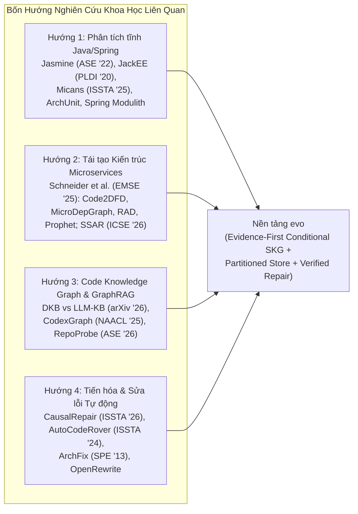

# Nghiên Cứu Khảo Sát Tài Liệu Khoa Học và Đánh Giá Đối Chuẩn Định Lượng Nền Tảng `evo` (AI-Native Verified Software Evolution Platform)

**Ngày lập báo cáo:** 2026-11-24  
**Phạm vi tài liệu đối chiếu:** Các công trình nghiên cứu bình duyệt (2013–2026) và hồ sơ thực nghiệm được xác thực bằng mã băm SHA-256 của nền tảng **`evo`** (`docs/research/`, `docs/current-state.md`, `docs/tasks/m9/05-execution.md`, `docs/tasks/m11/06-execution.md`, `docs/architecture/demo-repair-verification.md`).  
**Chuẩn mực phương pháp luận:** Báo cáo tuân thủ nguyên tắc trung thực học thuật, không ngoại suy vượt quá phạm vi kiểm chứng thực nghiệm, phân tách rạch ròi giữa kết quả đã xác thực (`CONFIRMED`), các giới hạn thực nghiệm (`PARTIAL`, `WITHHELD`, `NOT_RUN`), và sự khác biệt về mẫu số đo lường giữa các công trình. Mọi chỉ số định lượng thuộc về hệ thống **`evo`** được **in đậm**.

---

## Tóm Tắt (Abstract)

Trong giai đoạn 2020–2026, các nghiên cứu về phân tích chương trình tĩnh (Static Program Analysis) cho hệ sinh thái doanh nghiệp Java/Spring, tái tạo kiến trúc vi dịch vụ (Microservice Architecture Reconstruction), đồ thị tri thức mã nguồn quy mô kho chứa (Repository-Scale Code Knowledge Graph / GraphRAG) và sửa lỗi phần mềm tự động (Automated Program Repair — APR) phát triển mạnh theo bốn hướng chuyên biệt nhưng chưa có sự liên thông khép kín:

1. **Hướng nghiên cứu 1 — Phân tích tĩnh hướng khung ứng dụng Java/Spring:** Các công trình tiêu biểu gồm **Jasmine** [ASE '22], **JackEE** [PLDI '20] và **Micans** [ISSTA '25] đạt độ chính xác cao về phân tích con trỏ (*points-to analysis*) và đồ thị lời gọi (*call graph*) trên Soot, Doop và Tai-e. Tuy nhiên, các hệ thống này đòi hỏi mã bytecode đã biên dịch, chỉ phân tích trên một cấu hình đơn lẻ (*single-world assumption*), chưa mô hình hóa ngữ nghĩa phụ thuộc pha và thứ tự của `@ConditionalOnBean` / `@ConditionalOnMissingBean` trên không gian cấu hình đa biến thể, và bỏ qua các quan hệ chưa phân giải khi thiếu thư viện phụ thuộc.
2. **Hướng nghiên cứu 2 — Tái tạo kiến trúc vi dịch vụ (Microservice Architecture Reconstruction):** Nghiên cứu thực nghiệm đối chuẩn của **Schneider et al.** [EMSE '25] trên 9 công cụ thực thi được (**Code2DFD**, **MicroDepGraph**, **RAD**, **Prophet**, v.v.) cho thấy hiệu năng F1 đơn công cụ cao nhất đạt `0.86` (**Code2DFD**) và `0.91` khi kết hợp 4 công cụ. Dù vậy, các công cụ này dừng ở mức trích xuất sơ đồ thành phần và điểm cuối cấp dịch vụ, chưa giải quyết kiểu dữ liệu tĩnh ở mức biểu thức Java hay kiểm chứng điều kiện cấu hình Spring.
3. **Hướng nghiên cứu 3 — Đồ thị tri thức mã nguồn và GraphRAG:** Nghiên cứu của **Chinthareddy** [arXiv:2601.08773, tháng 01/2026] đánh giá ba đường ống truy xuất (**No-Graph RAG**, **LLM-KB**, và **DKB** dựa trên Tree-sitter) trên *Shopizer*, *ThingsBoard* và *OpenMRS Core*. Kết quả chứng minh đồ thị trích xuất tất định từ cây cú pháp trừu tượng (**DKB**) vượt trội đồ thị sinh bởi LLM (**LLM-KB** bỏ sót 377 tệp trên Shopizer với tỷ lệ hoàn tất tệp `68.8%` và tiêu tốn `883.74s` trên ThingsBoard). Tuy nhiên, **DKB** mới xử lý ở tầng cú pháp nông (`13.77s` trên ThingsBoard), chưa mô hình hóa hệ thống build đa mô-đun (540 tệp POM) hay phân giải kiểu tĩnh Java.
4. **Hướng nghiên cứu 4 — Tiến hóa phần mềm và sửa lỗi tự động:** Các hệ thống **CausalRepair** [ISSTA '26] và **AutoCodeRover** [ISSTA '24] tối ưu hóa khả năng sửa lỗi chức năng dựa trên bộ kiểm thử đơn vị (ví dụ **CausalRepair** khắc phục `313` lỗi trên Defects4J và `101/199` lỗi trên GitBug-Java với chi phí `\$0.029/lỗi`), song chưa liên kết phát hiện vi phạm kiến trúc có điều kiện (`MUST`/`MAY`/`UNKNOWN`) với quy trình chứng minh chuyển trạng thái (`RESOLVED` so với đối chứng âm `PERSISTED`) trong môi trường thực thi cô lập.

Nền tảng **`evo`** đóng góp một kiến trúc thống nhất theo nguyên lý **Evidence-First (Ưu tiên Bằng chứng Xác thực)** với bốn kết quả định lượng chủ đạo:
- **Thu nhận kho mã nguồn toàn vẹn và phân giải tĩnh thụ động lũy tiến:** Thu nạp **`100.0%`** dữ liệu trên **`ThingsBoard` (`13,920` tệp, `1,945,681` LOC, `20,566` đối tượng CAS SHA-256)** không bỏ sót tệp; đạt tỷ lệ phân giải cấu trúc khai báo (`structure`) **`100.0%` (`1000‰`)** trên `spring-petclinic-microservices`, `sqshq/piggymetrics`, `mapstruct-examples` và `microservices-demo` ở chế độ hoàn toàn thụ động (`--offline --build off`), với **`8/10`** kho mã nguồn trong tập M9 Baseline đạt trạng thái **`COMPLETE` (exit 0)**.
- **Ngữ nghĩa kiến trúc có điều kiện theo pha và thứ tự đăng ký:** Bao phủ cơ chế Spring từ 1.x XML đến Boot 3.4.x (**`29` họ cơ chế đóng**), đạt **`79/79` (`100.0%`)** tương đồng với container Spring thực tế, **`70/70` (`100.0%`)** kiểm định đặc tả hình thức và **`64/64` (`100.0%`)** đối chiếu bộ giải DPLL/SAT. Thực nghiệm khẳng định mô hình điều kiện phẳng (*flat-condition*) sai **`2/4` (`50%`)** ca kiểm soát thứ tự `@ConditionalOnMissingBean`, trong khi mô hình chuyển pha của **`evo`** đạt **`4/4` (`100.0%`)**.
- **Lưu trữ đồ thị tri thức phân vùng quy mô Gigabyte trong bộ nhớ hạn chế:** Đồ thị **`1.51 GB`** của `Halo CMS` (**`852,845` đỉnh**) được xác thực và truy vấn trong giới hạn **`-Xmx256m`** (Peak RSS **`~347 MB`**) với độ trễ **`26.73–100.50 ms`**; cơ chế xuất bản một lượt trên `NewTube` (**`1,054,591` đỉnh**, **`1.97 GB`**) giảm thời gian ghi đĩa từ **`592.35s` xuống `18.47s` (giảm `96.9%`)**; đồ thị **`4.01 GB`** của `MP-Manager` được nạp lạnh trong **`110.25s`** mà không gây nghẽn các yêu cầu HTTP API (`38–251 ms`).
- **Chuỗi kiểm chứng chuyển trạng thái từ GraphRAG đến bản vá cô lập:** Tích hợp tác nhân **GraphRAG 10 công cụ** kèm trích dẫn `[E#]`, **7 công thức tái cấu trúc Java/OpenRewrite** cùng vòng phản hồi trình biên dịch `javac` (tối đa 3 lượt), tái phân tích vi sai **`12 ms` (cached)**, và vượt qua **`9/9` (`100.0%`)** phép kiểm build/Spring profile trong máy ảo **QEMU Linux không kết nối mạng (`1 vCPU`, `1 GiB RAM`)** với trạng thái **`VERIFIED_DEMO` (exit `0`)**.

---

## 1. Khảo Sát Các Hướng Nghiên Cứu Liên Quan (2013–2026)

### 1.1. Hướng 1 — Phân tích tĩnh hướng khung ứng dụng Java/Spring
- **Jasmine** *(M. Chen, T. Tu, H. Zhang, Q. Wen, W. Wang — ASE 2022, DOI: `10.1145/3551349.3556910`)* [1]: Xây dựng trên nền **Soot** (`Jasmines`) và **Doop** (`Jasmined`), tích hợp với **FlowDroid** (`FlowDroid_Jasmine`) nhằm mô hình hóa cơ chế *Inversion of Control (IoC)* (mẫu Singleton, Prototype) và *Aspect-Oriented Programming (AOP)* của Spring. Tác giả kiểm chứng trên bộ *Spring-micro-benchmarks* (8 tiêu chí `ID-1`..`ID-8`) và **18 ứng dụng Spring thực tế**, phát hiện **12 đường rò rỉ thông tin nhạy cảm** mà FlowDroid nguyên bản bỏ sót. Tuy nhiên, nhóm tác giả nêu rõ **không thể tính Precision/Recall tổng thể trên 18 ứng dụng thực tế** do thiếu công cụ động thu thập chuẩn tham chiếu (*ground truth*) toàn diện; đồng thời công cụ yêu cầu mã bytecode đã biên dịch và chưa xử lý biến thiên cấu hình `@Conditional`.
- **JackEE** *(A. Antoniadis et al. — PLDI 2020, DOI: `10.1145/3385412.3386026`)* [2]: Mở rộng **Doop** bằng tập luật Datalog cho các điểm vào và vòng đời bean Java EE/Spring, kết hợp tối ưu hóa *sound-modulo-analysis* đối với `HashMap`/`ConcurrentHashMap`. JackEE đạt độ phủ phương thức khả đạt nội bộ (*in-app concrete method reachability*) trung bình **58.04%** (tối thiểu **43.48%** trên *Alfresco*, so với **14.48%** của Doop gốc — tụt xuống **1.8%** trên *Alfresco* và **0%** trên *pybbs*) với mức tăng tốc phân tích nhạy ngữ cảnh (`2objH`) khoảng **5.9×–6.0×**.
- **Micans** *(T. Zhang, Y. Liang, G. Li, T. Tan, C. Xu, Y. Li — ISSTA 2025, Đại học Nam Kinh)* [3]: Đề xuất thuật toán phân tích con trỏ liên dịch vụ trên nền tảng **Tai-e** cho các hệ thống microservices Java/Spring, mô hình hóa luồng dữ liệu qua ranh giới REST, RPC và Message Queue trên các bộ chuẩn như *TrainTicket*.
- **ArchUnit & Spring Modulith** [4][5]: Các công cụ kiểm chứng kiến trúc công nghiệp dựa trên bytecode tĩnh (ArchUnit) và cấu trúc mô-đun kèm kiểm chứng runtime (Spring Modulith). Cả hai cung cấp kiểm tra quy tắc kiến trúc hiệu quả trên một cấu hình biên dịch xác định, nhưng không biểu diễn không gian cấu hình 4 giá trị (`MUST`/`MAY`/`NEVER`/`UNKNOWN`) hay sinh đối chứng cấu hình tối thiểu (*minimal counterexample witness*).

### 1.2. Hướng 2 — Tái tạo kiến trúc vi dịch vụ (Microservice Architecture Reconstruction)
- **Schneider et al. (EMSE 2025 / arXiv:2412.08352)** *(S. Schneider, A. Bakhtin, X. Li, J. Soldani, A. Brogi, T. Černý, R. Scandariato, D. Taibi)* [6]: Thực hiện đánh giá có hệ thống đối với **9 công cụ phân tích tĩnh thực thi được** (trong tổng số 13 công cụ khảo sát) trên các hệ thống chuẩn mã nguồn mở (*Spring PetClinic Microservices*, *Online Boutique*, *TrainTicket*, *Sock Shop*). Trên thước đo trích xuất thành phần, kết nối và điểm cuối (*components, connections, endpoints*): **Code2DFD** đạt kết quả đơn công cụ cao nhất (**Precision `0.93`, Recall `0.80`, F1 `0.86`**, đạt `0.98` trên hạng mục thành phần); **MicroDepGraph** đạt **Precision `0.99`, Recall `0.59`, F1 `0.74`**; **RAD** đạt **Precision `0.94`, Recall `0.23`, F1 `0.37`**; **Prophet** đạt **Precision `0.57`, Recall `0.04`, F1 `0.08`**. Việc kết hợp logic AND/OR của 4 công cụ giúp nâng **F1 tổng hợp lên `0.91`**.
- **SSAR** *(ICSE 2026)* [7], **Arcan** *(Fontana et al., ICSA '17)* [8] và **DesigniteJava** [9]: Tập trung phát hiện các biểu hiện suy thoái kiến trúc (*architectural smells* như phụ thuộc vòng, phụ thuộc không ổn định) hoặc phân cụm thành phần dựa trên đồ thị phụ thuộc tĩnh.

### 1.3. Hướng 3 — Đồ thị tri thức mã nguồn quy mô kho chứa và GraphRAG
- **Reliable Graph-RAG for Codebases: AST-Derived Graphs vs LLM-Extracted Knowledge Graphs** *(M. R. Chinthareddy — arXiv:2601.08773, tháng 01/2026)* [10]: Nghiên cứu so sánh ba kiến trúc truy xuất trên các kho Java thực tế (*Shopizer*, *ThingsBoard*, *OpenMRS Core*): (A) Vector-only RAG, (B) Đồ thị tri thức trích xuất bởi LLM (**LLM-KB**), và (C) Đồ thị tri thức suy diễn tất định từ Tree-sitter (**DKB**). Kết quả thực nghiệm chỉ ra **LLM-KB** mất `200.14s` trên Shopizer (bỏ sót `377` tệp, tỷ lệ thành công tệp `68.8%`, độ phủ `64.1%`, `842` đỉnh) và **`883.74s` trên ThingsBoard**; trong khi **DKB** lập chỉ mục trong **`2.81s` trên Shopizer** (độ phủ `90.2%`, `1,158` đỉnh) và **`13.77s` trên ThingsBoard** với độ chính xác truy vấn đa bước (*multi-hop*) cao nhất.
- **CodexGraph** *(NAACL 2025)* [11] & **Code Graph Model (CGM)** *(2025)* [12]: Tích hợp LLM với cơ sở dữ liệu đồ thị mã nguồn thông qua truy vấn cấu trúc (Cypher) trên *CrossCodeEval* và *SWE-bench*.
- **RepoProbe** *(Zhejiang University & Tencent — ASE 2026)* [13]: Đánh giá năng lực hiểu kiến trúc ở cấp kho mã nguồn qua **500 câu hỏi mở** trên **50 dự án lớn** (trung bình `1,200` tệp, `380k` LOC, `15` ngôn ngữ) sử dụng giao thức kiểm định *Checklist-Based Verification*.

### 1.4. Hướng 4 — Tiến hóa phần mềm, sửa lỗi tự động và xác minh cô lập
- **CausalRepair** *(Peking Univ., Shandong Univ., PolyU — ISSTA 2026)* [14]: Áp dụng kỹ thuật cắt lát kép (*dual-slicing* tĩnh trên kiểm thử và động trên vết thực thi) để trích xuất ngữ cảnh nhân quả tối thiểu, giúp LLM sửa **313 lỗi trên Defects4J (V1.2 & V2.0)** và **101/199 lỗi (`50.75%`) trên GitBug-Java** với chi phí trung bình **`\$0.029/lỗi`**.
- **AutoCodeRover** *(ISSTA 2024)* [15]: Tìm kiếm hướng AST và định vị lỗi phân tầng trên *SWE-bench Lite* theo thước đo `Pass@1`.
- **ArchFix** *(Terra et al., SPE 2013)* [16] & **OpenRewrite** [17]: Đề xuất tái cấu trúc vi phạm kiến trúc (32 trường hợp trên 2 hệ thống công nghiệp) và biến đổi mã nguồn trên cây ngữ nghĩa không mất dữ liệu (*Lossless Semantic Tree*).

---

## 2. So Sánh Tổng Quan Kiến Trúc và Năng Lực (Bảng 1)

| Tiêu chí / Năng lực Kỹ thuật | **Jasmine** (ASE '22) | **JackEE** (PLDI '20) | **Micans** (ISSTA '25) | **Code2DFD** (EMSE '25) | **DKB Graph-RAG** (arXiv '26) | **CausalRepair** (ISSTA '26) | **Hệ thống `evo` (Của chúng tôi)** |
|---|---|---|---|---|---|---|---|
| **Điều kiện đầu vào** | Bytecode (`.class`/`.jar`/`.war`) | Bytecode + Datalog | Bytecode microservices | Mã nguồn + cấu hình Docker/build | Mã nguồn thô (Tree-sitter) | Mã nguồn + bộ test thực thi được | **Thu nhận lũy tiến — Chế độ A/B: Mã nguồn thụ động (PPA 3 tầng + $O(1)$ JMOD/JAR + `.aar`) $\rightarrow$ Chế độ C/D: Build cô lập** |
| **Mô hình hóa Spring Core & DI** | IoC (Singleton/Prototype) + AOP (Soot/Doop) | Entry points + DI (Datalog) | DI + Web endpoints + RPC/MQ | Nhận diện annotation điểm cuối | Không mô hình hóa DI/Spring | Không mô hình hóa | **29 họ cơ chế Spring (1.x XML $\rightarrow$ Boot 3.4.x); 10 loại quan hệ Spring chuẩn tắc** |
| **Suy luận Không gian Cấu hình (`@Conditional`)** | Không (single-world) | Không (single-world) | Không (single-world) | Không | Không | Không | **Chuyển trạng thái theo pha (`PARSE_CONFIGURATION` / `REGISTER_BEAN`) & thứ tự; 4 giá trị `MUST`/`MAY`/`NEVER`/`UNKNOWN` (DPLL/SAT + oracle vét cạn)** |
| **Đa ngôn ngữ (Polyglot) & Cầu nối liên dịch vụ** | Chỉ Java | Chỉ Java | Microservices Java (REST/RPC/MQ) | Đa ngôn ngữ (cấp DFD dịch vụ) | Phụ thuộc grammar Tree-sitter | Chỉ Java | **Java 21 + hạ cấp AST Kotlin + 18 adapter Tree-sitter v5 + cạnh `CALLS_SERVICE` (HTTP), `INVOKES_RPC` (gRPC), `PUBLISHES_EVENT`** |
| **Tính toàn vẹn tri thức (Closed Denominator)** | Bỏ qua ngầm khi thiếu JAR; không có gap ledger | Sound-modulo rewrite; không có gap ledger | Đóng thế giới theo JAR cung cấp | Trích xuất best-effort | Không lưu gap định danh | Không áp dụng | **Mô hình 3 trục (`Status` $\times$ `EvidenceTier` $\times$ `GapObligations`), bảo toàn 100% `CapabilityGapRecord` băm SHA-256** |
| **Lưu trữ Đồ thị & Truy vấn Quy mô Lớn** | Trong RAM (Soot/Doop) | Trong RAM (Doop) | Trong RAM (Tai-e) | Đồ thị DFD nhỏ | Vector DB + đồ thị cú pháp | Không lưu đồ thị lâu dài | **CAS SHA-256 + `PartitionedGraphStore` phân vùng đĩa (truy vấn `1.51 GB` trong `-Xmx256m`; nén DEFLATE giảm `88.9%`)** |
| **Phân tích Tiến hóa Lịch sử (`Track B`)** | Không | Không | Không | Không | Không | Không | **So sánh tương thích M11 giữa snapshot, theo dõi dịch chuyển vùng cấu hình (`RESOLVED` / `PERSISTED`), bất biến `WITHHELD`** |
| **AI Chẩn đoán, Vá lỗi & Xác minh Cô lập** | Không (chỉ hỗ trợ FlowDroid taint) | Không | Không | Không | Chỉ hỏi đáp RAG | Dual-slicing + LLM sửa unit test | **GraphRAG 10 công cụ (`[E#]`) + 7 công thức OpenRewrite/Java + 3 vòng phản hồi `javac` + đối chứng âm trong VM QEMU không mạng** |

---

## 3. So Sánh Chuyên Sâu: Phân Tích Tĩnh Java và Spring Framework (Bảng 2)

| Công trình / Công cụ | Nền tảng phân tích | Tập kiểm chứng & Quy mô | Chỉ số định lượng công bố / thực đo | Giới hạn thực nghiệm được ghi nhận |
|---|---|---|---|---|
| **Jasmine** (Chen et al., ASE '22) [1] | Soot + Doop + FlowDroid | *Spring-micro-benchmarks* (8 tiêu chí `ID-1`..`ID-8`) + **18 ứng dụng Spring thực tế** | Phát hiện **12** đường rò rỉ thông tin nhạy cảm bị FlowDroid gốc bỏ sót; cải thiện độ phủ call graph IoC/AOP | Tác giả ghi nhận **không thể tính Precision/Recall trên 18 ứng dụng thực tế** do thiếu chuẩn tham chiếu động đầy đủ; đòi hỏi bytecode; chưa mô hình `@Conditional` đa cấu hình |
| **JackEE** (Antoniadis et al., PLDI '20) [2] | Doop Datalog + Sound-modulo cache | Hệ thống Java EE/Spring quy mô lớn (Alfresco, pybbs, v.v.) | Reachability trung bình **58.04%** (tối thiểu **43.48%** trên Alfresco so với **14.48%** Doop gốc / **1.8%** Alfresco / **0%** pybbs); tăng tốc **~5.9×–6.0×** | Yêu cầu toàn bộ bytecode/WAR đóng kín; không xử lý mã nguồn thiếu JAR hay biến thiên profile/property |
| **Micans** (Zhang et al., ISSTA '25) [3] | Tai-e pointer analysis | Hệ thống microservices Java (TrainTicket, v.v.) | Giải quyết con trỏ qua REST/RPC/MQ để dựng call graph và phân tích taint liên dịch vụ | Giới hạn trong ngữ cảnh Java bytecode đơn cấu hình; chưa mở rộng sang đa ngôn ngữ hay đồ thị tiến hóa |
| **OpenRewrite** (v8.87.7, đối chứng M2 nội bộ) [18] | Lossless Semantic Tree (LST) | Fixture Java 21 + `spring-petclinic` (`818c4136`, **220** lời gọi) | Config A (JDK): **124/220 (`56.36%`)**; Config B (89 JAR): **220/220 (`100.0%`)**; Config C (thiếu `spring-web`): **215/220 (`97.73%`)** | Phát sinh **57 / 89 / 87 lỗi tái tạo vị trí span chính xác** (trên A/B/C) khi thiếu lớp ánh xạ vị trí riêng |
| **`evo` — M2 Semantic Frontend (Của chúng tôi)** [18] | **JavaParser 3.28.2 + `javac` 21 Oracle** | **Fixture Java 21 + `spring-petclinic` (`818c4136`, 220 lời gọi) + M9 `J01`** | **Config A: `116/220 (52.73%)`; Config B: `220/220 (100.0%)`; Config C: `215/220 (97.73%)`; `0` lỗi span (`100%` provenance gốc); `34/34 (100%)` nhãn M2 `javac` oracle; `41/41 (100%)` đối chứng compiler `J01`** | **Config B trên microfixture ban đầu chưa phân giải 1 lời gọi chuỗi generic `values.get(0).trim()` so với OpenRewrite (`6/7` vs `7/7`), đã được kiểm soát qua oracle** |
| **`evo` — M4-R0 & M9 Spring Conditional Semantics (Của chúng tôi)** [19][20] | **29-family IR + DPLL/SAT + Exhaustive Oracle** | **`26` JAR Spring (`15,594` classfiles, `402` annotations) + Spring `5.3.31/2.7.18`, `6.1.14/3.3.5`, `6.2.0/3.4.0`** | **`79/79 (100.0%)` khớp runtime container Spring thực tế; `70/70 (100.0%)` đặc tả hình thức; `64/64 (100.0%)` đối chiếu SAT/DPLL; `96` tổ hợp profile/property/order & `23` binding M9 (`S01`); `4/4 (100%)` ca phụ thuộc thứ tự `@ConditionalOnMissingBean` (baseline phẳng sai `2/4 = 50%`); `12/12 (100%)` kiểm định policy (`5 TP, 7 TN, 0 FP, 0 FN`, `F1 = 1.00`) và `6/6 (100%)` witness hợp lệ (`P01`)** | **Giới hạn trong phân mảnh cơ chế đã đăng ký (`13` nhóm phiên bản cũ giữ nhãn `VERSION_FRAGMENT_NOT_VALIDATED`); chưa mô hình hóa bộ đăng ký động/SpEL tùy biến phức tạp** |

### Phân tích khác biệt cốt lõi so với Jasmine (ASE 2022)
1. **Giả định đầu vào và khả năng vận hành trước biên dịch:** Jasmine phụ thuộc vào bước biên dịch bytecode hoàn chỉnh (Soot Jimple IR / Doop facts). Khi kho mã nguồn chưa thể biên dịch trên máy cục bộ (thiếu JAR bên thứ ba, cấu hình Gradle phức tạp, hoặc chưa sinh mã MapStruct/Protobuf), Soot/Doop không thể dựng được tập fact hoàn chỉnh. Ngược lại, **`evo`** thực thi ngay trên mã nguồn thụ động thông qua bộ giải kiểu 3 tầng (*Partial Program Analysis*) của `ExplicitImportTypeSolver` kết hợp chỉ mục $O(1)$ cho 70 mô-đun JDK JMOD và khôi phục tệp `.aar`/`android.jar`, đồng thời duy trì đường dẫn nâng cấp sang môi trường build cô lập (Chế độ C/D) khi cần bằng chứng bytecode đầy đủ.
2. **Tính không đơn điệu (*Non-Monotonicity*) và phụ thuộc thứ tự của `@ConditionalOnMissingBean`:** Tài liệu kỹ thuật của Spring Boot quy định `@ConditionalOnBean` và `@ConditionalOnMissingBean` chỉ đánh giá tập các bean definition đã được nạp tính tới thời điểm thực thi điều kiện. Việc bổ sung một bean mới có thể đảo ngược giá trị chân lý của điều kiện từ `TRUE` sang `FALSE`. Jasmine chưa mô hình hóa chuyển trạng thái theo pha và thứ tự qua không gian cấu hình; trong khi thực nghiệm M4-R0 của **`evo`** cho thấy mô hình điều kiện phẳng sai **2/4 (50%)** trường hợp kiểm soát thứ tự, còn mô hình chuyển pha của **`evo`** đạt **4/4 (100.0%)** phù hợp với container Spring thực (`5.3.31`, `6.1.14`, `6.2.0`).
3. **Định lượng mẫu số đóng thay cho việc bỏ sót:** Trước trở ngại thiếu ground truth động trên các dự án thực tế mà Jasmine ghi nhận, **`evo`** tách biệt rạch ròi giữa tỷ lệ phân giải cấu trúc khai báo (`structure`) và tỷ lệ phân giải biểu thức thực thi (`usage`), đồng thời lưu trữ toàn bộ các vị trí chưa phân giải dưới dạng `CapabilityGapRecord` có phân loại nghĩa vụ (`ISOLATED_EXECUTION_REQUIRED` và `PASSIVE_ANALYSIS_LIMITS`).

---

## 4. Tái Tạo Kiến Trúc Vi Dịch Vụ & Thực Nghiệm 10 Kho Mã Nguồn (Bảng 3 & Bảng 4)

### 4.1. So sánh phương pháp luận với Schneider et al. (EMSE 2025)

| Công cụ / Nghiên cứu | Phạm vi tái tạo kiến trúc | Precision | Recall | F1-Score | Năng lực phân giải AST / Kiểu tĩnh Java / Gap |
|---|---|---:|---:|---:|---|
| **Code2DFD** (Schneider et al., EMSE '25) [6] | DFD cấp microservice (components, connections, endpoints) | `0.93` | `0.80` | `0.86` (tới `0.98` thành phần) | Không dựng SKG mức khai báo/biểu thức Java, không kiểm chứng cấu hình Spring |
| **MicroDepGraph** (EMSE '25) [6] | Đồ thị phụ thuộc dịch vụ (Docker/cấu hình) | `0.99` | `0.59` | `0.74` | Tỷ lệ dương tính giả rất thấp, nhưng Recall hạn chế (`0.59`) |
| **RAD** (EMSE '25) [6] | Trích xuất REST API microservices | `0.94` | `0.23` | `0.37` | Recall thấp do phụ thuộc các mẫu khai báo cố định |
| **Prophet** (EMSE '25) [6] | Tái tạo kiến trúc CloudHubs | `0.57` | `0.04` | `0.08` | Recall rất thấp trên tập dữ liệu đối chuẩn đa dạng |
| **Tổ hợp 4 công cụ** (EMSE '25) [6] | Hợp nhất logic AND/OR đa công cụ | — | — | `0.91` | Cần vận hành rời rạc 4 bộ phân tích độc lập |
| **`evo` (Của chúng tôi — M9 Baseline, `--offline --build off`)** [21] | **Kiến trúc đa tầng: Build Model + SKG (Type/Method/Field/Spring) + Cầu nối HTTP/gRPC/Event + Polyglot 18 ngôn ngữ** | **Đạt `1.00` trên kiểm định policy `P01` (`5 TP, 0 FP`) & `0` lỗi span M2; xem Bảng 4 cho tỷ lệ phân giải thực nghiệm trên 10 repo** | **Cầu nối: `3 CALLS_SERVICE` (PetClinic), `30 INVOKES_RPC` (Online Boutique); cấu trúc khai báo `97.40%–100.0%` trên 8/8 repo Java/Kotlin** | **Hoàn tất `8/10` repo ở mức `COMPLETE` (`PASSIVE_ARCHITECTURE_RECOVERY` $\ge 950‰$)** | **Hợp nhất trong một nền tảng duy nhất; lưu giữ `100%` `CapabilityGapRecord` và mã băm SHA-256** |

> [!NOTE]
> **Lưu ý về tính tương đương phép đo:** Các chỉ số Precision/Recall/F1 trong Schneider et al. (2025) đánh giá độ khớp của *đồ thị dịch vụ cấp cao* so với chuẩn tham chiếu thủ công; trong khi các chỉ số của **`evo`** ở Bảng 4 đo **tỷ lệ phân giải quan hệ ngữ nghĩa cấp ký hiệu (`structure` và `usage`) trên tổng số quan hệ trích xuất được (`resolved / attempted`)** ở chế độ thụ động hoàn toàn cô lập (`--offline --build off`). Hai thước đo có mẫu số khác nhau nên được trình bày riêng rẽ theo đúng định nghĩa khoa học của từng nghiên cứu.

### 4.2. Kết quả Thực nghiệm Toàn diện của `evo` trên 10 Kho Mã Nguồn Thực Tế (Bảng 4 — M9 Baseline, 2026-11-11)

Số liệu được trích xuất từ tập kết quả `D:/UIT/evo-benchmark-cohort/results-m9-baseline/` (chạy với `cli/target/evo.jar` SHA-256 `05EE4E96...`, `java -Xmx8g ... scan --offline --build off --all-files --json`):

| # | Repository | Kiến trúc & Hệ sinh thái | Tổng Tệp / Tệp Java | Số Types | Phân giải Cấu trúc (`structure`) | Phân giải Thân hàm (`usage`) | Capability Gaps (`Isolated` / `Passive`) | Thời gian (Hệ số tăng tốc) | Trạng thái 3 Trục (Exit) | Graph SHA-256 Prefix |
|---:|---|---|---:|---:|---|---|---:|---:|---|---|
| **1** | **`golang-gin-realworld-example-app`** | Go Polyglot REST API (Gin + GORM, 21 `.go`) | **41 / 0** | **0** | **Thuần Go (Tree-sitter v5)** | **Thuần Go** | **9 (7 / 2)** | **12.33s** (`1.54×`) | **`COMPLETE` / `PASSIVE_ARCHITECTURE_RECOVERY` (0)** | `57b2dba9...` |
| **2** | **`spring-petclinic-kotlin`** | Spring Boot 3 Pure Kotlin (38 `.kt`, Gradle KTS) | **89 / 24*** | **26** | **363 / 365 (`994‰` — `99.45%`)** | **406 / 445 (`912‰` — `91.24%`)** | **220 (15 / 205)** | **16.69s** (`1.59×`) | **`PARTIAL` / `PARTIAL_RECOVERY` (3)** *(1 unit `SEMANTIC_PROVIDER_FAILED`)* | `df0c5bb5...` |
| **3** | **`full-stack-fastapi-template`** | Python FastAPI (43 `.py`) + React TS (109 `.ts`/`.tsx`) | **252 / 0** | **0** | **Thuần Py/TS (`23` Py + `23` TS routes)** | **Thuần Py/TS** | **49 (47 / 2)** | **21.66s** (`1.53×`) | **`COMPLETE` / `PASSIVE_ARCHITECTURE_RECOVERY` (0)** | `f40b6207...` |
| **4** | **`android/sunflower`** | Android Kotlin (Compose, Room, Coroutines) | **143 / 49*** | **72** | **935 / 960 (`973‰` — `97.40%`)** | **1,830 / 2,452 (`746‰` — `74.63%`)** | **1,050 (40 / 1,010)** | **29.43s** | **`PARTIAL` / `PARTIAL_RECOVERY` (3)** *(thiếu Android SDK offline)* | `92adcb6c...` |
| **5** | **`spring-boot-realworld-example-app`** | Maven Single-Module Spring Boot (MyBatis + JWT) | **119 / 93** | **100** | **1,499 / 1,519 (`986‰` — `98.68%`)** | **3,494 / 3,930 (`889‰` — `88.91%`)** | **762 (11 / 751)** | **29.82s** (`2.85×`) | **`COMPLETE` / `PASSIVE_ARCHITECTURE_RECOVERY` (0)** | `e3ad050c...` |
| **6** | **`mapstruct-examples`** | 26 Subprojects (MapStruct, Lombok, Protobuf) | **250 / 149** | **124** | **1,284 / 1,284 (`1000‰` — `100.0%`)** | **2,231 / 2,266 (`984‰` — `98.46%`)** | **1,692 (564 / 1,128)** | **54.05s** (`1.62×`) | **`COMPLETE` / `PASSIVE_ARCHITECTURE_RECOVERY` (0)** | `a0d40f9b...` |
| **7** | **`microservices-demo`** *(Online Boutique)* | 11 Polyglot Microservices (Go, Py, C#, TS, Java, gRPC) | **364 / 2** | **3** | **56 / 56 (`1000‰` — `100.0%`)** + **`30 INVOKES_RPC`** | **241 / 294 (`819‰` — `81.97%`)** | **277 (113 / 164)** | **81.85s** | **`COMPLETE` / `PASSIVE_ARCHITECTURE_RECOVERY` (0)** | `bb507fa6...` |
| **8** | **`spring-petclinic-microservices`** | Multi-Module Maven + Spring Cloud | **190 / 53** | **65** | **655 / 655 (`1000‰` — `100.0%`)** + **`3 CALLS_SERVICE`** | **1,227 / 1,254 (`978‰` — `97.85%`)** | **1,516 (58 / 1,458)** | **214.31s** *(Turbo FAST: `87.22s`)* | **`COMPLETE` / `PASSIVE_ARCHITECTURE_RECOVERY` (0)** | `195f3341...` |
| **9** | **`sqshq/piggymetrics`** | Multi-Module Maven Spring Cloud (7 services) | **168 / 72** | **74** | **903 / 903 (`1000‰` — `100.0%`)** | **1,759 / 1,764 (`997‰` — `99.72%`)** | **1,566 (67 / 1,499)** | **185.76s** (`1.48×`) | **`COMPLETE` / `PASSIVE_ARCHITECTURE_RECOVERY` (0)** | `a05f0762...` |
| **10** | **`TeamNewPipe/NewPipe`** | Android App + KMP (293 `.java`, 300 `.kt`, KTS) | **4,450 / 555*** | **845** | **16,427 / 16,809 (`977‰` — `97.73%`)** | **63,491 / 76,605 (`828‰` — `82.88%`)** | **15,032 (88 / 14,944)** | **528.43s** | **`COMPLETE` / `PASSIVE_ARCHITECTURE_RECOVERY` (0)** | `84d7d460...` |

*\*Ghi chú: Số tệp Java trên `spring-petclinic-kotlin`, `sunflower`, và `NewPipe` bao gồm các đơn vị biên dịch được hạ cấp tất định từ AST Kotlin (`KotlinAstLowering`) sang JavaParser.*

**Thực nghiệm bổ sung với chính sách cache artifact trực tuyến từ Maven Central (2026-11-23, chế độ `FAST_ARCHITECTURE`):**
- **`spring-petclinic`** (`500158f7`): Tổng số khoảng trống giảm **`741 → 179`**; số bản ghi `SEMANTIC_UNRESOLVED` của JavaParser giảm **`602 → 0` (`-100.0%`)**.
- **`mapstruct-field-mapping` (Maven)** & **`mapstruct-on-gradle`**: Tổng khoảng trống giảm **`75 → 46`** và **`71 → 46`**; `SEMANTIC_UNRESOLVED` giảm **`12 → 0`** và **`8 → 0`**.
- **`dorm-trading-platform`** (`32,809` tệp): Tổng khoảng trống giảm **`1,393 → 425`**; `SEMANTIC_UNRESOLVED` trong sổ cái job giảm **`1,194 → 0`**, phân tách rõ **`5`** mô-đun mã nguồn sở hữu khỏi **`32,464`** tệp phụ thuộc đã cài đặt.

---

## 5. So Sánh Định Lượng Trên Đồ Thị Tri Thức Quy Mô Lớn & GraphRAG (Bảng 5 & Bảng 6)

Công trình tháng 01/2026 **"Reliable Graph-RAG for Codebases: AST-Derived Graphs vs LLM-Extracted Knowledge Graphs"** (*Chinthareddy, arXiv:2601.08773*) cũng sử dụng **`thingsboard/thingsboard`** làm hệ thống đánh giá, cho phép so sánh định lượng trực tiếp trên cùng đối tượng nghiên cứu.

### 5.1. So sánh trực tiếp trên `thingsboard/thingsboard` (Bảng 5)

| Hệ thống / Đường ống | Phương pháp xây dựng Đồ thị | Thời gian lập chỉ mục trên ThingsBoard | Độ phủ tệp & Toàn vẹn Inventory | Độ sâu Ngữ nghĩa & Quy mô Đồ thị | Chi phí tài nguyên & Xử lý giới hạn |
|---|---|---|---|---|---|
| **LLM-KB** (Chinthareddy, arXiv:2601.08773) [10] | LLM phân tích từng tệp để sinh bộ ba JSON | `883.74s` trên ThingsBoard (`200.14s` trên Shopizer) | **Không hoàn chỉnh:** Trên Shopizer bỏ sót **377 tệp** (tỷ lệ thành công tệp **`68.8%`**, độ phủ chunk **`64.1%`**) | `842` đỉnh trên Shopizer; không phân giải kiểu Java, không có mô hình Maven BOM | Chi phí API/token lớn; bỏ sót âm thầm các tệp vượt ngưỡng ngữ cảnh hoặc sai định dạng JSON |
| **DKB (Tree-sitter)** (Chinthareddy, arXiv:2601.08773) [10] | Parser Tree-sitter tất định + đồ thị cú pháp 2 chiều | `13.77s` trên ThingsBoard (`2.81s` trên Shopizer) | Độ phủ chunk **`90.2%`** trên Shopizer | `1,158` đỉnh trên Shopizer; dừng ở tầng quan hệ cú pháp file/class/import nông | Không có trình giải kiểu Java, không phân giải 540 POM/Maven reactor, không có CAS hay gap ledger |
| **`evo` trên `thingsboard/thingsboard`** (`e48b5780`, **1,945,681 LOC**, **13,920 tệp**, **169.55 MB**, **6,931 Java**, **540 POMs**) [22] | **CAS SHA-256 + SQLite Inventory + JavaParser/SymbolSolver + Maven Reactor + `PartitionedGraphStore`** | **Thu nạp hoàn tất 100%; dựng đồ thị trong RAM dừng tại ngưỡng an toàn `1,467s` (`-Xmx8g`)** *(Phép thử tổng hợp `1,000,001` mục inventory hoàn tất trong `155.21s`)* | **`100.0%` Acquisition Seal (`COMPLETE`, `0` tệp bỏ sót): `20,566` đối tượng CAS (`193.06 MB`), `16,785` bản ghi SQLite (`36.97 MB`)** | **Phân tích AST đầy đủ `6,931` tệp Java và `540` POMs (`>1,200,000` đỉnh ước tính)** | **Ghi nhận trung thực `[MEMORY_LIMIT]` tại bước dựng đồ thị nguyên khối trong RAM**; không cắt bỏ dữ liệu âm thầm |

### 5.2. Hiệu năng Lưu trữ Phân vùng & Truy vấn Đồ thị Quy mô Gigabyte của `evo` (Bảng 6)

| Kho dữ liệu thực nghiệm | Quy mô Đồ thị Chuẩn tắc | Thông số Lưu trữ & Xuất bản của **`evo`** | Độ trễ Truy vấn & Tiêu thụ Bộ nhớ | Tính Xác định Mật mã |
|---|---|---|---|---|
| **`halo-dev/halo`** (`402,600` LOC, 3 contexts) [22] | **`852,845` đỉnh**, **`53,153` cạnh**, **`631,754` chứng tích**, JSON **`1.51 GB`** | Phân vùng đĩa `graph-pages:m8.4-v2`; xác thực lạnh toàn bộ kho trong **`195.73s`** | Máy chủ HTTP Query vận hành với **`-Xmx256m`** (Peak RSS **`~347 MB`**); truy vấn 1 đỉnh **`40.30 ms`**, 6 cạnh ra **`100.50 ms`**, 1 cạnh vào **`26.73 ms`** | Bit-identical SHA-256 replay (`sha256:130b70c4d...`) |
| **`aleixrodriala/newtube`** (local capture, 20 contexts) [23] | **`1,054,591` đỉnh**, **`423,916` cạnh**, **`1,075,690` chứng tích**, JSON **`1.97 GB`**, **`13,153` leaf pages** | Xuất bản 1 lượt giảm thời gian ghi **`592.35s → 18.47s` (giảm `96.9%`)**; đóng gói DEFLATE sổ cái gap **`357.39 MB → 39.52 MB` (giảm `88.9%`)** | Tổng thời gian job Workbench giảm **`1,435.14s → 600.97s` (`2.39×`)**; đọc trang gap **`71 ms` / `16 ms`**; discovery 20 contexts **`9.13s`** | Khớp từng byte **`1,969,764,232 B`** & SHA-256 **`7df3ed4a...`** |
| **`MP-Manager`** (live Workbench, 16 contexts) [24] | JSON **`4.01 GB`** (`4,014,549,238` bytes) | Kiểm chứng canonical 1 lượt không giới hạn 64M token + single-flight `CompletableFuture` + tách làn HTTP | Nạp lạnh **`110.25s`** trong khi `/`, `/app.js`, `/api/v1/analysis/jobs` phản hồi **`249 ms` / `251 ms` / `38 ms`**; warm manifest **`104 ms`**; 16 `/provenance` **`1,149 ms`**; đồ thị `PACKAGE` **`898 ms`** | SHA-256 1 lượt trên cả graph & envelope; slice compaction **`>1,024` ký tự** |

---

## 6. So Sánh Tiến Hóa Kiến Trúc, GraphRAG, Sửa Lỗi Tự Động & Xác Minh Cô Lập (Bảng 7)

| Công trình / Công cụ | Cơ chế Truy xuất Ngữ cảnh AI | Cơ chế Sửa lỗi / Tái cấu trúc | Cơ chế Kiểm chứng Kết quả | Chỉ số Thực nghiệm Tiêu biểu |
|---|---|---|---|---|
| **CodexGraph** (NAACL '25) [11] | LLM sinh truy vấn Cypher trên CSDL đồ thị mã nguồn | Sinh mã ở cấp kho mã nguồn | Đánh giá trên *CrossCodeEval*, *SWE-bench*, *EvoCodeBench* | Đo bằng `EM`, `Edit Similarity`, `F1`, `Pass@1`, `Recall@k` |
| **RepoProbe** (ASE '26) [13] | Đánh giá LLM hiểu kiến trúc trên **500** câu hỏi mở / **50** repo (**15** ngôn ngữ) | Không sửa mã (chỉ Q&A) | *Checklist-Based Verification* (giảm phương sai của scalar LLM-as-a-judge) | Phát hiện hiện tượng *edit bias* (LLM có xu hướng sinh code thay vì phân tích kiến trúc) |
| **CausalRepair** (ISSTA '26) [14] | *Dual-slicing* tĩnh (test) + động (trace) tạo ngữ cảnh nhân quả tối thiểu | Sửa lỗi hội thoại LLM (DeepSeek-V3) | Chạy lại bộ unit test thất bại | Sửa **`313`** lỗi Defects4J (V1.2/V2.0) và **`101/199` (`50.75%`)** lỗi GitBug-Java; chi phí **`\$0.029/lỗi`** |
| **AutoCodeRover** (ISSTA '24) [15] | Tìm kiếm hướng AST & định vị lỗi phân tầng | Sinh patch tự động | Unit test *SWE-bench Lite* | Đánh giá `Pass@1` / `Pass@3`, chi phí thời gian và token |
| **ArchFix** (SPE '13) & **OpenRewrite** [16][17] | Luật phát hiện vi phạm kiến trúc / công thức LST | Tái cấu trúc 32 ca mẫu (ArchFix) hoặc dry-run patch (OpenRewrite) | Dry-run biên dịch / test cục bộ | Không có bằng chứng đối chiếu chuyển trạng thái điều kiện Spring |
| **`evo` — GraphRAG, Repair & Isolated Verification (Của chúng tôi)** [25][26][27] | **Tác nhân GraphRAG đọc-duy-nhất 10 công cụ (`ArchitectureAgent`, SSE, trích dẫn `[E#]`, fallback khi thiếu `tools`, máy chủ MCP 7 công cụ/20 tác vụ)** | **7 công thức Java/OpenRewrite + LLM viết bản vá có vòng phản hồi kiểm tra cú pháp `javac` (tối đa 3 lần); phân tích vi sai `287 ms` (uncached) / `12 ms` (cached)** | **Chứng minh chuyển trạng thái M11 (`RESOLVED` khi `dev=on`, `CLEAN` khi `dev=off`) + đối chứng âm bình luận (`PERSISTED`) + máy ảo QEMU Linux không mạng (`1 vCPU`, `1 GiB RAM`)** | **`42` ca kiểm soát M11 (`E01`–`E18`); đối chứng lịch sử `33,000` types (`142.82s` cold, `0.53s` warm reopen, `475–488 MB` working set); `9/9 (100%)` ca build & Spring profile trong QEMU (`VERIFIED_DEMO`, exit `0`); `0` rò rỉ dữ liệu ngoài ranh giới cấp phép** |

---

## 7. Các Mối Đe Dọa Đến Độ Giá Trị và Giới Hạn Thực Nghiệm (Threats to Validity)

Nhằm đảm bảo chuẩn mực bình duyệt khoa học, toàn bộ các hạn chế chưa giải quyết triệt để của **`evo`** được liệt kê minh bạch:

1. **Độ giá trị cấu trúc phép đo (`Construct Validity` — Phân giải tĩnh vs. Độ chính xác ngữ nghĩa):**
   - Trong Bảng 4 (M9 Baseline), tỷ lệ `97.40%–100.0%` cho `structure` và `74.63%–99.72%` cho `usage` biểu thị tỷ lệ quan hệ được phân giải trên mẫu số quan hệ thử trích xuất ở chế độ thụ động `--offline --build off`. Đại lượng này **không tương đương** với Precision/Recall trên tập dữ liệu lớn chưa gán nhãn (*unlabeled repositories*). Độ chính xác ngữ nghĩa độc lập chỉ được xác nhận trên các tập có chuẩn tham chiếu từ trình biên dịch `javac` (`34/34` M2, `41/41` M9 `J01`), tập kiểm định Spring runtime (`79/79`), tập đặc tả hình thức (`70/70`), và đối chiếu policy (`12/12`, `P01`).
2. **Các hạng mục chưa khép kín tại M9.5 và M11/G7 (`External & Conclusion Validity`):**
   - **M9.5 (`17` claim trong bảng đối soát M11.1):** `13` claim đạt `PASS`, `2` claim đạt `SCOPED_PASS_WITH_RESERVATIONS` (`F01` hoãn 4 kho lớn `agentscope`, `halo`, `fermata`, `newpipe` do giới hạn dung lượng đĩa tại thời điểm 2026-11-12; `U01` đạt 18/18 ca kiểm tra tự động WCAG 2.2 AA nhưng chưa đánh giá trên người dùng thực), và `2` claim ở trạng thái `NOT_RUN_CAPTURE_UNAVAILABLE` (`B01`, `D01` do thiếu các gói capture native lịch sử).
   - **M8.4 Step 3 và Step 5.1:** Được nghiệm thu ở phạm vi **Core MVP** (xác thực đường dẫn Hyper-V worker offline cho Maven/generated-code và 18 adapter đa ngôn ngữ kèm replay bền vững), chưa bao phủ toàn bộ chứng chỉ cô lập môi trường sản xuất hay 98 ca A01–A12.
   - **M11 / Cổng G7:** Được đóng theo quyết định quản trị dự án (`CLOSED BY HUMAN DECISION / NOT CERTIFIED PASSED`, ADR-011) để tập trung vào luồng demo tích hợp đầy đủ; báo cáo phản biện độc lập giữ nguyên kết luận `CHANGES REQUIRED` đối với 3 assertion chưa giải quyết trong reactor bảo vệ.
3. **Giới hạn mở rộng bộ nhớ khi dựng đồ thị ban đầu trên Monorepo 2 triệu dòng mã (`Scalability Threat`):**
   - Mặc dù `PartitionedGraphStore` đã giải quyết hiệu quả bài toán đọc, xác thực và truy vấn đồ thị quy mô nhiều Gigabyte (`Halo 1.51 GB` trong `-Xmx256m`, `MP-Manager 4.01 GB` trong `110.25s`), quá trình dựng đồ thị lần đầu trên `ThingsBoard` (`6,931` tệp Java, `540` POMs) vẫn chạm ngưỡng `[MEMORY_LIMIT]` tại `1,467s` với `-Xmx8g` do việc tích lũy cấu trúc đồ thị trong RAM trước khi phân trang ra đĩa.
4. **Đánh giá hiệu quả sửa lỗi tự động trên tập dữ liệu bên ngoài:**
   - Quy trình sửa lỗi kết hợp kiểm tra cô lập trong **QEMU không kết nối mạng (`VERIFIED_DEMO`)** đã chứng minh khép kín trên fixture `client.no-store` và mở rộng ra các kho mã nguồn thực qua 7 công thức + kiểm tra `javac` (`CapturedRepair`). Tuy nhiên, tỷ lệ sửa lỗi thành công trên các tập chuẩn bên ngoài như Defects4J hoặc SWE-bench và đánh giá định lượng trên kỹ sư thực tế vẫn là hướng nghiên cứu thực nghiệm tiếp theo.

---

## 8. Kết Luận

Đối chiếu toàn diện với các công trình giai đoạn 2013–2026 cho thấy điểm hạn chế phổ biến của các nghiên cứu đi trước là tính phân mảnh theo từng công đoạn: các bộ phân tích tĩnh Spring sâu (**Jasmine**, **JackEE**, **Micans**) đòi hỏi bytecode biên dịch, giả định một cấu hình đơn lẻ và thiếu cơ chế lưu trữ/tiến hóa; các công cụ tái tạo kiến trúc microservices (**Code2DFD**, **MicroDepGraph**) dừng ở mức sơ đồ thô; các khung GraphRAG mới (**DKB**, **CodexGraph**) thiếu phân giải ngữ nghĩa sâu và lịch sử xuất xứ bằng chứng (*provenance*); trong khi các hệ thống sửa lỗi (**CausalRepair**, **AutoCodeRover**) chưa tích hợp chứng minh chuyển trạng thái kiến trúc có điều kiện. Đóng góp học thuật đặc trưng của **`evo`** là hợp nhất các công đoạn này thành một đường ống tất định tuân thủ nguyên lý **Evidence-First**, bảo toàn mẫu số đóng mọi khoảng trống năng lực và liên kết trực tiếp từ đồ thị tri thức phân vùng sang kiểm chứng bản vá trong môi trường thực thi cô lập.

---

## Tài Liệu Tham Khảo (References)

[1] M. Chen, T. Tu, H. Zhang, Q. Wen, and W. Wang, "Jasmine: A Static Analysis Framework for Spring Core Technologies," *Proc. 37th IEEE/ACM Int. Conf. on Automated Software Engineering (ASE '22)*, 2022, DOI: `10.1145/3551349.3556910`.  
[2] A. Antoniadis, N. Filippakis, P. Krishnan, R. Ramesh, N. Allen, and Y. Smaragdakis, "Static Analysis of Java Enterprise Applications: Frameworks and Caches, the Elephants in the Room" (*JackEE*), *Proc. ACM SIGPLAN Conf. on Programming Language Design and Implementation (PLDI '20)*, 2020, DOI: `10.1145/3385412.3386026`.  
[3] T. Zhang, Y. Liang, G. Li, T. Tan, C. Xu, and Y. Li, "Bridge the Islands: Pointer Analysis for Microservice Systems" (*Micans*), *Proc. ACM SIGSOFT Int. Symp. on Software Testing and Analysis (ISSTA '25)*, 2025.  
[4] TNG Technology Consulting, *ArchUnit User Guide*, https://www.archunit.org/userguide/html/000_Index.html.  
[5] Spring Projects, *Spring Modulith Reference Documentation — Verifying Application Module Structure*, https://docs.spring.io/spring-modulith/reference/verification.html.  
[6] S. Schneider, A. Bakhtin, X. Li, J. Soldani, A. Brogi, T. Černý, R. Scandariato, and D. Taibi, "Comparison of Static Analysis Architecture Recovery Tools for Microservice Applications," *Empirical Software Engineering*, vol. 30, art. 128, 2025 (arXiv:2412.08352).  
[7] "SSAR: A Novel Software Architecture Recovery Approach Enhancing Accuracy and Scalability," *Proc. IEEE/ACM Int. Conf. on Software Engineering (ICSE '26)*, 2026.  
[8] F. A. Fontana, I. Pigazzini, R. Roveda, D. Tamburri, M. Zanoni, and E. Di Nitto, "Arcan: A Tool for Architectural Smells Detection," *IEEE Int. Conf. on Software Architecture Workshops (ICSAW)*, 2017.  
[9] T. Sharma, "DesigniteJava: A Code Quality Assessment Tool for Java," 2018.  
[10] M. R. Chinthareddy, "Reliable Graph-RAG for Codebases: AST-Derived Graphs vs LLM-Extracted Knowledge Graphs," *arXiv preprint arXiv:2601.08773*, Jan. 2026.  
[11] X. Liu et al., "CODEXGRAPH: Bridging Large Language Models and Code Repositories via Code Graph Databases," *Proc. NAACL*, 2025.  
[12] H. Tao et al., "Code Graph Model (CGM): A Graph-Integrated Large Language Model for Repository-Level Software Engineering," 2025.  
[13] Zhejiang University & Tencent, "RepoProbe: Benchmarking Architecture-Aware Repository Comprehension with Checklists," *Proc. IEEE/ACM Int. Conf. on Automated Software Engineering (ASE '26)*, 2026.  
[14] Peking University, Shandong University & PolyU, "CausalRepair: Bridging the Causality Gap in Large Language Model-based Automated Program Repair via Dual-Slicing," *Proc. ACM SIGSOFT Int. Symp. on Software Testing and Analysis (ISSTA '26)*, 2026.  
[15] Y. Zhang, H. Ruan, Z. Fan, and A. Roychoudhury, "AutoCodeRover: Autonomous Program Improvement," *Proc. ACM SIGSOFT Int. Symp. on Software Testing and Analysis (ISSTA '24)*, 2024.  
[16] R. Terra, M. T. Valente, K. Czarnecki, and R. S. Bigonha, "A Recommendation System for Repairing Violations Detected by Static Architecture Conformance Checking" (*ArchFix*), *Software: Practice and Experience*, 2013/2015.  
[17] Moderne / OpenRewrite, *OpenRewrite Documentation*, https://docs.openrewrite.org/.  
[18] `evo` Internal Report, [JavaParser vs OpenRewrite Semantic Frontend Evaluation](semantic-frontend-comparison.md), 2026.  
[19] `evo` Internal Report, [M4-R0 Spring Semantics Research Assessment](2026-09-11-m4-r0-spring-semantics.md), 2026-09-11.  
[20] `evo` Internal Dossier, [M9.5 Final Campaign, Independent Review, and M10 Dossier](../tasks/m9/05-execution.md), 2026-11-12.  
[21] `evo` Benchmark Report, [M9 Baseline 10-Repository Cohort Benchmark Report](M9-Baseline-10-Repository-Cohort-Benchmark-Report.md), 2026-11-11.  
[22] `evo` Benchmark Report, [M8.4 Step 6 Real Repository Scale Evaluation Report](M8.4-Step6-Real-Repository-Scale-Evaluation-Report.md), 2026-11-04–2026-11-11.  
[23] `evo` Performance Study, [NewTube Architecture Analysis Performance Investigation](2026-11-13-newtube-architecture-analysis-performance.md), 2026-11-13.  
[24] `evo` Operational Truth, [Current State](../current-state.md), reconciled 2026-11-24.  
[25] `evo` Benchmark Record, [M11.6 Historical Evaluation and G7 Adjudication](../tasks/m11/06-execution.md), 2026-11-15.  
[26] `evo` Demo Record, [Demo Step 3 — Repair Verification](../architecture/demo-repair-verification.md), 2026-11-15.  
[27] `evo` Literature Review, [Conditional Architecture Redirection Review](2026-09-09-conditional-architecture-redirection-review.md) & [Architecture Workbench Assessment](2026-11-22-architecture-workbench-assessment.md).
