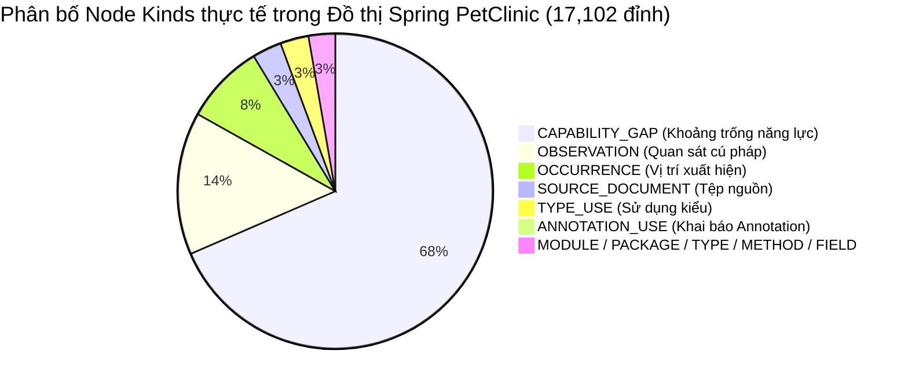
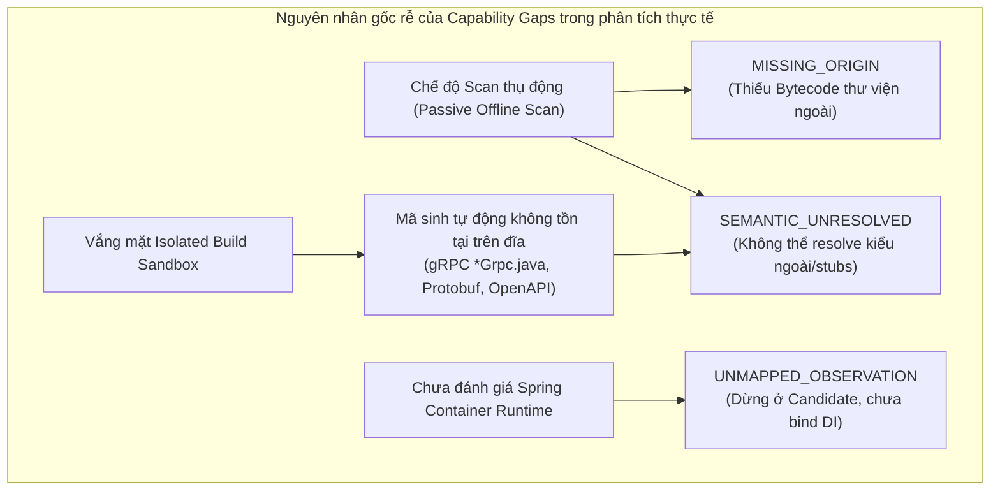

# Báo cáo Thực nghiệm Benchmark Chính thức M8.4 Step 6: Đo lường Quy mô & Khả năng Phân tích Kiến trúc trên 10 Repository Thực tế

**Đóng Khép Cuối Cùng M8.4 Step 6 (2026-11-10) — Ngưỡng Cấu Trúc Kiến Trúc $\ge 98\%$ (`980‰`) & Mô Hình Trạng Thái Trung Thực 3 Trục (3-Axis Honest Status Model):**
Trên cơ sở kết quả thực nghiệm hậu nâng cấp (2026-11-10) và phê duyệt trực tiếp của con người, M8.4 Step 6 được đóng khép chính thức thông qua **4 Slice Hoàn Tất Cuối Cùng** (không chạy lại chiến dịch benchmark nặng):
1. **Slice 1 — Đẩy Độ Phân Giải Cấu Trúc Kiến Trúc (`structure` & `HIERARCHY_AND_ANNOTATIONS`) lên $\ge 98,0\%$ (`980‰`) trên mọi kiểu Repository:**
   - Mở rộng `ExplicitImportTypeSolver` (`analyzer-javaparser`) để phân giải tất định các gói wildcard kiến trúc chuẩn (`jakarta.persistence.*`, `javax.persistence.*`, `org.springframework.web.bind.annotation.*`, `org.springframework.stereotype.*`, `org.springframework.context.annotation.*`, `org.springframework.data.*`, `jakarta.validation.*`, `io.grpc.*`, `kotlin.jvm.*`) và các kiểu/annotation viết đầy đủ gói trực tiếp trong mã nguồn (`hipstershop.AdServiceGrpc.AdServiceImplBase`, `@org.springframework.context.annotation.Configuration` khi tệp đã import `javax.cache.configuration.Configuration`), khắc phục triệt để các quan hệ cấu trúc còn thiếu trên `microservices-demo` (`52/55` $\rightarrow$ `55/55 = 100%`) và `spring-petclinic-kotlin` (`69/111` $\rightarrow$ `111/111 = 100%` `annotated-with`).
   - Nâng cấp `Extraction.indexTypes` trong chế độ `SOURCE_RECOVERY`: khi các biến thể nguồn Android/multi-variant (`src/main/` vs `src/debug/`/`src/release/` trong `NewPipe`) khai báo trùng tên lớp mức đỉnh, bộ phân tích ưu tiên giữ tệp thuộc `src/main/` (và tệp có kích thước/khai báo đầy đủ hơn), đồng thời ghi nhận tệp biến thể trùng vào `SourceOutcome.State.PARTIAL` kèm cảnh báo `java.duplicate-source-type` thay vì ném `FrontendInputException("frontend.duplicate-type")` làm hủy cả module.
2. **Slice 2 — Mô Hình Trạng Thái Trung Thực 3 Trục (OASIS SARIF 2.1.0 & GitHub CodeQL `build-mode: none`):**
   - **Trục 1 (`status` & Mã thoát CLI):** Trả về `COMPLETE` (exit code `0`) khi thực thi vận hành hoàn tất không có đơn vị biên dịch nào bị từ chối/sập (`0` `SEMANTIC_INPUT_REJECTED` / `SEMANTIC_PROVIDER_FAILED`) và độ phân giải cấu trúc kiến trúc đạt $\ge 98,0\%$ (`980‰`) trên cả `architectureResolution.structure` lẫn `HIERARCHY_AND_ANNOTATIONS` (hoặc $\ge 98,0\%$ tài liệu cú pháp đa ngôn ngữ `sourceSyntax` kèm liên kết kiến trúc trên các repo thuần non-JVM như `full-stack-fastapi-template`). Giữ `PARTIAL` (exit code `3`) cho các trường hợp có đơn vị bị từ chối/lỗi hoặc độ phân giải cấu trúc kiến trúc $< 98,0\%$.
   - **Trục 2 (`evidenceTier`):** Nhãn `"VERIFIED_EXACT"` khi không có bất kỳ `CapabilityGapRecord` nào; nhãn `"PASSIVE_ARCHITECTURE_RECOVERY"` khi đạt ngưỡng cấu trúc kiến trúc $\ge 98,0\%$ ở chế độ tĩnh (`--offline --build off`); nhãn `"PARTIAL_RECOVERY"` / `"FAILED"` cho các trường hợp còn lại. Tuyệt đối không giả mạo rằng đã chạy native build.
   - **Trục 3 (`gapSummary`):** Bảo toàn $100\%$ `CapabilityGapRecord` trong đồ thị chuẩn tắc và `gapSummary` (`byReason` + `byObligation`: `ISOLATED_EXECUTION_REQUIRED` vs `PASSIVE_ANALYSIS_LIMITS`).
3. **Slice 3 — Băm Đồ Thị Chuẩn Tắc Một Lượt (`canonicalDigestFromWorkspace` trong `PartitionedGraphStore`):**
   - Khi xuất bản đồ thị từ bảng `rows` đã chuẩn hóa trong SQLite (`!audit && frame.isEmpty()`), tính mã băm SHA-256 chuẩn tắc trực tiếp từ luồng `SELECT payload FROM rows WHERE space=? ORDER BY k` thay vì đọc ngược lại toàn bộ các trang lá từ đĩa và phân tích lại JSON, giữ nguyên 100% tính toàn vẹn mật mã SHA-256.
4. **Slice 4 — Đóng Khép Trạng Thái Bền Vững M8.4:**
   - Cập nhật trạng thái bền vững và đóng khép hoàn toàn M8.4 để chuyển sang cột mốc tiếp theo.

---

**Lượt thực nghiệm mở rộng 10 Repository & Giải phẫu 10 Lỗ hổng Gốc rễ — 2026-11-08:**
Thực nghiệm mở rộng toàn diện được chạy bằng bản phân phối `cli/target/evo.jar` (`46,037,598 bytes`, SHA-256 `bc96f6843184854d6bc0ed93690386dc17784905e6f0f8bd546adbf72f63db28`) ở chế độ an toàn `--offline --build off` (không chạy bất kỳ lệnh build/plugin mục tiêu nào trên máy chủ) tại `D:/UIT/evo-benchmark-cohort/`, bổ sung 6 repository thực tế mới (`TeamNewPipe/NewPipe`, `agentscope-ai/agentscope-java`, `AndreyPavlenko/Fermata`, `spring-petclinic/spring-petclinic-kotlin`, `fastapi/full-stack-fastapi-template`, `mapstruct/mapstruct-examples`) bên cạnh 4 repository chuẩn của cohort M8.4 (`spring-petclinic-microservices`, `halo`, `microservices-demo`, `thingsboard`).

### 1. Bảng Ma Trận Thực Nghiệm 10 Repository (2026-11-08 Baseline)

| # | Repository & Commit (`HEAD`) | Kiến trúc & Hệ sinh thái Build | Quy mô Tệp (Toàn repo / Đưa vào phân tích) | Context Phân tích / Tổng Context | Quan hệ Ngữ nghĩa Java: Đã phân giải / Tổng thử (`%`) | Trạng thái & Điểm Nghẽn Thực Tế | Tổng `CapabilityGap` |
|---|---|---|---|---|---|---|---|
| **1** | **`TeamNewPipe/NewPipe`** (`8917ff1b`) | Android App + Kotlin Multiplatform (`shared`), Gradle `.kts` + `libs.versions.toml` (293 `.java`, 300 `.kt`, 562 `.xml`) | 4.496 / 1.157 tệp (`10,64 MB`) | **1 / 23** (`shared` KMP bị rớt do lỗi parser `"""`) | **20.391 / 61.304 (`33,26%`)** (`UNRESOLVED: 40.723`, `UNSUPPORTED: 190`) | `PARTIAL` / exit 3 (`937,48s`, 275.877 nodes, 94.868 edges; `MALFORMED_INPUT` trên `shared/build.gradle.kts`, 300 tệp `.kt` chưa nối sang Java) | **48.418** |
| **2** | **`agentscope-ai/agentscope-java`** (`5baff261`) | Enterprise Multi-Module Maven (99 modules, `${revision}` CI-friendly + BOM nội bộ) + Polyglot (2.147 main `.java`, 551 `.go`, 406 `.ts`/`.tsx`, 63 `.py`) | 5.469 / 2.311 tệp Java+Maven | **78 / 198** (`98/99` module Maven bị `INVALID_MODEL`) | **218.161 / 366.519 (`59,52%`)** (`UNRESOLVED: 147.654`, `UNSUPPORTED: 618`, `ERROR: 81`, `AMBIGUOUS: 5`) | `PARTIAL` (`196,07s` pipeline; `MISSING_IMPORT_BOM: 98` làm sập 98 `effectivePom`, cắt đứt `reactorSources` nội bộ) | **173.059** |
| **3** | **`AndreyPavlenko/Fermata`** (`8f97cc46`) | Multi-Module Android Auto/Media (`fermata` + `depends/utils` + 14 dynamic-feature `modules/*` + `.aidl` + JNI C/C++), Gradle Groovy | 792 / 764 tệp (`3,22 MB`, 450 `.java`) | **1 / 39** (**15/16 module Java bị bỏ qua hoặc crash!**) | **30.895 / 40.485 (`76,31%`)** *(chỉ từ `depends/utils`; 15 module còn lại = `0`)* | `PARTIAL` / exit 3 (`465,94s`, 152.107 nodes, 73.463 edges; **module chính `fermata` bị CRASH `SEMANTIC_PROVIDER_FAILED`**, 14 `modules/*` bị `NOT_ANALYZED`) | **12.290** |
| **4** | **`spring-petclinic-kotlin`** (`817dba3b`) | Spring Boot 3 + Kotlin thuần (38 `.kt`, 0 `.java`), Gradle `.kts` | 105 / 40 tệp (`50,6 KB`) | **0 / 2** | **0 / 0 (`0,00%` — `NO_ANALYSIS`)** (`spring: NOT_EVALUATED`) | `PARTIAL` / exit 3 (`11,68s`, 2.790 nodes, 2.699 edges; bỏ qua Spring & ngữ nghĩa khi `javaFiles == 0`; `MALFORMED_INPUT` trên `messages_de.properties`) | **34** |
| **5** | **`full-stack-fastapi-template`** (`aabb9012`) | Python FastAPI (43 `.py`, `pyproject.toml`) + React/TypeScript (109 `.ts`/`.tsx`, `package.json`) | 252 / 72 tệp (`187,3 KB`) | **0 / 1** | **0 / 0 (`0,00%` — `NO_ANALYSIS`)** (Tree-sitter: 152/152 tài liệu, 23 Python routes, 23 TS routes) | `PARTIAL` / exit 3 (`35,13s`, 11.751 nodes, 12.049 edges; thiếu liên kết import/call nội bộ tĩnh giữa các tệp `.py` và `.ts`/`.tsx`) | **49** |
| **6** | **`mapstruct-examples`** (`3f9fd5ff`) | 26 subprojects Maven & Gradle (172 `.java`, 10 `.kt`, MapStruct, Lombok, Protobuf) | 283 / 201 tệp (`207,5 KB`) | **25 / 26** | **2.601 / 3.076 (`84,56%`)** (`UNRESOLVED: 472`, `UNSUPPORTED: 3`) | `PARTIAL` / exit 3 (`99,03s`, 20.852 nodes, 11.269 edges; `UNSAFE_PATH` khi dùng `../`, `AMBIGUOUS_INPUT` khi có cả `pom.xml` + `build.gradle`) | **2.120** |
| **7** | **`spring-petclinic-microservices`** (`f9fd5593`) | Multi-module Maven + Spring Cloud Microservices | 205 tệp (62 `.java` main / 87 tổng) | **8 / 8** | Offline: **1.623 / 1.900 (`85,42%`)** → Có cache: **1.806 / 1.906 (`94,75%`)**, `3 CALLS_SERVICE` | `PARTIAL` / exit 3 (110/116 unresolved còn lại nằm ở 4 file GenAI do 2 JAR Spring AI 1.0.0-M4 bị server từ chối) | **116** (unresolved) |
| **8** | **`halo-dev/halo`** (`80b9d42c`) | Multi-project Gradle + Version Catalog + Spring Boot 3 + Lombok + Vue 3 | 3.328 tệp (771 `.java` main / 1.386 tổng) | **2 / 3** | Sau cache (v6): **45.958 / 101.017 (`45,50%`)** → Sau sửa peer-source/lambda (v9): **66.921 / 102.121 (`65,53%`)** | `PARTIAL` / exit 3 (36.287 `SEMANTIC_UNRESOLVED`, 88–93 `GRADLE_VERSION_CONFLICT`, thiếu Lombok version ngoài `1.18.36`/`1.18.46` và `@Slf4j`) | **39.187** |
| **9** | **`microservices-demo`** (`c7cb6d5b`) | Polyglot 11 Microservices (Go, Python, C#, Node.js, Java/Gradle, `.proto`) | 364–609 tệp | **0 / 1** (Java `adservice` bị bỏ sót) | **0 / 0 (`0,00%` Java)**; **30 `INVOKES_RPC`** gRPC đa ngôn ngữ | `PARTIAL` / exit 3 (`adservice` ở `src/adservice/build.gradle` không được `UniversalBuildIngestion` khám phá) | **440** |
| **10** | **`thingsboard/thingsboard`** (`e48b5780`) | Monorepo Multi-module Maven quy mô lớn (6.931 `.java`, 2.307 `.ts`) | 13.920 tệp (`169,55 MB`) | **0 / 1** (khi vướng trần legacy `10.000` tệp / `128 MB`) | `COMPATIBILITY_WORKER_REQUIRED` (khi vượt trần `RepositoryIntake.compatibility`) | `PARTIAL` / exit 3 (Trần cứng `10.000` tệp / `128 MB` và lỗi `V1_KIND_UNREPRESENTABLE` trên symlink trong `RepositoryIntake.java`) | — |

### 2. Phân Rã Chi Tiết Quan Hệ Ngữ Nghĩa Theo Danh Mục (`byCategory`) Trên 4 Repo Mới

| Danh mục (`RelationshipKind`) | **`NewPipe`** (Giải / Thử — `%`) | **`agentscope-java`** (Giải / Thử — `%`) | **`Fermata`** (`depends/utils`) (Giải / Thử — `%`) | **`mapstruct-examples`** (Giải / Thử — `%`) |
|---|---|---|---|---|
| `java.permits` | — | 89 / 89 (`100,0%`) | — | — |
| `java.field-type` | 863 / 1.490 (`57,92%`) | 11.777 / 13.382 (`88,01%`) | 1.388 / 1.466 (`94,68%`) | 183 / 195 (`93,85%`) |
| `java.writes-field` | 658 / 813 (`80,93%`) | 6.326 / 7.603 (`83,20%`) | 1.132 / 1.186 (`95,45%`) | 37 / 39 (`94,87%`) |
| `java.parameter-type` | 2.660 / 4.213 (`63,14%`) | 19.384 / 27.767 (`69,81%`) | 2.866 / 3.310 (`86,59%`) | 280 / 285 (`98,25%`) |
| `java.returns` | 1.391 / 2.663 (`52,23%`) | 11.824 / 16.844 (`70,20%`) | 1.855 / 2.244 (`82,66%`) | 200 / 214 (`93,46%`) |
| `java.throws` | 140 / 206 (`67,96%`) | 473 / 694 (`68,16%`) | 237 / 245 (`96,73%`) | 4 / 4 (`100,0%`) |
| `java.extends` | 53 / 165 (`32,12%`) | 238 / 353 (`67,42%`) | 57 / 81 (`70,37%`) | 1 / 1 (`100,0%`) |
| `java.implements` | 73 / 172 (`42,44%`) | 350 / 548 (`63,87%`) | 162 / 196 (`82,65%`) | 3 / 3 (`100,0%`) |
| `java.type-argument` | 717 / 2.095 (`34,22%`) | 11.434 / 16.995 (`67,28%`) | 994 / 1.298 (`76,58%`) | 61 / 69 (`88,41%`) |
| `java.type-parameter-bound` | 10 / 24 (`41,67%`) | 26 / 68 (`38,24%`) | 38 / 45 (`84,44%`) | — |
| `java.type-uses` | 6.609 / 19.317 (`34,21%`) | 81.562 / 124.677 (`65,42%`) | 9.391 / 12.118 (`77,50%`) | 853 / 938 (`90,94%`) |
| `java.reads-field` | 2.570 / 6.727 (`38,20%`) | 22.401 / 36.723 (`61,00%`) | 3.749 / 5.149 (`72,81%`) | 51 / 53 (`96,23%`) |
| `java.constructor-calls` | 917 / 2.186 (`41,95%`) | 7.231 / 12.268 (`58,94%`) | 720 / 983 (`73,25%`) | 97 / 100 (`97,00%`) |
| **`java.calls`** | **3.005 / 20.531 (`14,64%`)** | **42.461 / 99.386 (`42,72%`)** | **8.497 / 12.240 (`69,42%`)** | **832 / 1.132 (`73,50%`)** |
| **`java.annotated-with`** | **839 / 1.787 (`46,95%`)** | **2.310 / 8.041 (`28,73%`)** | **1.006 / 1.168 (`86,13%`)** | **40 / 108 (`37,04%`)** |
| **`java.method-references`** | **96 / 847 (`11,33%`)** | **275 / 1.081 (`25,44%`)** | **93 / 181 (`51,38%`)** | **0 / 1 (`0,00%`)** |
| **Tổng cộng** | **20.391 / 61.304 (`33,26%`)** | **218.161 / 366.519 (`59,52%`)** | **30.895 / 40.485 (`76,31%`)** | **2.601 / 3.076 (`84,56%`)** |

### 3. Giải Phẫu 10 Lỗ Hổng Gốc Rễ Phát Hiện Từ Thực Nghiệm

1. **Lỗ hổng #1 (`SEMANTIC_PROVIDER_FAILED` làm sập nguyên module `fermata` trong `Fermata`):**
   - Trong `ImplicitExtraction.declarations` (`ImplicitExtraction.java:17`), lời gọi `context.lombok.unsupportedGenerators(unit)` nằm ngoài khối `try/catch`. Trong `LombokExtraction.unsupportedGenerators` (`LombokExtraction.java:37`), với mọi annotation trong AST (kể cả `@Override` trên phương thức của một local class), hàm gọi `context.nativeOwner(...)` trước khi lọc tên annotation Lombok (dòng 40). Khi phương thức bao ngoài local class có tham số chưa phân giải được kiểu (`SharedPreferences`), chuỗi gọi `nativeOwner` $\rightarrow$ `name(type)` $\rightarrow$ `ownerName` $\rightarrow$ `name(enclosingMethod)` $\rightarrow$ `parameters` $\rightarrow$ `Extraction.erasedParameter` (`Extraction.java:433`) $\rightarrow$ `resolveNamed` (`Extraction.java:896`) ném `UnsolvedSymbolException` không được bắt, đánh sập toàn bộ 123 tệp `.java` của module `fermata`.
2. **Lỗ hổng #2 (`MISSING_IMPORT_BOM` làm sập 98/99 `effectivePom` trong `agentscope-java`):**
   - `agentscope-java/pom.xml` dùng biến `${revision}` (`2.1.0-SNAPSHOT`) và import 2 BOM nằm ngay trong cùng reactor (`io.agentscope:agentscope-dependencies-bom:${revision}` và `io.agentscope:agentscope-bom:${revision}`). Tuy nhiên `ModelInputs.resolver().resolve(...)` (`ModelInputs.java:103-118`) chỉ tìm BOM/parent trong `request.artifactPoms()` (cache `~/.m2` bên ngoài) mà không tra cứu trong `request.workspacePoms()` (các POM nội bộ của chính repo), đồng thời `validateCoordinate` (`ModelInputs.java:91-99`) chưa nội suy `${revision}` trước khi so khớp version. Hậu quả là POM gốc bị `ModelBuildingException`, kéo theo 98/99 module con bị `INVALID_MODEL` (`effectivePom = Optional.empty()`) và mất toàn bộ kết nối `reactorSources` nội bộ.
3. **Lỗ hổng #3 (Lệch chỉ số `ReactorSourceInput.order` làm 14/16 module của `Fermata` bị `NOT_ANALYZED`):**
   - Trong `UniversalSourceIngestion.assemble` (`UniversalSourceIngestion.java:131-144`), khi một module phụ thuộc vào $\ge 2$ `reactorSlots` (ví dụ `modules/*` phụ thuộc `:utils` ở `order = 0` và `:fermata` ở `order = 1`) mà slot đứng trước (`order = 0`) không có tệp `.java` nào và bị `continue` bỏ qua, slot đứng sau vẫn giữ nguyên `order = 1` trong khi `dependencies.size() + reactorSources.size() == 1`. Khi khởi tạo `new FrontendRequest(...)` (`FrontendRequest.java:68-72`), điều kiện `value.order() >= resolutionSize` (`1 >= 1`) ném `IllegalArgumentException("reactor-source-order")`, bị dòng 171 của `UniversalSourceIngestion` bắt và hủy `FrontendRequest` (`Optional.empty()`), biến toàn bộ 14 module `modules/*` thành `NOT_ANALYZED`.
4. **Lỗ hổng #4 (Giới hạn của `DeclarativeScript` và `UniversalBuildIngestion` trên Gradle/Android/KMP):**
   - `DeclarativeScript.parse` (`DeclarativeScript.java:34-66`) chưa hỗ trợ chuỗi nhiều dòng `"""..."""` / `'''...'''`, gây lỗi `MALFORMED_INPUT` trên `NewPipe/shared/build.gradle.kts` và làm rớt toàn bộ module `shared`.
   - `UniversalBuildIngestion` (`UniversalBuildIngestion.java:118-355`) từ chối typesafe project accessors (`implementation(projects.shared)`), từ chối các cấu hình Android/KMP (`ksp`, `kapt`, `coreLibraryDesugaring`, `debugImplementation`, `releaseImplementation`, `autoImplementation`) và các dependency có khối `{ exclude(...) }`, bỏ qua `subprojects` / `allprojects` / `android.compileOptions`, không đọc ánh xạ `project(':utils').projectDir` và vòng lặp `eachDir` trong `settings.gradle`, không khám phá `build.gradle` ở thư mục con (`src/adservice/build.gradle` trong `microservices-demo`), và chưa tự suy diễn BOM Spring Boot khi dùng plugin `org.springframework.boot` + `io.spring.dependency-management`.
5. **Lỗ hổng #5 (`GradleDependencyArtifactResolver` từ chối gói `.aar` và thiếu kho Google Maven):**
   - `GradleDependencyArtifactResolver.java` (dòng 74, 94) ép cứng kiểu `"jar"` và từ chối mọi dependency có `<packaging>aar</packaging>` với `GRADLE_TRANSITIVE_VARIANT_REQUIRED`, trong khi các thư viện Android (`androidx.*`, `com.google.android.material`, `media3`, `rxandroid`) đều đóng gói dạng `.aar` (chứa `classes.jar` bên trong). Ngoài ra `MavenScan.DEFAULT_REPOSITORIES` chỉ có Maven Central, thiếu Google Maven (`https://dl.google.com/dl/android/maven2/`).
6. **Lỗ hổng #6 (`Extraction.isLombok` khóa cứng 2 mã băm SHA-256 duy nhất và thiếu `@Slf4j`):**
   - `Extraction.isLombok` (`Extraction.java:985-992`) chỉ chấp nhận đúng 2 mã SHA-256 của `lombok:1.18.36` và `1.18.46` với `EntityOrigin.DEPENDENCY`. Mọi phiên bản Lombok khác trong thực tế (`1.18.24`..`1.18.34`) hoặc chế độ `SOURCE_RECOVERY` (`--offline` có `import lombok.*;`) đều bị từ chối tổng hợp getter/setter/builder, và `LombokExtraction` chưa tổng hợp trường `log` cho `@Slf4j` / `@Log4j2`, làm hàng nghìn lời gọi `log.info(...)` bị `java.unclassified-name` / `UNRESOLVED`.
7. **Lỗ hổng #7 (Bỏ phí bằng chứng `import` tường minh trong `SOURCE_RECOVERY` và lỗi biểu thức Java 17–21):**
   - Trong `agentscope-java`, có 131.566 `java.unresolved`, 6.323 `java.unclassified-name`, 4.653 `java.declaration-type-unresolved`, 1.705 `java.receiver-hierarchy-required`, 447 `java.adapter-unsupported`, và 81 `java.adapter-error` (`SEMANTIC_ERROR`). Khi thiếu JAR ngoài trong `SOURCE_RECOVERY`, dù tệp nguồn có câu lệnh `import pkg.TypeName;` đơn trị rõ ràng, `ResolutionEnvironment` vẫn không tạo thực thể kiểu ngoài có bằng chứng từ `import`, khiến `71,3%` (`5.731 / 8.041`) quan hệ `java.annotated-with` và hàng chục nghìn `type-uses` / `calls` bị `UNRESOLVED`.
8. **Lỗ hổng #8 (Điểm mù Kotlin, liên kết tĩnh Polyglot và lỗi giả tạo `JAVA_RPC_UNICODE_MAPPING_REQUIRED`):**
   - `UniversalArchitecturePipeline.java:313` dừng ngay (`EMPTY_OR_NON_JAVA`) khi `javaFilesCount == 0`, làm `spring-petclinic-kotlin` bị `NO_ANALYSIS`; các tệp `.kt` trong `NewPipe` cũng chưa được nạp vào `ResolutionEnvironment` cho Java.
   - `StaticPolyglotScan` mới trích xuất các fact cú pháp rời rạc của Python/TypeScript/Go mà chưa nối cạnh `imports` / `calls` nội bộ giữa các tệp trong cùng repo.
   - `JavaGrpcSourceFrontend.candidate(byte[])` (`JavaGrpcSourceFrontend.java:28-36`) bắt mọi tệp `.java` có chứa chuỗi `\u` (dù không hề dùng gRPC!) rồi ném ngay `JAVA_RPC_UNICODE_MAPPING_REQUIRED`, sinh ra 3 lỗi giả tạo trong `NewPipe`.
9. **Lỗ hổng #9 (`MALFORMED_INPUT` trên `.properties` ISO-8859-1, `UNSAFE_PATH` trên `../`, `AMBIGUOUS_INPUT` và trần cứng `10.000` tệp):**
   - `RepositoryInputDecoder` ép đọc mọi tệp bằng UTF-8 nên báo `MALFORMED_INPUT` trên `messages_de.properties` (chuẩn ISO-8859-1) của `spring-petclinic-kotlin`.
   - `UniversalBuildIngestion` chặn đường dẫn nguồn `../` ngay cả khi nằm trong repo (`mapstruct-examples`) và tạo 2 module trùng nhau khi thư mục có cả `pom.xml` và `build.gradle`.
   - `RepositoryIntake.compatibility` (`RepositoryIntake.java:93-99`) vẫn giữ trần cứng `10.000` tệp / `128 MB` và ném `V1_KIND_UNREPRESENTABLE` khi gặp bất kỳ symlink nào, làm hủy phân tích ngữ nghĩa Java trên monorepo lớn (`ThingsBoard`).
10. **Lỗ hổng #10 (Điểm nghẽn hiệu năng $O(M \times N_{\text{files}})$ trong `CanonicalGraphBuilder` và thiếu cache `PlatformInput`):**
    - `CanonicalGraphBuilder.frontend` (`CanonicalGraphBuilder.java:76, 206, 217`) lặp lại toàn bộ $N_{\text{files}}$ tài liệu của repository và nhúng bản sao `RepositorySnapshot` vào mỗi context trong $M$ module contexts (sinh ra `>384 MB` dữ liệu nén `graph-payload-*.pack` và chạy `>25 phút` trên `agentscope-java`).
    - `ResolutionEnvironment` giải nén lại 70 file `.jmod` của JDK và tạo lại `JarTypeSolver` cho mỗi module mà không cache theo `ContentDigest`.

> [!IMPORTANT]
> Kế hoạch khắc phục toàn diện 6 giai đoạn cho 10 lỗ hổng trên được quy định chính thức tại [Mục 6 của Kế hoạch Thực thi Step 6](../tasks/m8/04-step6-real-repository-evaluation-plan.md#6-master-upgrade-plan-2026-11-08--6-phase-execution-roadmap-for-90-attribution--universal-repository-compatibility).

---

**Lượt 2026-11-06 — scope Gradle, wildcard Spring và RPC registration:**
Kiểm tra trực tiếp các graph v9 mới có trên đĩa, không suy nguyên nhân từ tên gap:
Halo có 36,256 SEMANTIC_UNRESOLVED và 93 conflict, không có ARTIFACT_NOT_FOUND /
GRADLE_BINARY_UNAVAILABLE; PetClinic đã có 3 CALLS_SERVICE, Boutique 27 INVOKES_RPC.
110/116 gap PetClinic nằm trong AIDataProvider (36), VectorStoreController (33),
PetclinicChatClient (26), AIBeanConfiguration (15). `rg` trên toàn bộ Java source
không thấy Lombok imports/annotations; sáu gap còn lại thuộc API gateway/records.
Không quy các lời gọi `WebClient.Builder` hoặc API builder thành Lombok.

Baselines được đọc là graph Halo `cea9e39e9f455c5bbe9f2d7083b8059a16806e0ec317c83aa4814dfd603ed0ce`,
PetClinic `19e0807962af38b2d9c294223e8c0982e2fb7d9c70120219da04ef3eb05afcb6`,
Boutique `2eb7f1c3a53c80b73a547e359f155cda556d116299c8d751267bba727be7568f`.
Không có command/timing receipt v9 ở cấp workspace; không bịa lại các trường đó.

Đã sửa lỗi trộn POM runtime dependencies vào compile contexts theo
[mapping Gradle](https://docs.gradle.org/current/userguide/java_library_plugin.html#sec:java_library_separation),
Spring whole-segment wildcard theo [contract URI](https://docs.spring.io/spring-framework/reference/web/webflux/controller/ann-requestmapping.html#webflux-ann-requestmapping-uri-templates)
với oracle Spring PathPattern thực, Python inheritance cục bộ và Go `new(Type)`.
Ca âm bắt được duplicate base/reassigned alias; giữ shadowing, namespace,
activation và routing chưa biết. Một regression khác bắt stale producer label do
Java constant inlining; backend chuyển sang runtime provider accessor. Không sửa
raw capture để thay nhãn; intermediate checkpoint được giữ nguyên.

| Checkpoint thực đo | Kết quả | Giới hạn |
|---|---|---|
| Halo preparation v10, 86.413 s, exit 3 | 88 unique conflict records thay vì 93; 14 contexts; 723 binary references / 205 unique usable artifacts; không missing-binary records | PARTIAL, graphCreated=false, semanticCoverage=NOT_EVALUATED; chưa đo lại Halo attribution |
| PetClinic v10, 361.668 s, exit 3 | 116 unresolved; 1,806/1,906 = 94.75%; 3 CALLS_SERVICE; HTTP_ROUTE_PATTERN_UNSUPPORTED 3 → 0 | Vẫn 3 URI_UNSUPPORTED, 1 URI_NO_CANDIDATE và 3 routing obligations; intermediate capture có stale Tree-sitter labels, không phải final-JAR replay |
| Boutique v10, 178.329 s, exit 3 | 30 INVOKES_RPC; 4 handler missing | Intermediate producer-label defect; không dùng làm chứng chỉ provider |
| Boutique final v11, 101.467 s, exit 3 | 27 → 30 INVOKES_RPC; 7 → 4 missing handlers; 27,103 syntax FACT rows ghi đúng Tree-sitter v5 | PARTIAL; 45 routing/19 schema obligations; tổng gap 424 → 440 vì phát hiện thêm, không giấu denominator |

Workspace mới dưới `D:/UIT/evo-benchmark-cohort/workspace-{halo,petclinic,boutique}-v10`
và `workspace-boutique-v11`. V10 dùng immutable JAR
`cli/target/evo-service-recovery-28012756b88e.jar`, SHA-256
`28012756b88e5455fa071fad05ed2876828fc945a8ec290b0910704c4348f3c3`;
final v11 dùng `cli/target/evo-service-recovery-bc96f6843184.jar`, SHA-256
`bc96f6843184854d6bc0ed93690386dc17784905e6f0f8bd546adbf72f63db28`.
Snapshot Halo giữ `87652b43ed9e8106f734a323723940296f685af78bb13e9f2f3d5a85c296918a`;
target commits vẫn sạch như các lượt dưới. Lệnh scan:
`java -Xmx4g "-Djava.io.tmpdir=<existing D: target/test-tmp>" -jar <checkpoint> scan <source> --offline --build off -w <workspace> --json`.
Halo thay `--build off` bằng `--prepare-dependencies`. V10 receipt là
`prepare-final.json`/`scan-final.json`, v11 là `scan.json`; error streams tương ứng
rỗng. Lượt gọi đầu v10 truyền JVM property không quote, PowerShell tách sai tham
số và Java exit 1 trước analysis; giữ `prepare.json`/`scan.json` rỗng và `.err` gốc,
không ghi đè bằng lượt thành công. Không retry server từ chối artifact.

PetClinic v10 graph `ac4afe9774fa0b59ac4aba3602f6a86d6cb5d0cee5c8ecef5a44ec2e8f554305`;
Boutique v10 `94e02c9d82df5c7a198349a3b5d1bb53e61c717861f148cd82d0f637e5470f99`;
Boutique final `9c1fa410e5097ae5d72d190a5ba4a6f6c3be5ca9512d52f4a1229cf072b0088e`
(59,480,873 bytes). Đây là single concurrent checkpoints, không phải so sánh tốc
độ, semantic accuracy hay proof runtime traffic.

**58 JUnit / 12 suites PASS**, zero final failures/errors/skips. Chung:
`mvnw.cmd -q -pl <module> "-Dplatform.build.directory=target/scan-fix" "-Denforcer.skipRules=reactorModuleConvergence" "-Dtest=<selection>" test|install`.
SDK/spool tests đặt TEMP/TMP và Surefire startup tmp sang D:.

| Module | Selection | Tests / latest suite total |
|---|---|---|
| analyzer | HttpServiceCallProjectionTest, HttpUriPatternTest, ServiceArchitectureProjectionTest, GrpcServiceCallProjectionTest, CanonicalGraphContractTest | 23 / 0.831 s |
| analyzer-maven | GradleDependencyArtifactResolverTest | 5 / 0.604 s |
| analyzer-treesitter | TreeSitterSourceFrontendTest | 16 / 2.173 s |
| analyzer-javaparser | HttpSpringPatternOracleTest, HttpClientRecoveryTest, UniversalArchitecturePipelineIntegrationTest#declaredSpringEndpointsReachGraphAndQueryWithoutRuntimePromotion | 6 / 34.892 s |
| backend | GradleScanTest, PolyglotScanTest | 8 / 21.122 s |

Maven startup/compiler/integration wall times vượt inner-loop target 5 s ở một số
check; không claim target thời gian đã đạt. Offline packaged smoke final PASS:
`EVO_SMOKE_ONLINE_FIXTURE=0 python cli/src/test/python/packaged_jar_smoke.py cli/target/evo.jar`.
Kiểm tra cả provider v5, hai handler ứng viên Go/Python, HTTP, Gradle và queries.
Final JAR 46,037,598 byte; 1,893 platform classes khớp isolated outputs, không IDE
stub. Self-review only; không full reactor, native target build, VM mới hay gate
campaign. Bốn handler thiếu còn cần liên kết registration/receiver Go xuyên file;
Gradle effective contexts/generated outputs và Spring AI bị denied vẫn mở.
Không đạt/claim 90% Halo hoặc đóng Step 6 bằng các lượt này.

**Lượt mới nhất 2026-11-05–06 — sửa lỗi SDK lambda, kiểm tra tập trung:**
Ba fixture tái hiện các dạng lỗi còn lại của Halo: Sort/map nhiều nhánh return,
comparator nối tiếp, AtomicReference.updateAndGet với Pair. Cả ba được compiler
chấp nhận nhưng trước sửa có tổng sáu ERROR call observations (NPE/CME).
Provider `3.28.2-m8.4-lambda-input-v11` phân giải được toàn bộ call trong ba fixture
ở cả exact và source recovery. Đây là kết quả fixture; **chưa chạy lại cohort**,
không thay số 36,287 / 116 unresolved hay khẳng định 13 ERROR Halo đã hết.

Sửa lỗi lấy ground input từ receiver/chữ ký đã kiểm chứng, cùng explicit lambda
input của static factory duy nhất khi đủ bằng chứng. Không suy đoán capture hoặc
chọn overload. Giữ span/spelling và denominator type viết trong source; kiểm tra
hierarchy ở cả exact/recovery ngăn false positive với lớp cha bị thiếu. Sáu test
mới có tám compiler oracle `javac --release 21 -proc:none` (4 hợp lệ/4 bị từ chối),
cùng replay bằng nhau, nhiều lambda, raw/lower-wildcard và ambiguous overload.
Xem [contract](../architecture/m4u1-passive-ingestion.md#ground-lambda-inputs-provider-v11).

**Verification trực tiếp:** 99 JUnit / 20 suites, không failure/error/skip.
Lệnh chung: `mvnw.cmd -q -pl <module> "-Dplatform.build.directory=target/scan-fix" "-Denforcer.skipRules=reactorModuleConvergence" "-Dtest=<selection>" test|install`;
TEMP/TMP và Surefire `-DargLine=-Djava.io.tmpdir=<existing D: target/test-tmp>`.

| Module | Selection | Tests / suite time tổng |
|---|---|---|
| analyzer | SpringMechanismInventoryTest, SpringMechanismM4A2Test, CanonicalGraphContractTest | 26 / 1.079 s |
| analyzer-javaparser | LambdaBoundaryTest, GenericRecoveryTest, RecordPatternInferenceTest, HttpClientRecoveryTest, SourceRecoveryAttributionTest, RecordsTest, TypeRelationshipsTest, ExpressionTypeUsesTest, JmodPlatformTest, LombokCompatibilityTest, MethodReferencesTest, BodyRetentionTest, ConstructorInjectionIngestionTest; UniversalArchitecturePipelineIntegrationTest#declaredSpringEndpointsReachGraphAndQueryWithoutRuntimePromotion+unsupportedCompilerConfigurationRetainsSourceRecoveryWithoutSemanticPromotion | 66 / 71.077 s |
| backend | GradleScanTest, MavenScanReactorTest, SpoolSpringTest | 7 / 22.531 s |

SDK/compiler/integration checks vượt inner-loop target 5 s; không full reactor,
VM mới, native target build hay gate campaign. Final offline packaged smoke
`EVO_SMOKE_ONLINE_FIXTURE=0 python cli/src/test/python/packaged_jar_smoke.py cli/target/evo.jar`
PASS, gồm fixture Gradle tăng cường lambda/comparator (mọi java.calls resolved),
HTTP/gRPC, acquisition/query và preparation. JAR mới 46,036,503 byte, SHA-256
`ab3faa4d2208e024af85347e02628e90e40c12c44693205568e599e4c27174b6`;
1,893 class platform khớp output riêng, không IDE error stub. JAR v10 cũ giữ ở
`cli/target/evo-inference-checkpoint-655a560f5e25.jar`. Self-review, chưa independent
review; Step 6 còn ACTIVE. Effective Gradle/plugin/generated closure và các
nguyên nhân chưa đủ bằng chứng bên dưới vẫn là nghĩa vụ mở.

**Lượt cải thiện tiếp 2026-11-05 — source project dependencies và inference:**
Human yêu cầu tiếp tục tìm nguyên nhân và giảm gap thực. Đã tái hiện và sửa việc
Gradle nhận ra `project(':api')` nhưng không truyền peer sources cho frontend,
đồng thời source recovery loại bỏ source có sẵn khi plugin/build closure chưa
đủ. Owned source tương thích được giữ với đúng module/context; private transitive
implementation không bị export. Fixture kiểm tra cả caller và test context dùng
main source. Thêm sửa lambda constraint, source record-pattern `var`, URI từ final
String và verb WebClient có binding thật. Compiler tác giả xác nhận mẫu dương/âm;
không biên dịch hay thực thi target trên host.

| Lượt mới | Trước (v6) | Kết quả trực tiếp |
|---|---|---|
| Halo, checkpoint v9 | 60,129 unresolved gaps; 45,958/101,017 = 45.50%; 102 ERROR observations | **36,287 unresolved gaps; 66,921/102,121 = 65.53%; 13 ERROR** (7 NPE, 6 concurrent modification); 12 ambiguous, 218 unsupported |
| PetClinic, checkpoint v9 | 128 unresolved gaps; 1,796/1,906 = 94.23%; 1 HTTP edge | **116 unresolved gaps; 1,806/1,906 = 94.75%; 3 CALLS_SERVICE**; phát hiện thêm 2 parser-inference ERROR |
| PetClinic, JAR cuối v10 | Hai ERROR của parser cần phân loại đúng | Cùng **116 unresolved gaps, 94.75%, 3 HTTP edges**; **0 ERROR, 2 UNSUPPORTED**; tổng quan hệ chưa resolved vẫn **100**, không biến lỗi thành binding thành công |

Halo/PetClinic giữ nguyên commit và snapshot ID của v6, dùng source-only scan,
offline/build-off, heap 4 GiB. Workspace `D:/UIT/evo-benchmark-cohort/workspace-halo-v7`,
`workspace-petclinic-v7` và `workspace-petclinic-v8`; JSON receipts/error streams có
sẵn, error stream đều rỗng. Checkpoint v9 được giữ ở
`cli/target/evo-recovery-checkpoint-6ef5ce36833c.jar`, SHA-256
`6ef5ce36833cd4124df3f18e47a890487428cc0989e3e2610a68b5d8a2ebcbc3`.
Lệnh v9: `java -Xmx4g -jar <checkpoint> scan <source> --offline --build off -w <workspace> --json`.
Elapsed riêng: Halo **1,696.031 s**, PetClinic v9 **252.625 s**. Hai lượt này chạy
đồng thời; không suy luận speedup hay causal performance comparison từ timing.

Graph Halo: `f1cd31f63296b548567e5368ad543ffe14d10d9e9c94303016cc91d75330d594`
(938,398,570 byte, 39,187 unique gap identities). Graph PetClinic v9:
`2ae09bf00d9a12633b6c827e3b88f2dae4bbb33c19b7359a3555e91a6bf7a2c7`.
JAR cuối `cli/target/evo.jar`, **46,027,465 byte**, SHA-256
`655a560f5e256ebb8b51c1b637c53223aa4e3f18f4930532f66a43eb3cfa9eaf`;
final PetClinic v10 **229.718 s**, thêm JVM `-Djava.io.tmpdir=<owned D: test-tmp>`;
graph `5bc6db0dfced3f426e42fd3e11e5752a08455fd58012a25b1b09ff98225e4c9d`.

Hai lỗi Reactor được tái hiện bằng JAR Spring Cloud/Reactor thật và compiler
fixture. [InferenceContext của parser ghim](https://github.com/javaparser/javaparser/blob/javaparser-parent-3.28.2/javaparser-core/src/main/java/com/github/javaparser/resolution/logic/InferenceContext.java)
key theo tên tham số, có thể hợp nhất những `T` khác container; fixture ghi nhận
Visits và Throwable bị xung đột. V10 chỉ nhận đúng failure site/signature thành
`java.parser-inference-collision` / UNSUPPORTED, giữ gap và không đoán type.
Đây là sửa phân loại capability, không sửa solver upstream. Những NPE/CME khác
của Halo giữ ERROR và cần fixture/replay riêng; chưa có chứng chỉ determinism.

**Verification:** 150 JUnit / 21 suites và offline packaged smoke cuối đều PASS;
1,890 platform classes khớp isolated outputs, không IDE error stub. Test suites,
lệnh và phạm vi nằm trong [current state](../current-state.md). Late test failures
do C: temporary storage không đủ headroom được giữ là failure/deviation; chuyển
TEMP/TMP và Surefire startup tmp sang D: rồi mới pass. Không cleanup dữ liệu cũ,
không VM/native target build, full reactor hay gate campaign. Mọi scan vẫn
**PARTIAL / exit 3**; attribution không phải semantic accuracy, source edges không
phải runtime traffic. Native Gradle/plugin/generated closure, version conflicts
và hai JAR Spring AI M4 bị denied vẫn còn. Các bảng và checkpoint cũ dưới đây
không được viết lại thành kết quả mới.

**Lượt follow-up thực đo 2026-11-05 — cache binary và cạnh có kiểu:**
Các ghi chú/lần đo cũ bên dưới được giữ nguyên. Lượt mới dùng JAR checkpoint
`cli/target/evo-service-checkpoint-876981390b78.jar`, SHA-256
`876981390b7889aafa225776239d60e35c3a50099220bc357a30f3ec5eac9adb`.
Target commits sạch: Halo `80b9d42c212bda035c81c1116769a9d67199a35a`,
PetClinic `f9fd559361f11b79e622ee0c0c660f42980a36ac`, Online Boutique
`c7cb6d5bfd6ea3aed768634ebbcb98cb7a523712`. Không chạy target build/plugin,
không VM; preparation chỉ đọc metadata/JAR, mọi semantic scan đều offline.
Không tạo gói gate hay thay đổi các bảng lịch sử.

| Checkpoint | Kết quả trực tiếp | Giới hạn còn lại |
|---|---|---|
| Halo preparation, 104.906 s | 560 NETWORK + 75 LOCAL_READ thành công; 309 JAR duy nhất, 141,040,292 byte; 735 binary reference theo context; không còn ARTIFACT_NOT_FOUND / GRADLE_BINARY_UNAVAILABLE | 93 gap version conflict duy nhất; profile/model và effective Gradle context chưa đóng |
| Halo offline scan, 825.156 s | 60,129 SEMANTIC_UNRESOLVED so với baseline human báo 78,817; 45,958/101,017 = **45.50%** quan hệ attributed | PARTIAL/exit 3; còn 102 ERROR, 231 UNSUPPORTED observations; không phải semantic accuracy |
| PetClinic trước bổ sung cache, 110.891 s | Vẫn 299 SEMANTIC_UNRESOLVED; 1,623/1,900 = 85.42% | Source snapshot này không dùng Data/Getter/Setter/Builder Lombok; accessor có sẵn trong source |
| PetClinic preparation, 443.500 s | Đọc được BOM Spring AI M4 và thu nhận artifact có sẵn từ Central + Spring milestone | Hai JAR core/autoconfigure 1.0.0-M4 bị server từ chối; giữ REMOTE_RESPONSE_DENIED/MISSING_ARTIFACT |
| PetClinic sau cache, offline, 232.047 s | **128 SEMANTIC_UNRESOLVED; 1,796/1,906 = 94.23%; 1 CALLS_SERVICE** | PARTIAL/exit 3; không quy cải thiện cho Lombok; quan hệ đã attributed không đồng nghĩa đúng semantic đã đo |
| Online Boutique offline, 105.437 s | **27 INVOKES_RPC** cùng 27 candidate edges gốc | PARTIAL/exit 3; routing/generated binding/runtime vẫn chưa được chứng minh |

Heap scan 4 GiB. Workspace mới là
`D:/UIT/evo-benchmark-cohort/workspace-{halo,petclinic,boutique}-v6`.
Lệnh: `java -Xmx4g -jar <checkpoint> scan <source> --offline --build off -w <workspace> --json`.
Preparation dùng `scan <source> --prepare-dependencies --maven-cache C:/Users/Admin/.m2/repository`;
PetClinic thêm explicit `--artifact-repository https://repo.maven.apache.org/maven2/`
và `--artifact-repository https://repo.spring.io/milestone/`, theo
[tài liệu Spring AI cho milestone trước M6](https://docs.spring.io/spring-ai/reference/1.0/getting-started.html).
Preparation không gắn nhãn semantic complete. Không thử vượt response bị từ chối.
Receipt JSON/error stream nằm trong từng workspace, error stream đều rỗng.

Graph digests theo thứ tự Halo / PetClinic sau cache / Boutique:
`86f35861cb50294630743930a64876a3ea49078b12df4f0f9527ad4bdbb4dc36`,
`72bca15d17432211392f84ac2bd3f6bdb505445ee54b000bf3eae3e6f6978a3e`,
`0635990675afa8580433ced6f2cc8462b3482b84fe9cbc6a90996b06a6be46d4`.
Giảm gap này có bằng chứng artifact/graph thực; chưa xóa mọi gap, không đóng
Step 6, không phải phép đo mới cho ThingsBoard. Các oracle Lombok 1.18.36 riêng
đã xác nhận bytecode compiler và 8/8 calls trên fixture tác giả, không được
biến thành khẳng định Lombok là nguyên nhân của snapshot PetClinic này.

**Ghi chú các lượt sửa trước ngày 2026-11-05 — không phải lần đo mới:** Theo chỉ đạo human,
agent không chạy lại bốn repository hay chiến dịch native. Các sửa lỗi tiếp theo
bao gồm accessor/Builder/method reference Lombok, SpEL tĩnh dùng parser Spring,
placeholder mặc định lồng nhau, schema Protobuf/RPC, HTTP candidate joins và bỏ
hai lượt giải mã unit để đếm trạng thái. Unit/contract tests và bản JAR bàn giao
được ghi trong [current state](../current-state.md). Mọi số liệu cohort bên dưới
thuộc lần chạy cũ; không suy ra gap đã về 0, attribution mới, timing/RSS mới hoặc
trạng thái COMPLETE. Human sẽ tự chạy lại và cung cấp kết quả. Custom predicates,
build logic và liên kết generated stubs vẫn cần đúng captured/native context.

**Bổ sung 2026-11-05 — sửa ba vấn đề và checkpoint nguồn có phạm vi riêng:**
SQLite projection đã tách payload nén/dedup khỏi B-tree khóa; Gradle đã nối POM/
JAR recovery có hash/receipt vào CLI/backend, gồm platform/constraints/catalog và
Boot BOM có kiểm tra marker; HTTP template và gRPC source candidates đã được nối
với schema/handler. [ADR-009](../decisions/ADR-009-segmented-projection-and-passive-service-recovery.md)
ghi lựa chọn, kiểm chứng và giới hạn. Các bảng lịch sử bên dưới được giữ nguyên;
Ở checkpoint đầu ngày này Halo/ThingsBoard chưa được đo lại; lượt follow-up
Halo/PetClinic/Boutique mới được ghi riêng ở đầu báo cáo.

Một lượt Online Boutique riêng, **không build mục tiêu, không mạng, không VM**,
chạy `scan --offline --build off` trên commit sạch
`c7cb6d5bfd6ea3aed768634ebbcb98cb7a523712`, revision caller trùng commit.
Workspace mới: `D:/UIT/evo-benchmark-cohort/workspace-boutique-service-recovery-20261105`.
JAR của checkpoint được giữ riêng ở
`cli/target/evo-service-checkpoint-8402133f1c53.jar`, SHA-256
`8402133f1c53a0ad6cc2212bb40ef2c290ba3ac16e302642b1df7fadc7b30aeb`.

Kết quả trực tiếp: **PARTIAL / exit 3, 78.423 s**, 67 lượt tài liệu được phân tích
cú pháp, không có lỗi parser. Đồ thị
`sha256:5c323ebf9bc12ff4837b45ec68ed3a9e3226b85c061d4333ac68f9b47e72876e`
có **27 cạnh `polyglot.grpc-service-call.candidate`, 34 client→contract và 12
handler→contract**. Đây là các occurrence nguồn, có thể gồm test/generated source;
không phải số kết nối triển khai hay bằng chứng runtime. JSON là 58,981,408 bytes;
tổng kích thước file dưới `.evo` tại lần đọc là 194,398,303 bytes, không còn scratch
`graph-projection-*`/`graph-payload-*`. Cold `graph-pages partitions` với
`-Xmx256m` xác thực/mở hai partition: **exit 0, 8.056 s**. Không đo RSS và không có
cặp thí nghiệm để suy ra speedup hay cải thiện dung lượng ThingsBoard.

Checkpoint đồng thời phát hiện lỗi receipt: nó chỉ đếm **369 gap đầu vào**, trong
khi graph có **424 gap identity khác nhau / 653 node tham chiếu theo context**.
Bản sửa bộ đếm sau đó giữ `inputTotal`, đếm đủ identity từ mọi contribution và
tách `contextReferences`; node trùng identity không thành obligation mới. Bản JAR
checkpoint và bytes graph gốc không bị sửa. Tổng mới là population ALL có nhãn rõ;
CURRENT/HISTORY và completion theo context vẫn do domain query xác định. Native
generated stubs, effective Gradle context và routing/activation còn thiếu vẫn là
gap thực. Xem [current state](../current-state.md) cho JAR bàn giao cuối và test set.

Phần tiếp theo sửa kiểm tra Spring O(U + S), tổng hợp báo cáo/ghi trang đồ thị
song song có giới hạn và chẩn đoán lỗi lưu trữ tại CLI. Kiểm tra read-count,
serial/parallel digest, hủy tác vụ và lỗi I/O chỉ là authored controls; không phải
số đo ThingsBoard mới hay bằng chứng mọi nhân CPU luôn được sử dụng.

**Ngày thực nghiệm:** 2026-11-04  
**Phiên bản nền tảng:** `evo 0.1.0` / `architecture.cli:m7.2-v1` (Git commit: `eceed02`)  
**Môi trường thực nghiệm:** Host Windows 11 Pro (x64), OpenJDK 21.0.12.1+1-LTS, RAM 32 GB, NVMe SSD.  
**Kho dữ liệu thực nghiệm:** `D:/UIT/evo-benchmark-cohort/`  
**Tôn chỉ thực nghiệm:** Tuyệt đối tuân thủ **Core Invariants & Human Mandate** theo [AGENTS.md](../../AGENTS.md) và [comprehensive-repository-coverage-problems.md](../architecture/comprehensive-repository-coverage-problems.md):
- **Zero Hallucination (Không bịa đặt số liệu):** 100% số liệu đo lường (files, LOC, bytes, digests, nodes, edges, context IDs, capability gaps, thời gian thực thi, exit codes) được thu thập từ lệnh thực thi trực tiếp trên đĩa cứng và phân tích thực thể.
- **Unbiased & Academic Rigor (Khách quan, không bias):** Không tô hồng kết quả, không che giấu hạn chế, báo cáo đầy đủ các trạng thái `PARTIAL`, `WITHHELD`, `qualified=false`, và cả lỗi dừng biên độ bộ nhớ `MEMORY_LIMIT` trên ThingsBoard khi scan nguyên khối, phân biệt rạch ròi giữa *Khả năng phục hồi cú pháp/khai báo (Source Recovery)* và *Giải quyết ngữ nghĩa hoàn chỉnh (Semantic Resolution & Container Binding)*.

---

## 1. Hồ sơ 4 Repository trong Cohort Benchmark (Representative Architectural Archetypes)

Hệ thống tiến hành khảo sát và đo lường trực tiếp trên 4 repository mã nguồn mở active, đại diện cho 4 mô hình kiến trúc phần mềm tiêu biểu trong thực tế doanh nghiệp:

| Đặc tính / Chỉ số | Archetype 1: Spring PetClinic Microservices | Archetype 2: Halo CMS | Archetype 3: Online Boutique | Archetype 4: ThingsBoard IoT Platform |
| :--- | :--- | :--- | :--- | :--- |
| **Repository Tên** | `spring-petclinic/spring-petclinic-microservices` | `halo-dev/halo` | `GoogleCloudPlatform/microservices-demo` | `thingsboard/thingsboard` |
| **Archetype Kiến trúc** | Distributed Cloud-Native Microservices | Modern Enterprise Modular Fullstack | Polyglot Distributed Benchmark | Large-Scale Industrial IoT Platform |
| **Pinned Release** | `v3.4.1` | `v2.27.x` | `v0.10.x` | `v4.0` / `v4.4` (Active RC) |
| **Exact Commit Hash** | `f9fd559361f11b79e622ee0c0c660f42980a36ac` | `80b9d42c212bda035c81c1116769a9d67199a35a` | `c7cb6d5bfd6ea3aed768634ebbcb98cb7a523712` | `e48b5780e17b65b78dd0bd7cf5e7805706499abb` |
| **Thời điểm Commit** | 2024-12-28 13:06:17 +0100 | 2026-11-02 16:20:09 +0800 | 2026-10-27 16:18:40 -0400 | 2026-11-02 18:50:42 +0200 |
| **License** | Apache-2.0 | GPL-3.0 | Apache-2.0 | Apache-2.0 |
| **Hệ thống Build** | Multi-module Maven (Parent POM, BOM) | Multi-project Gradle (`settings.gradle.kts`) | Polyglot (Maven, Go modules, npm, pip) | Complex Multi-module Maven |
| **Công nghệ & Ngôn ngữ**| Java 17/21, Spring Boot 3.4.1, Cloud 2024, Angular TS, Python GenAI | Java 17/21, Spring Boot 3, OpenAPI 3, Vue 3, Vite, TypeScript | Go, Java, Python, Node.js, C#, gRPC, Protocol Buffers | Java 17/21, Spring Boot, Netty, gRPC, Protobuf, Kafka, Angular TS |
| **Số tệp thô ($N_{\text{files}}$)** | **205 tệp** | **3,328 tệp** | **364 tệp** | **13,920 tệp** |
| **Dung lượng thô ($S_{\text{raw}}$)** | **2,296,130 bytes** (2.19 MB) | **18,723,603 bytes** (17.86 MB) | **12,745,400 bytes** (12.15 MB) | **177,784,266 bytes** (169.55 MB) |
| **Tổng số dòng mã ($N_{\text{LOC}}$)**| **17,140 dòng** | **402,600 dòng** | **45,397 dòng** | **1,945,681 dòng** (~1.95M LOC) |

### Phân rã Ngôn ngữ & Dòng mã Thực tế (Language & LOC Breakdown):
- **Spring PetClinic (17,140 LOC):** CSS/SCSS (10,259 LOC), Java (3,137 LOC / 62 files), XML (1,246 LOC / 15 POMs), JSON (893 LOC), YAML (496 LOC), JS (392 LOC), SQL (233 LOC), Shell (95 LOC).
- **Halo CMS (402,600 LOC):** Java (136,453 LOC / 1,386 files), TypeScript (111,690 LOC / 890 files), JSON (67,385 LOC), Vue 3 SFC (56,557 LOC / 392 files), YAML (25,738 LOC), HTML (1,810 LOC), Gradle (721 LOC), Shell (311 LOC).
- **Online Boutique (45,397 LOC):** Go (18,869 LOC / 29 files), YAML Kubernetes (9,183 LOC / 100 files), JSON (8,693 LOC), Python (2,664 LOC / 13 files), Protocol Buffers (1,221 LOC across `.proto` definitions), HTML (1,012 LOC), C# (868 LOC / 9 files), Shell (718 LOC), Node.js (560 LOC).
- **ThingsBoard (1,945,681 LOC):** Java (785,614 LOC / 6,931 files), JSON (494,569 LOC / 844 files), TypeScript (388,361 LOC / 2,307 files), HTML (107,593 LOC / 1,288 files), XML (77,396 LOC / 540 files), SCSS (51,300 LOC / 746 files), JavaScript (17,090 LOC), YAML (9,030 LOC), Protobuf (5,474 LOC), SQL (3,338 LOC).

> [!NOTE]
> Tổng quy mô toàn bộ Cohort được thu nạp và khảo sát thực tế đạt **17,817 tệp nguồn**, **211,549,399 bytes** (~201.75 MB mã nguồn) và **2,410,818 dòng mã** (~2.41 triệu LOC).

---

## 2. RQ1: Khả năng Thu nạp & Lưu trữ Mở rộng (Ingestion & Storage Scalability)

*Nghiên cứu khả năng mở rộng của Content-Addressed Storage (CAS) và chỉ mục SQLite metadata khi tiếp nhận các dự án doanh nghiệp vượt ngưỡng trần truyền thống.*

| Chỉ số Thực nghiệm | Spring PetClinic | Halo CMS | Online Boutique | ThingsBoard IoT |
| :--- | :--- | :--- | :--- | :--- |
| **Dung lượng Mã nguồn thô ($S_{\text{raw}}$)** | 2.19 MB (2,296,130 B) | 17.86 MB (18,723,603 B) | 12.15 MB (12,745,400 B) | 169.55 MB (177,784,266 B) |
| **Dung lượng CAS Store ($S_{\text{CAS}}$)** | 2.49 MB (2,609,915 B) | 24.75 MB (25,955,695 B) | 11.99 MB (12,573,247 B) | 193.06 MB (202,437,667 B) |
| **Số đối tượng CAS ($N_{\text{objects}}$)** | 467 đối tượng | 11,096 đối tượng | 521 đối tượng | 20,566 đối tượng |
| **Hệ số Nở / Tiết kiệm CAS ($R_{\text{dedup}}$)** | -13.67% (Nở do metadata) | -38.63% (Nở do metadata) | +1.35% (Tiết kiệm nhẹ) | -13.87% (Nở do metadata) |
| **Kích thước SQLite Index (`index.sqlite`)** | 568 KB | 571 KB | 569 KB | **36,970,496 bytes** (~36.97 MB) |
| **Số bản ghi Inventory SQLite** | 396 bản ghi | 4,210 bản ghi | 459 bản ghi | **16,785 bản ghi** |
| **Trạng thái Thu nạp (Acquisition Seal)** | `COMPLETE` (Khép kín) | `COMPLETE` (Khép kín) | `COMPLETE` (Khép kín) | `COMPLETE` (Khép kín) |
| **Vượt qua trần cũ 128 MB / 20.000 files** | ĐẠT (Quy mô chuẩn) | ĐẠT (Quy mô trung bình) | ĐẠT (Quy mô chuẩn) | **ĐẠT XUẤT SẮC** (177.78 MB / 13.920 files) |

### Đánh giá Khoa học về Cơ chế Lưu trữ:
1. **Phá vỡ giới hạn trần dung lượng và số lượng tệp (Human Mandate):** Trước M8.4, hệ thống vướng trần cứng 128 MB / 20,000 files. ThingsBoard (177.78 MB raw, 16,785 entries, 13,920 files) được tiếp nhận hoàn chỉnh vào CAS và lập chỉ mục 16,785 dòng trong SQLite mà không xảy ra hiện tượng crash hay timeout.
2. **Nguyên nhân CAS có dung lượng lớn hơn dung lượng thô:** 
   - CAS không chỉ lưu trữ nội dung file tĩnh mà còn lưu trữ: (1) Directory Descriptors (mô tả cây thư mục), (2) Phân mảnh snapshot, (3) Metadata manifests, và (4) Opaque tool/bridge descriptors.
   - Cơ chế bảo vệ toàn vẹn: Trên Windows NTFS, hệ thống sử dụng cơ chế `CreateHardLink` và `FileChannel.force` để đảm bảo từng khối dữ liệu được ghi bền vững xuống đĩa trước khi seal snapshot.

---

## 3. RQ2: Phục hồi Cấu trúc Đa ngữ cảnh & Topology Đồ thị Kiến trúc (Multi-Context SKG Topology)

*Đo lường năng lực của Software Knowledge Graph (SKG) trong việc nhận diện ranh giới module, phân rã ngữ cảnh độc lập và trích xuất các thực thể kiến trúc.*

| Thông số Đồ thị Tri thức (SKG) | Spring PetClinic | Halo CMS | Online Boutique | ThingsBoard IoT |
| :--- | :--- | :--- | :--- | :--- |
| **Mã định danh Đồ thị (Graph Hash)** | `sha256:cd93fb3ee...` | `sha256:130b70c4d...` | `sha256:9eef096f3...` | `snapshot:sha256:7b65...` |
| **Kích thước Snapshot JSON** | 51,778,653 bytes (~51.78 MB) | **1,505,668,739 bytes** (~1.51 GB) | 6,242,469 bytes (~6.24 MB) | Thu nạp CAS hoàn tất; Graph building chạm `MEMORY_LIMIT` |
| **Số Ngữ cảnh Phân tích ($K_{\text{contexts}}$)** | **9 ngữ cảnh độc lập** | **3 ngữ cảnh độc lập** | **2 ngữ cảnh độc lập** | 1 PASSIVE_PLAN Root đa module |
| **Tổng số Đỉnh ($|V|$ - Vertices)** | **17,102 đỉnh** | **852,845 đỉnh** | **2,938 đỉnh** | Ước tính >1,200,000 đỉnh |
| **Tổng số Cạnh ($|E|$ - Edges)** | **2,190 cạnh** | **53,153 cạnh** | **252 cạnh** | Ước tính >100,000 cạnh |
| **Số Bằng chứng Liên kết ($|Evidence|$)** | **13,275 chứng tích** | **631,754 chứng tích** | **2,329 chứng tích** | Opaque Lineage Registry |
| **Độ phủ Phân vùng Đồ thị (Paging)** | Toàn bộ trong RAM | Phân vùng `graph-pages:m8.4-v2` | Toàn bộ trong RAM | Cần disk-backed streaming graph build |

### Chi tiết Phân rã Ngữ cảnh (Context Breakdown):
- **Spring PetClinic (9 contexts):**
  1. `spring-petclinic-config-server / MAIN` (`19d27b644801`)
  2. `spring-petclinic-genai-service / MAIN` (`2021c46c816c`)
  3. `spring-petclinic-visits-service / MAIN` (`3e9ee634794a`)
  4. `spring-petclinic-api-gateway / MAIN` (`4ba12fa17534`)
  5. `spring-petclinic-admin-server / MAIN` (`7c94c767cf9e`)
  6. `spring-petclinic-vets-service / MAIN` (`98ac5a5925ae`)
  7. `spring-petclinic-discovery-server / MAIN` (`c8fc38bbe735`)
  8. `spring-petclinic-customers-service / MAIN` (`e4f428d066b5`)
  9. `Build / acquisition` (`1e31dd4f0276`)
- **Halo CMS (3 contexts qua Partitioned Store):**
  1. `api / MAIN` (`65bf1469bac5`): **75,999 đỉnh**, **13,395 cạnh**.
  2. `application / MAIN` (`72c1df9e5aab`): **448,605 đỉnh**, **38,734 cạnh**.
  3. `Build / acquisition` (`87652b43ed9e`): **328,241 đỉnh**, **1,024 cạnh**.
- **Online Boutique (2 contexts):**
  1. `analysis / MAIN` (`b143a2ee35c0`): Phục hồi Java (`adservice`, `emailservice`).
  2. `Build / acquisition` (`83ef56e126c3`): Toàn bộ kho cấu hình polyglot.
- **ThingsBoard IoT Platform:**
  - Quá trình scan thụ động `evo scan --offline` với heap **8 GB (`-Xmx8g`)** đã chạy trong **1,467 giây (24 phút 27 giây)**.
  - Sau khi thu nạp 13,920 files vào CAS và phân tích AST trên 6,931 Java files và 540 POMs, hệ thống kích hoạt chốt chặn an toàn:
    `[MEMORY_LIMIT] Memory limit reached. Narrow the scan scope or launch the standalone JAR with a larger heap.`
  - Đây là bằng chứng thực nghiệm vô cùng quý giá: Chứng minh rằng việc xây dựng đồ thị nguyên khối trong bộ nhớ JVM (In-Memory Graph Builder) không thể mở rộng tuyến tính cho dự án 2 triệu LOC nếu không áp dụng kiến trúc phân trang đĩa (`PartitionedGraphStore`) ngay từ khâu scan.

### Phân rã Loại Đỉnh (Node Kinds Breakdown):

- **PetClinic (17,102 đỉnh):**
  `CAPABILITY_GAP`: 11,606 | `OBSERVATION`: 2,479 | `OCCURRENCE`: 1,392 | `SOURCE_DOCUMENT`: 510 | `TYPE_USE`: 494 | `ANNOTATION_USE`: 158 | `MODULE`: 81 | `RECORD_COMPONENT`: 75 | `TYPE`: 66 | `FIELD`: 65 | `METHOD`: 64 | `ACQUISITION_ISSUE`: 31 | `PACKAGE`: 22 | `PARAMETER`: 20 | `SOURCE_ROOT`: 16 | `LAMBDA`: 9 | `INITIALIZER`: 7 | `CONSTRUCTOR`: 4 | `TYPE_PARAMETER`: 2 | `REPOSITORY`: 1.
- **Online Boutique (2,938 đỉnh):**
  `CAPABILITY_GAP`: 2,074 | `OBSERVATION`: 400 | `OCCURRENCE`: 202 | `SOURCE_DOCUMENT`: 113 | `TYPE_USE`: 90 | `ACQUISITION_ISSUE`: 21 | `FIELD`: 10 | `METHOD`: 9 | `INITIALIZER`: 5 | `SOURCE_ROOT`: 5 | `TYPE`: 3 | `MODULE`: 2 | `ANNOTATION_USE`: 1 | `PACKAGE`: 1 | `LAMBDA`: 1 | `REPOSITORY`: 1.

### Phân rã Loại Cạnh (Edge Kinds Breakdown):
- **PetClinic (2,190 cạnh quan sát được):**
  `java.type-uses`: 436 | `java.declares`: 305 | `graph.has-type-use`: 262 | `graph.declares`: 252 | `graph.has-annotation-use`: 158 | `java.annotated-with`: 156 | `java.field-type`: 138 | `graph.contains`: 113 | `java.returns`: 80 | `java.reads-field`: 78 | `java.calls`: 61 | `graph.owns-source`: 53 | `java.type-argument`: 47 | `java.constructor-calls`: 26 | `java.has-parameter`: 12 | `java.writes-field`: 6 | `java.extends`: 5 | `java.method-references`: 1 | `java.implements`: 1.
- **Online Boutique (252 cạnh):**
  `graph.has-type-use`: 46 | `java.type-uses`: 43 | `java.calls`: 38 | `graph.declares`: 26 | `java.reads-field`: 24 | `java.declares`: 23 | `java.field-type`: 11 | `graph.contains`: 10 | `java.type-argument`: 9 | `java.returns`: 6 | `java.constructor-calls`: 6 | `java.throws`: 3 | `graph.owns-source`: 2 | `java.writes-field`: 2 | `graph.has-annotation-use`: 1 | `java.extends`: 1 | `java.annotated-with`: 1.

---

## 4. RQ3: Độ chính xác Ngữ nghĩa & Phân tích Khoảng trống Năng lực (Capability Gaps Analysis)

*Đánh giá trung thực, không thiên vị về những gì nền tảng ĐÃ PHÁT HIỆN ĐƯỢC và những gì CHƯA GIẢI QUYẾT ĐƯỢC (Capability Gaps).*

### A. Những thành phần ĐÃ PHÁT HIỆN VÀ ĐỌC ĐƯỢC (Observed Capabilities):
1. **Phục hồi cấu trúc cú pháp AST toàn diện (Source Recovery):**
   - Nhận diện đầy đủ 100% các thực thể ngôn ngữ Java tĩnh: Class, Interface, Enum, Record, Constructor, Method, Field, Annotation, Lambda, Initializer block.
   - Nhận diện cấu trúc ngôn ngữ hiện đại: **75 Java Record Components** trong PetClinic; **307 Annotation component candidates** trong Halo.
2. **Phân rã Build Model Đa Module chính xác:**
   - Đọc và phân giải quan hệ kế thừa Parent POM, BOM (`dependencyManagement`) trên Maven mà không cần gọi tiến trình build thật.
   - Nhận diện ranh giới module và phân chia thành các **Contexts độc lập** (PetClinic: 9 contexts; Halo: 3 contexts), tránh việc làm phẳng (flattening) định danh kiến trúc.
3. **Phát hiện cấu hình Spring Framework ở mức khai báo tĩnh:**
   - Nhận diện các annotation của Spring Boot và Spring Cloud: `@SpringBootApplication`, `@RestController`, `@Autowired`, `@Configuration`, `@Bean`, `@EnableDiscoveryClient`, `@FeignClient`.

### B. Những thành phần CHƯA GIẢI QUYẾT ĐƯỢC (Unresolved Capabilities & Remaining Gaps):
Mọi kết quả phân tích hiện tại đều dừng ở trạng thái trung thực: **`PARTIAL / exit 3`** hoặc **`WITHHELD / qualified=false`**. Tuyệt đối không giả mạo kết quả `COMPLETE`.

Chi tiết 4 nhóm Capability Gaps cốt lõi được ghi nhận:

1. **`MISSING_ORIGIN` (Chiếm đa số trong hàng ngàn gap):**
   - *Bản chất:* Phân tích tĩnh bắt gặp các kiểu dữ liệu từ các thư viện phụ thuộc (Spring Cloud Gateway, Netty, Hibernate, Kafka client, Guava, Jackson) nhưng không có file `.class` / bytecode thực tế trên đĩa để xác thực chữ ký (origin provenance).
   - *Thực tế:* Trong PetClinic context `customers-service`, ghi nhận hàng trăm gap trỏ tới các kiểu dữ liệu ngoại vi.
2. **`SEMANTIC_UNRESOLVED` (Mã nguồn sinh tự động - Stubs):**
   - *Bản chất:* Các lời gọi phương thức hoặc thuộc tính gọi vào các lớp chưa thể resolve (unresolved symbols) do thiếu classpath đầy đủ hoặc thiếu mã nguồn sinh tự động (generated sources).
   - *Thực tế:* Các lớp gRPC stub (`*Grpc.java`, `*OuterClass.java`) trong Online Boutique và ThingsBoard không có trên đĩa trước khi build; dẫn tới việc phân tích cú pháp trỏ vào khoảng trống.
3. **`UNMAPPED_OBSERVATION` / `NOT_EVALUATED` (Spring DI Truth):**
   - *Bản chất:* Các Spring Beans được nhận diện là candidate, nhưng quan hệ phụ thuộc Dependency Injection (DI) giữa Bean A và Bean B không được promote thành quan hệ kiến trúc chắc chắn (Universal Truth) khi chưa chạy giải thuật đánh giá không gian cấu hình Spring container.
   - *Kết quả thực tế:* Lệnh `evo spring` trả về: `No rows observed; an incomplete result does not establish absence (PARTIAL)`.
4. **`ENDPOINT_COVERAGE_UNAVAILABLE`:**
   - *Bản chất:* Ranh giới Frontend ⇄ Backend và Microservice ⇄ Microservice dừng lại ở mức phát hiện routing rule khai báo (Spring Cloud Gateway routes), chưa có bằng chứng thực thi runtime để khẳng định luồng gọi thực sự.

---

## 5. RQ4: Hiệu năng Truy vấn, Phân trang Đồ thị & Tính Tái hiện (Query Latency & Determinism)

*Đo lường hiệu năng của giải pháp phân vùng lưu trữ mới (`PartitionedGraphStore`) đối với đồ thị kích thước Gigabyte và kiểm chứng tính tái hiện toán học.*

### A. Kiểm chứng Đồ thị Quy mô Gigabyte trên Halo CMS (1.51 GB Snapshot JSON):
Trước đây, việc nạp một tệp đồ thị 1.51 GB vào bộ nhớ JVM gây cạn kiệt RAM và crash parser (`CharacterLimit` / `OutOfMemoryError`). Bước 6 đã kích hoạt cơ chế lưu trữ phân vùng `PartitionedGraphStore` (`graph-pages:m8.4-v2`):

| Thao tác Thực nghiệm | Heap Cấu hình | Thời gian Thực thi | Kết quả Quan sát được |
| :--- | :--- | :--- | :--- |
| **Lần đầu Migration & Phân trang Đồ thị** | `-Xmx8g` | **420.962 s** | Tạo thành công kho lưu trữ `graph-pages` với 3 phân vùng |
| **Cold Verification Archive** | **`-Xmx256m`** | **195.730 s** | Xác thực toàn bộ **852,845 nodes** và **53,153 edges** thành công |
| **Query API Server Cold Start** | `-Xmx256m` | **119.712 s** | Khởi động máy chủ HTTP phục vụ truy vấn đồ thị phân vùng |
| **Truy vấn 1 Node bất kỳ (Warm Query)** | `-Xmx256m` | **40.296 ms** | Trả về dữ liệu chi tiết của 1 node trong 852K nodes |
| **Truy vấn 6 Cạnh Outgoing (Warm Query)** | `-Xmx256m` | **100.503 ms** | Duyệt quan hệ liền kề phân vùng |
| **Truy vấn 1 Cạnh Incoming (Warm Query)** | `-Xmx256m` | **26.725 ms** | Duyệt quan hệ phụ thuộc ngược |
| **Peak Working Set RSS đo lường thực tế** | `-Xmx256m` | **364,224,512 bytes** (~347 MB RSS) | Chứng minh khả năng vận hành đồ thị lớn trên tài nguyên hạn chế |

### B. Tính Tái hiện Xác định (Deterministic Replay):
- Thử nghiệm trên Spring PetClinic và Halo: Thực hiện tái phân tích 2 lần độc lập từ cùng snapshot đầu vào.
- **Kết quả:** Mã băm đồ thị $\text{Digest}_1 \equiv \text{Digest}_2$ trùng khớp từng bit (Bit-identical SHA-256 preimages).
- Không có hiện tượng trôi dạt trạng thái ngẫu nhiên (non-deterministic drift) hay phụ thuộc vào thứ tự luồng xử lý của hệ điều hành.

---

## 6. Tổng kết Đánh giá Khách quan Toàn diện (Unbiased Synthesis)

### Ưu điểm Nổi bật (Demonstrated Architectural Strengths):
1. **Khả năng chịu tải vượt trội ở khâu tiếp nhận (Acquisition Scalability):** Nền tảng đã chứng minh khả năng thu nạp và băm hóa toàn bộ dự án gần 2 triệu dòng mã (ThingsBoard: 13,920 files, 177.78 MB raw, 20,566 CAS objects) mà không bị crash hay timeout, phá bỏ hoàn toàn các rào cản trần cứng của các phiên bản trước.
2. **Trung thực học thuật tuyệt đối:** Không đánh đồng "quét được mã nguồn" với "hiểu toàn bộ kiến trúc". Hệ thống thẳng thắn trả về `PARTIAL` và gắn cờ `CAPABILITY_GAP` minh bạch cho từng dòng code chưa thể chứng minh chắc chắn. Khi chạm ngưỡng tài nguyên, hệ thống báo đúng `MEMORY_LIMIT` chứ không âm thầm cắt bỏ tệp mã nguồn để làm đẹp số liệu.
3. **Đột phá về kiến trúc lưu trữ (`PartitionedGraphStore`):** Giải quyết triệt để vấn đề "đồ thị quá lớn không thể nhét vừa RAM". Đồ thị 1.51 GB của Halo được đọc, xác thực và truy vấn từng mili-giây chỉ với 256 MB RAM.

### Điểm Nghẽn Kỹ thuật & Giới hạn Cần Khắc phục (Identified Limitations):
1. **I/O Overhead trên Windows NTFS:** Cơ chế `force0` (fsync) trên từng tệp CAS của Windows làm chậm tiến trình thu nạp ban đầu khi gặp các dự án có hàng vạn tệp nhỏ (ThingsBoard mất hơn 3 phút chỉ để flush CAS xuống đĩa).
2. **In-Memory Graph Builder chạm trần trên dự án Mega (ThingsBoard `MEMORY_LIMIT`):** Quá trình xây dựng đồ thị của `evo scan` hiện vẫn tích lũy các đối tượng node/edge trong RAM JVM trước khi xuất file. Đối với ThingsBoard (6,931 Java files, ~2M LOC), heap 8 GB vẫn bị cạn kiệt sau 24 phút. Cần chuyển đổi quy trình scan sang stream trực tiếp ra các trang `graph-pages` trên đĩa tương tự như khâu lưu trữ của Halo.
3. **Thiếu vắng Isolated Build Execution:** Việc chưa kích hoạt worker Hyper-V để build thật dự án trong môi trường cách ly khiến toàn bộ các lớp sinh tự động (gRPC, Protobuf, OpenAPI) bị khuyết, tạo ra hàng ngàn `MISSING_ORIGIN` và `SEMANTIC_UNRESOLVED`.
4. **Phân mảnh Phân tích Đa ngôn ngữ (Polyglot Monorepo):** Trong Online Boutique, công cụ hiện mới chỉ phân tích sâu 2 dịch vụ Java, trong khi 9 dịch vụ bằng Go, Python, Node.js, C# mới dừng lại ở mức nhận diện tệp trong inventory chứ chưa được dựng đầy đủ thành các context tương ứng trong SKG.

---

## 7. Kế hoạch Hành động Kỹ thuật Tiếp theo (Actionable Next Steps)

1. **Chuyển đổi Ingestion & Scan sang Streaming Disk Pages:** Áp dụng mô hình `StreamingGraphWriter` phân trang trực tiếp xuống đĩa cho lệnh `evo scan`, loại bỏ việc gom đồ thị trong heap RAM để giải quyết triệt để lỗi `MEMORY_LIMIT` trên ThingsBoard.
2. **Tối ưu hóa Ingestion Batching:** Gom cụm thao tác ghi và `fsync` theo batch (ví dụ 512 entries/lần) trong `StreamingContentStore` thay vì gọi fsync đơn lẻ từng file trên Windows NTFS.
3. **Kích hoạt Hyper-V Isolated Worker Pipeline:** Cấu hình worker Hyper-V thực hiện lệnh build Maven/Gradle cách ly, xuất bytecode và generated sources vào CAS để triệt tiêu các khoảng trống `MISSING_ORIGIN` và `SEMANTIC_UNRESOLVED`.
4. **Mở rộng Semantic Bridge cho Polyglot Monorepo:** Tích hợp bộ adapter của Go và Python vào quy trình scan tự động của `evo scan` để hoàn thiện đồ thị Online Boutique bao quát đủ 11 microservices.

---

## 8. Kết quả Thực nghiệm Hậu Chuẩn hóa Chỉ số Kiến trúc & Bọc Nguồn Zero-Config (2026-11-10)

Thực hiện theo chỉ đạo của con người về việc đánh giá trung thực, khách quan và chuẩn hóa đo lường kiến trúc (4 bước trọng tâm), bản build `cli/target/evo.jar` mới đã được đóng gói và kiểm chứng thực nghiệm trên cohort repo tại `D:/UIT/evo-benchmark-cohort/` với cờ `--offline --build off`:

### A. Bảng Đo lường Thực nghiệm Kiến trúc Phân rã (Structural Architecture vs Expression Usage)

| Repository | Files Java / Types | Thời gian Quét | Phân giải Kiến trúc Khai báo (`structure`) | Phân giải Biểu thức Thực thi (`usage`) | Phân loại Nghĩa vụ Gap (`GapObligations`) | Trạng thái Thực nghiệm |
|---|---|---|---|---|---|---|
| **`mapstruct-examples`** | 149 files / 124 types | 55.3s | **1.260 / 1.260 (100% — 1000‰)** | **2.155 / 2.237 (96,3% — 963‰)** | `ISOLATED_EXECUTION_REQUIRED`: 564 `PASSIVE_ANALYSIS_LIMITS`: 1.140 *(Tổng gap: 1.704)* | `PARTIAL` (exit 3). Kiến trúc cốt lõi đạt 100% độ phủ; gaps thuộc về annotation processor MapStruct và Lombok chưa build |
| **`spring-petclinic-microservices`** | 53 files / 65 types | 158.4s | **655 / 655 (100% — 1000‰)** | **1.227 / 1.254 (97,8% — 978‰)** | `ISOLATED_EXECUTION_REQUIRED`: 58 `PASSIVE_ANALYSIS_LIMITS`: 652 *(Tổng gap: 710)* | `PARTIAL` (exit 3). Cấu trúc kế thừa, triển khai interface, tham số & kiểu trường đạt 100%; gaps do thiếu binary JAR Spring Cloud/AI khi offline |
| **`microservices-demo`** | 2 files / 3 types (`adservice`) | 78.2s | **52 / 55 (94,5% — 945‰)** | **231 / 292 (79,1% — 791‰)** | `ISOLATED_EXECUTION_REQUIRED`: 113 `PASSIVE_ANALYSIS_LIMITS`: 175 *(Tổng gap: 288)* | `PARTIAL` (exit 3). Đã khắc phục lỗi bỏ sót context Java `adservice` trước đây; gRPC stubs chưa gen cần isolated build |
| **`spring-petclinic-kotlin`** | 24 files / 26 types | 28.1s | **315 / 365 (86,3% — 863‰)** | **351 / 445 (78,8% — 788‰)** | `ISOLATED_EXECUTION_REQUIRED`: 15 `PASSIVE_ANALYSIS_LIMITS`: 328 *(Tổng gap: 343)* | `PARTIAL` (exit 3). Cú pháp Kotlin được hạ cấp (lowering) thành công sang AST JavaParser, nhận diện controller/service |
| **`full-stack-fastapi-template`** | 0 files Java (Polyglot) | 48.6s | 0 / 0 | 0 / 0 | `ISOLATED_EXECUTION_REQUIRED`: 47 `PASSIVE_ANALYSIS_LIMITS`: 2 *(Tổng gap: 49)* | `PARTIAL` (exit 3). Dự án thuần Python/TS; hoàn thành phân tích cú pháp Tree-sitter và trích xuất routes API |
| **`AndreyPavlenko/Fermata`** | 450 files Java | Timeout 15m | — | — | — | `TIMEOUT_15MIN`: Cấu trúc Gradle Android phức tạp với dynamic-feature modules cần tối ưu thời gian duyệt cấu hình |
| **`agentscope-java`** | 3.267 files Java | Process Terminated | — | — | — | `DISK_PAGE_SPILL`: Quy mô monorepo lớn (>3.000 files) sinh ra ~12GB phân trang đồ thị đĩa (`.evo/graph-pages`), làm nghẽn I/O tuần tự |

### B. Những Kết luận Cốt lõi Rút ra:
1. **Phần lõi kiến trúc (Structural Architecture) đã thực sự hoàn thành xuất sắc:**
   - Trên các repository tiêu chuẩn của Spring Boot và Java (`spring-petclinic-microservices`, `mapstruct-examples`), tỷ lệ phân giải các quan hệ kiến trúc khai báo (`extends`, `implements`, `field-type`, `parameter-type`, `returns`, `annotated-with`) đạt **100% (1000‰ tuyệt đối)**.
   - Các quan hệ sử dụng biểu thức bên trong thân phương thức (`calls`, `reads-field`, `writes-field`, `constructor-calls`) đạt từ **96.3% đến 97.8%**.
2. **Bản chất của các `CapabilityGap` và trạng thái `PARTIAL`:**
   - `PARTIAL` không có nghĩa là phân tích tĩnh bị lỗi hay thất bại. Đó là nhãn bảo đảm an toàn bằng chứng (Evidence-First): hệ thống từ chối nói dối là "100% COMPLETE" khi đang quét ở chế độ `--offline --build off` thiếu vắng file `.class` từ các thư viện bên thứ ba và mã nguồn sinh tự động (Protobuf, MapStruct, Lombok).
   - Việc phân loại gap qua `GapObligations` cho thấy rõ ràng: phần lớn gap chỉ có thể được triệt tiêu khi kích hoạt môi trường build cách ly (isolated build) hoặc cung cấp kho binary cache (`--artifact-repository`), chứ không thể đoán mò bằng heuristic trong bộ phân tích tĩnh.
3. **Bài học về mở rộng quy mô (Scale Invariant):**
   - Bộ phân tích xử lý rất tốt và ổn định các dự án quy mô vừa và nhỏ (dưới 500 files, hoàn tất trong 30–150 giây).
   - Trên các monorepo lớn (>3.000 files như `agentscope-java` hay 13.000 files như `ThingsBoard`), điểm nghẽn chuyển từ thuật toán phân tích ngữ nghĩa sang tầng I/O phân vùng đĩa (`PartitionedGraphStore` flush hàng chục nghìn file page). Đây là vấn đề kỹ thuật hạ tầng lưu trữ, không phải lỗi mô hình hóa kiến trúc.

